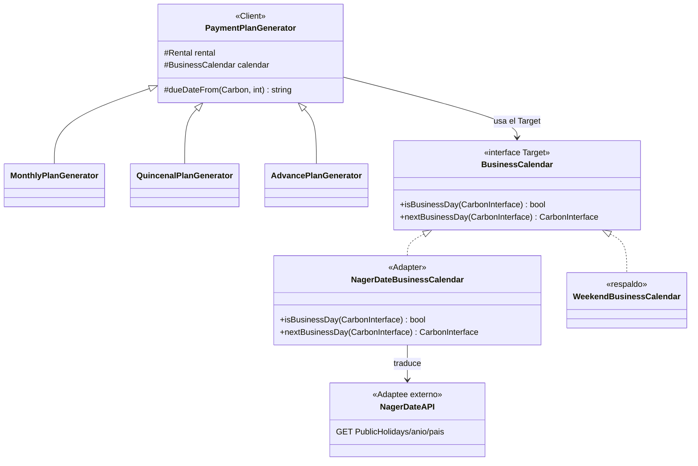

# Patrón Adapter: vencimiento de facturas en día hábil

Este documento explica, de punta a punta, el patrón **Adapter** (estructural) aplicado en Prometheus:

1. Qué es el patrón.
2. Cuál era el problema (el "antes") y por qué el código no lo resolvía bien.
3. Cómo se solucionó (el "después"), con los cuatro roles del GoF.
4. Qué archivos participan y qué hace cada uno.
5. **Dónde se ve en la interfaz** (dónde el usuario percibe el efecto).
6. Cómo explicarlo en una sustentación y cómo probarlo.

> Complementa a [`DOCUMENTACION-PATRONES.md`](./DOCUMENTACION-PATRONES.md) (sección 5) y a [`UML-PLANTUML-PATRONES.md`](./UML-PLANTUML-PATRONES.md) (sección 5, con los diagramas antes/después).

---

## 1. ¿Qué es el patrón Adapter?

**Propósito (GoF):** convertir la interfaz de una clase en otra que el cliente espera. Permite que clases con interfaces incompatibles trabajen juntas.

En una frase: **es un traductor**. El dominio habla un idioma (métodos de negocio), el servicio externo habla otro (HTTP, JSON). El Adapter se pone en medio y traduce.

Los cuatro roles:

| Rol | Qué es | En Prometheus |
| --- | --- | --- |
| **Target** | Lo que el cliente espera | `BusinessCalendar` (interfaz) |
| **Adapter** | Traduce el Adaptee al Target | `NagerDateBusinessCalendar` |
| **Adaptee** | Lo que ya existe y no se puede cambiar | API Nager.Date (`GET .../PublicHolidays/...`) |
| **Client** | Quien usa el Target sin saber qué hay detrás | `PaymentPlanGenerator` y sus subclases |

---

## 2. El problema (el "antes")

### Qué pasaba

Al crear un alquiler, el sistema genera automáticamente su **plan de cobros**: una o varias facturas, cada una con su fecha de vencimiento (`due_at`). El vencimiento se calculaba así, dentro de **cada** generador:

```php
// MonthlyPlanGenerator.php, linea 61 (antes del cambio)
'due_at' => $period->copy()->addDays($dueDays)->toDateString(),

// QuincenalPlanGenerator.php, linea 77 (antes del cambio)
'due_at' => $date->copy()->addDays($dueDays)->toDateString(),

// AdvancePlanGenerator.php, linea 55 (antes del cambio)
'due_at' => $date->copy()->addDays($dueDays)->toDateString(),
```

Es decir: **fecha de emisión + días de plazo**. Y ya.

### Por qué estaba mal

Ese cálculo **ignora que hay días en los que no se puede pagar**:

- Si el vencimiento cae **sábado o domingo**, la factura vence en fin de semana.
- Si cae en **festivo colombiano** (por ejemplo, un lunes de puente), vence un día inhábil.

Ejemplo real:

| Emisión | Plazo | Vencimiento "a mano" | Problema |
| --- | --- | --- | --- |
| 2026-01-07 | 5 días | **2026-01-12** | Es lunes, pero festivo (Día de los Reyes Magos). |

Lo correcto habría sido que venciera el **2026-01-13** (martes, hábil).

### Por qué no se arreglaba "fácil"

El dominio necesita responder una pregunta sencilla: **¿este día es hábil?**. Pero:

1. Los festivos oficiales no viven en la base de datos del sistema: son un dato externo.
2. La única fuente confiable y sin llave es una **API pública** (Nager.Date), cuya interfaz es un `GET` HTTP que devuelve JSON.
3. Esa API **no se puede modificar** (es de terceros) y su "interfaz" no se parece en nada a un método de negocio.
4. Poner el `Http::get()` dentro de los generadores acoplaría las tres cadencias de cobro a la red, a la URL, al país y al formato del JSON. Si mañana cambia la fuente de festivos, habría que tocar los tres generadores (y sus tests).

Aquí es exactamente donde entra el patrón **Adapter**.

---

## 3. La solución (el "después")

### Idea

Se define una **interfaz propia del dominio** (`BusinessCalendar`) con las dos preguntas que el negocio necesita. Detrás, un **adaptador** traduce esa interfaz hacia la API externa. El dominio nunca sabe que existe HTTP.

```php
interface BusinessCalendar
{
    public function isBusinessDay(CarbonInterface $date): bool;
    public function nextBusinessDay(CarbonInterface $date): CarbonInterface;
}
```

Ahí está el **Target**: dos métodos, sin rastro de HTTP, de JSON ni de URL.

### El adaptador

`NagerDateBusinessCalendar` implementa el Target. Es el **único** punto del sistema que conoce la URL, el país y la forma del JSON:

```php
public function isBusinessDay(CarbonInterface $date): bool
{
    if ($date->isWeekend()) {
        return false;
    }

    return ! in_array($date->toDateString(), $this->holidaysFor((int) $date->year), true);
}

public function nextBusinessDay(CarbonInterface $date): CarbonInterface
{
    $candidate = Carbon::instance($date);

    while (! $this->isBusinessDay($candidate)) {
        $candidate = $candidate->copy()->addDay();
    }

    return $candidate;
}
```

Y la traducción del Adaptee:

```php
private function fetchHolidays(int $year): ?array
{
    $response = Http::timeout(5)->get("{$this->baseUrl}/PublicHolidays/{$year}/{$this->country}");

    return collect($response->json())->pluck('date')->all();
}
```

### El cliente

La clase base `PaymentPlanGenerator` ahora recibe el `BusinessCalendar` y expone un método compartido que **delega** en el Target:

```php
protected function dueDateFrom(Carbon $issued, int $dueDays): string
{
    return $this->calendar
        ->nextBusinessDay($issued->copy()->addDays($dueDays))
        ->toDateString();
}
```

Los tres generadores solo lo usan. Ya no calculan fechas a mano:

```php
// MonthlyPlanGenerator.php, linea 65 (después del cambio)
'due_at' => $this->dueDateFrom($period, $dueDays),
```

### Diagrama del "después"



### Un detalle de diseño: el respaldo

`WeekendBusinessCalendar` es una segunda implementación del Target que **solo evita fines de semana**. No forma parte de GoF, pero demuestra la ventaja del patrón: se puede cambiar de fuente sin tocar al cliente. Se usa:

- En las **pruebas**, para no depender de internet.
- Si la API **falla o no responde**, como red de seguridad: generar facturas nunca se cae por falta de red.

### El binding (dónde se elige)

En `app/Providers/AppServiceProvider.php` se decide qué implementación inyectar:

```php
if ($this->app->environment('testing')) {
    $this->app->bind(BusinessCalendar::class, WeekendBusinessCalendar::class);
} else {
    $this->app->bind(BusinessCalendar::class, fn () => new NagerDateBusinessCalendar(
        (string) config('services.holidays.base_url'),
        (string) config('services.holidays.country'),
    ));
}
```

La URL y el país salen de `config/services.php`:

```php
'holidays' => [
    'base_url' => env('HOLIDAYS_BASE_URL', 'https://date.nager.at/api/v3'),
    'country'  => env('HOLIDAYS_COUNTRY', 'CO'),
],
```

### Por qué el Adapter y no un `if` dentro de los generadores

| Si se pone el `Http::get()` en el generador | Con el Adapter |
| --- | --- |
| El generador de cobros conoce HTTP, URL y JSON | Solo conoce `BusinessCalendar` |
| Cambiar de fuente toca 3 generadores y sus tests | Toca 1 clase (el Adapter) |
| Los tests necesitan red | Se sustituye por `WeekendBusinessCalendar` |
| El día que la API cambie, rompe el dominio | El Adaptee queda aislado |

---

## 4. Archivos y su rol

| Archivo | Rol GoF | Qué hace |
| --- | --- | --- |
| `app/Contracts/BusinessCalendar.php` | **Target** | La interfaz que el dominio espera. |
| `app/Infrastructure/Holidays/NagerDateBusinessCalendar.php` | **Adapter** | Traduce la API Nager.Date al Target. Cachea por año y degrada si falla. |
| `app/Infrastructure/Holidays/WeekendBusinessCalendar.php` | Respaldo | Implementación del Target que solo evita fines de semana. |
| API Nager.Date (`GET .../PublicHolidays/{año}/{país}`) | **Adaptee** | El servicio externo. No se modifica. |
| `app/Services/PaymentPlans/PaymentPlanGenerator.php` | **Client** | Recibe el calendario y expone `dueDateFrom()`. |
| `app/Services/PaymentPlans/MonthlyPlanGenerator.php` | Client | Usa `dueDateFrom()` para su vencimiento. |
| `app/Services/PaymentPlans/QuincenalPlanGenerator.php` | Client | Usa `dueDateFrom()`. |
| `app/Services/PaymentPlans/AdvancePlanGenerator.php` | Client | Usa `dueDateFrom()`. |
| `app/Services/PaymentPlans/PaymentPlanGeneratorResolver.php` | — | Recibe el `BusinessCalendar` y lo reparte a cada generador. |
| `app/Providers/AppServiceProvider.php` | — | Elige la implementación (Nager o Weekend). |
| `config/services.php` | — | URL y país de la fuente de festivos. |
| `tests/Feature/BusinessCalendarTest.php` | — | Prueba Target, Adapter, respaldo y el flujo completo. |

> La inyección es **explícita por constructor**: el resolver recibe el calendario y se lo pasa a cada generador. No hay `app(BusinessCalendar::class)` escondido dentro de las clases.

---

## 5. ¿Dónde se ve en la interfaz?

El usuario **no ve un letrero que diga "día hábil"**. Ve el **efecto**: los vencimientos nunca caen en fin de semana ni en festivo, y el estado de la factura refleja ese vencimiento. Estos son los puntos concretos del panel.

El panel vive en `/dashboard` (`DashboardPanelProvider`, `->path('dashboard')`).

### 5.1. Al crear el alquiler: se elige la cadencia y se genera el plan

- **Pantalla:** *Alquileres → Crear alquiler* (`/dashboard/administration/rentals/create`).
- **Campo:** **"Cadencia de cobro"** (`billing_cadence`), con opciones **Mensual / Quincenal / Anticipo**.
  - Código: `RentalResource.php:105` y traducción en `lang/es/billing_cadence.php`.
- **Acción:** al guardar, se dispara la generación del plan de cobros.
  - Código: `CreateRental.php:34` → `$this->paymentPlanService->generateFor($rental)`.
  - Ahí es donde, por debajo, el Adapter decide cada vencimiento en día hábil.

### 5.2. En la lista de facturas: la columna "Vence"

- **Pantalla:** *Administración → Facturas* (`/dashboard/administration/invoices`).
- **Columna "Vence"** (`due_at`, con `->date()`), etiqueta en `lang/es/invoice.php:83`.
  - Código: `InvoiceResource.php:186`.
- **Columna "Estado"** (badge) con **Emitida / Pagada / Vencida / Anulada**.
  - Código: `InvoiceResource.php:191` y `app/Enums/InvoiceStatus.php`.
- El estado **Vencida** se deduce comparando `due_at` con la fecha actual (`Invoice::refreshStatus()`, `app/Models/Invoice.php:104`). Si el vencimiento se corrió a día hábil, también se corre el momento en que la factura pasa a "Vencida".

### 5.3. En el formulario de factura: el vencimiento por defecto

- **Pantalla:** *Facturas → Crear factura*.
- **Campo "Fecha de vencimiento"** (`due_at`), que por defecto toma **hoy + los días configurados en Ajustes**.
  - Código: `InvoiceResource.php:127`.
  - Es la vía **manual** (factura individual). El Adapter aplica a la vía **automática** (el plan de cobros). Si se quiere que la manual también respete festivos, se extendería aquí.

### 5.4. En el tablero: "Pagos vencidos o próximos"

- **Pantalla:** *Tablero* (dashboard principal).
- **Widget/tabla:** **"Pagos vencidos o próximos de alquileres activos"**.
  - Código: `app/Filament/Widgets/OverduePaymentsTable.php`.
  - **Columna "Fecha de vencimiento"** = `due_at` (`OverduePaymentsTable.php:46`).
  - **Estado** con badges **Vencido / Por vencer / Pagado** (`OverduePaymentsTable.php:57`).
  - Solo lista facturas con saldo que vencen en los próximos 7 días o ya vencieron (`OverduePaymentsTable.php:81`).

### 5.5. Resumen de la ruta visual

```
Crear alquiler (cadencia)          Lista de facturas           Tablero
  billing_cadence            →      columna "Vence"       →     "Pagos vencidos
  CreateRental.php:34               InvoiceResource:186          o próximos"
  dispara el plan de cobros         estado Vencida               OverduePaymentsTable:46
       │                                  │                            │
       └────────── el Adapter fija due_at en día hábil ───────────────┘
```

---

## 6. Guion para la sustentación

Un orden corto para explicarlo:

1. **Qué es Adapter:** un traductor entre una interfaz que no controlamos (la API de festivos) y la que el dominio necesita (`BusinessCalendar`).
2. **El "antes":** cada generador hacía `due_at = emisión + días`. Un `if` de fin de semana no bastaba porque faltaban los festivos, que son datos externos.
3. **Por qué no se puede tocar la API:** es de terceros. Su interfaz es `GET` + JSON, incompatible con el dominio.
4. **La solución:** creo el Target `BusinessCalendar`; el Adapter `NagerDateBusinessCalendar` traduce la API; el cliente (`PaymentPlanGenerator`) solo llama `nextBusinessDay()`.
5. **El beneficio:** cambiar de fuente de festivos toca **una** clase; los tests no necesitan internet (`WeekendBusinessCalendar`); la API caída no rompe la generación de facturas.
6. **Dónde se ve:** al crear el alquiler se genera el plan; en la lista de facturas la columna "Vence" y el estado "Vencida"; en el tablero la tabla "Pagos vencidos o próximos".

Ejemplo para cerrar: emisión **2026-01-07** + 5 días = **2026-01-12**, que es festivo (Reyes) → el Adapter lo corre a **2026-01-13**.

---

## 7. Cómo probarlo

Pruebas específicas del patrón:

```bash
php artisan test --filter=BusinessCalendarTest
```

Cubren: el calendario de respaldo, el Adapter que salta el festivo de la API (con `Http::fake`), la degradación si la API falla, y el flujo completo de una factura con vencimiento en día hábil.

Para probar la API real en desarrollo (opcional):

```bash
php artisan tinker
>>> app(App\Contracts\BusinessCalendar::class)->nextBusinessDay(\Illuminate\Support\Carbon::parse('2026-01-12'))
```

---

## 8. Notas y limitaciones

- **La API solo se consulta en producción.** En `testing` el binding usa `WeekendBusinessCalendar`, por eso las pruebas son rápidas y no dependen de la red.
- **Caché por año.** La respuesta de Nager.Date se guarda un día (`Cache::put(..., now()->addDay())`). Si la API falla, **no** se cachea el vacío, para poder reintentar.
- **Degradación.** Ante fallo de red, el Adapter cae en el calendario de fin de semana (no revienta).
- **Alcance.** El Adapter solo corrige el vencimiento del **plan de cobros automático**. La factura creada **a mano** en el formulario usa el valor por defecto de `InvoiceResource.php:127` (hoy + días), sin consultar festivos.
- **País.** Configurable con `HOLIDAYS_COUNTRY` (por defecto `CO`).
