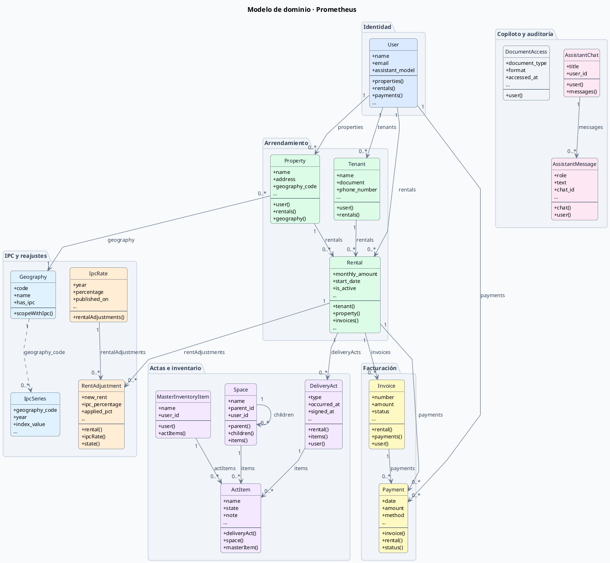

# Diagrama de clases de dominio

Modelo Eloquent de `app/Models`. Cada clase muestra como máximo tres atributos y
tres métodos; el resto se resume con `...`. Las relaciones llevan el nombre del
método que las expone y la cardinalidad en sus extremos.

## Lectura del diagrama

- `-->` es una relación Eloquent declarada (`hasMany` / `belongsTo`); el nombre
  sobre la flecha es el método que la expone.
- `..>` es una llave compartida sin relación Eloquent (`geography_code`), que se
  usa para cruzar el catálogo de ciudades con la serie de IPC.
- Todas las entidades de primer nivel guardan `user_id` y declaran
  `user() : BelongsTo`; el diagrama dibuja solo las relaciones inversas que
  `User` define, para no llenar el gráfico de flechas repetidas.

## Fuera del alcance

`SpaceComponent`, `SpaceComposite` y `SpaceLeaf` son clases de los patrones
Composite, Iterator y Visitor, no tablas. Los DTO, objetos de valor y documentos
renderizables tampoco son modelos Eloquent.
