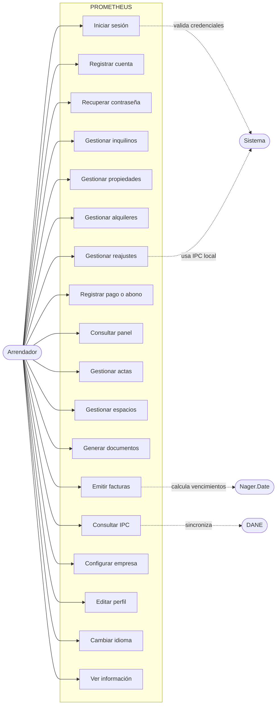
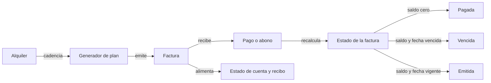
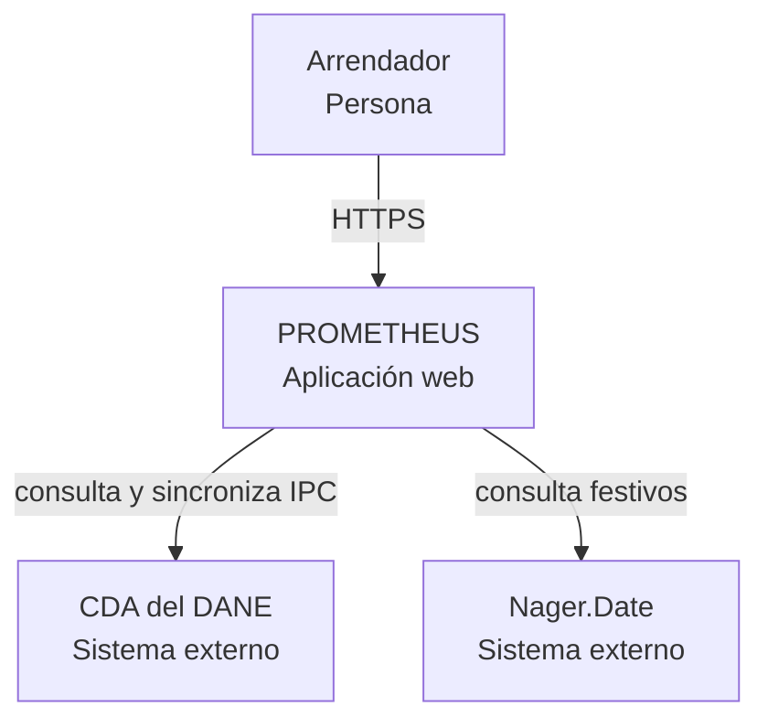
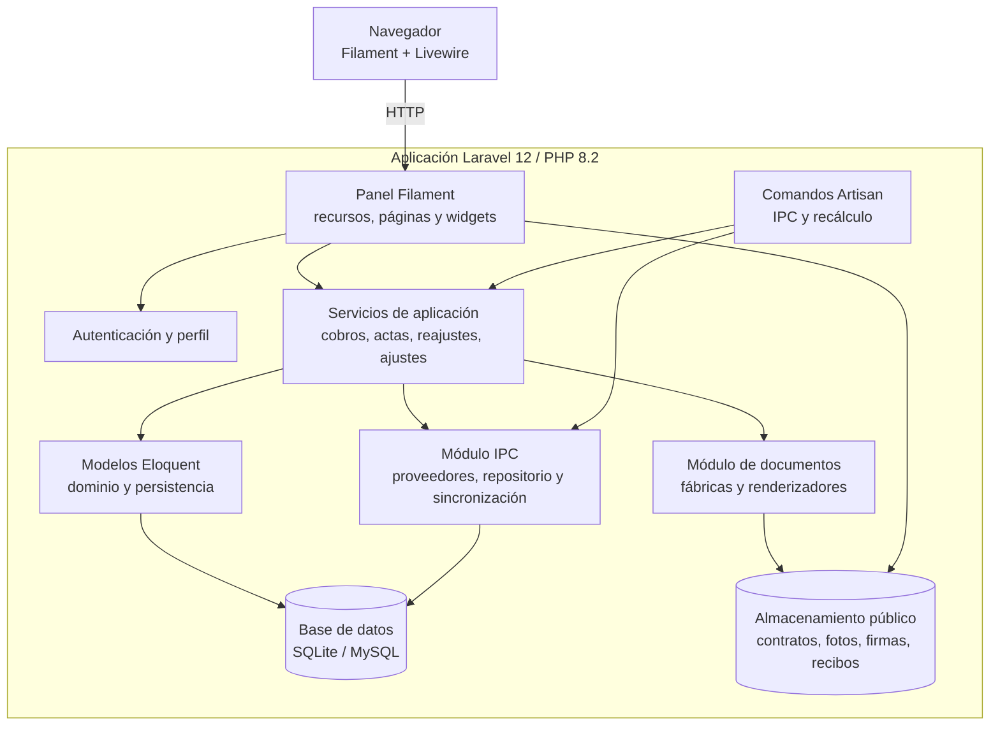
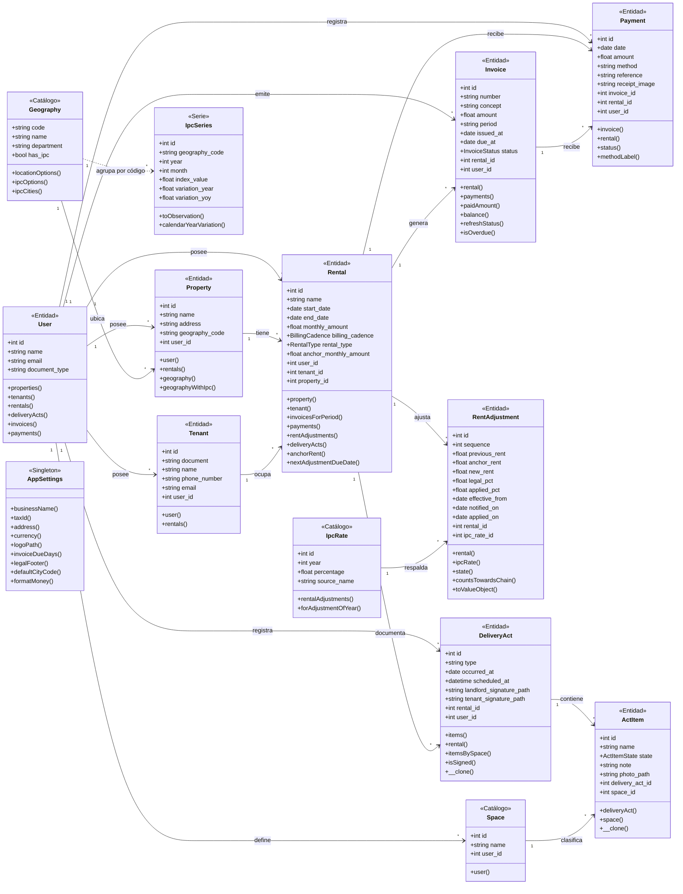

# Parcial 2 — Implementación de Patrones de Diseño

## PROMETHEUS

**Autores:** Albeiro Armando Navarro Rojas, Diego Andrés Castro Carvajal, Isaac David Jácome García y Alexander Muñoz Olivo  
**Institución:** Facultad de Ingenierías y Tecnologías, Universidad Popular del Cesar  
**Asignatura:** SS901 Electiva de Profundización II — Patrones de Diseño de Software  
**Docente:** Jairo Francisco Seoanes León  
**Fecha:** Octubre de 2026  
**Repositorio:** <https://github.com/diegocastro-ac/prometheus/tree/patrones-2>  
**Versión:** 1.0 — documento editable en Markdown, actualizado contra el código de la rama `patrones-2`.

> Este documento reemplaza la plantilla del PDF para facilitar su edición y revisión. Los diagramas están escritos en Mermaid; los documentos individuales de los patrones conservan diagramas PlantUML compatibles con Draw.io. Las cifras y comportamientos descritos se verificaron contra el código y las pruebas del repositorio.

---

## Contenido

1. [Introducción](#1-introducción)
2. [Desarrollo](#2-desarrollo)
   - [2.1 Etapa 1 — Diagrama de clases básico (nueva versión)](#21-etapa-1--diagrama-de-clases-básico-nueva-versión)
     - [2.1.1 Descripción de la aplicación y requisitos funcionales](#211-descripción-de-la-aplicación-y-requisitos-funcionales)
     - [2.1.2 Diagrama de casos de uso](#212-diagrama-de-casos-de-uso)
     - [2.1.3 Diseño conceptual de la solución](#213-diseño-conceptual-de-la-solución)
     - [2.1.4 Diagrama de arquitectura o de componentes (esquema C4)](#214-diagrama-de-arquitectura-o-de-componentes-esquema-c4)
     - [2.1.5 Diagrama de clases UML](#215-diagrama-de-clases-uml)
     - [2.1.6 Tabla de control de cambios](#216-tabla-de-control-de-cambios)
   - [2.2 Etapa 2 — Implementación de funcionalidades iniciales](#22-etapa-2--implementación-de-funcionalidades-iniciales)
     - [2.2.1 Implementación frontend](#221-implementación-frontend)
     - [2.2.2 Implementación backend](#222-implementación-backend)
     - [2.2.3 Implementación DB](#223-implementación-db)
     - [2.2.4 Tabla de control de cambios en el código](#224-tabla-de-control-de-cambios-en-el-código)
     - [2.2.5 Tabla de mapa de patrones](#225-tabla-de-mapa-de-patrones)
3. [Anexos](#3-anexos)

---

## 1. Introducción

PROMETHEUS es una aplicación web responsiva para la gestión de alquileres de inmuebles urbanos en Colombia. Está dirigida a arrendadores informales que hoy administran propiedades, inquilinos, contratos, cobros y comprobantes mediante hojas de cálculo, cuadernos o mensajes dispersos. El sistema concentra esa información en un panel único, con historial, validaciones y documentos listos para imprimir o descargar.

La aplicación permite registrar propiedades y su ubicación, administrar inquilinos, crear alquileres con su canon y cadencia de cobro, emitir facturas, registrar abonos totales o parciales, generar actas de entrega con inventario y fotografías, calcular reajustes de canon con el IPC y producir documentos en texto, PDF o JSON. Cada arrendador trabaja con su propia información: las consultas y formularios filtran por `user_id`, de modo que el aislamiento es lógico y se aplica en la capa de aplicación.

El proyecto usa Laravel 12, PHP 8.2, Filament 3, Livewire, Tailwind CSS 4 y una base de datos relacional configurable; por defecto el archivo de entorno de ejemplo usa SQLite y las pruebas usan SQLite en memoria. La interfaz está disponible en español e inglés mediante el plugin de cambio de idioma de Filament.

Esta entrega documenta la implementación actual y los siete patrones de diseño verificados en el código:

- cinco patrones creacionales: **Singleton**, **Prototype**, **Builder**, **Abstract Factory** y **Factory Method**;
- dos patrones estructurales: **Adapter**, aplicado a los días hábiles y al IPC del DANE, y **Bridge**, aplicado a los documentos y sus formatos de entrega.

Los documentos individuales de cada patrón se enlazan en sus secciones y en el Anexo A; están en [`docs/Patrones creacionales`](Patrones%20creacionales) y [`docs/Patrones estructurales`](Patrones%20estructurales). Este documento principal explica el contexto funcional, el diseño, la arquitectura, la base de datos y la forma en que los patrones se integran en la aplicación.

### 1.1. Convenciones del documento

- **Actor principal:** arrendador autenticado. El arrendatario es un actor pasivo: existe en los contratos y actas, pero no inicia sesión.
- **Factura:** documento interno de cobro. No es una factura electrónica autorizada por la DIAN.
- **Pago o abono:** registro de dinero recibido contra una factura. Una factura puede recibir varios abonos.
- **IPC:** índice de precios al consumidor publicado por el DANE. El sistema guarda una copia local de la serie mensual.
- **UML:** los diagramas de clases de los documentos de patrón usan PlantUML; los diagramas de este documento usan Mermaid para que se puedan previsualizar directamente en GitHub o en un editor compatible.

---

## 2. Desarrollo

### 2.1. Etapa 1 — Diagrama de clases básico (nueva versión)

#### 2.1.1. Descripción de la aplicación y requisitos funcionales

##### Descripción

PROMETHEUS centraliza la operación de un arrendador en cinco áreas:

1. **Propiedades e inquilinos:** registro de inmuebles, direcciones, ciudades y datos de contacto.
2. **Alquileres:** relación entre propiedad e inquilino, fechas, canon, cadencia de cobro y contrato adjunto.
3. **Cobros:** facturas por periodo, abonos parciales, comprobantes y estados derivados.
4. **Actas de entrega:** inventario por espacio, lecturas de medidores, firmas y observaciones.
5. **Reajustes y documentos:** cálculo de incrementos con IPC, cartas de reajuste, estados de cuenta, facturas y recibos.

El modelo actual supera las cinco entidades iniciales del planteamiento original (Usuario, Propiedad, Alquiler, Inquilino y Pago). Incorpora facturas, pagos parciales, actas de entrega, elementos de inventario, espacios, reajustes, tasas IPC, series IPC, geografías y configuración de la empresa.

##### Alcance

**Incluido**

- Autenticación, registro y recuperación de contraseña.
- Gestión de propiedades, inquilinos y alquileres.
- Catálogo de espacios inventariables por arrendador.
- Actas de entrega y recepción con inventario y fotografías.
- Facturación por cadencia, abonos y comprobantes.
- Reajustes de canon con IPC nacional o de ciudad, cadena de reajustes y validaciones legales.
- Documentos en texto, PDF y JSON.
- Panel de control con indicadores, gráficos y facturas pendientes.
- Configuración de datos de la empresa, perfil y cambio de idioma.

**No incluido**

- Facturación electrónica ante la DIAN.
- Pasarela de pagos o conciliación bancaria automática.
- Contabilidad general, nómina o impuestos.
- Portal o inicio de sesión para arrendatarios.
- Aplicación móvil nativa.
- Envío automático de correos o notificaciones: el sistema registra la comunicación del reajuste, pero no la envía.

##### Actores

| Actor | Tipo | Responsabilidad |
| --- | --- | --- |
| Arrendador | Primario | Gestiona propiedades, inquilinos, alquileres, cobros, actas, reajustes y documentos. |
| Arrendatario | Pasivo | Figura en contratos y actas; no accede al sistema. |
| Sistema | Interno | Calcula estados, genera facturas, reprocesa cadenas y produce documentos. |
| DANE — CDA | Externo | Publica la serie mensual del IPC y el catálogo de geografías. |
| Nager.Date | Externo | Publica los días festivos usados para calcular vencimientos. |

##### Requisitos funcionales

| ID | Descripción | Actor(es) | Prioridad | Criterios de aceptación |
| --- | --- | --- | --- | --- |
| RF-01 | Iniciar sesión con correo y contraseña. | Arrendador | Alta | Credenciales validadas contra la base de datos; sesión iniciada en el panel. |
| RF-02 | Registrar un nuevo arrendador. | Arrendador | Alta | Se exigen nombre, correo, contraseña y tipo de documento; el correo no se repite. |
| RF-03 | Recuperar el acceso cuando se olvida la contraseña. | Arrendador | Alta | El usuario solicita el restablecimiento con su correo y completa el flujo de Filament. |
| RF-04 | Gestionar inquilinos: crear, actualizar, eliminar, listar y eliminar en grupo. | Arrendador | Alta | Se almacenan documento, nombre, teléfono y correo; cada registro pertenece al arrendador. |
| RF-05 | Gestionar propiedades: crear, actualizar, eliminar, listar y eliminar en grupo. | Arrendador | Alta | Se almacenan nombre, descripción, dirección y ciudad; la ciudad se elige del catálogo de geografías. |
| RF-06 | Gestionar alquileres: crear, actualizar, eliminar, listar y eliminar en grupo. | Arrendador | Alta | El alquiler se asocia a una propiedad y un inquilino, con fechas, canon, tipo, cadencia y contrato adjunto. |
| RF-07 | Gestionar facturación y pagos. | Arrendador | Alta | Se emiten facturas por periodo; se registran abonos totales o parciales contra una factura; se consulta saldo y estado; se adjunta comprobante. |
| RF-08 | Mostrar un panel de control con métricas del negocio. | Arrendador | Alta | Se muestran alquileres activos, ingresos del mes, facturas pendientes, gráfico de ingresos y estado de facturas. |
| RF-09 | Cambiar el idioma de la interfaz entre español e inglés. | Arrendador | Media | El selector de idioma cambia las etiquetas y textos de la interfaz. |
| RF-10 | Editar el perfil del usuario. | Arrendador | Media | Se pueden actualizar los datos personales y la contraseña. |
| RF-11 | Mostrar las páginas informativas “Acerca de” y “Contacto”. | Arrendador | Baja | Ambas páginas son accesibles desde la navegación. |
| RF-12 | Gestionar actas de entrega, recepción y cambio de arrendatario. | Arrendador | Alta | El acta se asocia a un alquiler; incluye partes, lecturas, inventario, compromisos, observaciones y firmas. |
| RF-13 | Gestionar el catálogo de espacios del inventario. | Arrendador | Media | Los espacios se crean por arrendador y se usan para clasificar los elementos del acta. |
| RF-14 | Generar documentos de factura, recibo, estado de cuenta y carta de reajuste. | Arrendador | Alta | El usuario elige el formato texto, PDF o JSON; el texto se previsualiza o copia y el PDF/JSON se descarga. |
| RF-15 | Gestionar reajustes de canon con IPC. | Arrendador | Alta | Se calcula el tope legal, se registra el reajuste, se controla la cadena y se registra la comunicación. |
| RF-16 | Sincronizar y consultar las series IPC. | Arrendador / Sistema | Media | Los comandos actualizan la copia local; las pantallas consultan la serie sin depender del DANE en tiempo real. |
| RF-17 | Configurar los datos de la empresa y las preferencias de facturación. | Arrendador | Media | Se guardan razón social, NIT, dirección, moneda, logo, correo, teléfono, días de vencimiento y pie legal. |
| RF-18 | Copiar un acta existente para reutilizar su inventario. | Arrendador | Media | La copia conserva el contenido del acta y del inventario, pero descarta identidad, firmas, lecturas y programación. |

##### Requisitos no funcionales

| ID | Requisito | Criterio |
| --- | --- | --- |
| RNF-01 | Seguridad de acceso | Rutas del panel protegidas por autenticación; contraseñas con hash; CSRF y sesión gestionadas por Laravel. |
| RNF-02 | Aislamiento por arrendador | Las consultas y formularios filtran por `user_id`; no hay bases de datos separadas ni Row Level Security. |
| RNF-03 | Usabilidad y respuesta | Interfaz responsiva, navegación por grupos, formularios con validación y mensajes de error claros. |
| RNF-04 | Internacionalización | Español e inglés para etiquetas, mensajes y documentos de la interfaz. |
| RNF-05 | Mantenibilidad | Separación entre panel, servicios, modelos, contratos e infraestructura; patrones documentados. |
| RNF-06 | Testabilidad | Pruebas de feature para los flujos críticos y dobles de prueba para servicios externos. |
| RNF-07 | Disponibilidad del IPC | La lectura del IPC usa una copia local; la sincronización es explícita y de una sola vía. |
| RNF-08 | Portabilidad | PHP 8.2, Laravel 12 y base de datos relacional configurable; SQLite por defecto y en pruebas. |
| RNF-09 | Trazabilidad | Facturas, pagos, actas, ajustes y documentos conservan fechas, referencias y datos del emisor. |
| RNF-10 | Integridad de montos | Los estados se derivan de los datos; los consecutivos de factura son únicos por arrendador y año. |

#### 2.1.2. Diagrama de casos de uso

El siguiente diagrama resume los casos de uso principales. La tabla posterior conserva el detalle y los casos de apoyo.



| ID | Caso de uso | Actor | Resultado |
| --- | --- | --- | --- |
| CU-01 | Iniciar sesión | Arrendador | Acceso al panel `/dashboard`. |
| CU-02 | Registrar cuenta | Arrendador | Usuario creado y autenticado. |
| CU-03 | Recuperar contraseña | Arrendador | Nueva contraseña establecida. |
| CU-04 | Gestionar inquilinos | Arrendador | Inquilinos creados, editados, listados o eliminados. |
| CU-05 | Gestionar propiedades | Arrendador | Propiedades con ciudad y datos completos. |
| CU-06 | Gestionar alquileres | Arrendador | Contrato con propiedad, inquilino, canon, fechas y cadencia. |
| CU-07 | Emitir facturas | Arrendador / Sistema | Facturas del periodo según la cadencia del alquiler. |
| CU-08 | Registrar pago o abono | Arrendador | Pago asociado a factura; estado de la factura recalculado. |
| CU-09 | Consultar panel | Arrendador | Indicadores y gráficos del negocio. |
| CU-10 | Gestionar actas | Arrendador | Acta con inventario, lecturas, firmas y observaciones. |
| CU-11 | Gestionar espacios | Arrendador | Catálogo de espacios disponible para las actas. |
| CU-12 | Generar documentos | Arrendador | Documento en texto, PDF o JSON. |
| CU-13 | Gestionar reajustes | Arrendador / Sistema | Reajuste registrado, validado y comunicado. |
| CU-14 | Consultar y sincronizar IPC | Arrendador / Sistema | Serie local consultable y actualizada por comando. |
| CU-15 | Configurar empresa | Arrendador | Datos del emisor y preferencias de facturación. |
| CU-16 | Editar perfil | Arrendador | Datos personales actualizados. |
| CU-17 | Cambiar idioma | Arrendador | Interfaz en español o inglés. |
| CU-18 | Ver información | Arrendador | Páginas “Acerca de” y “Contacto”. |

#### 2.1.3. Diseño conceptual de la solución

El diseño se organiza alrededor del arrendador como propietario lógico de los datos. Cada entidad de negocio lleva `user_id`, y las relaciones principales son:

- una **propiedad** pertenece a un arrendador y está ubicada en una **geografía**;
- un **inquilino** pertenece a un arrendador y puede ocupar varios **alquileres**;
- un **alquiler** relaciona una propiedad con un inquilino y define el canon, la cadencia y el contrato;
- una **factura** pertenece a un alquiler y a un periodo; un **pago** es un abono contra una factura;
- un **acta de entrega** pertenece a un alquiler y contiene **elementos de inventario**, clasificados por **espacio**;
- un **reajuste** pertenece a un alquiler y puede referenciar una **tasa IPC**; la serie mensual del IPC se guarda en **ipc_series** por geografía y periodo;
- la **configuración de la empresa** es una fila única y global del sistema, no un dato por arrendador.

| Entidad | Propósito | Relaciones principales |
| --- | --- | --- |
| `User` | Arrendador autenticado. | Posee propiedades, inquilinos, alquileres, actas, facturas, pagos y ajustes. |
| `Property` | Inmueble arrendable. | Pertenece a `User`; tiene muchos `Rental`; referencia `Geography`. |
| `Geography` | Ciudad o total nacional del catálogo DANE/DIVIPOLA. | Agrupa propiedades y series IPC. |
| `Tenant` | Persona que ocupa el inmueble. | Pertenece a `User`; tiene muchos `Rental`. |
| `Rental` | Contrato de arrendamiento. | Pertenece a `Property` y `Tenant`; tiene facturas, pagos, actas y reajustes. |
| `Invoice` | Cobro de un periodo. | Pertenece a `Rental`; recibe muchos `Payment`. |
| `Payment` | Abono contra una factura. | Pertenece a `Invoice`, `Rental` y `User`. |
| `DeliveryAct` | Acta de entrega, recepción o cambio. | Pertenece a `Rental`; contiene `ActItem`. |
| `ActItem` | Elemento inventariado en un acta. | Pertenece a `DeliveryAct` y, cuando existe, a `Space`. |
| `Space` | Espacio del catálogo del arrendador. | Pertenece a `User`; clasifica elementos de acta. |
| `RentAdjustment` | Reajuste de canon registrado. | Pertenece a `Rental`; puede referenciar `IpcRate`. |
| `IpcRate` | Variación anual del IPC usada por un ajuste. | Tiene muchos `RentAdjustment`. |
| `IpcSeries` | Serie mensual del IPC por geografía. | Se relaciona con `Geography` por `geography_code`. |
| `AppSettings` | Configuración de la empresa. | Fila única global; no tiene relación Eloquent. |

##### Reglas de negocio principales

| ID | Regla | Implementación |
| --- | --- | --- |
| RN-01 | Cada registro de negocio pertenece a un arrendador. | `user_id` en las tablas y filtros en recursos y consultas. |
| RN-02 | La factura es la fuente de verdad del saldo. | `Invoice::paidAmount()`, `balance()` y `refreshStatus()`. |
| RN-03 | Un pago es un abono, no un estado booleano del servicio. | `Payment` referencia `invoice_id`; el estado se deduce de la factura. |
| RN-04 | El número de factura es único por arrendador y año. | `invoices` único `(user_id, number)`; `invoice_sequences` único `(user_id, year)`. |
| RN-05 | La generación de facturas debe ser idempotente. | Los generadores reutilizan facturas existentes del periodo. |
| RN-06 | El reajuste se calcula desde el ancla del alquiler. | `anchor_monthly_amount` y `AdjustmentChainCalculator`. |
| RN-07 | El reajuste de vivienda urbana sigue la Ley 820 de 2003. | Validaciones de IPC, doce meses, topes y comunicación. |
| RN-08 | El IPC se lee de una copia local. | `IpcSeriesRepository` y tabla `ipc_series`; sincronización explícita. |
| RN-09 | El acta copiada no conserva identidad ni firmas. | `DeliveryAct::__clone()` y `ActItem::__clone()`. |
| RN-10 | Los documentos se producen por familia de formato. | `DocumentFactory`, `TextDocumentFactory`, `PdfDocumentFactory` y `JsonDocumentFactory`. |

##### Flujo conceptual de cobro



#### 2.1.4. Diagrama de arquitectura o de componentes (esquema C4)

La aplicación sigue una arquitectura monolítica de tres capas lógicas: presentación con Filament/Livewire, aplicación con servicios de caso de uso y persistencia con Eloquent sobre una base relacional. Los documentos y el IPC se organizan en módulos internos con contratos e implementaciones intercambiables.

##### Nivel 1 — Contexto



##### Nivel 2 — Contenedores y componentes



| Componente | Responsabilidad | Tecnología |
| --- | --- | --- |
| Panel Filament | Recursos, formularios, tablas, acciones y navegación. | Filament 3, Livewire. |
| Autenticación y perfil | Login, registro, recuperación y edición de perfil. | Filament y Laravel Auth. |
| Servicios de aplicación | Casos de uso de cobros, pagos, actas, reajustes y configuración. | PHP 8.2. |
| Modelos Eloquent | Entidades, relaciones, casts y reglas de persistencia. | Laravel 12. |
| Documentos | Cuatro tipos de documento en familias texto, PDF y JSON. | `DocumentFactory`, `DocumentRenderer`, FlexPDF y Blade. |
| IPC | Sincronización y lectura local de la serie del DANE. | Adaptadores, repositorio y comandos. |
| Base de datos | Persistencia relacional y restricciones de integridad. | SQLite/MySQL. |
| Almacenamiento | Contratos, fotografías de inventario, firmas y comprobantes. | Disco `public` de Laravel. |

#### 2.1.5. Diagrama de clases UML

El diagrama muestra el modelo de dominio y las relaciones persistentes principales. Los servicios de aplicación y los patrones se describen en la sección 2.2 y en los documentos individuales.



**Lectura del diagrama**

- `Invoice` y `Payment` reemplazan el modelo antiguo de indicadores booleanos por servicio. La factura concentra el valor, el periodo, el vencimiento y el saldo; el pago solo registra el abono.
- `DeliveryAct` y `ActItem` implementan `Prototype`; el inventario se clona en profundidad y la copia se desvincula del acta original.
- `RentAdjustment` conserva el resultado del cálculo y los datos del IPC utilizado; la cadena se reprocesa desde el ancla del alquiler.
- `Geography` e `IpcSeries` comparten el código de geografía, pero no tienen una clave foránea entre sí. La integridad se controla por el catálogo y la sincronización.
- `AppSettings` no es una entidad Eloquent: es una clase inmutable construida desde la fila única de `app_settings`.

#### 2.1.6. Tabla de control de cambios

| ID | Cambio de diseño | Situación anterior | Situación actual | Motivo |
| --- | --- | --- | --- | --- |
| CC-01 | Facturas y abonos | Pagos con indicadores booleanos por servicio. | `Invoice` con periodo, vencimiento y estado; `Payment` como abono contra factura. | Permitir saldos, pagos parciales, mora y comprobantes. |
| CC-02 | Actas e inventario | No existía representación del acta ni de los elementos. | `DeliveryAct`, `ActItem` y catálogo de `Space`. | Documentar la entrega y el estado del inmueble. |
| CC-03 | Catálogo de espacios | El catálogo vivía en la configuración global. | Tabla `spaces` por arrendador; `space_id` en el inventario. | Evitar que un arrendador vea o modifique espacios de otro. |
| CC-04 | Reajustes con IPC | Cálculo aislado, sin cadena reproducible. | Ancla del alquiler, cadena de ajustes, IPC local y validaciones legales. | Cumplir la Ley 820 y permitir recálculos consistentes. |
| CC-05 | Serie IPC | Consulta al DANE en tiempo real o datos puntuales. | Copia local `ipc_series` y sincronización por comando. | Evitar dependencia de disponibilidad y preservar el dato usado. |
| CC-06 | Documentos | Generación acoplada a un formato. | Familias de documentos texto, PDF y JSON con fábricas y renderizadores. | Agregar formatos sin cambiar los casos de uso. |
| CC-07 | Actas reutilizables | Crear cada acta desde cero. | Copia profunda de acta e inventario desde una existente. | Reducir trabajo repetitivo sin arrastrar firmas ni identidad. |
| CC-08 | Configuración | Lecturas dispersas de la configuración. | `AppSettings` como singleton inmutable del contenedor. | Una sola fuente de verdad por petición. |
| CC-09 | Días hábiles | Cálculo directo de fechas y festivos. | `BusinessCalendar` con adaptador Nager.Date y respaldo local. | Aislar el servicio externo y permitir pruebas deterministas. |
| CC-10 | Planes de cobro | Lógica condicional por cadencia en un solo lugar. | `PaymentPlanGenerator` y subclases por cadencia. | Extender cadencias sin modificar el servicio cliente. |

---

### 2.2. Etapa 2 — Implementación de funcionalidades iniciales

#### 2.2.1. Implementación frontend

El frontend es un panel administrativo construido con Filament 3 sobre Livewire. No es una SPA separada: las pantallas se renderizan en el servidor y se actualizan con Livewire. Los estilos usan Tailwind CSS 4 y los recursos se compilan con Vite.

##### Estructura del panel

- Panel `dashboard`, ruta `/dashboard`, color primario ámbar.
- Login, registro y recuperación de contraseña integrados por Filament.
- Elementos de menú de usuario para perfil y ajustes.
- Navegación lateral colapsable en escritorio.
- Grupos de navegación `Administration` e `Information`.
- Selector de idioma español/inglés mediante `bezhansalleh/filament-language-switch`.

##### Recursos administrativos

| Recurso | Funcionalidad principal |
| --- | --- |
| `PropertyResource` | Alta, edición, listado y gestión de propiedades. |
| `TenantResource` | Alta, edición, listado y gestión de inquilinos. |
| `RentalResource` | Alta, edición, vista y listado de alquileres; generación de plan de cobro. |
| `InvoiceResource` | Emisión, listado, consulta de saldo y registro de pagos. |
| `DeliveryActResource` | Actas de entrega/recepción, inventario, fotografías y copia de acta. |
| `RentAdjustmentResource` | Registro, cálculo, comunicación y listado de reajustes. |
| `IpcSeriesResource` | Consulta de la serie IPC local y su estado de sincronización. |

##### Páginas

| Página | Ruta | Función |
| --- | --- | --- |
| Dashboard | `/dashboard` | Indicadores, gráficos y facturas pendientes. |
| `DocumentsPage` | `/dashboard/administration/documents` | Generación de estados de cuenta, facturas, recibos y cartas. |
| `AjustesPage` | Ajustes del panel | Configuración de empresa, moneda, logo, vencimiento y ciudad por defecto. |
| `EditProfile` | Perfil del panel | Edición de datos personales y contraseña. |
| `About` | Información | Descripción de la aplicación. |
| `Contact` | Información | Datos de contacto. |

##### Widgets del panel

- **StatsOverview:** alquileres activos, ingresos cobrados en el mes y facturas pendientes.
- **IncomeChart:** comparación de lo facturado y lo cobrado en los últimos doce meses.
- **PaymentsStatusChart:** distribución de facturas pagadas, vencidas y pendientes del mes.
- **OverduePaymentsTable:** facturas con saldo que vencen en los próximos siete días o ya vencieron.

##### Formularios y experiencia de usuario

- Formularios por secciones para separar datos generales, datos legales, inventario y documentos.
- Selects dependientes para propiedad, alquiler, periodo, factura y ajuste.
- Repeaters para el inventario de un acta, con estado, nota y fotografía por elemento.
- Validaciones de obligatoriedad, rangos numéricos y fechas.
- Acciones de tabla para generar facturas, registrar pagos, copiar actas, descargar documentos y abrir vistas.
- Notificaciones de éxito o error después de las acciones.
- Previsualización de documentos de texto y descarga de PDF desde la misma página.

##### Internacionalización y compilación

- Archivos de traducción en `lang/es` y `lang/en` para las áreas funcionales.
- El idioma se cambia desde la interfaz; las etiquetas de modelos, recursos y documentos se resuelven con `__()`.
- `npm run dev` inicia Vite; `npm run build` genera los assets de producción.
- Los assets de Filament se publican con los comandos estándar del paquete.

#### 2.2.2. Implementación backend

El backend sigue una separación por responsabilidades:

| Capa | Ubicación | Responsabilidad |
| --- | --- | --- |
| Presentación | `app/Filament` | Recursos, páginas, widgets, formularios, tablas y acciones. |
| Aplicación | `app/Services` | Casos de uso y coordinación de transacciones del dominio. |
| Dominio y persistencia | `app/Models`, `app/Enums`, `app/ValueObjects`, `app/Dto` | Entidades, estados, valores y reglas de negocio. |
| Documentos | `app/Documents` | Contratos, productos, fábricas y renderizadores. |
| Infraestructura | `app/Infrastructure` | Adaptadores de IPC, festivos, almacenamiento y contexto de usuario. |
| Contratos | `app/Contracts` | Interfaces de calendario, IPC, prototipo, almacenamiento y usuario actual. |
| Comandos | `app/Console/Commands` | Sincronización de IPC y recálculo de cadenas. |
| Pruebas | `tests/Feature`, `tests/Unit` | Verificación de flujos y comportamientos críticos. |

##### Flujos principales

1. **Alta de alquiler y plan de cobro.** El recurso de alquiler captura propiedad, inquilino, fechas, canon, tipo y cadencia. `PaymentPlanService` resuelve el generador adecuado y crea las facturas del periodo. La generación reutiliza facturas existentes para no duplicar cobros.
2. **Registro de pagos.** `PaymentRecordingService` valida que la factura admita pagos, crea el `Payment`, lo asocia a factura, alquiler y usuario, y ejecuta `Invoice::refreshStatus()`. El estado de la factura se deriva del saldo y del vencimiento.
3. **Actas de entrega.** `DeliveryActBuilder` acumula secciones opcionales, valida el inventario contra el catálogo de espacios y persiste el acta con sus elementos. `DeliveryActDraft` traduce una copia al formulario cuando se reutiliza un acta.
4. **Reajustes.** `RentAdjustmentService` obtiene el IPC de la serie local, calcula el tope legal, valida las reglas, registra el ajuste y reprocesa la cadena desde el ancla. `AdjustmentChainCalculator` y `AdjustmentChainRecalculator` mantienen coherentes los valores derivados.
5. **Documentos.** `DocumentService` selecciona la fábrica de texto, PDF o JSON y produce factura, recibo, estado de cuenta o carta de reajuste. Los documentos comparten el cuerpo y delegan el formato al renderizador de la familia. La pantalla consulta `isEmpty()` del contrato para avisar cuando un estado de cuenta no tiene facturas.
6. **IPC.** `IpcSynchronizer` recibe un `IpcProvider`; los comandos usan el adaptador remoto `DaneCdaIpcProvider`; las pantallas y los cálculos leen la copia local mediante `IpcSeriesRepository`.
7. **Configuración.** `SettingsService` guarda la fila única y descarta la instancia de `AppSettings` del contenedor para que la siguiente lectura use los valores nuevos.

##### Seguridad y aislamiento

- Autenticación y sesión gestionadas por Laravel y Filament.
- Contraseñas con hash; recuperación de contraseña mediante el flujo estándar.
- Formularios con validación y protección CSRF.
- Filtros por `user_id` en consultas y opciones de formulario.
- El aislamiento es lógico, no de infraestructura: no hay una base de datos por arrendador ni políticas RLS.
- Los archivos de contratos, fotos, firmas y comprobantes se guardan en el disco `public`; la protección depende de las rutas y del servidor web.
- No hay roles ni permisos diferenciados: todo usuario autenticado es un arrendador.

##### Pruebas y comandos

La verificación se apoya en pruebas de feature. En la última ejecución reportada:

| Área | Prueba(s) | Resultado |
| --- | --- | --- |
| Prototype | `DeliveryActPrototypeTest` | 5 pruebas, 66 aserciones. |
| Prototype desde formulario | `CreateDeliveryActFromTest` | 8 pruebas, 50 aserciones. |
| Builder y alta de acta | `DeliveryActBuilderTest` + `CreateDeliveryActTest` | 19 pruebas, 82 aserciones. |
| Abstract Factory | `DocumentFactoryTest` | 14 pruebas, 96 aserciones. |
| Factory Method | `PaymentPlanGeneratorTest` | 7 pruebas, 18 aserciones. |
| Adapter | `BusinessCalendarTest` + `DaneCdaIpcProviderTest` | 25 pruebas, 47 aserciones. |
| Bridge | `JsonDocumentBridgeTest` | 6 pruebas, 68 aserciones. |

Comandos de operación:

```bash
php artisan ipc:sync
php artisan ipc:sync:geographies
php artisan ipc:doctor
php artisan rent-adjustments:recalculate
php artisan test
npm run dev
npm run build
```

#### 2.2.3. Implementación DB

La persistencia usa Eloquent sobre una base relacional. La conexión se configura con `DB_CONNECTION`; el archivo `.env.example` usa SQLite y las pruebas usan `sqlite` en memoria. El esquema se construye con migraciones versionadas.

##### Tablas principales

| Tabla | Propósito | Llaves y restricciones relevantes |
| --- | --- | --- |
| `users` | Arrendadores y datos de autenticación. | Correo único; tipo de documento. |
| `properties` | Inmuebles. | `user_id`; `geography_code`; relación con `geographies`. |
| `tenants` | Inquilinos. | `user_id`; documento, nombre, teléfono y correo. |
| `rentals` | Contratos de alquiler. | `user_id`, `property_id`, `tenant_id`; canon, cadencia, tipo y ancla. |
| `invoices` | Facturas internas. | `user_id`, `rental_id`; único `(user_id, number)`; índice `(status, due_at)`. |
| `invoice_sequences` | Consecutivo anual por arrendador. | Único `(user_id, year)`. |
| `payments` | Abonos contra facturas. | `invoice_id`, `rental_id`, `user_id`; método, referencia y comprobante. |
| `delivery_acts` | Actas de entrega/recepción. | `user_id`, `rental_id`; firmas, lecturas y fechas. |
| `act_items` | Inventario de un acta. | `delivery_act_id`, `space_id`; estado, nota y foto. |
| `spaces` | Catálogo de espacios por arrendador. | `user_id`; nombre. |
| `rent_adjustments` | Reajustes de canon. | `user_id`, `rental_id`, `ipc_rate_id`; secuencia, porcentajes y fechas. |
| `ipc_rates` | Variación anual del IPC. | Año, porcentaje, fuente y fecha de publicación. |
| `ipc_series` | Serie mensual del IPC por geografía. | Único `(geography_code, year, month)`; índice de consulta. |
| `geographies` | Catálogo de ciudades y total nacional. | Código único; `has_ipc`; departamento. |
| `app_settings` | Configuración global de la empresa. | Fila única con `id = 1`; no tiene `user_id`. |
| `cache`, `jobs` | Infraestructura de Laravel. | Uso interno del framework. |

##### Integridad y decisiones de datos

- **Factura como fuente de verdad:** `invoices` guarda valor, periodo, vencimiento y estado; `payments` guarda abonos. Los estados no se escriben a mano: se recalculan.
- **Consecutivos:** `invoice_sequences` evita colisiones entre arrendadores y reinicia el consecutivo por año.
- **Periodo:** `invoices.period` usa `YYYY-MM` y es independiente de la fecha de emisión.
- **Catálogo de espacios:** se migró desde la configuración global a `spaces`, con `user_id`; los elementos de acta conservan además el nombre textual de respaldo.
- **Reajustes:** `anchor_monthly_amount` y `anchor_established_on` congelan el punto de partida; `sequence` y `effective_from` permiten reproducir el orden de la cadena.
- **IPC:** `ipc_series` tiene una fila por geografía, año y mes; la sincronización usa `upsert` lógico. `geographies.has_ipc` distingue las ciudades con serie de las que solo existen en DIVIPOLA.
- **Aislamiento:** no hay RLS ni esquemas separados. La integridad por arrendador se apoya en `user_id` y en las consultas de la aplicación.
- **Borrado:** las relaciones principales usan borrado en cascada o `nullOnDelete` según el caso; no se usa borrado lógico de forma general.

##### Migraciones relevantes

| Migración | Cambio |
| --- | --- |
| `2026_10_03_211741_create_invoices_table.php` | Crea facturas y consecutivos. |
| `2026_10_03_211743_restructure_payments_table.php` | Elimina booleanos de servicios y agrega `invoice_id`, `method` y `reference`. |
| `2026_10_03_205453_create_delivery_acts_table.php` | Crea actas de entrega. |
| `2026_10_03_205454_create_act_items_table.php` | Crea el inventario de actas. |
| `2026_10_05_022842_create_spaces_table.php` | Crea el catálogo de espacios por usuario. |
| `2026_10_13_090000_create_ipc_series_table.php` | Crea la serie mensual del IPC. |
| `2026_10_13_090100_create_geographies_table.php` | Crea el catálogo de geografías. |
| `2026_10_13_090200_add_ipc_fields_to_rentals_table.php` | Agrega tipo, valores legales y ancla al alquiler. |
| `2026_10_13_090300_add_chain_fields_to_rent_adjustments_table.php` | Agrega secuencia, porcentajes, IPC y trazabilidad. |
| `2026_10_14_090000_backfill_space_catalog_into_spaces_table.php` | Migra el catálogo de espacios desde la configuración. |
| `2026_10_14_090100_drop_space_catalog_from_app_settings.php` | Elimina el catálogo global obsoleto. |

#### 2.2.4. Tabla de control de cambios en el código

| ID | Problema en el código | Cambio aplicado | Archivos principales | Principio o patrón |
| --- | --- | --- | --- | --- |
| CC-C01 | `Rental` concentraba la persistencia de archivos en eventos del modelo. | Se extrajo el contrato `AgreementStorageInterface` y la implementación `PublicDiskAgreementStorage`; `AgreementStorageService` encapsula la operación y `Rental` delega. | `app/Contracts/AgreementStorageInterface.php`, `app/Infrastructure/PublicDiskAgreementStorage.php`, `app/Services/AgreementStorageService.php`, `app/Models/Rental.php` | SRP y DIP. |
| CC-C02 | El pago usaba cuatro booleanos de servicio y no permitía calcular saldo ni mora. | Se crearon `invoices` e `invoice_sequences`; `payments` ahora referencia `invoice_id`; `PaymentRecordingService` registra abonos y `Invoice::refreshStatus()` deduce el estado. | `app/Models/Invoice.php`, `app/Models/Payment.php`, `app/Services/PaymentRecordingService.php`, migraciones de facturas y pagos. | Fuente única de verdad. |
| CC-C03 | El catálogo de espacios vivía en `AppSettings` y era global. | Se creó `spaces` por usuario, se agregó `space_id` a `act_items` y se migró el catálogo; el Builder valida contra la tabla. | `app/Models/Space.php`, `app/Filament/Support/SpaceCatalogField.php`, `app/Services/Acts/DeliveryActBuilder.php`, migraciones de espacios. | SRP y aislamiento por usuario. |
| CC-C04 | La construcción de un acta con muchas secciones opcionales estaba dispersa. | Se incorporó `DeliveryActBuilder` con métodos encadenados, validación y persistencia; `CreateDeliveryAct::assemble()` actúa como director. | `app/Services/Acts/DeliveryActBuilder.php`, `app/Filament/Resources/DeliveryActResource/Pages/CreateDeliveryAct.php` | Builder. |
| CC-C05 | Copiar un acta y su inventario a mano duplicaba filas y arrastraba identidad. | `DeliveryAct` y `ActItem` implementan `Prototype` con `__clone()`; `DeliveryActDraft` adapta la copia al formulario. | `app/Contracts/Prototype.php`, `app/Models/DeliveryAct.php`, `app/Models/ActItem.php`, `app/Services/Acts/DeliveryActDraft.php` | Prototype. |
| CC-C06 | El cálculo del reajuste dependía del canon vigente y no era reproducible. | Se agregó el ancla del alquiler, la cadena de ajustes, el recálculo y la separación entre porcentaje legal y aplicado. | `app/Services/RentAdjustmentService.php`, `app/Services/Adjustment/`, `app/Models/RentAdjustment.php`, migraciones de reajustes. | Cadena reproducible y SRP. |
| CC-C07 | El IPC se consultaba en línea y un fallo del DANE impedía calcular. | Se creó la serie local `ipc_series`, el repositorio, los proveedores y los comandos de sincronización. | `app/Services/Ipc/`, `app/Infrastructure/Ipc/`, `app/Console/Commands/`, migraciones de IPC. | Adapter y Repository. |
| CC-C08 | La generación de documentos estaba acoplada a un formato. | Se incorporaron `DocumentFactory`, las familias texto/PDF/JSON, los productos y los renderizadores. | `app/Documents/`, `app/Filament/Support/DocumentAction.php`, `app/Filament/Pages/DocumentsPage.php` | Abstract Factory. |
| CC-C09 | La lógica de facturación por cadencia estaba centralizada en condicionales. | Se crearon `PaymentPlanGenerator` y las subclases mensual, quincenal y anticipo; el resolver elige el generador. | `app/Services/PaymentPlans/`, `app/Services/PaymentPlanService.php` | Factory Method. |
| CC-C10 | La configuración se leía en varios puntos y podía quedar desactualizada en la misma petición. | `AppSettings` se registra como singleton inmutable; `SettingsService` descarta la instancia al guardar. | `app/Settings/AppSettings.php`, `app/Services/SettingsService.php`, `app/Providers/AppServiceProvider.php` | Singleton. |
| CC-C11 | El cálculo de días hábiles dependía directamente de un servicio externo. | `BusinessCalendar` define el contrato; `NagerDateBusinessCalendar` adapta Nager.Date y `WeekendBusinessCalendar` sirve de respaldo. | `app/Contracts/BusinessCalendar.php`, `app/Infrastructure/Holidays/`, `app/Providers/AppServiceProvider.php` | Adapter. |
| CC-C12 | La exportación de documentos solo cubría texto/PDF, la entrega del PDF se duplicaba, el cuerpo apuntaba al modelo en tres documentos y la pantalla inspeccionaba `invoices()` del producto concreto. | Se agregó `JsonRenderer`/`JsonDocumentFactory`, se unificó la entrega por `content()`, cada documento se adjunta a su cuerpo y `Document::isEmpty()` permite detectar el estado de cuenta vacío sin conocer el producto. | `app/Documents/AbstractDocument.php`, `app/Documents/Contracts/Document.php`, `app/Documents/MonthlyStatement.php`, `app/Documents/Rendering/JsonRenderer.php`, `app/Documents/Factories/JsonDocumentFactory.php`, `app/Documents/DocumentFactoryLocator.php`, `app/Filament/Pages/DocumentsPage.php`, `app/Filament/Support/DocumentAction.php` | Bridge y Abstract Factory. |

**Notas de implementación**

- `Rental` conserva los eventos `created`, `updating` y `deleted`, pero la operación de archivos se delega al servicio; no se eliminó el punto de integración con Eloquent.
- `AppSettings` es global: la configuración de empresa no es por arrendador. El aislamiento por `user_id` aplica a propiedades, inquilinos, alquileres, actas, facturas, pagos, espacios y reajustes.
- El proyecto no usa transacciones explícitas en todos los servicios; las garantías dependen de las operaciones de Eloquent y de las validaciones previas.
- Las pruebas usan SQLite en memoria y un calendario de fin de semana para evitar dependencias de red.

#### 2.2.5. Tabla de mapa de patrones

| Patrón | Tipo | Implementación en PROMETHEUS | Problema que resuelve | Beneficio principal | Límite o desviación |
| --- | --- | --- | --- | --- | --- |
| **Singleton** | Creacional | `AppSettings` y `CurrentUserContextInterface` registrados en el contenedor. | Evitar lecturas repetidas de configuración y contexto dentro de una petición. | Una instancia compartida e inmutable por petición. | No es un singleton estático: `fromDatabase()` y `defaults()` pueden crear otras instancias; la configuración es global. |
| **Prototype** | Creacional | `DeliveryAct` y `ActItem` implementan `__clone()`; `DeliveryActDraft` es el cliente. | Reutilizar un acta y su inventario sin copiar filas manualmente ni arrastrar identidad, firmas o lecturas. | Copia profunda controlada y menos trabajo repetitivo. | La copia no se guarda sola: el guardado sigue pasando por el Builder; la foto conserva la misma ruta. |
| **Builder** | Creacional | `DeliveryActBuilder` con métodos encadenados; `CreateDeliveryAct::assemble()` como director. | Construir un acta con muchas secciones opcionales sin un constructor frágil. | Código legible, validaciones centralizadas y persistencia coherente. | No hay interfaz `Builder` ni `Director` separado; el builder es `scoped`, acumula estado y no es idempotente. |
| **Abstract Factory** | Creacional | `DocumentFactory` con familias `TextDocumentFactory`, `PdfDocumentFactory` y `JsonDocumentFactory`; cuatro productos. | Producir varios documentos relacionados sin acoplar los casos de uso a un formato. | Familias intercambiables y consistencia de formato. | Los métodos devuelven tipos concretos; agregar un producto exige actualizar las tres fábricas. |
| **Factory Method** | Creacional | `PaymentPlanGenerator` y subclases mensual, quincenal y anticipo; `PaymentPlanGeneratorResolver` selecciona. | Crear facturas según la cadencia sin llenar el servicio de condicionales. | Extensión de cadencias y pruebas por generador. | El producto siempre es `Invoice`; la variación es la política de creación, por lo que se acerca a Template Method. |
| **Adapter** | Estructural | `BusinessCalendar` + `NagerDateBusinessCalendar`; `IpcProvider` + `DaneCdaIpcProvider`/`LocalSeriesIpcProvider`. | Aislar el dominio de Nager.Date y del CDA del DANE. | Dominio desacoplado, pruebas deterministas y lectura local del IPC. | Si Nager.Date falla, los festivos entre semana se tratan como hábiles; la lectura de IPC no pasa siempre por el Target. |
| **Bridge** | Estructural | `AbstractDocument` + `DocumentRenderer`; `PaymentReceipt`, `AdjustmentLetter`, `MonthlyStatement` y `RentInvoice` como abstracciones refinadas; `PlainTextRenderer`, `PdfRenderer` y `JsonRenderer`. | Separar el tipo de documento de su formato de serialización y evitar ramas por formato. | Agregar formatos sin tocar la lógica de los documentos y unificar la entrega por `content()`. | `PdfRenderer::selectView()` conoce las clases concretas; el JSON usa valores de presentación y excluye `meta`; agregar un documento exige actualizar las tres fábricas. |

##### Cobertura de pruebas por patrón

| Patrón | Pruebas relacionadas | Resultado reportado |
| --- | --- | --- |
| Singleton | Pruebas de configuración y contexto de usuario. | Verificado en la suite de feature. |
| Prototype | `DeliveryActPrototypeTest`, `CreateDeliveryActFromTest`. | 13 pruebas, 116 aserciones. |
| Builder | `DeliveryActBuilderTest`, `CreateDeliveryActTest`. | 19 pruebas, 82 aserciones. |
| Abstract Factory | `DocumentFactoryTest`. | 14 pruebas, 96 aserciones. |
| Factory Method | `PaymentPlanGeneratorTest`. | 7 pruebas, 18 aserciones. |
| Adapter | `BusinessCalendarTest`, `DaneCdaIpcProviderTest`. | 25 pruebas, 47 aserciones. |
| Bridge | `JsonDocumentBridgeTest`. | 6 pruebas, 68 aserciones. |

##### Documentos individuales

- [Singleton](Patrones%20creacionales/Singleton.md)
- [Prototype](Patrones%20creacionales/Prototype.md)
- [Builder](Patrones%20creacionales/Builder.md)
- [Abstract Factory](Patrones%20creacionales/Abstract%20Factory.md)
- [Factory Method](Patrones%20creacionales/Factory%20Method.md)
- [Adapter](Patrones%20estructurales/Adapter.md)
- [Bridge](Patrones%20estructurales/Bridge.md)

##### Patrones fuera del alcance

El código contiene otras estructuras que podrían analizarse con patrones adicionales, pero esta entrega se limita a los siete patrones verificados y aprobados. Facade, Composite, Flyweight y Proxy aparecen en documentos de planificación, pero no se documentan como implementaciones de esta entrega.

---

## 3. Anexos

### Anexo A. Documentos de patrón

| Patrón | Documento | Diagrama |
| --- | --- | --- |
| Singleton | [`Singleton.md`](Patrones%20creacionales/Singleton.md) | PlantUML con roles GoF. |
| Prototype | [`Prototype.md`](Patrones%20creacionales/Prototype.md) | PlantUML con roles GoF. |
| Builder | [`Builder.md`](Patrones%20creacionales/Builder.md) | PlantUML con roles GoF. |
| Abstract Factory | [`Abstract Factory.md`](Patrones%20creacionales/Abstract%20Factory.md) | PlantUML con roles GoF. |
| Factory Method | [`Factory Method.md`](Patrones%20creacionales/Factory%20Method.md) | PlantUML con roles GoF. |
| Adapter | [`Adapter.md`](Patrones%20estructurales/Adapter.md) | Dos diagramas PlantUML: días hábiles e IPC. |
| Bridge | [`Bridge.md`](Patrones%20estructurales/Bridge.md) | Un diagrama PlantUML con las dos jerarquías y roles GoF. |

### Anexo B. Comandos de operación

```bash
# Sincronizar la serie mensual del IPC
php artisan ipc:sync

# Sincronizar el catálogo de geografías con IPC
php artisan ipc:sync:geographies

# Verificar la copia local contra el DANE
php artisan ipc:doctor

# Reprocesar cadenas de reajustes
php artisan rent-adjustments:recalculate

# Ejecutar pruebas
php artisan test

# Desarrollo de assets
npm run dev

# Compilar assets de producción
npm run build
```

### Anexo C. Glosario

| Término | Definición |
| --- | --- |
| Abono | Pago parcial o total aplicado contra una factura. |
| Ancla | Canon desde el que se encadena el primer reajuste de un alquiler. |
| Cadencia | Frecuencia de cobro: mensual, quincenal o anticipo. |
| CDA | Centro de Datos Abiertos del DANE, origen de la serie IPC. |
| DIVIPOLA | Catálogo oficial de división política de Colombia. |
| IPC | Índice de Precios al Consumidor. |
| Multi-tenancy lógico | Separación de datos por `user_id` en una misma base de datos. |
| RLS | Row Level Security; no se usa en esta implementación. |
| Target | Interfaz que el dominio espera en el patrón Adapter. |
| Adaptee | Componente externo que se adapta al Target. |

### Anexo D. Control de versiones del documento

| Versión | Fecha | Cambio |
| --- | --- | --- |
| 1.0 | Octubre de 2026 | Versión Markdown inicial basada en el PDF y actualizada contra el código de `patrones-2`. |
| 1.1 | Octubre de 2026 | Se documentó Bridge y el formato JSON; Abstract Factory pasó a tres familias y el mapa quedó en siete patrones. |
| 1.2 | Octubre de 2026 | Se documentó `Document::isEmpty()` y se movió Bridge a `docs/Patrones estructurales/`. |

---

**Nota final:** este documento es una versión editable de apoyo. La fuente de verdad para clases, métodos, relaciones y comportamientos es el código de la rama `patrones-2`; los documentos de patrón contienen el detalle de roles, diagramas y valoración de cada implementación.
