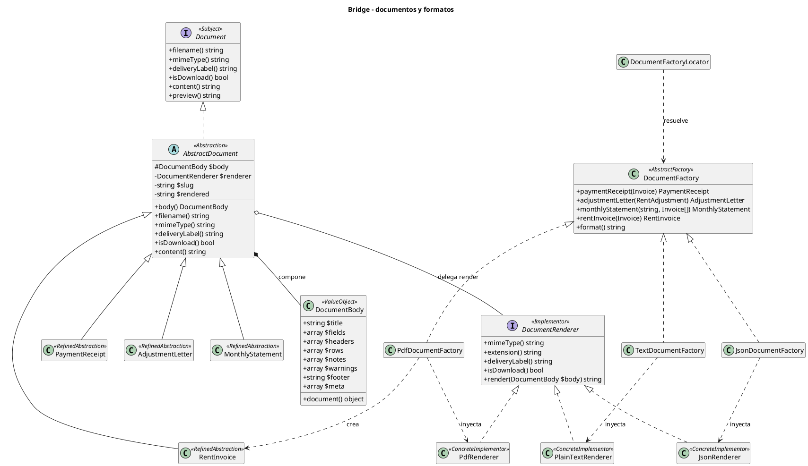
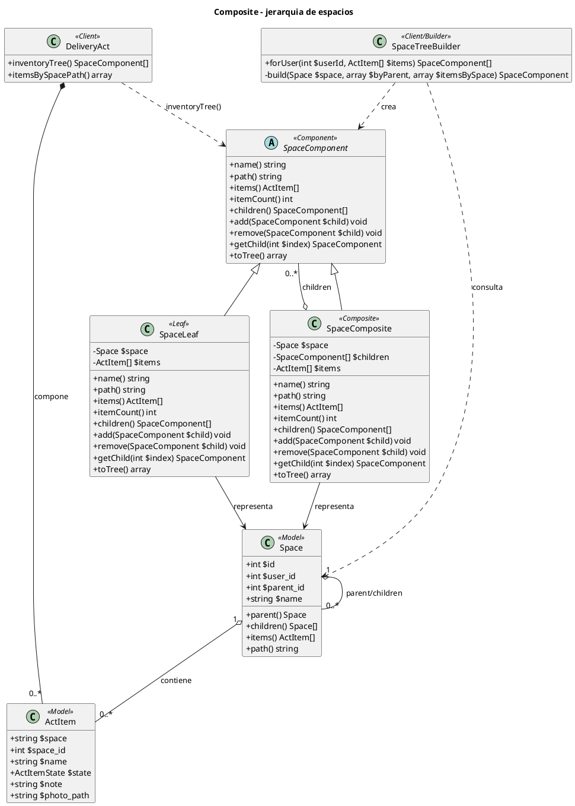
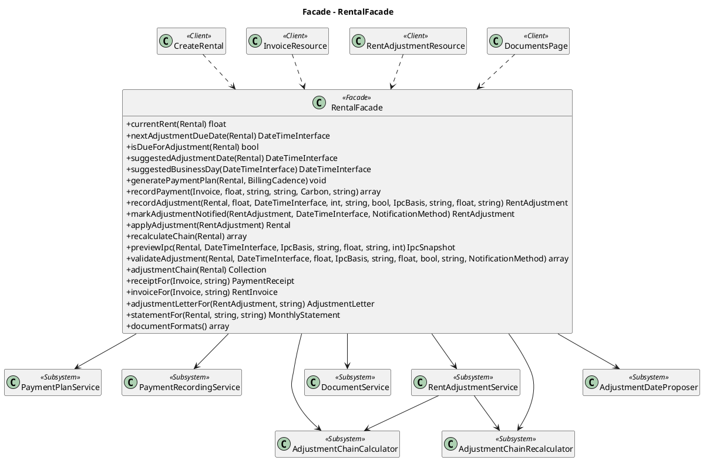
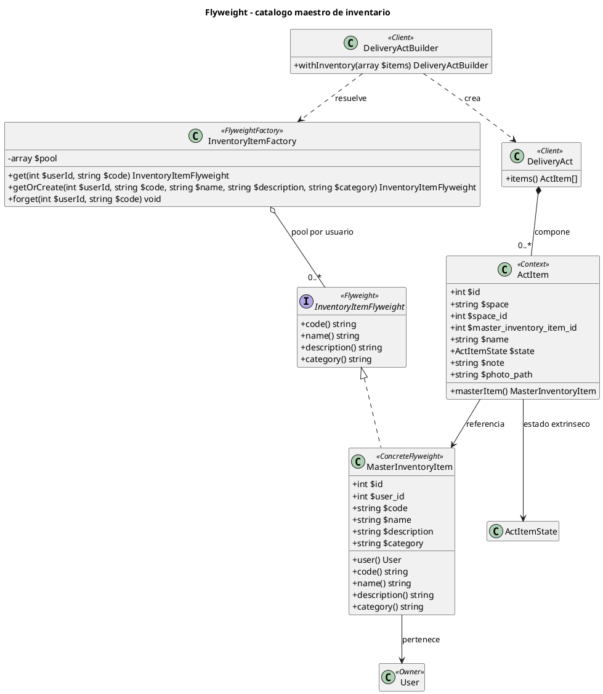
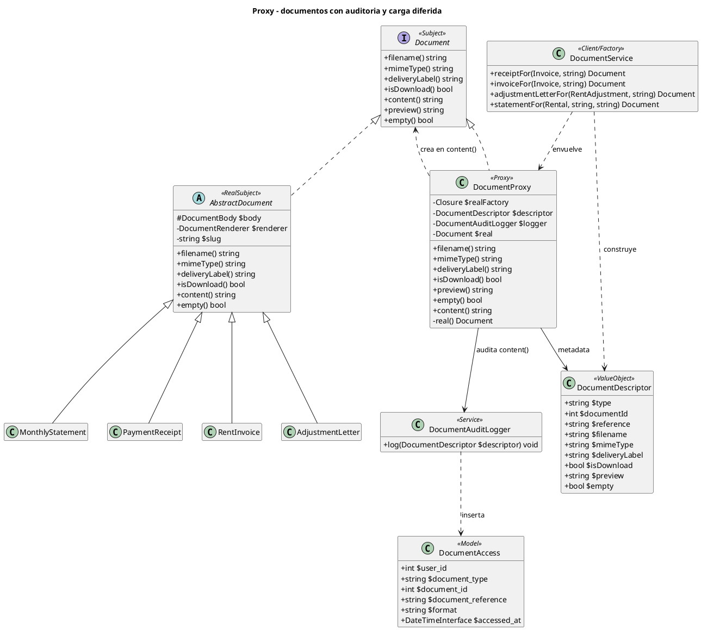
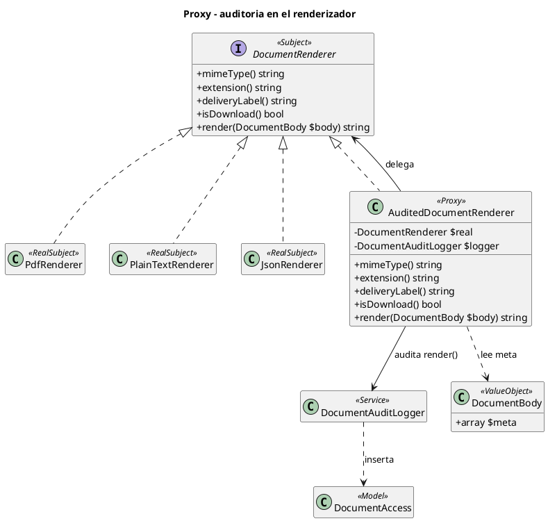
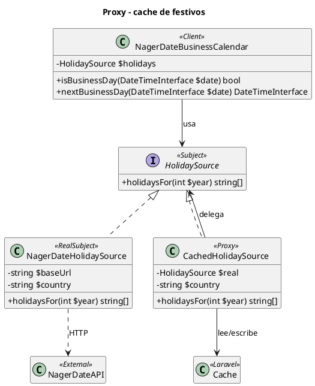

# Plan detallado de implementación: cinco patrones GoF en Prometheus

> **Documento de análisis y planificación.** No implementa código.
>
> Este plan parte del prompt del compañero (Bridge, Composite, Facade, Flyweight y Proxy), se contrasta contra el código real de `app/`, y corrige las suposiciones que no se sostienen. El objetivo es que cada patrón tenga un lugar honesto en el proyecto, una estructura GoF clásica y un UML que se pueda leer antes de escribir una línea.
>
> Documentos relacionados que no se reemplazan: `docs/DOCUMENTACION-PATRONES.md`, `docs/PATRONES-IPC-REAJUSTES.md`, `docs/UML-PLANTUML-PATRONES.md`, `docs/PROXY-FESTIVOS.md` y `docs/Patrones estructurales/Proxy.md`.

---

## 0. Resumen ejecutivo

| Feature | Patrón GoF | Dónde se aplica | Estado actual | Esfuerzo |
| --- | --- | --- | --- | --- |
| 1 | **Bridge** | Documentos (factura, comprobante, carta, estado de cuenta) y formatos (texto, PDF, JSON) | Implementado y documentado; `JsonRenderer` y `JsonDocumentFactory` cubren el formato JSON | Bajo |
| 2 | **Composite** | Jerarquía de espacios del inmueble y árbol del inventario del acta | `spaces` es plano; `act_items.space_id` existe pero no hay `parent_id` | Alto |
| 3 | **Facade** | Operaciones de alquiler: plan, pago, reajuste, documentos | Resources coordinan 5+ servicios a mano | Medio |
| 4 | **Flyweight** | Catálogo maestro de elementos de inventario | No existe; cada `ActItem` repite el nombre | Alto |
| 5 | **Proxy** | Auditoría y/o carga diferida de documentos; alternativa: caché de festivos | Ruta C implementada y documentada: `HolidaySource` + `CachedHolidaySource` + `NagerDateHolidaySource`; `DocumentProxy` (A) y auditoría de renderer (B) no implementados | Bajo (C); Medio/Alto (A/B) |

### Decisiones ya cerradas

| Decisión | Valor |
| --- | --- |
| TTL de la caché de festivos (si se usa el Proxy de festivos) | **1 día** |
| Vínculo del inventario con el catálogo maestro | **FK `master_inventory_item_id`** |
| Selección de espacios en el acta | **`space_id`** (con `space` como snapshot) |
| Alcance de interfaz | **Completo**: JSON en pantalla y tablas; árbol de espacios en modal |
| Ruta del Proxy | **Ruta C implementada** (festivos) en `a4307bc`; A y B quedan como alternativas no implementadas |

### Hallazgos que cambian el plan

1. **El Bridge y la Abstract Factory ya existen.** `AbstractDocument` es la abstracción; `DocumentRenderer` es el implementador; `PdfRenderer` y `PlainTextRenderer` son implementaciones concretas. Agregar JSON no requiere tocar las clases de documento, pero sí crear `JsonRenderer`, `JsonDocumentFactory`, registrar el formato, agregar traducciones y corregir la entrega.
2. **La entrega de PDF no pasa por `content()`.** `DocumentAction::pdf()` y `DocumentsPage::deliver()` llaman a FlexPDF directamente con `$document->body()`. Eso duplica la lógica de `PdfRenderer` y, más grave, **saltaría la auditoría** de un Proxy de documentos. Hay que unificar la entrega en `content()`.
3. **`DocumentBody::withDocument()` está mal usado en tres documentos.** `PaymentReceipt`, `RentInvoice` y `AdjustmentLetter` adjuntan el modelo (`Invoice` o `RentAdjustment`), no el documento. `PdfRenderer::selectView()` compara contra `PaymentReceipt::class`, etc., así que hoy esos tres caen en la vista genérica cuando se renderizan por `content()`. `MonthlyStatement` sí adjunta el documento. Esto es un prerrequisito para el Bridge JSON y para cualquier Proxy de documentos.
4. **`DocumentService` devuelve tipos concretos** (`PaymentReceipt`, `RentInvoice`, `AdjustmentLetter`, `MonthlyStatement`). Un `DocumentProxy` que solo implemente `Document` no puede devolverse desde esos métodos sin cambiar la API. `Document` ya declara `isEmpty()`, pero no `body()`; `DocumentsPage` dejó de usar `invoices()` y ahora consulta `isEmpty()`. El plan debe elegir entre cambiar la API o usar una alternativa.
5. **`spaces` tiene `unique(name, user_id)`.** Para permitir “Baño” en dos pisos hay que cambiar el índice a `(user_id, parent_id, name)`. En MySQL/Postgres los `NULL` de `parent_id` no colisionan; la unicidad de raíces hay que reforzarla en aplicación o con una columna generada.
6. **`ActItem.space_id` ya existe** desde `2026_10_05_022900_add_space_id_to_act_items_table.php`. Lo que falta es `spaces.parent_id`, el árbol y el cambio de formulario para seleccionar por id.
7. **`master_inventory_items` necesita `user_id`.** Sin él se reintroduce el bug del catálogo global que ya se corrigió en `2026_10_14_090000_backfill_space_catalog_into_spaces_table.php`.
8. **`RentAdjustmentService` tiene 4 dependencias, no 8**, y `PaymentPlanService::generateFor()` devuelve `void`, no un array. `PaymentRecordingService::record()` devuelve `array{payment, invoice, just_settled}`.
9. **El Proxy de festivos quedó implementado en `a4307bc`.** `HolidaySource` es el Subject; `CachedHolidaySource` cachea por país/año y degrada a `[]`; `NagerDateHolidaySource` traduce HTTP/JSON y lanza si falla; `NagerDateBusinessCalendar` ya no cachea ni degrada. El commit anterior lo describía solo en `docs/PROXY-FESTIVOS.md`.

> **Estado del Feature 1:** los hallazgos 1 a 3 ya se resolvieron al implementar el formato JSON y unificar la entrega por `content()`. El Bridge quedó documentado en `docs/Patrones estructurales/Bridge.md`; este plan se conserva como registro de análisis y del alcance de los Features 2 a 5.
>
> **Estado del Feature 5:** la Ruta C (Proxy de festivos) se implementó y documentó en `docs/Patrones estructurales/Proxy.md`. Las rutas A (DocumentProxy) y B (auditoría en renderer) no se implementaron; las secciones que las describen se conservan como análisis de alternativas.

---

## 1. Cómo leer los UML

Los diagramas están en **PlantUML** porque el proyecto ya los usa en `docs/UML-PLANTUML-PATRONES.md` y `docs/PROXY-FESTIVOS.md`. Se pueden pegar en el visor de PlantUML, en la extensión de VS Code o en IntelliJ.

### Convenciones

| Notación | Significado |
| --- | --- |
| `A <|.. B` | B realiza la interfaz A |
| `A <|-- B` | B hereda de A |
| `A *-- B` | Composición: B es parte de A y no existe sin A |
| `A o-- B` | Agregación: A agrupa B, pero B tiene vida propia |
| `A --> B` | Asociación: A guarda una referencia a B |
| `A ..> B` | Dependencia: A usa o crea B |
| `<<Subject>>`, `<<RealSubject>>`, `<<Proxy>>` | Roles GoF del Proxy |
| `<<Abstraction>>`, `<<RefinedAbstraction>>`, `<<Implementor>>`, `<<ConcreteImplementor>>` | Roles GoF del Bridge |
| `<<Component>>`, `<<Leaf>>`, `<<Composite>>` | Roles GoF del Composite |
| `<<Facade>>`, `<<Subsystem>>` | Roles GoF de la Facade |
| `<<Flyweight>>`, `<<ConcreteFlyweight>>`, `<<FlyweightFactory>>`, `<<Context>>` | Roles GoF del Flyweight |

### Regla de lectura

Cada diagrama muestra **solo las clases que hacen falta para entender el patrón**. Las pantallas de Filament aparecen únicamente cuando son el Cliente del patrón. Los modelos de dominio aparecen solo con los atributos y métodos que el patrón toca.

### Regla de entrega: antes y después

Cada patrón, al implementarse, se documenta con **dos diagramas de clases**:

1. **Antes:** el estado real del código antes de aplicar el patrón. Sirve para explicar qué problema había y por qué se justifica el patrón.
2. **Después:** la estructura ya implementada, con los roles GoF identificados.

No se usan diagramas de secuencia en la entrega. Esta regla aplica a los cinco patrones del plan: **Bridge, Composite, Facade, Flyweight y Proxy**. En los patrones que aún no están implementados, el diagrama "Antes" documenta el estado actual y el "Después" se produce al cerrar la implementación.

---

## 2. Feature 1: Bridge — exportación de documentos a JSON

### 2.1 Objetivo funcional

Agregar un tercer formato de documento, **JSON estructurado**, para que un contador pueda importar facturas, comprobantes, cartas y estados de cuenta a un software contable sin parsear PDFs ni texto plano.

El JSON debe contener los mismos datos que el texto plano, pero con una estructura estable:

```json
{
  "title": "Comprobante de pago",
  "document_type": "PaymentReceipt",
  "fields": {
    "Número de factura": "FV-2026-0001",
    "Total": "$ 1.500.000"
  },
  "table": {
    "headers": ["Fecha", "Valor", "Método"],
    "rows": [["01/02/2026", "$ 1.500.000", "Transferencia"]]
  },
  "warnings": [],
  "notes": ["..."],
  "footer": "Generado por Prometheus el 01/02/2026"
}
```

### 2.2 Por qué es Bridge y no Abstract Factory

Son dos patrones que colaboran, pero no son lo mismo:

- **Bridge** separa la **abstracción** (qué documento es) de la **implementación** (cómo se serializa). La abstracción es `AbstractDocument` y sus refinamientos (`RentInvoice`, `PaymentReceipt`, `AdjustmentLetter`, `MonthlyStatement`). El implementador es `DocumentRenderer` y sus concretos (`PdfRenderer`, `PlainTextRenderer`, `JsonRenderer`).
- **Abstract Factory** crea una **familia completa** de productos para un formato. `PdfDocumentFactory`, `TextDocumentFactory` y `JsonDocumentFactory` producen los cuatro documentos con el renderizador correcto.

El Bridge es la estructura que permite que un documento no sepa si está en PDF, texto o JSON. La Abstract Factory es la que elige la familia. `DocumentFactoryLocator` es el selector de familia, no parte del Bridge.

### 2.3 Estructura GoF clásica

| Rol GoF | Clase en Prometheus | Responsabilidad |
| --- | --- | --- |
| **Abstraction** | `AbstractDocument` | Define la interfaz del documento, guarda `DocumentBody` y delega `content()` en `DocumentRenderer` |
| **RefinedAbstraction** | `RentInvoice`, `PaymentReceipt`, `AdjustmentLetter`, `MonthlyStatement` | Arman su `DocumentBody` y conservan sus datos de dominio |
| **Implementor** | `DocumentRenderer` | Declara `mimeType()`, `extension()`, `deliveryLabel()`, `isDownload()`, `render(DocumentBody)` |
| **ConcreteImplementor** | `PdfRenderer`, `PlainTextRenderer`, `JsonRenderer` | Serializan el mismo `DocumentBody` en su formato |
| **Client** | `DocumentService`, `DocumentsPage`, `DocumentAction` | Piden el documento a la fábrica y lo entregan |
| **Colaborador** | `DocumentBody` | Objeto de valor con el contenido sin formato. No es un rol GoF del Bridge |

### 2.4 Diagrama de clases



**Lectura clave:** `AbstractDocument` no tiene un `if ($formato === 'pdf')`. Solo guarda un `DocumentRenderer` y le pasa el `DocumentBody`. Agregar `JsonRenderer` no toca `RentInvoice`, `PaymentReceipt`, `AdjustmentLetter` ni `MonthlyStatement`.

El problema y la solución de este patrón, que son los que se llevan a la sustentación, están en `docs/Patrones estructurales/Bridge.md`, secciones 2 y 4: el problema muestra la entrega PDF duplicada y el diagrama muestra las dos jerarquías y la entrega unificada por `content()`.

### 2.5 Guía de implementación

#### Clases nuevas

| Archivo | Rol | Contenido mínimo |
| --- | --- | --- |
| `app/Documents/Rendering/JsonRenderer.php` | ConcreteImplementor | `mimeType(): 'application/json'`, `extension(): 'json'`, `isDownload(): true`, `deliveryLabel()`, `render(DocumentBody): string` |
| `app/Documents/Factories/JsonDocumentFactory.php` | Abstract Factory concreta | Los cuatro métodos de `DocumentFactory` y `format(): 'json'` |

#### Clases modificadas

| Archivo | Cambio |
| --- | --- |
| `app/Documents/DocumentFactoryLocator.php` | `FORMATS = ['text', 'pdf', 'json']`; `IMPLEMENTATIONS['json'] = JsonDocumentFactory::class` |
| `app/Documents/DocumentService.php` | `formatOptions()` agrega `'json' => __('invoice.documents.format.json')` |
| `app/Filament/Pages/DocumentsPage.php` | Entrega unificada por `content()`; el formato JSON aparece solo con `formatOptions()` |
| `app/Filament/Support/DocumentAction.php` | Agregar `file()`/`json()` y simplificar `pdf()` para que use `download()` |
| `lang/es/invoice.php`, `lang/en/invoice.php` | `documents.format.json`, `documents.download_json` |
| `app/Documents/AbstractDocument.php` | Prerrequisito: método para adjuntar el documento al `DocumentBody` |
| `app/Documents/PaymentReceipt.php`, `RentInvoice.php`, `AdjustmentLetter.php` | Prerrequisito: adjuntar `$this` al body, no el modelo |
| `app/Documents/Rendering/PdfRenderer.php` | Ya selecciona la vista por `body->document()`; queda correcto tras el prerrequisito |

#### Prerrequisito: el body debe conocer el documento

Hoy:

- `PaymentReceipt::buildBody()` termina con `->withDocument($invoice)`.
- `RentInvoice::buildBody()` termina con `->withDocument($invoice)`.
- `AdjustmentLetter` adjunta `$adjustment`.
- `MonthlyStatement` sí adjunta `$document`.

`PdfRenderer::selectView()` hace `match ($document::class)` contra `PaymentReceipt::class`, etc. Con un `Invoice` o un `RentAdjustment`, cae en `documents.document` y pierde la plantilla específica. La corrección:

1. Agregar en `AbstractDocument` un método protegido `attachToBody(): void` que haga `$this->body = $this->body->withDocument($this)`.
2. Llamarlo en los cuatro constructores estáticos después de crear la instancia.
3. Ajustar `buildBody()` para que no adjunte el modelo.
4. Probar que `$body->document()` es la instancia del documento y que `PdfRenderer` selecciona la vista correcta.

Sin este paso, el JSON puede funcionar, pero el PDF por `content()` seguiría usando la vista genérica.

#### `JsonRenderer`

```php
final class JsonRenderer implements DocumentRenderer
{
    public function mimeType(): string { return 'application/json'; }
    public function extension(): string { return 'json'; }
    public function isDownload(): bool { return true; }
    public function deliveryLabel(): string { return __('invoice.documents.download_json'); }

    public function render(DocumentBody $body): string
    {
        return json_encode([
            'title' => $body->title,
            'document_type' => $body->document() ? class_basename($body->document()) : null,
            'fields' => $body->fields,
            'table' => $body->headers === [] ? null : [
                'headers' => $body->headers,
                'rows' => $body->rows,
            ],
            'warnings' => $body->warnings,
            'notes' => $body->notes,
            'footer' => $body->footer,
        ], JSON_PRETTY_PRINT | JSON_UNESCAPED_UNICODE | JSON_UNESCAPED_SLASHES);
    }
}
```

Decisiones:

- **No incluir `meta`** en el JSON: `PaymentReceipt` guarda `receipt_image` como data URI base64. Un JSON contable no debe llevar una imagen embebida. Si se necesita, se agrega una referencia, no el binario.
- Los `fields` son cadenas ya formateadas (`$ 1.500.000`, `01/02/2026`). Es una exportación de presentación. Si se quiere un feed contable crudo, hay que agregar datos estructurados a `DocumentBody`; eso es otro alcance.
- `document_type` usa `body->document()`; por eso el prerrequisito anterior es obligatorio.

#### `JsonDocumentFactory`

Replica `TextDocumentFactory`:

```php
final class JsonDocumentFactory implements DocumentFactory
{
    public function __construct(private readonly JsonRenderer $renderer) {}

    public function paymentReceipt(Invoice $invoice): PaymentReceipt
    {
        return PaymentReceipt::forInvoice($invoice, $this->renderer);
    }

    public function adjustmentLetter(RentAdjustment $adjustment): AdjustmentLetter
    {
        return AdjustmentLetter::forAdjustment($adjustment, $this->renderer);
    }

    public function monthlyStatement(string $period, array $invoices): MonthlyStatement
    {
        return MonthlyStatement::forPeriod($period, $invoices, $this->renderer);
    }

    public function rentInvoice(Invoice $invoice): RentInvoice
    {
        return RentInvoice::forInvoice($invoice, $this->renderer);
    }

    public function format(): string { return 'json'; }
}
```

#### Entrega unificada

Hoy `DocumentsPage::deliver()` y `DocumentAction::pdf()` hacen:

```php
$pdfBytes = Pdf::view($view, [
    'body' => $document->body(),
    'document' => $document,
    'settings' => $settings,
])->page('a4')->output();
```

Eso duplica `PdfRenderer` y solo sirve para PDF. La entrega debe ser:

```php
if ($document->isDownload()) {
    return DocumentAction::download($document);
}

$this->textPreview = $document->content();
```

`DocumentAction::download()` ya hace `streamDownload(fn () => print($document->content()), $document->filename(), ['Content-Type' => $document->mimeType()])`. Con eso, PDF, JSON y cualquier formato futuro pasan por el mismo camino. `DocumentAction::pdf()` puede quedar como:

```php
public static function pdf(string $name, Closure $builder, ?string $label = null, string $actionClass = TableAction::class): MountableAction
{
    return $actionClass::make($name)
        ->label($label ?? __('invoice.buttons.download_document_pdf'))
        ->icon('heroicon-o-arrow-down-tray')
        ->action(fn (mixed $record) => self::download($builder($record, 'pdf')));
}
```

`DocumentAction::file()` hace lo mismo con `'json'`.

#### Interfaz

- `DocumentsPage` ya usa `formatOptions()`; al agregar `json`, el selector lo muestra sin cambiar la vista Blade.
- Agregar acciones JSON en `InvoiceResource` (factura y comprobante) y `RentAdjustmentResource` (carta) con `DocumentAction::file()`. El estado de cuenta ya se genera desde `DocumentsPage`.
- En `DocumentsPage`, el estado de cuenta vacío se detecta con `Document::isEmpty()`; ya no se necesita el método concreto `invoices()` ni una comprobación antes de envolver en Proxy.

### 2.6 Pruebas

| Prueba | Qué verifica |
| --- | --- |
| `tests/Feature/JsonDocumentBridgeTest.php` | Los cuatro documentos se generan en JSON; `json_decode` es válido; contiene `title`, `fields`, `table`, `warnings`, `notes`, `footer` |
| `DocumentFactoryTest` | `JsonDocumentFactory` completa los cuatro productos; `format() === 'json'`; el locator resuelve `json` |
| `DocumentContentTest` | Mismo body en texto y JSON: los datos no cambian, solo la serialización |
| `DocumentsPageTest` | El selector incluye JSON; la descarga devuelve `application/json`; no se llama a FlexPDF |
| `InvoiceTableDocumentActionsTest` | Las acciones JSON existen y devuelven un archivo con el nombre y MIME correctos |
| Prerrequisito | `body->document()` es el documento; `PdfRenderer` elige la vista correcta para los cuatro |

Comandos:

```bash
php artisan test --filter=JsonDocumentBridgeTest
php artisan test --filter=DocumentFactoryTest
composer test
vendor/bin/pint --test
```

### 2.7 Criterios de aceptación

- [ ] Los cuatro documentos se pueden exportar como JSON desde `DocumentsPage` y desde las tablas.
- [ ] El JSON es válido y estable; no incluye imágenes base64.
- [ ] `DocumentFactoryLocator::supports('json')` es `true`.
- [ ] El PDF sigue saliendo con su plantilla específica después de unificar la entrega por `content()`.
- [ ] No se modificó ninguna clase de documento para agregar el formato (salvo el prerrequisito del body, que es una corrección, no una dependencia del formato).

### 2.8 Corrección al prompt del compañero

El prompt dice: “Si mañana se añade un quinto documento, automáticamente funcionará en los tres formatos”. Eso no es exacto: en Abstract Factory, agregar un producto requiere agregar el método a `DocumentFactory` y a **cada** fábrica concreta. El Bridge garantiza que, una vez agregado el producto, no haya que duplicar la lógica de serialización por formato. Es una precisión importante para la sustentación.

---

## 3. Feature 2: Composite — jerarquía de espacios del inmueble

### 3.1 Objetivo funcional

Organizar los espacios como un árbol:

```text
Edificio A
├── Piso 1
│   ├── Apartamento 101
│   │   ├── Habitación principal
│   │   │   └── Armario empotrado
│   │   └── Baño
│   └── Apartamento 102
└── Piso 2
    └── Apartamento 201
```

El acta de entrega debe poder mostrar la ruta completa de cada elemento:

```text
Edificio A > Piso 1 > Apartamento 101 > Habitación principal > Armario empotrado
  Nevera 350L: funciona
  Puerta: tiene un rasguño
```

### 3.2 Por qué es Composite

GoF Composite permite tratar **indistintamente** un objeto individual (hoja) y una composición de objetos (compuesto). El cliente pregunta lo mismo a ambos:

- `itemCount()`: ¿cuántos elementos hay en esta rama?
- `items()`: ¿qué elementos contiene esta rama?
- `path()`: ¿dónde está?
- `toTree()`: ¿cómo se serializa?

Un `Espacio` con hijos es un compuesto; un espacio sin hijos es una hoja. El acta no necesita saber si está mirando un edificio o una habitación: llama a la misma interfaz.

### 3.3 Estructura GoF clásica

| Rol GoF | Clase en Prometheus | Responsabilidad |
| --- | --- | --- |
| **Component** | `SpaceComponent` | Declara `name()`, `path()`, `items()`, `itemCount()`, `children()`, `add()`, `remove()`, `getChild()`, `toTree()` |
| **Leaf** | `SpaceLeaf` | Representa un espacio sin hijos; `add/remove` fallan o son no-op; `itemCount()` cuenta sus ítems |
| **Composite** | `SpaceComposite` | Representa un espacio con hijos; agrega el conteo y los ítems de sus hijos; implementa `add/remove/getChild` |
| **Client** | `DeliveryAct`, `SpaceTreeBuilder`, `DeliveryActResource` | Construyen y consultan el árbol sin distinguir hoja de compuesto |

Nota de fidelidad GoF: el Composite clásico incluye gestión de hijos (`add`, `remove`, `getChild`). En Prometheus la fuente de verdad es la base de datos (`spaces.parent_id`), pero el `SpaceTreeBuilder` construye el árbol en memoria usando `add()`. Así el patrón no es decorativo: el compuesto realmente compone.

### 3.4 Diagrama de clases



**Lectura clave:** `SpaceLeaf` y `SpaceComposite` se tratan igual porque ambos son `SpaceComponent`. `SpaceComposite::itemCount()` no consulta la base de datos: suma los conteos de sus hijos. `SpaceTreeBuilder` es el único que arma la estructura desde `spaces.parent_id` y `act_items.space_id`.

### 3.5 Guía de implementación

#### Migración

`database/migrations/2026_10_25_000000_add_parent_id_to_spaces_table.php`

- Agregar `parent_id` nullable, FK a `spaces.id`, `nullOnDelete`.
- Eliminar el índice único `(name, user_id)`.
- Agregar índice único `(user_id, parent_id, name)`.
- Nota: en MySQL/Postgres los `NULL` de `parent_id` son distintos, así que dos raíces pueden llamarse igual. Reforzar en aplicación:
  - `SpaceCatalogField` valida `parent_id` y nombre antes de crear/renombrar.
  - `DeliveryActBuilder` valida que el `space_id` pertenezca al usuario.
  - Opcional: columna generada `parent_key = COALESCE(parent_id, 0)` y único `(user_id, parent_key, name)`.

#### Modelo `Space`

- `$fillable` agrega `parent_id`.
- `parent(): BelongsTo`, `children(): HasMany`, `items(): HasMany`.
- `path(): string`: recorre `parent` hasta la raíz y une con ` > `.
- `asComponent(array $items = []): SpaceComponent`: devuelve `SpaceComposite` si tiene hijos, `SpaceLeaf` si no.
- `descendants(): Collection`: recursivo o consulta por `parent_id`; usar con cuidado para evitar N+1.

#### Componentes

- `app/Models/SpaceComponent.php` (interfaz o clase abstracta).
- `app/Models/SpaceLeaf.php`.
- `app/Models/SpaceComposite.php`.
- `SpaceComposite::add()` agrega y actualiza el conteo; `remove()` lo quita; `getChild()` valida índice.
- `SpaceLeaf::add()` y `remove()` lanzan `LogicException` (“una hoja no tiene hijos”).
- `toTree()` devuelve:

```php
[
    'id' => $space->id,
    'name' => $space->name,
    'path' => $space->path(),
    'item_count' => $this->itemCount(),
    'items' => [...],
    'children' => [...],
]
```

#### `SpaceTreeBuilder`

- Carga todos los espacios del usuario en una sola consulta.
- Carga los ítems del acta y los agrupa por `space_id`.
- Agrupa espacios por `parent_id`.
- Construye recursivamente desde las raíces (`parent_id === null`).
- Ítems sin `space_id` (datos viejos) van a una hoja sintética “Sin espacio” para no perder información.
- Evita N+1: no llama a `$space->children` dentro del bucle.

#### Integración con el acta

- `DeliveryAct::inventoryTree(): array` usa `SpaceTreeBuilder`.
- `DeliveryAct::itemsBySpace()` se conserva para compatibilidad (agrupa por el snapshot `space`).
- `DeliveryAct::itemsBySpacePath()` agrupa por la ruta completa.
- `DeliveryActResource`: agregar una acción `tree` que abra un modal con `resources/views/filament/acts/inventory-tree.blade.php`.
- No hay página View hoy (solo index/create); el modal es el consumidor concreto.

#### Formulario

Este es el cambio más delicado. Hoy:

- `SpaceCatalogField` guarda el **nombre** del espacio.
- `DeliveryActBuilder::withInventory()` recibe `space` (string) y valida por nombre.
- `ActItem` guarda `space` (string) y `space_id` (nullable).

Para que la jerarquía sea real y permita “Baño” en dos pisos:

1. `SpaceCatalogField::options()` devuelve `id => path` (no `name => name`).
2. `createOptionUsing()` devuelve el `id` del espacio creado.
3. `editOptionUsing()` recibe el `id`, actualiza el nombre y, si se cambia el padre, valida el nuevo `parent_id`.
4. El repeater del acta usa `space_id` en lugar de `space`.
5. `CreateDeliveryAct` pasa `space_id` al Builder.
6. `DeliveryActBuilder::withInventory()` acepta `space_id`, resuelve el `Space`, valida que `user_id` coincida con el dueño del acta y guarda:
   - `space_id` (FK)
   - `space` (snapshot del nombre)
7. `DeliveryActDraft::formState()` devuelve `space_id` + `space` para el Prototype.
8. `ActItem::__clone()` conserva `space_id` y `master_inventory_item_id`; solo limpia `id`, `exists` y `delivery_act_id`.

Compatibilidad: si un ítem llega sin `space_id` pero con `space`, el Builder mantiene la ruta legacy por nombre. Así no se rompen datos ni pruebas viejas.

### 3.6 Pruebas

| Prueba | Qué verifica |
| --- | --- |
| `tests/Feature/SpaceHierarchyCompositeTest.php` | Hoja y compuesto; `itemCount`; `path`; `toTree` anidado; agregación entre pisos |
| `SpaceHierarchyCompositeTest` | “Baño” bajo dos padres; ítem sin espacio; ruta legacy por nombre |
| `DeliveryActBuilderTest` | Acepta `space_id`; valida dueño; guarda snapshot `space` |
| `CreateDeliveryActTest` | El formulario envía `space_id` y crea el árbol correcto |
| `SpaceCatalogFieldTest` | Opciones por `id => path`; crear/editar con padre; unicidad de raíz |
| `SeedingTest` | El seeder crea una jerarquía válida |

### 3.7 Criterios de aceptación

- [ ] `spaces.parent_id` existe y se puede crear un árbol de al menos tres niveles.
- [ ] El acta muestra la ruta completa de cada elemento.
- [ ] Un compuesto suma los ítems de todos sus descendientes.
- [ ] Se pueden tener dos espacios con el mismo nombre bajo padres distintos.
- [ ] El formulario guarda `space_id` y conserva `space` como snapshot.
- [ ] Los ítems viejos sin `space_id` siguen visibles.

### 3.8 Riesgos y decisiones

- **Cambio de formulario:** sin pasar de `space` a `space_id`, la jerarquía queda solo de visualización y no se pueden elegir nombres duplicados. Es obligatorio para el objetivo funcional.
- **Unicidad de raíces:** el índice con `parent_id` NULL no la garantiza en MySQL/Postgres. Se refuerza en aplicación o con columna generada.
- **Borrado de un padre:** `nullOnDelete` convierte a los hijos en raíces. Es preferible a borrar en cascada un subárbol con actas históricas.
- **Consumidor:** sin el modal, `toTree()` no tendría uso real. El modal es parte del alcance, no un extra.

---

## 4. Feature 3: Facade — `RentalFacade`

### 4.1 Objetivo funcional

Un solo punto de entrada para las operaciones de un alquiler:

- ¿Cuál es el canon vigente?
- ¿Está vencido para reajustar?
- Genera el plan de cobros.
- Registra un pago.
- Calcula, notifica y aplica un reajuste.
- Genera el comprobante, la factura, la carta o el estado de cuenta.

Hoy cada pantalla conoce varios servicios y su orden. La Facade no mueve la lógica: solo orquesta.

### 4.2 Por qué es Facade y no Mediator

- **Facade** proporciona una interfaz unificada a un subsistema. El subsistema no conoce a la Facade; la Facade conoce al subsistema.
- **Mediator** centraliza la comunicación entre colegas que sí conocen al mediador. Aquí no hay colegas que se comuniquen entre sí: hay pantallas que necesitan una secuencia de llamadas. Es Facade.

### 4.3 Estructura GoF clásica

| Rol GoF | Clase en Prometheus | Responsabilidad |
| --- | --- | --- |
| **Facade** | `RentalFacade` | Expone operaciones de alquiler y delega en el subsistema |
| **Subsystem** | `PaymentPlanService`, `PaymentRecordingService`, `RentAdjustmentService`, `DocumentService`, `AdjustmentChainCalculator`, `AdjustmentChainRecalculator`, `AdjustmentDateProposer` | Siguen teniendo la lógica de negocio |
| **Client** | `CreateRental`, `InvoiceResource`, `RentAdjustmentResource`, `DocumentsPage` | Llaman a la Facade en lugar de a 5+ servicios |

La Facade **no** debe convertirse en un god object. Regla: si un método necesita lógica nueva, esa lógica va al servicio; la Facade solo compone.

### 4.4 Diagrama de clases



### 4.5 Guía de implementación

#### API exacta

Basada en las firmas reales, no en el bosquejo del prompt:

```php
final class RentalFacade
{
    public function currentRent(Rental $rental): float;
    public function nextAdjustmentDueDate(Rental $rental): \DateTimeInterface;
    public function isDueForAdjustment(Rental $rental): bool;
    public function suggestedAdjustmentDate(Rental $rental): \DateTimeInterface;
    public function suggestedBusinessDay(\DateTimeInterface $date): \DateTimeInterface;

    public function generatePaymentPlan(Rental $rental, ?BillingCadence $cadence = null): void;

    /**
     * @return array{payment: Payment, invoice: Invoice, just_settled: bool}
     */
    public function recordPayment(
        Invoice $invoice,
        float $amount,
        ?string $method = null,
        ?string $reference = null,
        ?Carbon $paidAt = null,
        ?string $receiptImage = null,
    ): array;

    public function recordAdjustment(
        Rental $rental,
        float $newRent,
        \DateTimeInterface $effectiveFrom,
        ?int $ipcYear = null,
        ?string $notes = null,
        bool $ipcOutsideStatutoryYear = false,
        IpcBasis $basis = IpcBasis::National,
        ?string $geographyCode = null,
        ?float $pactadoPercentage = null,
        string $strategy = 'annual_variation',
    ): RentAdjustment;

    public function markAdjustmentNotified(
        RentAdjustment $adjustment,
        \DateTimeInterface $notifiedOn,
        ?NotificationMethod $method = null,
    ): RentAdjustment;

    public function applyAdjustment(RentAdjustment $adjustment): Rental;
    public function recalculateChain(Rental $rental): array;

    public function previewIpc(
        Rental $rental,
        \DateTimeInterface $effectiveFrom,
        IpcBasis $basis = IpcBasis::National,
        ?string $geographyCode = null,
        ?float $pactadoPercentage = null,
        string $strategy = 'annual_variation',
        ?int $ipcYear = null,
    ): IpcSnapshot;

    /**
     * @return array{summary: RuleResult, messages: list<array<string, mixed>>}
     */
    public function validateAdjustment(
        Rental $rental,
        \DateTimeInterface $effectiveFrom,
        float $requestedRent,
        IpcBasis $basis = IpcBasis::National,
        ?string $geographyCode = null,
        ?float $pactadoPercentage = null,
        bool $acknowledged = false,
        ?string $notes = null,
        ?NotificationMethod $notificationMethod = null,
    ): array;

    public function adjustmentChain(Rental $rental): \Illuminate\Support\Collection;

    public function receiptFor(Invoice $invoice, ?string $format = null): PaymentReceipt;
    public function invoiceFor(Invoice $invoice, ?string $format = null): RentInvoice;
    public function adjustmentLetterFor(RentAdjustment $adjustment, ?string $format = null): AdjustmentLetter;
    public function statementFor(Rental $rental, string $period, ?string $format = null): MonthlyStatement;
    public function documentFormats(): array;
}
```

#### Dependencias

```php
public function __construct(
    private readonly PaymentPlanService $paymentPlans,
    private readonly PaymentRecordingService $payments,
    private readonly RentAdjustmentService $adjustments,
    private readonly DocumentService $documents,
    private readonly AdjustmentChainCalculator $calculator,
    private readonly AdjustmentChainRecalculator $recalculator,
    private readonly AdjustmentDateProposer $dateProposer,
) {}
```

`RentAdjustmentService` ya depende de `IpcSeriesRepository`, `AdjustmentChainCalculator`, `AdjustmentChainRecalculator` y `ReajusteValidationChain`; la Facade no los duplica.

#### Registro

`AppServiceProvider`:

```php
$this->app->singleton(RentalFacade::class);
```

Es stateless: no guarda modelos ni usuario. Singleton solo evita reconstruirlo en cada llamada.

#### Call sites a migrar

| Archivo | Llamadas actuales | Reemplazo |
| --- | --- | --- |
| `RentalResource/Pages/CreateRental.php` | `PaymentPlanService::generateFor` | `RentalFacade::generatePaymentPlan` |
| `InvoiceResource.php` | `PaymentRecordingService::record`, `DocumentService::receiptFor/invoiceFor` | `RentalFacade::recordPayment`, `receiptFor`, `invoiceFor` |
| `RentAdjustmentResource.php` | `RentAdjustmentService::previewIpc/validate/applyToRental/markNotified/recalculateChain`, `DocumentService::adjustmentLetterFor` | `RentalFacade::previewIpc`, `validateAdjustment`, `applyAdjustment`, `markAdjustmentNotified`, `recalculateChain`, `adjustmentLetterFor` |
| `DocumentsPage.php` | `DocumentService::formatOptions/statementFor/invoiceFor/adjustmentLetterFor/receiptFor` | `RentalFacade::documentFormats/statementFor/invoiceFor/adjustmentLetterFor/receiptFor` |

Mantener directos `IpcSeriesRepository` y `AppSettings` en `RentAdjustmentResource`: no son orquestación del alquiler, son datos de apoyo del formulario. Migrarlos a la Facade solo por “reducir imports” la convertiría en un god object.

#### Notificación de `PaymentPlanService`

`PaymentPlanService::generateFor()` emite una `Notification` de Filament. La Facade hereda ese acoplamiento a UI. Opciones:

1. **Mantenerlo** (recomendado para no ampliar el alcance): la Facade delega y la notificación sigue en el servicio. En tests, `Notification::fake()`.
2. Mover la notificación al cliente. Es un refactor aparte; no es necesario para el patrón.

Documentar la decisión en la Facade.

#### Pruebas

| Prueba | Qué verifica |
| --- | --- |
| `tests/Feature/RentalFacadeTest.php` | Cada método delega y devuelve lo mismo que el servicio |
| `RentalFacadeTest` | `generatePaymentPlan` crea facturas; `recordPayment` actualiza el estado; `applyAdjustment` actualiza el canon |
| `RentalFacadeTest` | `receiptFor/invoiceFor/adjustmentLetterFor/statementFor` devuelven el tipo correcto |
| `RentalFacadeTest` | La instancia es singleton |
| `RentAdjustmentServiceTest`, `PaymentRecordingTest`, `PaymentPlanGeneratorTest` | No cambian: la lógica sigue en los servicios |
| `ReajusteScreensRenderTest`, `InvoiceResourceTest` | Las pantallas siguen funcionando con la Facade |

### 4.6 Criterios de aceptación

- [ ] Las cuatro pantallas usan `RentalFacade` y no coordinan 5+ servicios.
- [ ] La lógica de negocio sigue en los servicios; la Facade no tiene reglas nuevas.
- [ ] Los tests de los servicios pasan sin cambios.
- [ ] `RentalFacade` es singleton y no guarda estado.
- [ ] `generatePaymentPlan` devuelve `void` (no un array inventado).

### 4.7 Correcciones al prompt del compañero

- `RentAdjustmentService` tiene **4** dependencias, no 8.
- `PaymentPlanService::generateFor()` devuelve `void`, no un array.
- `PaymentRecordingService::record()` devuelve un array con `payment`, `invoice` y `just_settled`.
- La Facade no “elimina” los servicios: los oculta. La sustentación debe decir eso.

---

## 5. Feature 4: Flyweight — catálogo maestro de inventario

### 5.1 Objetivo funcional

Evitar que cada acta repita el mismo elemento:

```text
Acta 1: Nevera 350L, color rojo, marca HaceBue
Acta 2: Nevera 350L, color rojo, marca HaceBue
Acta 3: Nevera 350L, color rojo, marca HaceBue
```

En su lugar:

- El arrendador define **una vez** el elemento maestro: `nevera-350l-roja`.
- Cada acta referencia ese elemento y solo guarda el estado extrínseco: “funciona”, “tiene un rasguño”, foto, observaciones.
- Si se corrige la descripción del maestro, las actas **futuras** usan la corrección; las actas firmadas conservan el nombre con el que se firmaron (snapshot).

### 5.2 Por qué es Flyweight

GoF Flyweight separa:

- **Estado intrínseco:** lo que se comparte y no cambia con el contexto. Aquí: `code`, `name`, `description`, `category` del elemento maestro.
- **Estado extrínseco:** lo que varía por uso. Aquí: espacio, estado observado, nota, foto, acta.

La fábrica de flyweights mantiene un **pool** por usuario. El contexto (`ActItem`) guarda una referencia al flyweight (FK) y su estado extrínseco. El beneficio real aquí no es “memoria” (una fila de texto no pesa), sino **consistencia** y **normalización**: un solo nombre canónico por elemento, sin variantes.

### 5.3 Estructura GoF clásica

| Rol GoF | Clase en Prometheus | Responsabilidad |
| --- | --- | --- |
| **Flyweight** | `InventoryItemFlyweight` | Declara `code()`, `name()`, `description()`, `category()` |
| **ConcreteFlyweight** | `MasterInventoryItem` | Implementa el flyweight; es el registro compartido por usuario |
| **FlyweightFactory** | `InventoryItemFactory` | Mantiene el pool `userId:code` y devuelve la misma instancia por petición |
| **Context** | `ActItem` | Guarda el estado extrínseco y la referencia al flyweight |
| **Client** | `DeliveryActBuilder`, `CreateDeliveryAct` | Resuelven el flyweight y crean el contexto |

### 5.4 Diagrama de clases



### 5.5 Guía de implementación

#### Migraciones

1. `create_master_inventory_items_table`:

```text
id
user_id FK users cascade
code string
name string
description nullable string
category nullable string
timestamps
unique(user_id, code)
```

2. `add_master_inventory_item_id_to_act_items_table`:

```text
master_inventory_item_id nullable FK master_inventory_items nullOnDelete
```

No se elimina `act_items.name`: se conserva como snapshot histórico. Tampoco se elimina `space`/`space_id`.

#### Modelo y contrato

- `app/Contracts/InventoryItemFlyweight.php` o `app/Models/Contracts/...` con los cuatro accesores.
- `app/Models/MasterInventoryItem.php` implementa el contrato.
- `ActItem` agrega `master_inventory_item_id` a `$fillable` y `masterItem(): BelongsTo`.
- `ActItem::__clone()` conserva `master_inventory_item_id` y `space_id`; solo limpia `id`, `exists`, `delivery_act_id`.

#### `InventoryItemFactory`

- Registro `scoped` (una instancia por petición).
- Pool privado `array<string, MasterInventoryItem>` con clave `"{$userId}:{$code}"`.
- `get()` busca en el pool; si no está, consulta por `user_id` y `code`, guarda y devuelve.
- `getOrCreate()` crea si no existe y actualiza el pool.
- `forget()` elimina del pool después de renombrar/borrar.
- El pool es por petición. El beneficio de compartir entre peticiones lo da la base de datos, no el array.

#### Builder

`DeliveryActBuilder::withInventory()` acepta:

```php
[
    'space_id' => 10,
    'master_item_key' => 'nevera-350l',
    'state' => 'bueno',
    'note' => '...',
    'photo_path' => '...',
]
```

Pasos:

1. Resolver el espacio por `space_id` y validar que `user_id` sea el dueño del acta.
2. Resolver el flyweight con `InventoryItemFactory::get($ownerId, $key)`.
3. Validar que el flyweight pertenezca al mismo usuario.
4. Guardar en `ActItem`:
   - `master_inventory_item_id`
   - `name` = `$flyweight->name` (snapshot)
   - `space_id` y `space` (snapshot)
   - `state`, `note`, `photo_path`
5. Si no viene `master_item_key`, mantener la ruta legacy por `name`.

#### Interfaz

- El repeater de inventario cambia el `TextInput` de `name` por un `Select` de elementos maestros.
- `createOptionForm`: `name`, `description`, `category`.
- `createOptionUsing`: `InventoryItemFactory::getOrCreate(...)`, devuelve `code` o `id`.
- `editOptionForm`: corregir `name`, `description`, `category`; no reescribir actas pasadas.
- `CreateDeliveryAct`: arma el array con `master_item_key`, `space_id`, estado, nota y foto.

#### Seeders y factories

- `MasterInventoryItemFactory` con elementos comunes: Nevera, Lavadora, Cama, Sofá, Mesa, Armario.
- Seeder por usuario (no global).
- `ActItemFactory` actualizado para crear un maestro o aceptar uno existente.
- `DeliveryActSeeder` con elementos maestros y actas de ejemplo.

### 5.6 Pruebas

| Prueba | Qué verifica |
| --- | --- |
| `tests/Feature/InventoryItemFlyweightTest.php` | `get()` dos veces devuelve la misma instancia en la petición |
| `InventoryItemFlyweightTest` | Distintos usuarios tienen flyweights distintos |
| `InventoryItemFlyweightTest` | Dos actas comparten la misma fila maestra |
| `InventoryItemFlyweightTest` | El `ActItem` guarda FK + snapshot + estado extrínseco |
| `InventoryItemFlyweightTest` | Un maestro de otro usuario se rechaza |
| `DeliveryActBuilderTest` | La ruta legacy por `name` sigue funcionando |
| `CreateDeliveryActTest` | El selector de catálogo crea y elige elementos |

### 5.7 Criterios de aceptación

- [ ] El catálogo maestro es por usuario, no global.
- [ ] Dos actas pueden referenciar el mismo maestro sin duplicar el nombre canónico.
- [ ] El acta conserva el nombre con el que se firmó aunque el maestro cambie después.
- [ ] El estado extrínseco (espacio, estado, nota, foto) vive en `ActItem`.
- [ ] El pool se reinicia por petición y no filtra datos entre usuarios.

### 5.8 Riesgos y decisiones

- **Pureza del Flyweight:** guardar `name` en `ActItem` es una duplicación deliberada por integridad legal. La alternativa (solo FK) haría que una acta firmada cambiara si se edita el maestro. Documentar el tradeoff.
- **`key` vs `code`:** `key` es palabra reservada en MySQL; usar `code`. Si se exige `master_item_key` literal, se puede, pero se pierde la FK y se resuelve por `(user_id, code)`.
- **Borrado del maestro:** `nullOnDelete` deja el `ActItem` con su snapshot; no se pierde la historia.
- **Pool y Octane:** `scoped` reinicia por petición; no usar `singleton` para el pool.

---

## 6. Feature 5: Proxy — documentos o festivos

### 6.1 Objetivo del prompt

El prompt pide un `DocumentProxy` que:

- Envuelva cada documento devuelto por `DocumentService`.
- Implemente la misma interfaz `Document`.
- Registre en `document_accesses` quién accedió, qué documento y cuándo, **antes** de delegar.
- Delegue metadata (`filename`, MIME, preview) sin auditar.
- No implemente control de acceso entre roles (todos son arrendadores).

### 6.2 Por qué es Proxy

GoF Proxy es un sustituto que **controla el acceso** al objeto real y cumple la misma interfaz. El cliente no sabe si habla con el real o con el proxy. Variantes:

- **Virtual Proxy:** crea el objeto real de forma diferida (caro).
- **Smart Reference:** registra el acceso (auditoría).
- **Protection Proxy:** controla permisos (aquí **no** se implementa).

El prompt combina Virtual + Smart Reference. La estructura clásica es:

```text
Client --> Subject (interface)
              ^
              | implements
       +------+------+
       |             |
    Proxy        RealSubject
  (controla)     (hace el trabajo)
```

### 6.3 Por qué el `DocumentProxy` del prompt no es implementable tal cual

| Blocker | Detalle |
| --- | --- |
| Tipos de retorno | `DocumentService::receiptFor()` devuelve `PaymentReceipt`, no `Document`. Un `DocumentProxy` que implemente solo `Document` no se puede devolver sin cambiar la firma. |
| `body()` fuera de la interfaz | `DocumentsPage::deliver()` y `DocumentAction::pdf()` llaman `$document->body()`, pero `body()` está en `AbstractDocument`, no en `Document`. Un proxy que solo implemente `Document` rompe. |
| Vistas PDF con métodos concretos | `resources/views/documents/*.blade.php` llaman `$document->invoice()`, `$document->period()`, `$document->transactions()`, etc. Un proxy genérico no los tiene. |
| `invoices()` | `DocumentsPage` llama `$statement->invoices()`; `invoices()` solo existe en `MonthlyStatement`. |
| Auditoría saltada por PDF | `DocumentAction::pdf()` y `DocumentsPage::deliver()` no pasan por `content()`; renderizan con FlexPDF directamente. El proxy podría auditar `content()` y aun así el PDF no quedaría auditado. |
| `body->document()` incorrecto | Tres documentos adjuntan el modelo al body, no el documento; `PdfRenderer` elige la vista por `body->document()`. Sin el prerrequisito, el PDF por `content()` sale genérico. |

**Conclusión:** el `DocumentProxy` es viable, pero solo si se hace una de estas dos cosas:

1. Cambiar la API de `DocumentService` a `Document` y unificar la entrega por `content()` (Ruta A).
2. Mover el Proxy al renderizador, que ya es el punto por el que pasa todo renderizado (Ruta B).

La tercera opción, ya implementada, es el Proxy de festivos (Ruta C).

### 6.4 Ruta A: Proxy de documentos (Virtual + Smart Reference)

#### Diseño

- `DocumentProxy implements Document` (Subject).
- `DocumentDescriptor` (objeto de valor) con la metadata que no requiere construir el body:
  - `type` (`PaymentReceipt`, `RentInvoice`, ...)
  - `documentId` (factura, reajuste, alquiler)
  - `reference` (periodo, número)
  - `filename`, `mimeType`, `deliveryLabel`, `isDownload`
  - `preview`, `empty`
- `DocumentProxy` recibe un `Closure(): Document $realFactory` y un `DocumentDescriptor`.
- `content()`: registra la auditoría y luego construye el real (si no existe) y llama `content()`.
- `preview()`, `filename()`, `mimeType()`, `deliveryLabel()`, `isDownload()`, `empty()`: usan el descriptor, sin auditar y sin construir el real.
- `DocumentService` construye el descriptor y el closure; devuelve `Document` (proxy).
- `Document` agrega `empty(): bool` (no `body()`).
- `AbstractDocument` implementa `empty(): false`; `MonthlyStatement` lo sobrescribe.
- La entrega se unifica por `content()`; `DocumentAction::pdf()` y `DocumentsPage::deliver()` dejan de usar FlexPDF directamente.
- `PdfRenderer` selecciona la vista por `body->document()`; se aplica el prerrequisito de adjuntar el documento al body.

#### Diagrama de clases



#### Cambios de API

- `DocumentService::receiptFor/invoiceFor/adjustmentLetterFor/statementFor` devuelven `Document`, no los tipos concretos.
- `RentalFacade` de documentos también devuelve `Document`.
- `DocumentsPage` y `DocumentAction` usan `Document`.
- Tests que esperan `PaymentReceipt` se actualizan a `Document` + `instanceof DocumentProxy` o `content()`.
- `DocumentsPage` ya usa `Document::isEmpty()`; no necesita `MonthlyStatement::invoices()`.

#### Tabla de auditoría

`document_accesses`:

```text
id
user_id nullable FK users nullOnDelete
document_type string
document_id nullable unsignedBigInteger
document_reference nullable string
format string
accessed_at timestamp
ip nullable string
timestamps
index(user_id, accessed_at)
index(document_type, document_id)
```

`DocumentAuditLogger`:

- Usuario: `app(CurrentUserContextInterface::class)->id()` o `auth()->id()`.
- Si no hay usuario (consola/queue), `user_id = null` y `source = 'console'` (opcional).
- Registrar **antes** de delegar. Si la inserción falla, decidir:
  - **Fail-closed:** no se entrega el documento si no se pudo auditar. Es lo correcto para trazabilidad legal.
  - **Fail-open:** se registra el error y se entrega. Es más disponible, pero debilita la auditoría.
  - Recomendación para el proyecto: fail-closed en web; fail-open con log en consola.

#### Pruebas

| Prueba | Qué verifica |
| --- | --- |
| `tests/Feature/DocumentProxyTest.php` | `content()` inserta una fila en `document_accesses` |
| `DocumentProxyTest` | `filename()`, `mimeType()`, `deliveryLabel()`, `isDownload()`, `preview()` no insertan auditoría |
| `DocumentProxyTest` | `content()` dos veces reutiliza el real y no reconstruye el body |
| `DocumentProxyTest` | El proxy implementa `Document` |
| `DocumentProxyTest` | PDF, texto y JSON quedan auditados |
| `DocumentProxyTest` | Sin usuario autenticado, la política acordada se respeta |
| `DocumentFactoryTest` | Los métodos de `DocumentService` devuelven `Document` |
| `DocumentsPageTest` | La descarga usa `content()` y no FlexPDF directo |

#### Costo y riesgos

- Cambio de API público de `DocumentService` (rompe tests y posibles llamadas).
- Hay que construir `DocumentDescriptor` sin duplicar la lógica de `preview()` y `slug`.
- La construcción diferida exige un `Closure` y un descriptor; más piezas que un Proxy simple.
- La auditoría fail-closed puede impedir descargas si la tabla falla.
- Es la ruta más fiel al prompt, pero la más costosa.

### 6.5 Ruta B: Proxy de auditoría en el renderizador

#### Diseño

- `AuditedDocumentRenderer implements DocumentRenderer` (Subject = `DocumentRenderer`).
- Envuelve un renderer real (`PdfRenderer`, `PlainTextRenderer`, `JsonRenderer`).
- `render(DocumentBody $body)`: registra la auditoría y delega.
- Metadata (`mimeType`, `extension`, `deliveryLabel`, `isDownload`) se delega sin auditar.
- El `DocumentBody` lleva en `meta` el contexto de auditoría: `audit_type`, `audit_id`, `audit_reference`, `audit_format`.
- Las fábricas inyectan el renderer auditado; los documentos no cambian su tipo.
- La entrega debe pasar por `content()` (prerrequisito) para que el PDF también se audite.

#### Diagrama de clases



#### Ventajas

- No cambia `DocumentService` ni los tipos concretos.
- Audita PDF, texto y JSON porque todos pasan por `render()`.
- Es un Proxy GoF clásico: mismo `DocumentRenderer`, controla el acceso al real.
- Menos código y menos riesgo que la Ruta A.

#### Limitaciones

- No es un Virtual Proxy: el `DocumentBody` ya se construyó antes de `render()`. La carga diferida del body no se cumple.
- La auditoría se dispara al renderizar, no al pedir metadata. Es exactamente lo que se quiere: `preview()` no audita.
- Requiere el prerrequisito de unificar la entrega por `content()`; si no, el PDF sigue saltando el renderer.

#### Pruebas

| Prueba | Qué verifica |
| --- | --- |
| `tests/Feature/AuditedDocumentRendererTest.php` | `render()` inserta auditoría y devuelve el contenido del real |
| `AuditedDocumentRendererTest` | Metadata no audita |
| `AuditedDocumentRendererTest` | PDF, texto y JSON auditados |
| `DocumentFactoryTest` | Las fábricas usan el renderer auditado |
| `DocumentsPageTest` | La descarga pasa por `content()` |

### 6.6 Ruta C: Proxy de festivos (implementada)

#### Diseño

Implementada en `a4307bc` y documentada en `docs/Patrones estructurales/Proxy.md`; `docs/PROXY-FESTIVOS.md` conserva el detalle de diseño:

| Rol GoF | Clase |
| --- | --- |
| **Client** | `NagerDateBusinessCalendar` |
| **Subject** | `HolidaySource` |
| **Proxy** | `CachedHolidaySource` |
| **RealSubject** | `NagerDateHolidaySource` (también Adapter) |

- `NagerDateHolidaySource`: HTTP + parseo; lanza si falla.
- `CachedHolidaySource`: clave `holidays:{country}:{year}`, TTL **1 día**, degrada a `[]` si la API falla y no cachea el fallo.
- `NagerDateBusinessCalendar`: solo pregunta festivos y calcula días hábiles; ya no conoce `Http`, `Cache` ni `Log`.
- `WeekendBusinessCalendar`: implementación de respaldo para tests.
- `AppServiceProvider`: compone `NagerDateBusinessCalendar(CachedHolidaySource(NagerDateHolidaySource(...)))` en producción.

#### Diagrama de clases



#### Ventajas

- Es un Proxy GoF clásico y limpio.
- No toca documentos ni la API de `DocumentService`.
- Ya hay documento de diseño y decisión previa del equipo.
- Bajo riesgo, tests aislados con `Http::fake`.

#### Limitaciones

- No implementa la auditoría de documentos del prompt.
- No es un Virtual Proxy de documentos.

### 6.7 Matriz de decisión

| Criterio | Ruta A (DocumentProxy) | Ruta B (renderer proxy) | Ruta C (festivos) |
| --- | --- | --- | --- |
| Fidelidad al prompt (auditoría) | Alta | Alta | Baja |
| Fidelidad al prompt (carga diferida) | Alta | Baja | Baja |
| Cambio de API de documentos | Alto | Nulo | Nulo |
| Riesgo de regresión | Alto | Bajo | Bajo |
| Esfuerzo | Alto | Medio | Bajo |
| Proxy GoF clásico | Sí | Sí | Sí |
| Auditoría de PDF | Sí (con unificación) | Sí (con unificación) | No |
| Auditoría de metadata | No | No | N/A |
| Documento ya existente | No | No | Sí (`PROXY-FESTIVOS.md`) |

### 6.8 Recomendación

**Ruta implementada: C (festivos).**

- **C** es el Proxy canónico del proyecto, implementado en `a4307bc` y documentado; cumple el patrón GoF con riesgo bajo.
- **B** (auditoría en renderer) no se implementó. Era parte de la recomendación original C+B, pero la entrega se cerró con C.
- **A** (DocumentProxy) no se implementó. Sigue siendo la ruta más fiel al enunciado si se exige auditoría de documentos, pero implica cambiar la API de `DocumentService`.
- A y B ya no tienen pendiente el prerrequisito de entrega: `DocumentAction`/`DocumentsPage` usan `content()` y `CC-C12` corrigió `body->document()`. A exige cambiar la API de `DocumentService`; B exige agregar la auditoría y su migración.

### 6.9 Criterios de aceptación (según ruta)

Ruta A:

- [ ] `DocumentService` devuelve `Document` (proxy).
- [ ] `content()` registra auditoría antes de delegar.
- [ ] Metadata no audita.
- [ ] PDF, texto y JSON auditados.
- [ ] `Document` tiene `empty()` y `DocumentsPage` lo usa.
- [ ] No se rompen las vistas PDF.

Ruta B:

- [ ] `AuditedDocumentRenderer` implementa `DocumentRenderer`.
- [ ] `render()` audita y delega.
- [ ] Metadata no audita.
- [ ] Las fábricas usan el renderer auditado.
- [ ] PDF, texto y JSON auditados.

Ruta C:

- [x] `HolidaySource`, `NagerDateHolidaySource` y `CachedHolidaySource` existen.
- [x] TTL 1 día por año.
- [x] Fallo de API devuelve `[]` y no cachea.
- [x] `NagerDateBusinessCalendar` ya no cachea ni degrada.
- [x] Tests con `Http::fake` y `Cache::flush`.
- [x] Documento canónico en `docs/Patrones estructurales/Proxy.md`; `Adapter.md` actualizado.

---

## 7. Plan de ejecución por fases

El orden busca reducir riesgo: primero lo aislado, después los refactors, al final las migraciones con UI.

### Fase 0: línea base y prerrequisitos

- Correr `composer test` y `vendor/bin/pint --test` para tener una línea base.
- **Prerrequisito de documentos:** `AbstractDocument::attachToBody()`, corregir `PaymentReceipt`, `RentInvoice` y `AdjustmentLetter` para adjuntar `$this`, y probar que `PdfRenderer` elige la vista correcta.
- **Prerrequisito de entrega:** unificar `DocumentAction::pdf()` y `DocumentsPage::deliver()` en `content()`/`download()`.
- Estas correcciones no son un patrón: son deuda técnica que los patrones necesitan.

### Fase 1: Bridge JSON

- `JsonRenderer`, `JsonDocumentFactory`, locator, `formatOptions()`, lang.
- Acciones JSON en `InvoiceResource` y `RentAdjustmentResource`.
- Tests de Bridge y de documentos.
- **Documentación:** diagramas de clases antes/después en `docs/Patrones estructurales/Bridge.md`. Hecho.
- **Depende de:** Fase 0.

### Fase 2: Facade

- `RentalFacade` + singleton.
- Migrar `CreateRental`, `InvoiceResource`, `RentAdjustmentResource`, `DocumentsPage`.
- Tests de delegación e integración.
- **Documentación:** diagramas de clases antes/después en `docs/Patrones estructurales/Facade.md`.
- **Depende de:** Fase 1 si la Facade expone `documentFormats`/documentos JSON; si no, puede ir antes.

### Fase 3: Flyweight

- Migraciones de catálogo maestro y FK en `act_items`.
- `MasterInventoryItem`, `InventoryItemFactory`, Builder, draft, repeater, seeders.
- Tests.
- **Documentación:** diagramas de clases antes/después en `docs/Patrones estructurales/Flyweight.md`.
- **Depende de:** nada de las fases anteriores, pero comparte `ActItem` con Composite. Hacerlo antes de Composite evita mezclar dos migraciones en la misma tabla.

### Fase 4: Composite

- Migración `spaces.parent_id`, índice único, `SpaceComponent`/`SpaceLeaf`/`SpaceComposite`, `SpaceTreeBuilder`.
- Cambio de formulario a `space_id`, `DeliveryAct::inventoryTree()`, modal de árbol.
- Tests.
- **Documentación:** diagramas de clases antes/después en `docs/Patrones estructurales/Composite.md`.
- **Depende de:** Fase 3 (para que `ActItem` ya tenga el catálogo maestro y el formulario se cambie una sola vez).

### Fase 5: Proxy

- **Ruta C completada en `a4307bc`:** `HolidaySource`, `CachedHolidaySource` y `NagerDateHolidaySource`; `NagerDateBusinessCalendar` quedó como cliente.
- **B no implementada:** la auditoría de renderer se mantiene como alternativa si se requiere la auditoría del prompt.
- **A no implementada:** el `DocumentProxy` sigue siendo la ruta más fiel al enunciado, pero cambia la API de documentos.
- **Documentación:** `docs/Patrones estructurales/Proxy.md` (cinco apartados) y `docs/PROXY-FESTIVOS.md` (detalle). `Adapter.md` se actualizó para separar traducción de control de acceso.

### Orden originalmente recomendado (C + B; solo C ejecutada)

```text
0. Prerrequisitos de documentos
1. Bridge JSON
2. Facade
3. Flyweight
4. Composite
5. Proxy C (festivos) — implementado
6. Proxy B (auditoría de renderer) — no implementado
```

### Orden recomendado (A, si se exige DocumentProxy)

```text
0. Prerrequisitos de documentos
1. Bridge JSON
2. Facade (sin documentos o con la API actual)
3. Flyweight
4. Composite
5. Proxy A (DocumentProxy), coordinando el cambio de API con la Facade
```

---

## 8. Resumen de migraciones

| Migración | Tabla | Cambio | Feature |
| --- | --- | --- | --- |
| `add_parent_id_to_spaces_table` | `spaces` | `parent_id` FK self nullOnDelete; drop unique `(name,user_id)`; add unique `(user_id,parent_id,name)` | Composite |
| `create_master_inventory_items_table` | `master_inventory_items` | Catálogo por usuario con `code`, `name`, `description`, `category`; unique `(user_id,code)` | Flyweight |
| `add_master_inventory_item_id_to_act_items_table` | `act_items` | FK nullable `master_inventory_item_id` nullOnDelete | Flyweight |
| `create_document_accesses_table` | `document_accesses` | Auditoría de accesos | Proxy A/B |
| `2026_10_05_022900_add_space_id_to_act_items_table` | `act_items` | Ya existe; no se crea | Composite |
| `2026_10_14_090000_backfill_space_catalog_into_spaces_table` | `spaces` | Ya existe; referencia del bug de catálogo global | Flyweight/Composite |

Todas las migraciones deben tener `down()` real. Las que agregan columnas deben eliminar la FK y la columna; las que cambian índices deben restaurar el índice anterior.

---

## 9. Matriz de pruebas

| Feature | Prueba nueva | Pruebas existentes a tocar |
| --- | --- | --- |
| Bridge | `JsonDocumentBridgeTest` | `DocumentFactoryTest`, `DocumentContentTest`, `DocumentsPageTest`, `InvoiceDocumentActionTest`, `InvoiceTableDocumentActionsTest` |
| Composite | `SpaceHierarchyCompositeTest` | `DeliveryActBuilderTest`, `CreateDeliveryActTest`, `CreateDeliveryActFromTest`, `DeliveryActPrototypeTest`, `SpaceCatalogFieldTest`, `SeedingTest` |
| Facade | `RentalFacadeTest` | `RentAdjustmentServiceTest`, `PaymentRecordingTest`, `PaymentPlanGeneratorTest`, `InvoiceResourceTest`, `ReajusteScreensRenderTest` |
| Flyweight | `InventoryItemFlyweightTest` | `DeliveryActBuilderTest`, `CreateDeliveryActTest`, `ActItemFactory`, seeders |
| Proxy A | `DocumentProxyTest` | `DocumentFactoryTest`, `DocumentsPageTest`, `InvoiceTableDocumentActionsTest` |
| Proxy B | `AuditedDocumentRendererTest` | `DocumentFactoryTest`, `DocumentsPageTest` |
| Proxy C | `CachedHolidaySourceTest` | `BusinessCalendarTest` |

Comandos:

```bash
# Por feature
php artisan test --filter=JsonDocumentBridgeTest
php artisan test --filter=SpaceHierarchyCompositeTest
php artisan test --filter=RentalFacadeTest
php artisan test --filter=InventoryItemFlyweightTest
php artisan test --filter=DocumentProxyTest
php artisan test --filter=CachedHolidaySourceTest

# Suite completa y estilo
composer test
vendor/bin/pint --test
```

---

## 10. Riesgos y mitigaciones

| Riesgo | Probabilidad | Impacto | Mitigación |
| --- | --- | --- | --- |
| El cambio de `space` a `space_id` rompe actas viejas | Media | Alto | Ruta legacy por `space`; migración de datos; tests con datos viejos |
| El índice único de espacios no impide raíces duplicadas | Alta | Medio | Validación en aplicación; opcional columna generada |
| El Proxy A rompe la API de documentos | Alta | Alto | Fase 0, tests, o elegir B |
| La auditoría se salta el PDF | Alta si no se corrige | Alto | Unificar entrega por `content()` |
| `body->document()` sigue siendo el modelo | Alta si no se corrige | Alto | Prerrequisito `attachToBody()` |
| El pool del Flyweight filtra datos entre usuarios | Media | Alto | Clave `userId:code`; `scoped`; tests de aislamiento |
| El catálogo maestro se vuelve global | Media | Alto | `user_id` obligatorio; unique `(user_id,code)` |
| La Facade se convierte en god object | Media | Medio | Solo orquesta; lógica en servicios; no mover `IpcSeriesRepository`/`AppSettings` |
| El JSON incluye la imagen del comprobante | Media | Bajo | Excluir `meta.receipt_image` |
| Los tests de PDF fallan por el prerrequisito | Media | Medio | Probar `PdfRenderer` con los cuatro documentos antes de seguir |
| `Notification` de `PaymentPlanService` en tests | Alta | Bajo | `Notification::fake()` |

---

## 11. Criterios de aceptación globales

- [ ] Los cinco patrones tienen una clase o estructura identificable y un rol GoF documentado.
- [ ] Ningún patrón es decorativo: cada uno resuelve un problema funcional del prompt.
- [ ] Las migraciones corren hacia adelante y hacia atrás.
- [ ] `composer test` pasa completo.
- [ ] `vendor/bin/pint --test` pasa.
- [ ] Los UML del documento coinciden con las clases implementadas.
- [ ] Cada patrón tiene diagramas de clases **antes** y **después** en su documento; no se entregan diagramas de secuencia.
- [ ] La entrega de documentos pasa por `content()` y el PDF conserva su plantilla.
- [ ] El JSON es válido y no contiene binarios.
- [ ] El árbol de espacios se ve en la UI y no solo en tests.
- [ ] El catálogo maestro es por usuario y las actas conservan su snapshot.
- [ ] La Facade no contiene lógica de negocio nueva.
- [x] La ruta del Proxy está decidida y documentada en el commit/PR: Ruta C en `a4307bc`, con `docs/Patrones estructurales/Proxy.md`.

---

## 12. Decisiones abiertas para analizar

1. **Ruta del Proxy (resuelta):** se implementó **C** (festivos) en `a4307bc`. A (DocumentProxy) y B (renderer audit) no se implementaron; A sigue siendo la opción si el enunciado exige auditoría de documentos.
2. **JSON crudo vs formateado:** este plan entrega valores formateados. Si el contador necesita números y fechas crudas, agregar un bloque `data` estructurado a `DocumentBody` en una fase posterior.
3. **Unicidad de raíces de espacios:** validación en aplicación (simple) vs columna generada `parent_key` (más estricta).
4. **Auditoría fail-closed vs fail-open:** recomendación fail-closed en web, fail-open con log en consola.
5. **Alcance de la Facade:** migrar las cuatro pantallas listadas vs solo `CreateRental` e `InvoiceResource`. Recomendación: las cuatro, manteniendo `IpcSeriesRepository`/`AppSettings` directos.
6. **Snapshot del nombre en `ActItem`:** mantenerlo por integridad legal (recomendado) vs Flyweight puro sin duplicación.

---

## 13. Apéndice: inventario de archivos

### Nuevos

```text
app/Documents/Rendering/JsonRenderer.php
app/Documents/Factories/JsonDocumentFactory.php
app/Models/SpaceComponent.php
app/Models/SpaceLeaf.php
app/Models/SpaceComposite.php
app/Services/Acts/SpaceTreeBuilder.php
app/Services/RentalFacade.php
app/Contracts/InventoryItemFlyweight.php
app/Models/MasterInventoryItem.php
app/Services/Acts/InventoryItemFactory.php
app/Support/Documents/DocumentDescriptor.php        (si Ruta A)
app/Support/Documents/DocumentProxy.php             (si Ruta A)
app/Support/Documents/DocumentAuditLogger.php       (si Ruta A/B)
app/Models/DocumentAccess.php                       (si Ruta A/B)
app/Contracts/HolidaySource.php                     (Ruta C implementada)
app/Infrastructure/Holidays/NagerDateHolidaySource.php (Ruta C implementada)
app/Infrastructure/Holidays/CachedHolidaySource.php (Ruta C implementada)
app/Documents/Rendering/AuditedDocumentRenderer.php (si Ruta B)
database/migrations/2026_10_25_000000_add_parent_id_to_spaces_table.php
database/migrations/2026_10_25_000100_create_master_inventory_items_table.php
database/migrations/2026_10_25_000200_add_master_inventory_item_id_to_act_items_table.php
database/migrations/2026_10_25_000300_create_document_accesses_table.php
database/factories/MasterInventoryItemFactory.php
resources/views/filament/acts/inventory-tree.blade.php
tests/Feature/JsonDocumentBridgeTest.php
tests/Feature/SpaceHierarchyCompositeTest.php
tests/Feature/RentalFacadeTest.php
tests/Feature/InventoryItemFlyweightTest.php
tests/Feature/DocumentProxyTest.php
tests/Feature/AuditedDocumentRendererTest.php
tests/Feature/CachedHolidaySourceTest.php
```

### Modificados

```text
app/Documents/AbstractDocument.php
app/Documents/PaymentReceipt.php
app/Documents/RentInvoice.php
app/Documents/AdjustmentLetter.php
app/Documents/MonthlyStatement.php
app/Documents/DocumentFactoryLocator.php
app/Documents/DocumentService.php
app/Documents/Contracts/Document.php
app/Documents/Rendering/PdfRenderer.php
app/Filament/Pages/DocumentsPage.php
app/Filament/Support/DocumentAction.php
app/Filament/Resources/InvoiceResource.php
app/Filament/Resources/RentAdjustmentResource.php
app/Filament/Resources/RentalResource/Pages/CreateRental.php
app/Filament/Resources/DeliveryActResource.php
app/Filament/Resources/DeliveryActResource/Pages/CreateDeliveryAct.php
app/Filament/Support/SpaceCatalogField.php
app/Models/Space.php
app/Models/ActItem.php
app/Models/DeliveryAct.php
app/Services/Acts/DeliveryActBuilder.php
app/Services/Acts/DeliveryActDraft.php
app/Providers/AppServiceProvider.php
app/Infrastructure/Holidays/NagerDateBusinessCalendar.php (Ruta C implementada)
lang/es/invoice.php
lang/en/invoice.php
database/factories/ActItemFactory.php
database/seeders/SpaceSeeder.php
database/seeders/DeliveryActSeeder.php
tests/Feature/DocumentFactoryTest.php
tests/Feature/DocumentContentTest.php
tests/Feature/DocumentsPageTest.php
tests/Feature/InvoiceDocumentActionTest.php
tests/Feature/InvoiceTableDocumentActionsTest.php
tests/Feature/DeliveryActBuilderTest.php
tests/Feature/CreateDeliveryActTest.php
tests/Feature/CreateDeliveryActFromTest.php
tests/Feature/DeliveryActPrototypeTest.php
tests/Feature/SpaceCatalogFieldTest.php
tests/Feature/SeedingTest.php
tests/Feature/BusinessCalendarTest.php (Ruta C implementada)
```

---

## 14. Referencias

- `docs/DOCUMENTACION-PATRONES.md`: patrones ya implementados (Singleton, Builder, Abstract Factory, Factory Method, Adapter).
- `docs/PATRONES-IPC-REAJUSTES.md`: patrones del módulo IPC y reajustes.
- `docs/UML-PLANTUML-PATRONES.md`: UML PlantUML de los patrones existentes.
- `docs/PROXY-FESTIVOS.md`: diseño detallado del Proxy de festivos (Ruta C).
- `docs/Patrones estructurales/Proxy.md`: documento canónico del Proxy de festivos (Ruta C implementada).
- `app/Documents/`: implementación actual del Bridge y la Abstract Factory.
- `app/Services/`: servicios que la Facade orquesta.
- `app/Models/Space.php`, `app/Models/ActItem.php`, `app/Models/DeliveryAct.php`: base del Composite y el Flyweight.

---

**Fin del plan.** Cualquier decisión que se cambie debe actualizar este documento antes de tocar código, para que el UML y la implementación no empiecen a discrepar.
