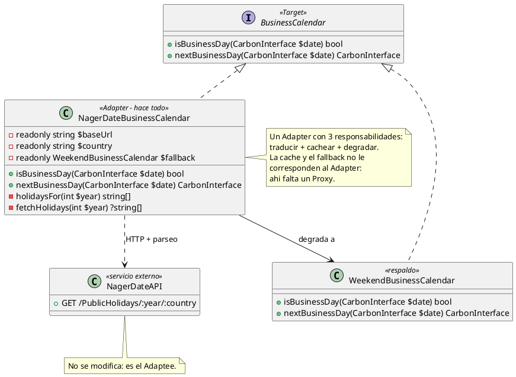
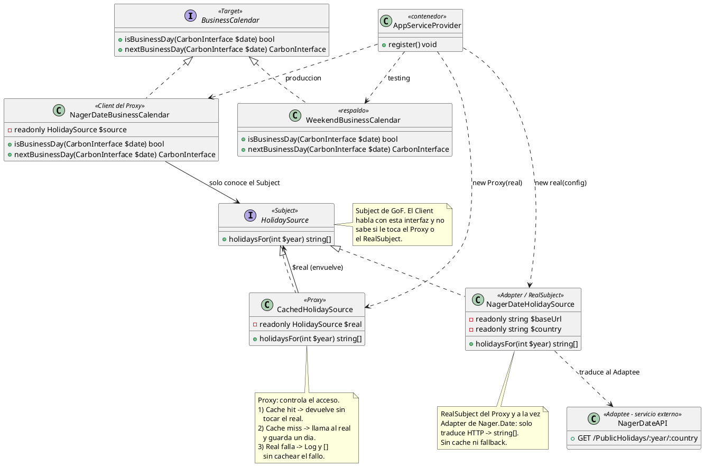
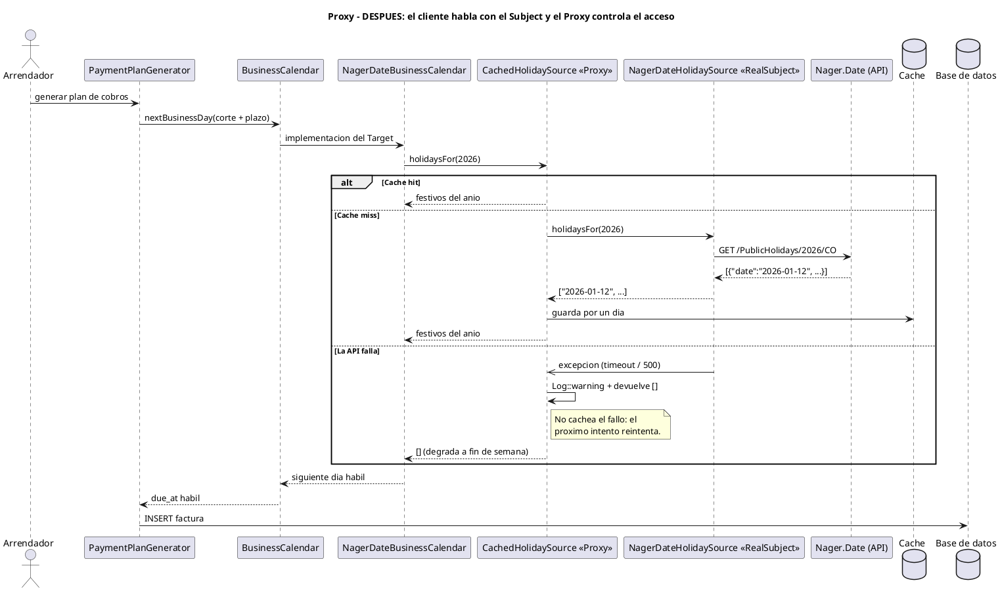

# Patrón Proxy: la caché de festivos (y por qué salió del Adapter)

Este documento explica **cómo implementamos el patrón Proxy** en Prometheus, en el mismo formato (PlantUML) que el documento de Adapter, para poder compararlos.

---

## 0. Resumen en 30 segundos (léelo primero)

- **Qué es Proxy:** un objeto con **la misma interfaz** que el objeto real, que se coloca **delante** de él y **controla el acceso**: a veces responde él (si tiene caché), a veces le pasa la pelota al real, y a veces atrapa sus errores.
- **Dónde lo aplicamos:** en la **caché de festivos** de Nager.Date. El profesor señaló que guardar en caché *dentro* del Adapter era un error de diseño: eso no es "traducir", es "controlar el acceso". Eso es Proxy.
- **La estructura GoF:** `Client → Subject → { Proxy, RealSubject }`. En nuestro código:

  | Rol GoF | Clase |
  |---|---|
  | **Client** | `NagerDateBusinessCalendar` |
  | **Subject** (interfaz) | `HolidaySource` |
  | **Proxy** | `CachedHolidaySource` |
  | **RealSubject** (service) | `NagerDateHolidaySource` |

- **Resultado:** el Adapter solo traduce, el Proxy cachea por año y degrada si la API falla. Cada clase tiene una responsabilidad, y los tests las prueban por separado.

---

## 1. ¿Qué es Proxy, en palabras normales?

Imagina el **portero de un edificio**. Tú llegas con un paquete y se lo das a él:

1. Si el paquete **ya está en recepción** (caché), te lo resuelve ahí mismo: no sube nadie.
2. Si **no está**, sube con el mensajero (el objeto real), lo deja y te devuelve la confirmación.
3. Si el mensajero **no vino o falló**, él lo atrapa, te avisa y resuelve como puede — tú no te enteras del lío.

Tú hablas **siempre con el portero**, nunca con el mensajero. Y lo mejor: el portero y el mensajero "hablan el mismo idioma" — tú no cambias nada de tu rutina por hablar con uno u otro.

Eso es Proxy. En GoF se ve así:

```
Client ──▶ Subject (interfaz)
                 ▲
                 │ implementan
          ┌──────┴──────┐
       Proxy       RealSubject
  (controla acceso)  (hace el trabajo)
```

El Client **solo conoce el Subject**. Recibe al Proxy sin saberlo, porque ambos cumplen la misma interfaz.

---

## 2. El problema: el Adapter hacía de todo (lo que señaló el profesor)

### Qué existía antes

Cuando implementamos Adapter, la clase `NagerDateBusinessCalendar` traducía la API de Nager.Date… pero **se trajo cosas que no le correspondían**: la caché por año y el respaldo si la API fallaba.



### Por qué estaba mal

- **Adapter = traducir.** Su trabajo es convertir la interfaz incompatible de Nager.Date (HTTP + JSON) en algo que el dominio entienda. Nada más.
- **Cachear y degradar = controlar el acceso.** Decidir "si ya lo tengo, no pregunto" o "si el real falla, resuelvo yo" es exactamente lo que hace un Proxy.
- Mezclar ambas cosas en una sola clase viola el principio de responsabilidad única: para cambiar **solo** la política de caché hay que meterse a reescribir el Adapter.

Eso es lo que el profesor vio en el UML: **faltaba un Proxy, y el Adapter estaba sobrecargado**.

---

## 3. La solución: la estructura GoF aplicada

Separamos en dos niveles: el dominio sigue preguntando por "días hábiles", y los festivos se piden a través de una interfaz nueva (`HolidaySource`) donde **el Proxy se sienta justo delante del Adapter**.



### Los cuatro roles GoF, con sus archivos

| Rol GoF | Clase / archivo | Responsabilidad |
|---|---|---|
| **Client** | `NagerDateBusinessCalendar`<br>`app/Infrastructure/Holidays/` | Calcula días hábiles preguntando a `HolidaySource`. No conoce URL, HTTP, caché ni errores de red. |
| **Subject** | `HolidaySource`<br>`app/Contracts/` | Interfaz compartida: `holidaysFor(int $year): array`. |
| **Proxy** | `CachedHolidaySource`<br>`app/Infrastructure/Holidays/` | Envuelve al real y controla el acceso: caché por año (1 día de TTL), log + degradación si el real falla. |
| **RealSubject** | `NagerDateHolidaySource`<br>`app/Infrastructure/Holidays/` | El único que habla con Nager.Date. Si falla, **lanza excepción** (ya no decide nada). |

**Detalle elegante:** `NagerDateHolidaySource` es **a la vez Adapter y RealSubject**. Es RealSubject porque es "el que de verdad trabaja" para el Proxy, y es Adapter porque traduce la interfaz incompatible de Nager.Date. **Los dos patrones se componen**: el Proxy va justo enfrente del Adapter.

### El Client cambió, pero poquito

```php
// Antes (Adapter hacía todo):
new NagerDateBusinessCalendar($baseUrl, $country);

// Después (Client solo recibe el Subject; detrás está Proxy -> Adapter):
new NagerDateBusinessCalendar(
    new CachedHolidaySource(                      // Proxy
        new NagerDateHolidaySource($baseUrl, $country), // Adapter / RealSubject
        $country,
    ),
);
```

En `AppServiceProvider` esa cadena es la que se ata en producción; en testing se ata directo `WeekendBusinessCalendar`, como antes.

---

## 4. Cómo funciona cada llamada: hit, miss y fallo



Las tres ramas (`alt`) las decide **el Proxy**, no el cliente:

1. **Cache hit:** el año ya está cacheado → responde él mismo. **No hay ni una flecha hacia el RealSubject ni hacia la API.** Ese es el beneficio.
2. **Cache miss:** no hay datos → escala al RealSubject, que hace el `GET` y traduce el JSON (ahí trabaja el Adapter); el Proxy guarda el resultado un día y devuelve.
3. **La API falla:** el RealSubject lanza una excepción (flecha `->>`), el Proxy la **atrapa**, escribe un `Log::warning` y devuelve `[]`. Con lista vacía el calendario sigue funcionando: no conoce festivos, así que salta solo fines de semana (degradación graceful).

> **Detalle importante:** el fallo **no se cachea**. Si lo hiciéramos, la aplicación creería "no hay festivos en 2026" hasta el día siguiente; así, el próximo intento reintenta la API.

---

## 5. Qué cambió en el código

| Archivo | Cambio |
|---|---|
| `app/Contracts/HolidaySource.php` | **Nuevo** — el Subject de GoF (un solo método). |
| `app/Infrastructure/Holidays/NagerDateHolidaySource.php` | **Nuevo** — Adapter/RealSubject: solo `GET` + `pluck('date')`. Lanza `RuntimeException` si la API falla. Sin caché, sin fallback. |
| `app/Infrastructure/Holidays/CachedHolidaySource.php` | **Nuevo** — Proxy: `Cache::get` → miss → `$real->holidaysFor()` → `Cache::put` un día; `try/catch` → `Log::warning` → `[]` sin cachear. |
| `app/Infrastructure/Holidays/NagerDateBusinessCalendar.php` | **Simplificado** — ya no importa `Http`, `Cache` ni `Log`; recibe un `HolidaySource` por constructor. |
| `app/Providers/AppServiceProvider.php` | El binding de producción arma la cadena `Proxy(Real)` dentro del Client. |
| `tests/Feature/CachedHolidaySourceTest.php` | **Nuevo** — 4 tests que demuestran el patrón (ver §7). |
| `tests/Feature/BusinessCalendarTest.php` | Actualizado para construir la cadena completa. |

**Nada del dominio cambió:** los generadores de facturas, `RentalPeriod` y las pantallas siguen llamando a `BusinessCalendar` idéntico que antes.

---

## 6. Comparación antes / después

| Aspecto | Antes | Después |
|---|---|---|
| Quién cachea | El Adapter (`NagerDateBusinessCalendar`) | El Proxy (`CachedHolidaySource`) |
| Quién degrada si falla la API | El Adapter | El Proxy |
| Quién traduce el JSON | El Adapter (mezclado con lo anterior) | El Adapter solo (`NagerDateHolidaySource`) |
| Responsabilidades del Adapter | 3 (traducir, cachear, degradar) | 1 (traducir) |
| Interfaz del festivo | No existía | `HolidaySource` (Subject de GoF) |
| Qué ve el dominio | `BusinessCalendar` | Igual — no cambió nada |
| Para cambiar la política de caché | Reescribir el Adapter | Modificar solo el Proxy |
| Patrón visible en el UML | Solo Adapter | Adapter **y** Proxy, compuestos |

---

## 7. Cómo probarlo

```bash
php artisan test --filter=CachedHolidaySourceTest
php artisan test --filter=BusinessCalendarTest
```

| Test | Qué demuestra |
|---|---|
| `el_proxy_cachea_los_festivos_y_no_vuelve_a_golpear_la_api` | Dos consultas, **un solo** request a la API (`Http::assertSentCount(1)`) → el Proxy respondió la segunda desde caché. |
| `el_proxy_degrada_a_lista_vacia_si_la_api_falla` | API responde 500 → el Proxy devuelve `[]` en vez de explotar. |
| `el_proxy_no_cachea_el_fallo_y_reintenta_en_el_siguiente_intento` | Primera llamada falla, segunda tiene datos → el fallo no quedó cacheado. |
| `el_proxy_y_el_real_son_intercambiables_para_el_cliente` | Ambos cumplen `HolidaySource`: el cliente recibe cualquiera sin cambiar una línea. |
| `el_adaptador_salta_el_festivo_que_devuelve_la_api` | La cadena completa (Client → Proxy → Adapter) sigue saltando festivos como antes. |
| `el_adaptador_degrada_a_fin_de_semana_si_la_api_falla` | La degradación de producción no se rompió al refactorizar. |

---

## 8. Guion de sustentación (dilo tal cual)

> "Implementamos el patrón **Proxy** sobre la fuente de festivos. La estructura es la del GoF: un **Subject**, que es la interfaz `HolidaySource` con el método `holidaysFor`; un **RealSubject**, que es `NagerDateHolidaySource`, la clase que habla con la API de Nager.Date; un **Proxy**, que es `CachedHolidaySource`, con exactamente la misma interfaz; y el **Client**, que es `NagerDateBusinessCalendar`.
>
> El Proxy controla el acceso en tres situaciones: si el año ya está en caché responde él mismo sin tocar la API; si no está, escala al RealSubject y guarda el resultado por un día; y si el RealSubject falla, atrapa la excepción, registra el aviso y devuelve una lista vacía, con lo cual el calendario degrada a solo fines de semana — y ese fallo no se cachea, para que el siguiente intento reintente.
>
> Esto corrigió un problema que ya habíamos dejado en el Adapter: la caché y la degradación estaban mezcladas con la traducción de la API. El Adapter solo debe **traducir**; controlar el acceso es trabajo del Proxy. Además, el RealSubject es a la vez **Adapter** de Nager.Date, así que los dos patrones se componen: el Proxy va justo enfrente del Adapter. Y el dominio no cambió: sigue preguntando por `BusinessCalendar`."

### Preguntas típicas y respuesta corta

- **¿Por qué esto no era parte del Adapter?** Porque el Adapter solo traduce interfaces. Cachear y manejar errores es controlar el acceso a un servicio, y eso es la definición de Proxy. Mezclarlos viola responsabilidad única.
- **¿Qué lo diferencia de Decorator?** El Proxy **controla el acceso** (mismo objeto, decide si va al real o responde él); Decorator **añade comportamiento** y los objetos se apilan en cadena. Además el Proxy suele ser transparente por completo, mientras que Decorator expone su propio comportamiento adicional.
- **¿El cliente sabe que usa el proxy?** No. El Client depende de `HolidaySource`; el contenedor (AppServiceProvider) le entrega el Proxy armado. Si mañana quitamos la caché, no se toca una línea del dominio.
- **¿Por qué no cacheas el fallo?** Para no "envenenar" la caché: si cacheáramos `[]` tras un error, la app creería que no hay festivos todo el día. Sin cachear el fallo, el próximo intento reintenta la API.
- **¿Se pueden apilar varios proxies?** Sí, todos cumplen el Subject: por ejemplo, un proxy de log delante del de caché.
- **¿Y en los tests?** El binding de `testing` ata directo `WeekendBusinessCalendar`; los tests del Proxy usan `Http::fake` para simular la API sin red.

---

## 9. Diagramas: dónde está cada cosa

| Diagrama | Sección | Qué muestra |
|---|---|---|
| `proxy_antes_clases` | §2 | El Adapter "haciendo todo" (el error señalado) |
| `proxy_despues_clases` | §3 | La estructura GoF: Client → Subject → Proxy / RealSubject |
| `proxy_despues_secuencia` | §4 | Los tres caminos: cache hit, cache miss y fallo |
