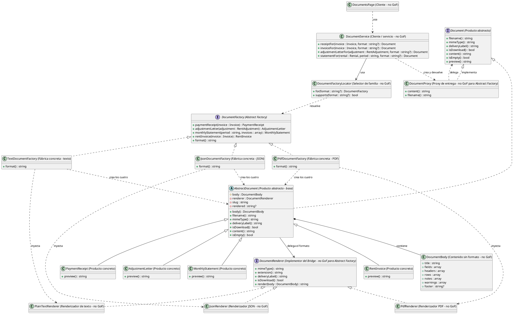

# Abstract Factory

## 1. Nombre y propósito

**Abstract Factory** ofrece una interfaz para crear familias de objetos relacionados sin que el cliente conozca las clases concretas. El cliente elige una familia y recibe productos compatibles entre sí.

En Prometheus la familia es el formato de los documentos. `DocumentFactory` declara cuatro productos —comprobante de pago, carta de reajuste, estado de cuenta y factura de arrendamiento— y cada familia los entrega completos en texto plano, PDF o JSON. Los cuatro comparten los mismos datos de negocio; cambia la forma de renderizarlos y entregarlos.

## 2. Problema que resuelve en Prometheus

El sistema genera cuatro documentos distintos y cada uno puede necesitarse en tres formatos:

- texto plano, para copiar o previsualizar;
- PDF, para descargar;
- JSON estructurado, para que un sistema contable lo importe sin interpretar una plantilla visual.

Sin una familia, cada documento tendría que decidir su formato por dentro o recibir un parámetro suelto. Eso produciría varios problemas:

- ramas `if ($formato === 'pdf')` o `if ($formato === 'json')` repartidas por los cuatro documentos;
- duplicación de la misma lógica de negocio en tres versiones;
- posibilidad de mezclar formatos, por ejemplo una factura en PDF y su comprobante en texto;
- que agregar un formato nuevo obligue a tocar cada documento.

La aplicación necesita elegir el formato una vez, obtener todos los documentos de esa misma familia y fallar si el formato no existe. También necesita que el formato de texto sea el predeterminado para poder probar y previsualizar sin depender de dompdf.

## 3. Solución y roles

| Rol GoF | Implementación en Prometheus | Responsabilidad |
| --- | --- | --- |
| **AbstractFactory** | `DocumentFactory` | Declarar los cuatro productos y el formato de la familia. |
| **ConcreteFactory** | `TextDocumentFactory` | Crear los cuatro documentos en texto plano. |
| **ConcreteFactory** | `PdfDocumentFactory` | Crear los cuatro documentos en PDF. |
| **ConcreteFactory** | `JsonDocumentFactory` | Crear los cuatro documentos en JSON estructurado. |
| **AbstractProduct** | `Document` | Contrato común de los documentos ya armados. |
| **AbstractProduct** (base) | `AbstractDocument` | Compartir cuerpo, renderizador, nombre y contenido memorizado. |
| **ConcreteProduct** | `PaymentReceipt`, `AdjustmentLetter`, `MonthlyStatement`, `RentInvoice` | Armar cada documento con sus datos y su vista previa. |
| **Cliente / servicio** (no GoF) | `DocumentService` | Elegir la familia, pedir el producto y envolverlo en `DocumentProxy`. |
| **Proxy de entrega** (no GoF para Abstract Factory) | `DocumentProxy` | Auditar el contenido y diferir la construcción del producto. |
| **Selector de familia** (no GoF) | `DocumentFactoryLocator` | Traducir `text`/`pdf`/`json` a una fábrica concreta. |
| **Cliente** (no GoF) | `DocumentsPage`, `DocumentAction`, `InvoiceResource`, `RentAdjustmentResource` | Elegir el formato y entregar el documento. |
| **Contenido** (no GoF) | `DocumentBody` | Guardar los datos sin formato que comparten las familias. |
| **Colaborador de formato** (no GoF para Abstract Factory) | `DocumentRenderer`, `PlainTextRenderer`, `PdfRenderer`, `JsonRenderer` | Renderizar el cuerpo según la familia; son el Implementor y los ConcreteImplementors del Bridge. |
| **Registro** (no GoF) | `AppServiceProvider` | Registrar el locator y la fábrica de texto por defecto. |

**Correspondencia con GoF.** `DocumentFactory` es la fábrica abstracta; `TextDocumentFactory`, `PdfDocumentFactory` y `JsonDocumentFactory` son las fábricas concretas. `Document` es el producto abstracto y los cuatro documentos son productos concretos que heredan de `AbstractDocument`.

`DocumentService` no entrega el producto directamente: lo envuelve en `DocumentProxy`, que implementa `Document` y solo construye el producto cuando se pide el contenido. La fábrica sigue produciendo el producto concreto; el Proxy es una capa de entrega ajena al patrón Abstract Factory.

Hay una desviación menor: los métodos de `DocumentFactory` declaran tipos concretos (`PaymentReceipt`, `AdjustmentLetter`, etc.) en lugar de devolver `Document`. La familia sigue siendo intercambiable porque los cuatro implementan `Document`, pero la interfaz queda acoplada a los productos concretos. `DocumentService` recupera el contrato abstracto al devolver siempre `Document`.

**Selección de familia.** `DocumentFactoryLocator` no es la fábrica abstracta: es el punto único que decide qué fábrica usar. `for(null)` devuelve la familia de texto; `for('text')`, `for('pdf')` y `for('json')` devuelven sus fábricas; un formato desconocido lanza `InvalidArgumentException` en lugar de caer silenciosamente en un valor por defecto. `DocumentService` usa ese selector y las pantallas eligen el formato una sola vez.

**Productos y renderizado.** Cada fábrica inyecta su renderizador: `PlainTextRenderer`, `PdfRenderer` o `JsonRenderer`. Los productos tienen constructores privados y constructores nombrados (`forInvoice()`, `forAdjustment()`, `forPeriod()`) que reciben el renderizador. Así el documento arma el `DocumentBody` con los datos de negocio y delega en el renderizador el nombre, MIME, etiqueta de entrega y contenido final. Los productos no contienen ramas por formato.

`AbstractDocument` memoriza el contenido renderizado: un PDF es costoso de generar y puede pedirse más de una vez dentro de la misma respuesta. También implementa `isEmpty()` con `false` por defecto; `MonthlyStatement` lo sobrescribe para indicar que no tiene facturas. La pantalla consulta el contrato `Document` y no el método concreto `invoices()`. `DocumentBody` conserva título, campos, tablas, notas, advertencias, pie y metadatos; es la pieza que permite que texto, PDF y JSON compartan los mismos datos sin duplicar la lógica de cada documento.

**La familia JSON.** `JsonDocumentFactory` replica la estructura de las otras dos familias y entrega `JsonRenderer`. El renderizador produce un objeto estable con `title`, `document_type`, `fields`, `table`, `warnings`, `notes` y `footer`; no incluye `meta`, porque allí viaja la imagen del comprobante como data URI. Los valores son de presentación, no un feed contable crudo.

**Registro.** `AppServiceProvider` registra `DocumentFactoryLocator` como singleton y enlaza `DocumentFactory` con `TextDocumentFactory` por defecto. Las fábricas concretas se resuelven desde el contenedor; el locator devuelve la implementación que corresponde al formato.

## 4. Diagrama de clases

Los cuatro productos concretos están en `app/Documents/`; sus nombres exactos son `PaymentReceipt`, `AdjustmentLetter`, `MonthlyStatement` y `RentInvoice`.

## 5. Clases participantes y valoración

| Clase | Rol | Ruta | Responsabilidad |
| --- | --- | --- | --- |
| `DocumentFactory` | AbstractFactory | `app/Documents/Factories/DocumentFactory.php` | Declarar los cuatro productos y `format()`. |
| `TextDocumentFactory` | ConcreteFactory | `app/Documents/Factories/TextDocumentFactory.php` | Crear los cuatro documentos con texto plano. |
| `PdfDocumentFactory` | ConcreteFactory | `app/Documents/Factories/PdfDocumentFactory.php` | Crear los cuatro documentos con PDF. |
| `JsonDocumentFactory` | ConcreteFactory | `app/Documents/Factories/JsonDocumentFactory.php` | Crear los cuatro documentos con JSON. |
| `Document` | AbstractProduct | `app/Documents/Contracts/Document.php` | Contrato de entrega, contenido y estado vacío. |
| `AbstractDocument` | AbstractProduct (base) | `app/Documents/AbstractDocument.php` | Compartir cuerpo, renderizador, contenido memorizado e `isEmpty()` por defecto. |
| `PaymentReceipt` | ConcreteProduct | `app/Documents/PaymentReceipt.php` | Comprobante de una factura pagada. |
| `AdjustmentLetter` | ConcreteProduct | `app/Documents/AdjustmentLetter.php` | Carta de comunicación del reajuste. |
| `MonthlyStatement` | ConcreteProduct | `app/Documents/MonthlyStatement.php` | Estado de cuenta de un periodo; reporta con `isEmpty()` si no tiene facturas. |
| `RentInvoice` | ConcreteProduct | `app/Documents/RentInvoice.php` | Factura de arrendamiento. |
| `DocumentBody` | Contenido (no GoF) | `app/Documents/Rendering/DocumentBody.php` | Datos sin formato compartidos por las familias. |
| `DocumentRenderer` | Implementor del Bridge (no GoF para Abstract Factory) | `app/Documents/Rendering/DocumentRenderer.php` | Contrato de renderizado por formato. |
| `PlainTextRenderer` | Colaborador (no GoF) | `app/Documents/Rendering/PlainTextRenderer.php` | Renderizar texto plano. |
| `PdfRenderer` | Colaborador (no GoF) | `app/Documents/Rendering/PdfRenderer.php` | Renderizar PDF con FlexPDF. |
| `JsonRenderer` | Colaborador (no GoF) | `app/Documents/Rendering/JsonRenderer.php` | Renderizar JSON estructurado. |
| `DocumentFactoryLocator` | Selector (no GoF) | `app/Documents/DocumentFactoryLocator.php` | Resolver la familia por formato. |
| `DocumentService` | Cliente / servicio | `app/Documents/DocumentService.php` | Pedir el producto a la familia elegida y envolverlo en `DocumentProxy`. |
| `DocumentProxy` | Proxy de entrega (no GoF para Abstract Factory) | `app/Documents/DocumentProxy.php` | Diferir la construcción del producto y auditar el acceso al contenido. |
| `DocumentsPage` | Cliente | `app/Filament/Pages/DocumentsPage.php` | Elegir el formato y entregar los cuatro documentos. |
| `DocumentAction` | Cliente / entrega | `app/Filament/Support/DocumentAction.php` | Acciones de descarga y copia mediante `content()`. |
| `InvoiceResource` | Cliente | `app/Filament/Resources/InvoiceResource.php` | Acciones de factura y comprobante. |
| `RentAdjustmentResource` | Cliente | `app/Filament/Resources/RentAdjustmentResource.php` | Acciones de carta de reajuste. |
| `AppServiceProvider` | Registro | `app/Providers/AppServiceProvider.php` | Registrar el locator y la fábrica de texto por defecto. |

### 5.1. Ventajas

- **Familia consistente:** una elección de formato entrega todos los documentos en ese formato; no se mezclan PDF, texto y JSON dentro de la misma pantalla.
- **Productos sin ramas de formato:** los cuatro documentos comparten la lógica de negocio y delegan la presentación al renderizador.
- **Datos compartidos:** `DocumentBody` evita reescribir cada documento tres veces y mantiene texto, PDF y JSON alineados.
- **JSON estructurado:** la familia JSON entrega un objeto estable para importación, sin obligar a interpretar una plantilla visual.
- **Alta extensibilidad por formato:** agregar una familia implica una fábrica, su renderizador y registrar el formato; no hay que tocar los cuatro productos.
- **Familia completa:** la interfaz obliga a que cada fábrica implemente los cuatro productos; una familia incompleta no compila.
- **Selección centralizada:** el locator y `DocumentService` concentran la decisión de formato.
- **Texto por defecto:** las pruebas y la previsualización funcionan sin dompdf.
- **Fallo temprano:** un formato desconocido lanza una excepción en lugar de entregar silenciosamente otro formato.
- **Entrega coherente:** el nombre, MIME, etiqueta y modo de descarga salen del producto y su renderizador, no de un `if` de la pantalla.

### 5.2. Desventajas

- **Agregar un producto cuesta en todas las familias:** hay que ampliar `DocumentFactory` y las tres fábricas concretas.
- **Retornos concretos:** los métodos de la fábrica devuelven `PaymentReceipt`, `AdjustmentLetter`, etc., no `Document`; el cliente queda acoplado a los tipos concretos.
- **Mapa de formatos duplicado:** `DocumentFactoryLocator` mantiene el mapa `text`/`pdf`/`json` y las fábricas mantienen `format()`; ambos deben actualizarse juntos.
- **Selección por cadena:** un formato inválido solo se detecta en ejecución, aunque el locator falla de forma explícita.
- **La garantía depende del punto de uso:** nada impide que un cliente pida manualmente productos a dos fábricas distintas; la consistencia se conserva porque `DocumentService` y la pantalla eligen una sola vez.
- **El JSON no es un feed contable crudo:** los valores ya vienen formateados; si se necesita un dato estructurado para importación, habría que enriquecer `DocumentBody`.
- **La imagen queda fuera del JSON:** `meta` se excluye a propósito para no incorporar el data URI del comprobante.
- **Dependencia de dompdf para PDF:** la familia PDF sigue dependiendo de FlexPDF y de sus plantillas; el texto plano es la familia más fácil de probar sin esa dependencia.
- **Productos acoplados a un renderizador:** cada producto recibe un `DocumentRenderer` y delega en él; el contrato es flexible, pero el producto no puede existir sin un renderizador.
