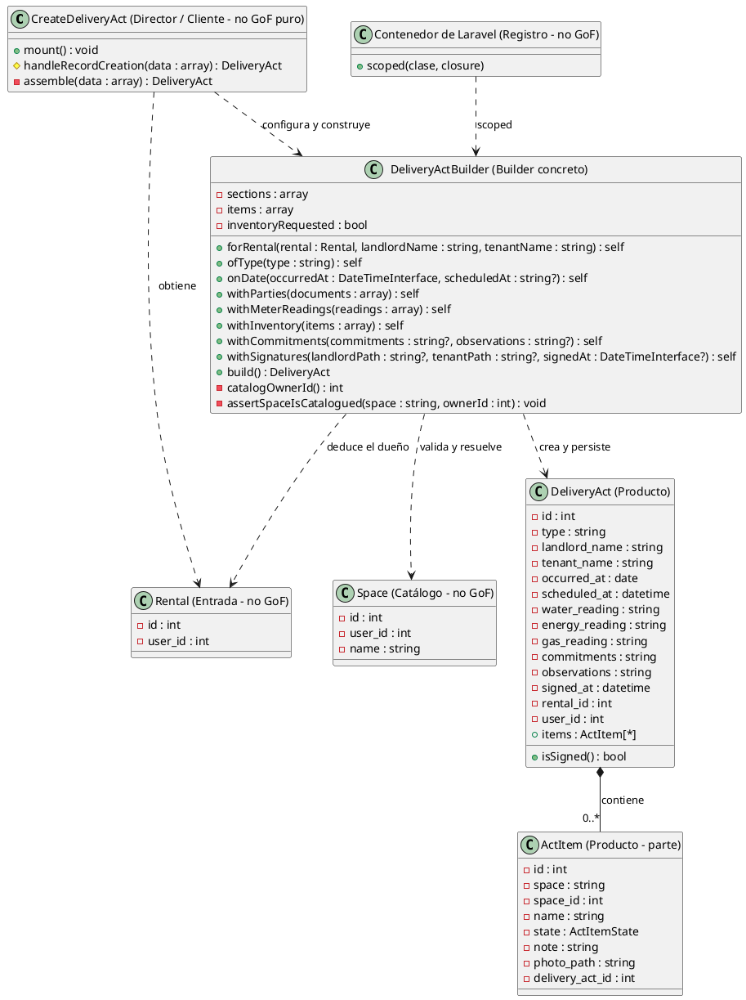

# Builder

## 1. Nombre y propósito

**Builder** separa la construcción de un objeto complejo de su representación final. El cliente indica qué partes debe tener el objeto, el Builder las acumula y valida, y `build()` entrega el producto terminado.

En Prometheus el producto es un acta de entrega y recepción. `DeliveryActBuilder` permite armar un acta con secciones obligatorias y secciones opcionales sin pasar una veintena de argumentos a un constructor.

## 2. Problema que resuelve en Prometheus

Un acta tiene datos obligatorios (alquiler, partes y fecha) y secciones que pueden existir o no:

- lecturas de medidores;
- inventario;
- compromisos y observaciones;
- firmas.

No es lo mismo **no leer un medidor** que **no aplicar la sección de medidores**. Un constructor con todos los parámetros obliga a decidir por posición y termina mezclando `null`, cadena vacía y “sección ausente”. Tampoco conviene que la pantalla arme el modelo a mano: las reglas de validación, el dueño del catálogo de espacios y la persistencia quedarían repartidas entre la vista y el modelo.

El Builder concentra esas decisiones: la pantalla declara qué secciones existen, el Builder valida cada una y `build()` persiste solamente lo que fue pedido.

## 3. Solución y roles

| Rol GoF | Implementación en Prometheus | Responsabilidad |
| --- | --- | --- |
| **Product** | `DeliveryAct` | Acta persistida que recibe las secciones. |
| **Product** (parte) | `ActItem` | Filas del inventario que pertenecen al acta. |
| **ConcreteBuilder** | `DeliveryActBuilder` | Acumular secciones, validar el inventario y construir/persistir el acta. |
| **Director / Client** (parcial) | `CreateDeliveryAct::assemble()` | Decidir qué secciones se piden y llamar a los métodos en orden. |
| **Client** | `CreateDeliveryAct` | Formulario, captura de errores y redirección. |
| **Registro** (no GoF) | `AppServiceProvider` | Registrar el Builder como `scoped`, una instancia por petición. |
| **Entrada** (no GoF) | `Rental` | Fuente del alquiler y del usuario dueño del acta. |
| **Catálogo** (no GoF) | `Space` | Espacios válidos del arrendador para el inventario. |

**Correspondencia con GoF.** No existe una interfaz `Builder` separada ni una clase `Director`: `DeliveryActBuilder` es el builder concreto y la pantalla cumple el papel de director al invocar los `with...`. Es un Builder pragmático: conserva la construcción por pasos y la separación entre cliente y producto, pero no la jerarquía abstracta del modelo clásico.

**Construcción por pasos.**

- `forRental()` fija `rental_id`, `user_id`, `landlord_name` y `tenant_name`. El `user_id` se deduce del alquiler y no se toma de un campo del formulario.
- `ofType()` define el tipo de acta. Si no se llama, `build()` usa `entrega`.
- `onDate()` fija `occurred_at` y, si se recibe una hora, arma `scheduled_at` con la fecha de la visita.
- `withParties()` incorpora los documentos de las partes.
- `withMeterReadings()` registra únicamente las lecturas recibidas.
- `withInventory()` marca que la sección fue pedida, reinicia los elementos, valida espacio y nombre, comprueba que el espacio exista en el catálogo del arrendador y normaliza el estado. Un estado desconocido cae en `BUENO`.
- `withCommitments()` y `withSignatures()` incorporan las secciones restantes.

**Cierre.** `build()` exige `rental_id`, `landlord_name`, `tenant_name` y `occurred_at`; crea el `DeliveryAct`, guarda y, si el inventario fue pedido y tiene elementos, resuelve cada `space_id` por nombre contra el catálogo del dueño del acta y crea los `ActItem`. Devuelve el acta con el inventario cargado. Las secciones que nunca se pidieron quedan en `null` y no se imprimen.

**Sin estado compartido.** El Builder es `scoped`, no singleton: acumula secciones e inventario mientras dura la petición. Una instancia global arrastraría los datos de un acta a la siguiente. No tiene un método `reset()`; la separación entre peticiones la garantiza el contenedor.

## 4. Diagrama de clases

No se dibuja una interfaz `Builder` porque el código no la tiene. Tampoco se dibuja un `Director` separado: ese papel lo cumple `CreateDeliveryAct::assemble()`.

## 5. Clases participantes y valoración

| Clase | Rol | Ruta | Responsabilidad |
| --- | --- | --- | --- |
| `DeliveryActBuilder` | Builder concreto | `app/Services/Acts/DeliveryActBuilder.php` | Acumular secciones, validar y persistir el acta. |
| `CreateDeliveryAct` | Director / Cliente | `app/Filament/Resources/DeliveryActResource/Pages/CreateDeliveryAct.php` | Decidir qué secciones se piden, invocar el Builder y manejar errores. |
| `DeliveryAct` | Producto | `app/Models/DeliveryAct.php` | Representar el acta y su inventario. |
| `ActItem` | Producto (parte) | `app/Models/ActItem.php` | Representar cada elemento del inventario. |
| `Rental` | Entrada | `app/Models/Rental.php` | Aportar el alquiler y el usuario dueño del acta. |
| `Space` | Catálogo | `app/Models/Space.php` | Validar los espacios del inventario por arrendador. |
| `AppServiceProvider` | Registro | `app/Providers/AppServiceProvider.php` | Registrar el Builder como `scoped`. |

### 5.1. Ventajas

- **Secciones explícitas:** una sección no pedida queda ausente; no se confunde con un valor vacío.
- **Construcción legible:** los `with...` encadenados describen el acta que se está armando.
- **Reglas centralizadas:** validación de obligatorios, inventario y catálogo viven en el Builder, no en la pantalla.
- **Producto consistente:** `build()` guarda el acta y su inventario en una sola operación.
- **Dueño derivado:** `user_id` sale del alquiler, no de un campo manipulable del formulario.
- **Errores controlados:** las reglas lanzan `RuntimeException` y la pantalla las muestra sin guardar un acta incompleta.
- **Aislamiento por petición:** el binding `scoped` evita que el estado de un acta se filtre a otra.

### 5.2. Desventajas

- **Sin interfaz Builder:** el cliente depende de la clase concreta; no se puede sustituir por otro builder sin cambiar el código.
- **Director acoplado a la pantalla:** la secuencia de construcción vive en `CreateDeliveryAct::assemble()`, no en un Director reutilizable.
- **No es idempotente:** cada llamada a `build()` crea y guarda un acta nueva; no está pensado para reconstruir el mismo objeto.
- **Estado acumulado:** reutilizar la misma instancia para dos actas en la misma petición mezclaría secciones e inventario. El `scoped` lo evita en el flujo normal, pero no impide un uso incorrecto.
- **Sin `reset()`:** no hay una forma explícita de vaciar el Builder para reutilizarlo.
- **Orden sensible:** `withInventory()` resuelve el dueño del catálogo con el alquiler si ya fue fijado; si se llama antes de `forRental()`, cae en el usuario autenticado.
- **Validación con efectos secundarios:** `withInventory()` consulta el catálogo y puede lanzar antes de `build()`; no es un simple acumulador.
- **Persistencia dentro del Builder:** `build()` guarda en base de datos, por lo que probarlo exige una base y no solo el armado en memoria.
- **Consultas por elemento:** cada fila del inventario resuelve su espacio con una consulta adicional al guardar.
