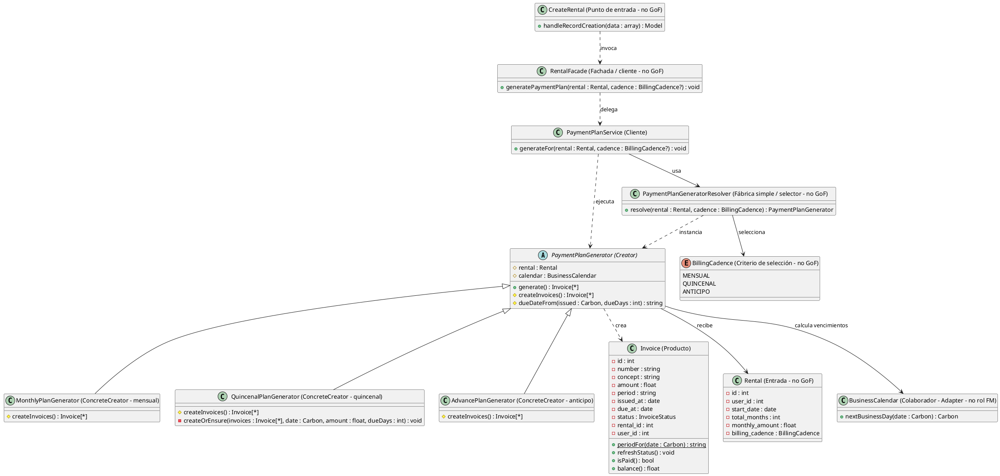

# Factory Method

## 1. Nombre y propósito

**Factory Method** define un método para crear un objeto, pero deja que las subclases decidan qué variante concreta se construye. El cliente trabaja con el creador abstracto y no necesita conocer las clases que participan en la creación.

En Prometheus el producto es la factura (`Invoice`) y el creador es el plan de cobros. `PaymentPlanGenerator` declara el método `createInvoices()` y las tres cadencias —mensual, quincenal y anticipo— deciden cuántas facturas crear, con qué fechas, montos y vencimientos. `PaymentPlanService` solo pide el generador y lo ejecuta.

## 2. Problema que resuelve en Prometheus

Un alquiler puede cobrarse de tres formas:

- **mensual:** una factura por cada mes del contrato;
- **quincenal:** dos facturas por mes, en los días 1 y 15;
- **anticipo:** una sola factura por el total del contrato.

Cada cadencia tiene sus propias reglas de cantidad, fecha de emisión, monto y vencimiento. Si `PaymentPlanService` conociera esas reglas, tendría un `match` grande con todos los cálculos y cada cadencia nueva obligaría a modificarlo.

También hay reglas comunes que no deben duplicarse:

- no volver a crear facturas que ya existen para el mismo alquiler y periodo;
- calcular el vencimiento como día hábil usando el `BusinessCalendar`;
- numerar las facturas por usuario y año;
- dejar las facturas en estado emitido y refrescar su estado después de crearlas.

El sistema necesita que el servicio no sepa de fechas ni de cantidades, que cada cadencia encapsule su política y que agregar una cadencia nueva no obligue a tocar el flujo principal.

## 3. Solución y roles

| Rol GoF | Implementación en Prometheus | Responsabilidad |
| --- | --- | --- |
| **Product** | `Invoice` | Factura creada por el plan de cobros. |
| **Creator** | `PaymentPlanGenerator` | Declarar `createInvoices()` y compartir el cálculo de vencimiento. |
| **ConcreteCreator** | `MonthlyPlanGenerator` | Crear una factura por mes de contrato. |
| **ConcreteCreator** | `QuincenalPlanGenerator` | Crear dos facturas por mes, en los días 1 y 15. |
| **ConcreteCreator** | `AdvancePlanGenerator` | Crear una factura por el total del contrato. |
| **Factory Method** | `PaymentPlanGenerator::createInvoices()` | Punto abstracto que cada cadencia implementa. |
| **Cliente** | `PaymentPlanService` | Elegir la cadencia, resolver el generador y ejecutarlo. |
| **Fábrica simple / selector** (no GoF) | `PaymentPlanGeneratorResolver` | Traducir `BillingCadence` a un generador concreto. |
| **Entrada** (no GoF) | `Rental` | Aportar cadencia, fechas, meses y monto. |
| **Criterio de selección** (no GoF) | `BillingCadence` | Enumerar las cadencias soportadas. |
| **Colaboradores** (no GoF) | `InvoiceNumberService`, `AppSettings`, `BusinessCalendar` | Numerar facturas, aportar días de plazo y calcular días hábiles. |
| **Fachada / cliente** (no GoF) | `RentalFacade` | Delegar en `PaymentPlanService` sin agregar reglas de facturación. |
| **Punto de entrada** (no GoF) | `CreateRental` | Invocar `RentalFacade::generatePaymentPlan()` después de crear el alquiler. |

**Correspondencia con GoF.** `PaymentPlanGenerator` es el creador abstracto y `MonthlyPlanGenerator`, `QuincenalPlanGenerator` y `AdvancePlanGenerator` son los creadores concretos. El método de fábrica es `createInvoices()`, que devuelve un arreglo de facturas.

`generate()` es el método plantilla que ejecuta la creación: llama a `createInvoices()` y devuelve las facturas creadas o existentes. La base también concentra `dueDateFrom()`, que suma los días de plazo y pide al `BusinessCalendar` el siguiente día hábil.

**Particularidad del dominio.** Las tres subclases producen la misma clase de producto, `Invoice`; lo que cambia es la política de creación (cantidad, fechas y montos), no el tipo de producto. Por eso el patrón se acerca también a Template Method. Se documenta como Factory Method porque el punto de variación es el método de creación y el cliente no conoce las subclases.

**Selección.** `PaymentPlanGeneratorResolver` no es el creador GoF: es una fábrica simple que instancia el creador concreto según `BillingCadence`. `PaymentPlanService` usa ese selector; si no recibe una cadencia explícita, toma la del alquiler o usa `MENSUAL`. Una cadencia no soportada lanza `InvalidArgumentException`.

**Entrada desde la pantalla.** `CreateRental` no conoce `PaymentPlanService`: después de guardar el alquiler llama `RentalFacade::generatePaymentPlan($rental)`, y la fachada delega en `PaymentPlanService::generateFor()`. La fachada es un punto de entrada, no un Creator ni un ConcreteCreator.

**Comportamiento de las cadencias.**

- `MonthlyPlanGenerator` recorre los meses del contrato, usa `addMonthsNoOverflow()` para no desplazar los cortes cuando el inicio cae a fin de mes, busca una factura existente por alquiler, usuario y periodo, y crea el monto mensual si no existe.
- `QuincenalPlanGenerator` genera dos cortes por mes, en los días 1 y 15, divide el monto mensual en dos y usa `createOrEnsure()` para no duplicar el mismo corte.
- `AdvancePlanGenerator` emite una sola factura en la fecha de inicio por `monthly_amount * total_months`.
- Las tres crean la factura con `InvoiceStatus::EMITIDA`, calculan el vencimiento con `dueDateFrom()` y llaman a `refreshStatus()` después de crearla o recuperarla.

`InvoiceNumberService` asigna el número por usuario y año; `AppSettings` aporta `invoiceDueDays`; `BusinessCalendar` resuelve el siguiente día hábil. Las facturas nacen sin pagos y con saldo pendiente.

## 4. Diagrama de clases

Los colaboradores `InvoiceNumberService` y `AppSettings` participan en las tres cadencias, pero se omiten del diagrama para no repetir las mismas dependencias en cada subclase.

## 5. Clases participantes y valoración

| Clase | Rol | Ruta | Responsabilidad |
| --- | --- | --- | --- |
| `PaymentPlanGenerator` | Creator | `app/Services/PaymentPlans/PaymentPlanGenerator.php` | Declarar `createInvoices()`, `generate()` y el cálculo común de vencimiento. |
| `MonthlyPlanGenerator` | ConcreteCreator | `app/Services/PaymentPlans/MonthlyPlanGenerator.php` | Crear una factura por mes de contrato. |
| `QuincenalPlanGenerator` | ConcreteCreator | `app/Services/PaymentPlans/QuincenalPlanGenerator.php` | Crear dos facturas por mes, en los días 1 y 15. |
| `AdvancePlanGenerator` | ConcreteCreator | `app/Services/PaymentPlans/AdvancePlanGenerator.php` | Crear una factura por el total del contrato. |
| `Invoice` | Product | `app/Models/Invoice.php` | Factura persistida, con periodo, vencimiento y estado. |
| `PaymentPlanService` | Cliente | `app/Services/PaymentPlanService.php` | Elegir la cadencia, resolver el generador y ejecutarlo. |
| `PaymentPlanGeneratorResolver` | Fábrica simple / selector | `app/Services/PaymentPlans/PaymentPlanGeneratorResolver.php` | Mapear `BillingCadence` a un creador concreto. |
| `BillingCadence` | Criterio de selección | `app/Enums/BillingCadence.php` | Enumerar `MENSUAL`, `QUINCENAL` y `ANTICIPO`. |
| `Rental` | Entrada | `app/Models/Rental.php` | Aportar cadencia, fechas, meses y monto. |
| `InvoiceNumberService` | Colaborador | `app/Services/InvoiceNumberService.php` | Asignar el número de factura por usuario y año. |
| `AppSettings` | Colaborador | `app/Settings/AppSettings.php` | Aportar los días de plazo para el vencimiento. |
| `BusinessCalendar` | Colaborador / Adapter | `app/Contracts/BusinessCalendar.php` | Resolver el siguiente día hábil. |
| `RentalFacade` | Fachada / cliente | `app/Services/RentalFacade.php` | Delegar `generatePaymentPlan()` en `PaymentPlanService`. |
| `CreateRental` | Punto de entrada | `app/Filament/Resources/RentalResource/Pages/CreateRental.php` | Generar el plan a través de `RentalFacade` después de crear el alquiler. |

### 5.1. Ventajas

- **Servicio delgado:** `PaymentPlanService` no contiene cálculos de fechas, montos ni cantidades.
- **Políticas encapsuladas:** cada cadencia concentra sus reglas y se puede probar por separado.
- **Extensión localizada:** una cadencia nueva agrega una subclase y su entrada en el selector; el flujo del servicio no cambia.
- **Lógica común reutilizada:** `generate()` y `dueDateFrom()` viven en la base y las tres subclases los heredan.
- **Idempotencia:** cada creador evita duplicar facturas existentes para el mismo alquiler y periodo.
- **Dependencias explícitas:** numeración, ajustes y calendario se inyectan; no se consultan globalmente dentro de las subclases.
- **Vencimientos consistentes:** todas las cadencias usan `BusinessCalendar`, no cálculos propios de días hábiles.
- **Selección centralizada:** el resolver traduce la cadencia y falla de forma explícita si no está soportada.
- **Resultado reutilizable:** `generate()` devuelve las facturas creadas o existentes para quien necesite informar el resultado.

### 5.2. Desventajas

- **Un solo tipo de producto:** las tres subclases crean `Invoice`; la variación está en la política, no en una jerarquía de productos. El patrón se acerca a Template Method.
- **No es totalmente abierto/cerrado:** una cadencia nueva obliga a tocar el enum, el resolver y agregar la subclase.
- **Persistencia dentro del creador:** `createInvoices()` consulta y guarda en base de datos; no es una creación pura en memoria y exige pruebas con base.
- **Idempotencia repetida:** cada subclase implementa sus consultas de no duplicación; una regla nueva debe replicarse con cuidado.
- **Constructores duplicados:** las tres subclases repiten las dependencias de numeración y ajustes.
- **Acoplamiento del resolver:** instancia las clases concretas con `new`, por lo que agregar o cambiar una cadencia toca ese punto.
- **Método de fábrica protegido:** `createInvoices()` no es público; el cliente siempre pasa por `generate()`, lo que limita probar la creación aislada.
- **Resultado ignorado:** `PaymentPlanService` no usa el arreglo que devuelve `generate()`, aunque el método lo expone.
- **Cálculo de vencimiento compartido pero dependiente de ajustes:** la base necesita que las subclases le pasen `dueDays`, que obtienen de `AppSettings`.
