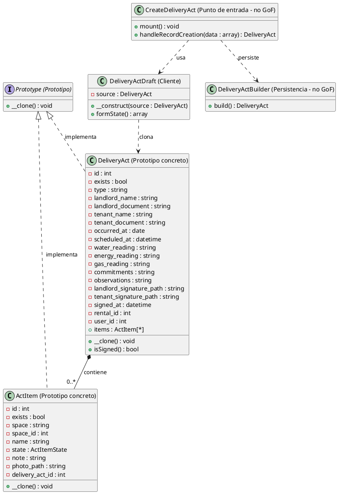

# Prototype

## 1. Nombre y propósito

**Prototype** crea objetos nuevos copiando una instancia existente, en lugar de construirlos desde cero. El cliente pide una copia al prototipo y trabaja sobre ella; no necesita conocer todos los atributos ni volver a armarlos.

En Prometheus el patrón se usa para crear un acta de entrega a partir de otra. La copia conserva la estructura del acta y todo el inventario, pero descarta lo que pertenece al evento anterior: firmas, lecturas, compromisos, observaciones y programación. La fecha de la visita se redefine al día actual.

## 2. Problema que resuelve en Prometheus

Un acta de entrega contiene:

- datos del alquiler y de las partes;
- lecturas de medidores;
- un inventario de elementos, cada uno con espacio, nombre, estado, nota y foto;
- compromisos, observaciones y firmas.

Cuando se hace una visita posterior sobre el mismo inmueble, buena parte de esa estructura se repite. Volver a digitar el inventario completo es lento y propenso a errores, y además impide aprovechar que el acta anterior ya contiene el estado de los mismos elementos.

Tampoco servía copiar la fila del acta y dejar que el usuario reconstruyera el inventario a mano: el inventario es justamente la parte costosa. Y guardar una copia automática antes de que el arrendador la revise tampoco era aceptable: la copia debía ser un borrador editable, no un acta nueva creada sin revisión.

El sistema necesitaba conservar la estructura y el inventario, limpiar los datos del evento anterior, producir un objeto independiente y dejar que el usuario revise antes de guardar.

## 3. Solución y roles

| Rol GoF | Implementación en Prometheus | Responsabilidad |
| --- | --- | --- |
| **Prototype** | `App\Contracts\Prototype` | Declarar que el objeto sabe copiarse mediante `__clone()`. |
| **ConcretePrototype** | `App\Models\DeliveryAct` | Copiar el acta, limpiar el evento anterior y clonar el inventario. |
| **ConcretePrototype** | `App\Models\ActItem` | Copiar cada elemento y descartar su identidad y llaves foráneas. |
| **Client** | `App\Services\Acts\DeliveryActDraft` | Pedir el clon y traducirlo al estado del formulario. |
| **Punto de entrada** (no GoF) | `CreateDeliveryAct` y la acción `derive` | Abrir el formulario con `?from=<id>` y recibir el estado. |
| **Persistencia** (no GoF) | `DeliveryActBuilder` | Armar y guardar el acta nueva. |

La interfaz es deliberadamente mínima:

```php
interface Prototype
{
    public function __clone(): void;
}
```

No declara atributos ni un método `copy()`: aprovecha la palabra clave `clone` de PHP. Cuando se ejecuta `clone $acta`, PHP crea una copia superficial y luego invoca automáticamente `DeliveryAct::__clone()`. Ese método es el que convierte la copia en una copia profunda.

**Copia profunda.** `clone` copia los valores de las propiedades, pero no los objetos referenciados. Si solo se clonara `DeliveryAct`, la copia seguiría apuntando a la misma colección de `ActItem` y modificar un elemento del borrador terminaría modificando el acta original. Por eso `DeliveryAct::__clone()` recorre el inventario y clona cada `ActItem` por separado.

El orden de la copia importa: `__clone()` lee primero `$this->items`, usando todavía el `id` original, y solo después limpia la identidad del acta. Si borrara el `id` antes, Eloquent no tendría la llave para cargar la relación y la copia llegaría sin inventario.

**Política de copia:**

| Grupo | Datos | Resultado |
| --- | --- | --- |
| Se conserva | `rental_id`, `user_id`, `type`, nombres y documentos de las partes, inventario (`space`, `name`, `state`, `note`, `photo_path`) | La copia mantiene la estructura y lo costoso de rehacer. |
| Se limpia | `id`, `exists`, `scheduled_at`, lecturas, `commitments`, `observations`, firmas, `signed_at`, `delivery_act_id` y `space_id` de los elementos | Esos datos pertenecen al evento anterior o a la identidad del registro. |
| Se redefine | `occurred_at` | La nueva visita es de hoy. |

La foto se conserva por **ruta**, no se duplica el archivo. El Builder resuelve el `space_id` por nombre al guardar, por eso la copia no necesita arrastrar esa llave.

**Flujo.** La acción `derive` de la tabla abre `CreateDeliveryAct` con `?from=<id>`. La página busca el acta con `DeliveryActResource::getEloquentQuery()`, que limita los resultados al usuario actual; si el acta no existe o es ajena, el formulario queda vacío. Luego `DeliveryActDraft` clona el acta y llena el formulario. Al guardar, `DeliveryActBuilder` valida y persiste un acta nueva; el original no se modifica.

## 4. Diagrama de clases



La cardinalidad es `0..*` y no `1..*`: el inventario es opcional. El formulario permite crear un acta sin elementos y el Builder solo persiste el inventario cuando se solicitó una sección con al menos un elemento.

## 5. Clases participantes y valoración

| Clase | Rol | Ruta | Responsabilidad |
| --- | --- | --- | --- |
| `Prototype` | Prototype | `app/Contracts/Prototype.php` | Declarar que el objeto sabe copiarse mediante `__clone()`. |
| `DeliveryAct` | ConcretePrototype | `app/Models/DeliveryAct.php` | Copiar el acta, limpiar el evento anterior y clonar el inventario. |
| `ActItem` | ConcretePrototype | `app/Models/ActItem.php` | Copiar cada elemento y descartar su identidad y llaves foráneas. |
| `DeliveryActDraft` | Client | `app/Services/Acts/DeliveryActDraft.php` | Pedir el clon y traducirlo al estado exacto del formulario. |
| `CreateDeliveryAct` | Punto de entrada (no GoF) | `app/Filament/Resources/DeliveryActResource/Pages/CreateDeliveryAct.php` | Leer `?from=`, obtener el acta con alcance por usuario, prellenar el formulario y persistir con el Builder. |
| `DeliveryActResource` | Punto de entrada (no GoF) | `app/Filament/Resources/DeliveryActResource.php` | Ofrecer la acción `derive` y limitar las actas al usuario actual. |
| `DeliveryActBuilder` | Persistencia (no GoF) | `app/Services/Acts/DeliveryActBuilder.php` | Armar y guardar el acta nueva a partir del estado del formulario. |

### 5.1. Ventajas

- **Reutilización del inventario:** lo costoso de rehacer se conserva.
- **Copia independiente:** modificar el borrador no altera el acta firmada.
- **Limpieza centralizada:** las reglas de qué datos pertenecen al evento anterior viven en `__clone()`.
- **Flujo seguro:** la copia existe en memoria hasta que el usuario la revisa y guarda.
- **Compatibilidad con la política del acta:** como el acta no se edita, corregir significa crear otra; Prototype facilita esa creación.
- **Menos duplicación:** el cliente no necesita conocer todos los campos del acta para copiarla.

### 5.2. Desventajas

- **Mantenimiento manual de la limpieza:** cada campo nuevo que describa el evento anterior debe limpiarse en `__clone()`. Si se olvida, el dato se filtra a la copia.
- **Timestamps no se limpian:** `created_at` y `updated_at` viajan con el clon. No afectan porque la copia no se guarda directamente, pero conviene tenerlo presente si se reutiliza el clon fuera de este flujo.
- **La foto no se duplica:** se conserva la misma ruta. La copia no es independiente a nivel de archivo.
- **Dependencia de la relación cargada:** el clon necesita leer `items` antes de borrar el `id`. Si se cambia ese orden, el inventario se pierde.
- **No hay Prototype Registry:** cada acta se copia de una acta concreta; no existe un catálogo de prototipos reutilizables.
- **No es una copia genérica:** el patrón está implementado en los modelos del acta, no como un mecanismo reutilizable para cualquier entidad.
