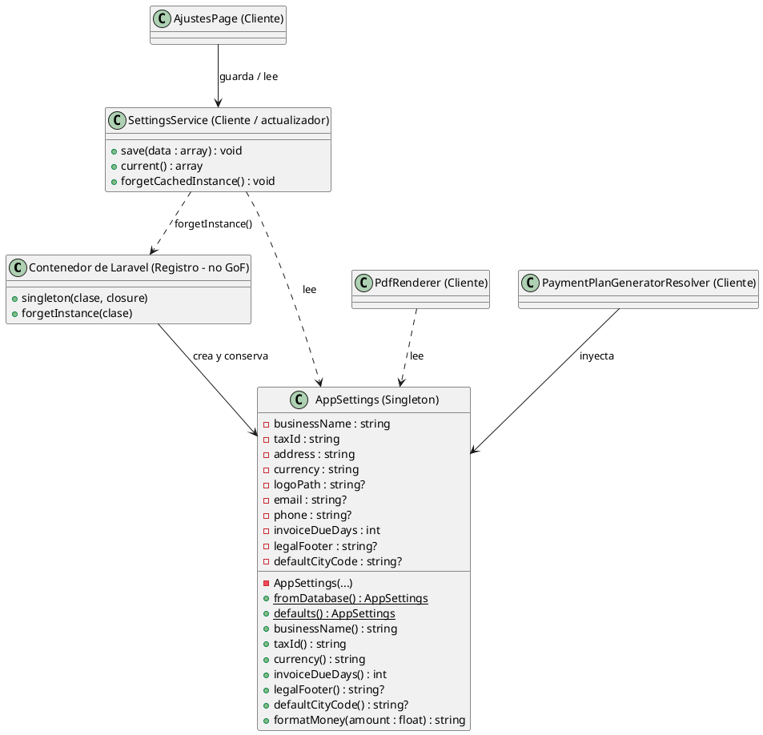
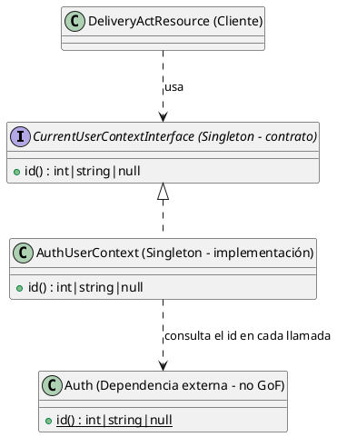

# Singleton

## 1. Nombre y propósito

**Singleton** garantiza que una clase tenga una única instancia accesible desde un punto conocido y que esa instancia no pueda construirse libremente desde cualquier parte del sistema.

En Prometheus el caso principal es `AppSettings`: la configuración de la empresa (razón social, NIT, moneda, datos de contacto, plazo de pago y textos legales) se lee una vez y se comparte durante toda la petición. El segundo caso es `CurrentUserContextInterface`, que expone el identificador del usuario autenticado sin almacenarlo.

## 2. Problema que resuelve en Prometheus

Los datos de la empresa los necesitan muchas partes del sistema:

- las pantallas de facturas, alquileres y reajustes, para mostrar la moneda;
- los documentos PDF y de texto, para imprimir la razón social, el NIT y el pie legal;
- los planes de cobro, para conocer el plazo de vencimiento;
- la pantalla de propiedades, para proponer la ciudad predeterminada;
- la pantalla de ajustes, para editarlos.

Si cada consumidor consultara la tabla `app_settings` por su cuenta, una misma petición podría trabajar con snapshots distintos. El caso más visible sería guardar los ajustes y generar un documento en el mismo minuto: una parte del sistema vería el NIT nuevo y otra el anterior.

Tampoco convenía pasar todos esos datos como parámetros en cada llamada: eso duplicaría la información, haría crecer las firmas de los métodos y obligaría a tocar cada consumidor cuando se agregara un dato de la empresa.

La configuración tiene tres características que justifican el patrón:

1. Es **única para toda la empresa**, no varía por usuario ni por alquiler.
2. Es **de solo lectura** durante la petición.
3. La consultan **muchos consumidores distintos**.

## 3. Solución y roles

| Rol GoF | Implementación en Prometheus | Responsabilidad |
| --- | --- | --- |
| **Singleton** | `AppSettings` | Mantener una única configuración inmutable de la empresa. |
| **Singleton** (segunda aplicación) | `CurrentUserContextInterface` / `AuthUserContext` | Exponer el usuario actual sin guardar su identidad. |
| **Cliente** | `PdfRenderer`, `InvoiceResource`, `PropertyResource`, `PaymentPlanGeneratorResolver` | Consumir la configuración compartida. |
| **Cliente / actualizador indirecto** | `AjustesPage` | Leer y guardar la configuración a través de `SettingsService`. |
| **Cliente / actualizador** | `SettingsService` | Guardar la fila única y descartar la instancia para forzar una nueva lectura. |
| **Registro** (no GoF) | Contenedor de Laravel | Crear y conservar la instancia; no forma parte del modelo clásico del patrón. |

`AppSettings` es una clase `final` con constructor privado y propiedades `readonly`. Se construye mediante dos fábricas estáticas:

- `fromDatabase()`: lee la fila `id = 1` de `app_settings`.
- `defaults()`: devuelve valores mínimos cuando todavía no existe configuración guardada.

La instancia se registra así:

```php
$this->app->singleton(AppSettings::class, fn () => AppSettings::fromDatabase());
```

La primera resolución ejecuta `fromDatabase()`; las siguientes, dentro del mismo ciclo de vida, devuelven exactamente la misma instancia.

**Correspondencia con GoF.** En el patrón clásico la propia clase conserva su instancia en una propiedad estática. Aquí la conserva el contenedor de Laravel. `AppSettings` impide `new AppSettings(...)` con el constructor privado, pero sus fábricas estáticas públicas sí pueden crear instancias adicionales. Por eso se documenta como un **Singleton de contenedor**: la unicidad la garantiza el binding, no la clase por sí sola.

**Refresco controlado.** `SettingsService::save()` actualiza la fila única y ejecuta `forgetCachedInstance()`, que llama a `forgetInstance(AppSettings::class)`. Sin ese descarte, el resto de la petición seguiría viendo la configuración anterior y un documento generado inmediatamente después de guardar mostraría el NIT viejo.

**Contexto del usuario.** `AuthUserContext` no guarda el identificador: cada llamada a `id()` delega en `Auth::id()`. Esa ausencia de estado es lo que hace seguro compartir una única instancia.

## 4. Diagrama de clases

### 4.1. Configuración de la empresa



### 4.2. Contexto del usuario



## 5. Clases participantes y valoración

| Clase | Rol | Ruta | Responsabilidad |
| --- | --- | --- | --- |
| `AppSettings` | Singleton | `app/Settings/AppSettings.php` | Mantener inmutable la configuración de la empresa y formatear montos. |
| Contenedor de Laravel | Registro (no GoF) | `app/Providers/AppServiceProvider.php` | Registrar `AppSettings` como singleton. |
| `SettingsService` | Cliente / actualizador | `app/Services/SettingsService.php` | Guardar la fila única, leer los valores y descartar la instancia. |
| `AjustesPage` | Cliente | `app/Filament/Pages/AjustesPage.php` | Formulario de configuración; guarda y vuelve a leer. |
| `PdfRenderer` | Cliente | `app/Documents/Rendering/PdfRenderer.php` | Usa la configuración para renderizar documentos PDF. |
| `DocumentAction` | Cliente | `app/Filament/Support/DocumentAction.php` | Consulta la configuración al generar documentos. |
| `InvoiceResource` | Cliente | `app/Filament/Resources/InvoiceResource.php` | Usa moneda y días de vencimiento. |
| `PropertyResource` | Cliente | `app/Filament/Resources/PropertyResource.php` | Usa la ciudad predeterminada. |
| `PaymentPlanGeneratorResolver` | Cliente | `app/Services/PaymentPlans/PaymentPlanGeneratorResolver.php` | Inyecta la configuración en los generadores de cobro. |
| `CurrentUserContextInterface` | Singleton (contrato) | `app/Contracts/CurrentUserContextInterface.php` | Declarar el acceso al usuario actual. |
| `AuthUserContext` | Singleton (implementación) | `app/Infrastructure/AuthUserContext.php` | Delegar en `Auth::id()` sin cachear el usuario. |

Los campos actuales de `AppSettings` son `businessName`, `taxId`, `address`, `currency`, `logoPath`, `email`, `phone`, `invoiceDueDays`, `legalFooter` y `defaultCityCode`. La tabla `app_settings` está diseñada para una sola fila (`id = 1`); `SettingsService::save()` usa `updateOrInsert(['id' => 1], ...)`, de modo que guardar siempre actualiza la misma configuración.

### 5.1. Ventajas

- **Consistencia:** todos los consumidores de una petición usan el mismo snapshot de la configuración.
- **Menos consultas:** la fila se lee una vez, no una vez por pantalla o documento.
- **Fuente única:** la razón social, el NIT, la moneda y los textos legales viven en un solo lugar.
- **Inmutabilidad:** las propiedades son `readonly`; nadie puede alterar la instancia en medio de la petición.
- **Refresco controlado:** `SettingsService` descarta la instancia después de guardar, de modo que el cambio se ve en la siguiente lectura.
- **Arranque seguro:** si no hay fila, `defaults()` permite operar con valores mínimos.

### 5.2. Desventajas

- **No es un Singleton clásico:** las fábricas estáticas `fromDatabase()` y `defaults()` son públicas y pueden crear instancias adicionales. La unicidad depende del contenedor.
- **Estado global:** `AppSettings` es compartida por toda la aplicación. Si en el futuro la configuración debe variar por arrendador, este diseño deja de ser correcto.
- **Dependencia oculta:** varias pantallas de Filament usan `app(AppSettings::class)` en lugar de recibirla por constructor. Es cómodo en la capa de presentación, pero oculta la dependencia.
- **Alcance según el runtime:** el binding está pensado para una instancia por petición. En procesos de larga vida hay que revisar si la instancia debe descartarse entre ejecuciones.
- **Invalidación manual:** si se guarda la configuración sin usar `SettingsService`, la instancia vieja sigue viva hasta que se descarte explícitamente.
- **El contexto del usuario debe seguir sin estado:** si `AuthUserContext` llegara a cachear el `id`, compartir la instancia entre peticiones sería un error.
