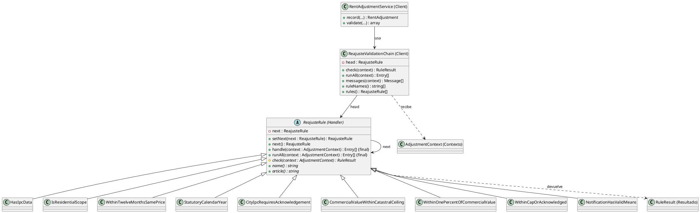
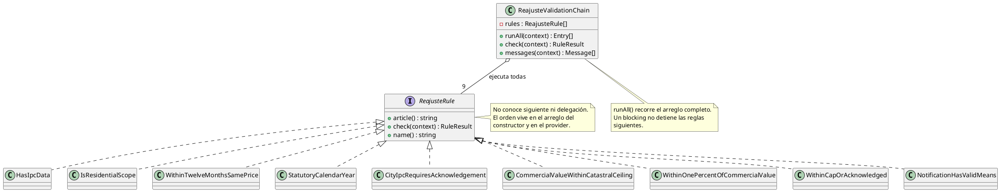
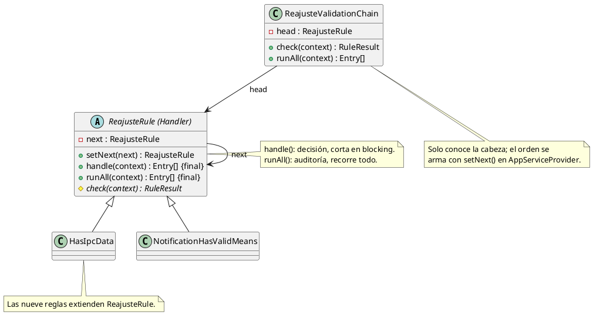

# Chain of Responsibility

## 1. Nombre y propósito

**Chain of Responsibility** encadena manejadores para procesar una petición: cada manejador decide si la atiende, si la delega al siguiente o si corta la cadena. El cliente solo conoce el primero y no necesita saber cuántos hay ni en qué orden están.

En Prometheus se aplica a la **validación de reajustes del canon** (artículos 18 y 20 de la Ley 820 de 2003). `ReajusteRule` es la clase base de los manejadores; las nueve reglas concretas comprueban un aspecto distinto del mismo `AdjustmentContext`; `AppServiceProvider` arma la cadena con `setNext()`; y `ReajusteValidationChain` es el punto de entrada que usa `RentAdjustmentService`.

La implementación tiene dos recorridos deliberadamente distintos:

- **decisión** (`handle()`): se detiene en la primera regla que devuelve `blocking`;
- **auditoría** (`runAll()`): recorre todas las reglas para alimentar el panel de comprobaciones.

## 2. Problema que resuelve en Prometheus

Un reajuste debe cumplir varias comprobaciones independientes: que exista el IPC, que el inmueble sea residencial, que hayan pasado doce meses bajo el mismo precio, que el año del IPC sea el legal, que la base sea nacional o esté reconocida, que el valor comercial no supere el avalúo catastral, que el canon no exceda el uno por ciento, que no supere el tope sin confirmación y que la notificación tenga un medio válido.

Antes de este cambio:

- `ReajusteRule` era una interfaz sin sucesor ni delegación;
- `ReajusteValidationChain` guardaba un arreglo de reglas y ejecutaba **todas** siempre;
- el orden estaba duplicado: un arreglo por defecto dentro de la cadena y otro en `AppServiceProvider`;
- las reglas posteriores a un bloqueo se ejecutaban aunque dependieran de un dato que ya faltaba.

Eso funcionaba para mostrar mensajes, pero no era una cadena GoF y no permitía que una regla estructural cortara la decisión. El caso concreto es el IPC: sin IPC no se puede emitir una carta, y seguir evaluando importes produce ruido sobre una decisión que ya está tomada.

Al mismo tiempo, la pantalla **necesita** ver todos los avisos, incluso los posteriores a un bloqueo, porque el arrendador debe revisarlos y confirmarlos. Por eso el patrón no podía limitarse a cortar todo: hacía falta separar la decisión de la auditoría.

## 3. Solución y roles del patrón

`ReajusteRule` concentra el enlace y los dos recorridos. Cada regla solo implementa su comprobación. La cadena se arma una vez en el contenedor y el servicio consume una fachada estable.

```text
AppServiceProvider
  -> HasIpcData
       -> IsResidentialScope
            -> WithinTwelveMonthsSamePrice
                 -> StatutoryCalendarYear
                      -> CityIpcRequiresAcknowledgement
                           -> CommercialValueWithinCatastralCeiling
                                -> WithinOnePercentOfCommercialValue
                                     -> WithinCapOrAcknowledged
                                          -> NotificationHasValidMeans
```

| Rol GoF | Implementación en Prometheus | Responsabilidad |
| --- | --- | --- |
| **Handler** | `ReajusteRule` | Guardar el sucesor, exponer `setNext()`, `handle()` y `runAll()`. |
| **ConcreteHandler** | `HasIpcData` | Bloquear si no existe el IPC del año que la ley manda. |
| **ConcreteHandler** | `IsResidentialScope` | Avisar si el inmueble no es vivienda urbana. |
| **ConcreteHandler** | `WithinTwelveMonthsSamePrice` | Avisar si el reajuste se hace antes de doce meses bajo el mismo precio. |
| **ConcreteHandler** | `StatutoryCalendarYear` | Avisar si el IPC elegido no es el del año calendario anterior. |
| **ConcreteHandler** | `CityIpcRequiresAcknowledgement` | Avisar si se usa IPC de ciudad sin reconocimiento. |
| **ConcreteHandler** | `CommercialValueWithinCatastralCeiling` | Avisar si el valor comercial supera dos avalúos catastrales. |
| **ConcreteHandler** | `WithinOnePercentOfCommercialValue` | Avisar si el canon supera el uno por ciento del valor comercial. |
| **ConcreteHandler** | `WithinCapOrAcknowledged` | Avisar si el incremento supera el IPC sin confirmación. |
| **ConcreteHandler** | `NotificationHasValidMeans` | Avisar si el medio de notificación no es el que nombra el artículo 20. |
| **Client** | `ReajusteValidationChain` | Exponer `check()`, `runAll()`, `messages()`, `ruleNames()` y `rules()`. |
| **Client** | `RentAdjustmentService` | Construir el contexto, decidir si guarda y mostrar mensajes. |
| **Contexto** | `AdjustmentContext` | Datos que las reglas pueden mirar. |
| **Resultado** | `RuleResult` | Gravedad (`info`, `warning`, `blocking`), mensaje, artículo y contexto. |
| **Composición** | `AppServiceProvider` | Único lugar donde vive el orden de la cadena. |

**Modo decisión.** `handle()` ejecuta `check()` y, si el resultado es `blocking`, devuelve lo recogido sin delegar en el siguiente. Es el modo que usa `check()` de la cadena y, por tanto, `RentAdjustmentService::record()` para saber si puede guardar.

**Modo auditoría.** `runAll()` recorre toda la cadena aunque una regla bloquee. Es el modo que usa `messages()` para que el panel de comprobaciones conserve todos los avisos. No se usa para decidir si se guarda.

**Por qué los avisos no cortan.** Un `warning` no es un dato faltante: es una decisión que el arrendador debe conocer y confirmar. Cortar en un aviso ocultaría el resto de comprobaciones y rompería el flujo de consentimiento. Solo el `blocking` corta, y hoy solo lo produce `HasIpcData`.

**Una sola composición.** El orden de las reglas vive únicamente en `AppServiceProvider`. La cadena recibe la cabeza y la recorre con `next()`, sin guardar una copia paralela del arreglo.

## 4. Diagrama de clases



`AppServiceProvider` no se dibuja como clase para no mezclar el contenedor con el patrón; su papel es encadenar los nueve manejadores en el orden indicado.

## 5. Clases participantes y valoración

| Clase | Ruta | Rol | Participación |
| --- | --- | --- | --- |
| `ReajusteRule` | `app/Services/Adjustment/Validation/ReajusteRule.php` | Handler | Enlace, `setNext()`, `handle()` de decisión y `runAll()` de auditoría. |
| `HasIpcData` | `app/Services/Adjustment/Validation/HasIpcData.php` | ConcreteHandler | Único bloqueo actual: falta el IPC o su variación anual. |
| `IsResidentialScope` | `app/Services/Adjustment/Validation/IsResidentialScope.php` | ConcreteHandler | Alcance de la Ley 820 (vivienda urbana). |
| `WithinTwelveMonthsSamePrice` | `app/Services/Adjustment/Validation/WithinTwelveMonthsSamePrice.php` | ConcreteHandler | Plazo de doce meses bajo el mismo precio. |
| `StatutoryCalendarYear` | `app/Services/Adjustment/Validation/StatutoryCalendarYear.php` | ConcreteHandler | Año calendario inmediatamente anterior. |
| `CityIpcRequiresAcknowledgement` | `app/Services/Adjustment/Validation/CityIpcRequiresAcknowledgement.php` | ConcreteHandler | IPC de ciudad vs. total nacional. |
| `CommercialValueWithinCatastralCeiling` | `app/Services/Adjustment/Validation/CommercialValueWithinCatastralCeiling.php` | ConcreteHandler | Valor comercial vs. dos avalúos. |
| `WithinOnePercentOfCommercialValue` | `app/Services/Adjustment/Validation/WithinOnePercentOfCommercialValue.php` | ConcreteHandler | Canon vs. uno por ciento del valor comercial. |
| `WithinCapOrAcknowledged` | `app/Services/Adjustment/Validation/WithinCapOrAcknowledged.php` | ConcreteHandler | Incremento vs. IPC y confirmación. |
| `NotificationHasValidMeans` | `app/Services/Adjustment/Validation/NotificationHasValidMeans.php` | ConcreteHandler | Medio de notificación del artículo 20. |
| `ReajusteValidationChain` | `app/Services/Adjustment/Validation/ReajusteValidationChain.php` | Client / fachada | Punto de entrada estable para el servicio. |
| `RentAdjustmentService` | `app/Services/RentAdjustmentService.php` | Client | Construye el contexto y aplica el veredicto. |
| `AdjustmentContext` | `app/Services/Adjustment/Validation/AdjustmentContext.php` | Contexto | Datos compartidos por las reglas. |
| `RuleResult` | `app/Services/Adjustment/Validation/RuleResult.php` | Resultado | Gravedad, mensaje, artículo y contexto. |
| `AppServiceProvider` | `app/Providers/AppServiceProvider.php` | Composición | Arma la cadena con `setNext()`. |

### 5.1. Ventajas

- **Corte con sentido:** un dato faltante detiene la decisión sin ejecutar reglas que dependen de él.
- **Una sola composición:** el orden vive en el provider; la cadena ya no guarda una copia que pueda desincronizarse.
- **Extensión localizada:** agregar una regla es crear la clase y encadenarla, sin tocar `RentAdjustmentService`.
- **Dos modos explícitos:** decisión y auditoría están separados por nombre y por método, no por un flag enterrado en el cliente.
- **Feedback completo:** la pantalla sigue recibiendo todos los avisos aunque exista un bloqueo.
- **Reglas puras:** las reglas no escriben ni lanzan excepciones; el servicio conserva la decisión de guardar.
- **Contratos intactos:** `record()`, `validate()` y `RentalFacade::validateAdjustment()` mantienen su firma y su comportamiento observable.

### 5.2. Desventajas

- **Dos recorridos que mantener:** `handle()` y `runAll()` deben seguir teniendo la misma semántica de orden; si se agrega una regla con efectos secundarios, la auditoría los ejecutaría aunque la decisión se haya cortado.
- **Resultado compuesto en arreglos:** `handle()` devuelve entradas `rule/result`; no es un retorno clásico de un solo valor. Se eligió así para no perder el detalle que ya consumía la UI.
- **Corte dependiente de la severidad:** solo `blocking` corta. Si una regla futura necesita cortar por otra razón, habrá que modelarlo explícitamente.
- **Orden crítico:** el orden sigue siendo una decisión de composición. Moverlo mal cambia la calidad de los mensajes aunque no la validez del cálculo.
- **Acoplamiento al contenedor:** la cadena se resuelve como singleton; en pruebas unitarias se construye con una cabeza falsa, pero la composición real solo se valida en integración.

## 6. Flujo de una llamada

**Registrar un reajuste (`RentAdjustmentService::record`):**

1. El servicio resuelve la estrategia IPC y construye el `AdjustmentContext` con el snapshot legal.
2. Llama a `ReajusteValidationChain::check($context)`.
3. La cadena toma la cabeza y ejecuta `handle()`.
4. Cada regla ejecuta su `check()`. Si devuelve `blocking`, la cadena se detiene; si devuelve `warning` o `info`, delega en la siguiente.
5. `check()` resume los resultados recogidos con `RuleResult::summary()`.
6. Si el resumen es bloqueante, el servicio lanza `RuntimeException` y no guarda. Si no, continúa con las validaciones de consentimiento y observaciones, y persiste.

**Previsualizar / validar en el formulario (`RentAdjustmentService::validate`):**

1. El servicio construye el contexto (el IPC puede ser `null` si no hay datos).
2. `check()` devuelve el resumen con el modo decisión.
3. `messages()` recorre la cadena con `runAll()` y devuelve **todos** los mensajes con severidad y artículo, incluidos los posteriores a un bloqueo.
4. La pantalla muestra el resumen y el detalle, sin decidir por su cuenta si el reajuste es válido.

**Orden de las reglas.** Primero las estructurales (IPC, alcance, plazo, año, ciudad), después las de importe (valor comercial, uno por ciento, tope) y al final la de notificación. El orden no cambia el resultado jurídico, pero sí la calidad del feedback: un aviso de importe sobre un reajuste sin IPC sería ruido.

## 7. Pruebas

| Prueba / evidencia | Qué respalda |
| --- | --- |
| `tests/Unit/ReajusteValidationChainTest.php` | `handle()` corta en el primer bloqueo; `runAll()` recorre toda la cadena; `messages()` conserva avisos posteriores; un aviso no corta; `ruleNames()` respeta el orden de `setNext()`. |
| `tests/Feature/AdjustmentChainTest.php` | Reglas del artículo 18 y 20 en el flujo real de reajustes: alcance comercial, uno por ciento, avalúo catastral, IPC de ciudad y comunicación. |
| `tests/Feature/RentAdjustmentServiceTest.php` | Registro, bloqueo por IPC faltante, confirmaciones, notificación y persistencia. |
| `tests/Feature/ReajusteCalculationTest.php` | Panel de comprobaciones, preview y mensajes visibles en la pantalla. |
| `tests/Feature/ReajusteScreensRenderTest.php` | Render de las pantallas y textos traducidos. |
| `tests/Feature/RentAdjustmentFormTest.php` | Formulario de reajuste y flujo de confirmación. |
| `tests/Feature/RentalFacadeTest.php` | La fachada expone la validación sin cambiar su contrato. |

Resultado de la implementación: **88 pruebas relacionadas en verde** (5 unitarias nuevas + 83 de integración). La suite completa se ejecuta al cierre del patrón.

## 8. Decisión de alcance

Se documenta **Chain of Responsibility** como patrón de comportamiento **implementado** en la validación de reajustes. La implementación:

- no cambia reglas de negocio, mensajes, artículos ni severidades;
- no convierte en bloqueantes los avisos que antes no lo eran;
- conserva el detalle completo del panel de comprobaciones mediante el modo auditoría;
- deja el orden de las reglas en un único punto (`AppServiceProvider`);
- no introduce efectos secundarios en las reglas.

**Cuándo usar cada modo:**

- para decidir si se guarda o se rechaza un reajuste, usar `check()`/`handle()`;
- para mostrar el panel de comprobaciones, usar `messages()`/`runAll()`;
- nunca usar `runAll()` como sustituto de la decisión.

Si en el futuro se agrega una regla:

1. crear la clase extendiendo `ReajusteRule`;
2. implementar `check()`, `name()` y `article()`;
3. encadenarla en `AppServiceProvider` en la posición que corresponda al orden de calidad de mensajes;
4. decidir explícitamente si su resultado es `info`, `warning` o `blocking`;
5. añadir una prueba unitaria si su corte o su posición afecta la decisión.

## 9. Evidencia de implementación: antes y después

La validación ya existía; el patrón convirtió una lista de reglas que se ejecutaban siempre en una cadena con sucesor y delegación. El contraste se muestra con UML; el código queda solo para el mecanismo que el diagrama no expresa por sí solo. Los diagramas «antes» corresponden a `e32dd90` (commit anterior a este patrón); los «después», al estado actual.

**Por qué era necesario.** En el diseño anterior no había sucesor ni delegación: `runAll()` recorría el arreglo completo y un `blocking` no detenía las reglas siguientes. Además, el orden estaba duplicado entre el arreglo del constructor y el provider, y agregar una regla obligaba a tocar ambos.

**Antes — lista plana, sin sucesor**



**Después — Handler con sucesor y dos recorridos**



El código imprescindible es el corte del recorrido de decisión; el resto es estructura que ya muestra el UML:

```php
if ($this->next === null || ($stopOnBlocking && $result->isBlocking())) {
    return $entries; // handle() corta; runAll() continúa
}
```

**Qué evidencia**

- `ReajusteRule` dejó de ser una interfaz y pasó a ser el **Handler** con `next`/`setNext`.
- `handle()` es el recorrido de **decisión**: se detiene en la primera regla `blocking`.
- `runAll()` conserva el recorrido de **auditoría** que alimenta el panel de comprobaciones.
- `ReajusteValidationChain` ya no guarda un arreglo: conoce la cabeza y delega; el orden se arma con `setNext()` en `AppServiceProvider`.
- El diff no cambia la lógica de las nueve reglas, sus mensajes, severidades ni artículos; solo cambia cómo se encadenan y cómo se recorre la cadena.
