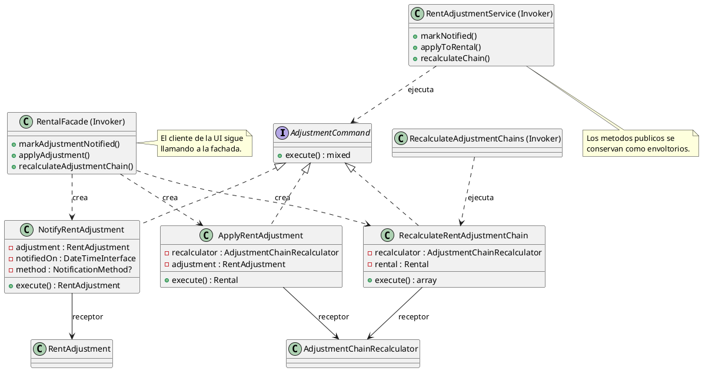
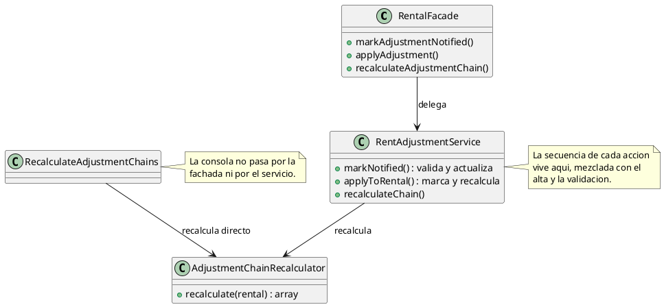
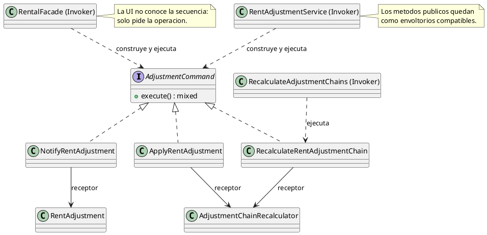

# Command

## 1. Nombre y propósito

**Command** encapsula una petición como un objeto. Así el invocador no necesita conocer los detalles de la operación ni el receptor que la ejecuta: solo pide `execute()`. El patrón permite tratar acciones como valores, reutilizarlas desde varios clientes y añadir más adelante colas, reintentos o auditoría sin tocar a quien las invoca.

En Prometheus se aplica a las **acciones discretas del reajuste**: notificar, aplicar y recalcular la cadena. Antes eran métodos repartidos entre `RentAdjustmentService` y `AdjustmentChainRecalculator`, y cada cliente los llamaba por una vía distinta. Ahora cada operación es un comando con su receptor y sus parámetros; la fachada, el servicio y el comando Artisan comparten la misma ejecución.

## 2. Problema que resuelve en Prometheus

Las tres acciones existían, pero no como operaciones de primera clase:

- `RentAdjustmentService::markNotified()` validaba el medio, actualizaba el modelo y lo refrescaba.
- `RentAdjustmentService::applyToRental()` marcaba `applied_on` y pedía el recálculo de la cadena.
- `RentalFacade::recalculateAdjustmentChain()` llamaba al recalculador directamente, mientras el comando Artisan también lo hacía por su cuenta.

Eso dejaba tres problemas:

1. **La lógica de la operación vivía dentro de un servicio grande**, mezclada con el alta, la validación y la previsualización del IPC.
2. **La misma acción se ejecutaba por caminos distintos** según viniera de Filament o de la consola, sin un punto único que fijara su secuencia.
3. **No había un objeto que representara “aplicar este reajuste”**. Para probar o reutilizar la acción había que conocer el servicio y sus dependencias.

Command no agrega una funcionalidad de negocio nueva: convierte operaciones ya existentes en objetos explícitos y deja preparado el terreno para ejecutarlas de forma uniforme desde UI, CLI o, en el futuro, una cola.

## 3. Solución y roles del patrón

| Rol GoF | Implementación en Prometheus | Responsabilidad |
| --- | --- | --- |
| **Command** | `AdjustmentCommand` | Contrato `execute()`. |
| **ConcreteCommand** | `NotifyRentAdjustment` | Exige el medio legal y guarda la constancia de la comunicación. |
| **ConcreteCommand** | `ApplyRentAdjustment` | Marca `applied_on`, recalcula la cadena y devuelve el alquiler. |
| **ConcreteCommand** | `RecalculateRentAdjustmentChain` | Reprocesa la cadena de un alquiler y devuelve el resultado con su memento. |
| **Receiver** | `RentAdjustment` | Recibe la actualización de la comunicación. |
| **Receiver** | `AdjustmentChainRecalculator` | Ejecuta el recálculo y conserva el memento. |
| **Invoker** | `RentalFacade` | Puerta de entrada de la UI; construye y ejecuta los comandos. |
| **Invoker** | `RentAdjustmentService` | Conserva sus métodos públicos como envoltorios compatibles. |
| **Invoker** | `RecalculateAdjustmentChains` | Comando Artisan; usa `RecalculateRentAdjustmentChain` en modo individual y global. |
| **Client** | Acciones Filament y `CreateRentAdjustment` | Piden la operación a la fachada; no conocen los comandos. |

**Qué encapsula cada comando**

| Comando | Parámetros | Receptor | Resultado |
| --- | --- | --- | --- |
| `NotifyRentAdjustment` | Ajuste, fecha, medio | `RentAdjustment` | Ajuste refrescado. |
| `ApplyRentAdjustment` | Ajuste | `AdjustmentChainRecalculator` | Alquiler refrescado. |
| `RecalculateRentAdjustmentChain` | Alquiler | `AdjustmentChainRecalculator` | Array con `touched`, `current_rent`, `changed_ids` y `memento`. |

## 4. Diagrama de clases



## 5. Clases participantes y valoración

| Clase | Ruta | Rol | Participación |
| --- | --- | --- | --- |
| `AdjustmentCommand` | `app/Commands/Adjustment/AdjustmentCommand.php` | Command | Contrato único de ejecución. |
| `NotifyRentAdjustment` | `app/Commands/Adjustment/NotifyRentAdjustment.php` | ConcreteCommand | Comunicación y constancia del medio. |
| `ApplyRentAdjustment` | `app/Commands/Adjustment/ApplyRentAdjustment.php` | ConcreteCommand | Aplicación del canon y recálculo. |
| `RecalculateRentAdjustmentChain` | `app/Commands/Adjustment/RecalculateRentAdjustmentChain.php` | ConcreteCommand | Recálculo de la cadena. |
| `RentalFacade` | `app/Services/RentalFacade.php` | Invoker | Construye y ejecuta los comandos; contrato intacto. |
| `RentAdjustmentService` | `app/Services/RentAdjustmentService.php` | Invoker | Envoltorios compatibles para llamadas existentes. |
| `RecalculateAdjustmentChains` | `app/Console/Commands/RecalculateAdjustmentChains.php` | Invoker | Reutiliza el comando de recálculo. |

### 5.1. Ventajas

- **Operaciones explícitas:** cada acción tiene nombre, parámetros y receptor visibles en una clase.
- **Un solo camino de ejecución:** UI, consola y pruebas comparten la misma secuencia.
- **Servicio más delgado:** la lógica de notificar/aplicar sale de `RentAdjustmentService`; el método público queda como compatibilidad.
- **Contratos preservados:** Filament, `RentalFacade` y `RentAdjustmentService` mantienen sus firmas.
- **Preparado para el futuro:** un comando puede encolarse o registrarse sin cambiar al cliente.

### 5.2. Desventajas

- **Más clases para operaciones pequeñas.** La ganancia es estructural, no de comportamiento; se acepta porque el plan prioriza formalizar los patrones y porque las acciones se comparten entre UI y CLI.
- **Invocadores duplicados.** La fachada y el servicio construyen comandos; es el precio de conservar ambos contratos.
- **Sin cola ni reintentos todavía.** El patrón deja el punto de extensión, pero la ejecución sigue siendo síncrona.
- **El alta queda fuera.** Registrar un reajuste es un flujo de formulario con muchos parámetros; envolverlo añadiría un objeto grande sin reutilización real.

## 6. Flujo de una llamada

**Desde la UI:**

1. La acción Filament llama a `RentalFacade::applyAdjustment($record)`.
2. La fachada construye `new ApplyRentAdjustment($this->recalculator, $record)`.
3. El comando comprueba que exista `effective_from`, guarda `applied_on` y pide el recálculo al receptor.
4. El recalculador reprocesa la cadena y devuelve el resultado con el memento.
5. La fachada devuelve el alquiler refrescado y Filament muestra la notificación de siempre.

**Desde la consola:**

1. `RecalculateAdjustmentChains` construye `RecalculateRentAdjustmentChain($recalculator, $rental)`.
2. El comando delega en el recalculador.
3. El comando Artisan usa `touched` y `current_rent` para imprimir el resumen.

**Desde código existente:**

1. `RentAdjustmentService::markNotified()`, `applyToRental()` o `recalculateChain()` construyen el comando correspondiente.
2. La firma y el valor de retorno no cambian.

## 7. Pruebas

| Prueba / evidencia | Qué respalda |
| --- | --- |
| `tests/Feature/AdjustmentCommandsTest.php` | Notificar guarda fecha y medio; sin medio falla con el mensaje legal; aplicar marca el ajuste y sincroniza el canon; sin vigencia falla; recalcular devuelve el memento; la fachada conserva sus operaciones. |
| `tests/Feature/RentAdjustmentServiceTest.php` | El servicio sigue registrando, notificando y aplicando con el mismo comportamiento. |
| `tests/Feature/AdjustmentChainTest.php` | La cadena se encadena sobre el canon que rigió y el recálculo es idempotente. |
| `tests/Feature/RentalFacadeTest.php` | La fachada mantiene su contrato. |
| `tests/Feature/RecalculateAdjustmentChainsCommandTest.php` | El comando Artisan sigue reprocesando y `--dry-run` no escribe. |
| `tests/Feature/ReajusteScreensRenderTest.php` | Las pantallas de reajuste renderizan y exponen las acciones. |
| `tests/Feature/RentAdjustmentFormTest.php` | El formulario conserva sus campos y acciones. |

Resultado de la implementación: **105 pruebas relacionadas en verde** (6 nuevas + 99 de regresión). Suite completa: **395 pruebas, 1877 aserciones, OK**, corrida en dos procesos (`384 + 11`) por el `set_time_limit(300)` de `ListIpcSeries`; no es un fallo de código.

## 8. Decisión de alcance

Se documenta **Command** como patrón de comportamiento **implementado** en las acciones discretas del reajuste. La implementación:

- encapsula notificar, aplicar y recalcular en comandos con receptor explícito;
- conserva las firmas de `RentAdjustmentService`, `RentalFacade` y Filament;
- hace que la UI y el comando Artisan compartan la misma ejecución;
- no agrega colas, reintentos, historial ni UI nueva;
- no envuelve el alta (`record`) porque es un flujo de formulario, no una transición discreta;
- no cambia mensajes, validaciones, transacciones ni valores calculados.

**Cuándo usar el patrón:** cuando una operación se invoca desde varios clientes, tiene parámetros y receptor propios, o se quiere poder encolar/auditar más adelante. **Cuándo no:** si la operación es una llamada única y trivial a un servicio, un comando solo añadiría una clase sin valor.

## 9. Evidencia de implementación: antes y después

El patrón no creó las operaciones: las hizo explícitas y las unificó. El contraste se muestra con UML; el código queda solo para el mecanismo que el diagrama no expresa. Los diagramas «antes» corresponden a `4214453` (commit anterior a este patrón); los «después», al estado actual.

**Por qué era necesario.** Antes la lógica de notificar y aplicar vivía dentro de `RentAdjustmentService`, la fachada delegaba en ella y el comando Artisan llamaba al recalculador por su cuenta. No existía un objeto que representara la acción, así que cada cliente conocía una parte distinta de la secuencia.

**Antes — acciones como métodos repartidos**



**Después — command, receptor e invocador**



El código imprescindible es la construcción y ejecución del comando; el resto es la estructura que ya muestra el UML:

```php
// La fachada construye el comando con su receptor y lo ejecuta.
return (new ApplyRentAdjustment($this->recalculator, $adjustment))->execute();
```

**Qué evidencia**

- `AdjustmentCommand` declara el contrato único `execute()`.
- Cada comando concreto fija su receptor y sus parámetros en el constructor.
- `RentalFacade` y `RentAdjustmentService` conservan sus firmas y ejecutan los comandos.
- El comando Artisan deja de llamar al recalculador por su cuenta y usa `RecalculateRentAdjustmentChain`.
- No cambian mensajes, validaciones, transacciones ni valores calculados.
