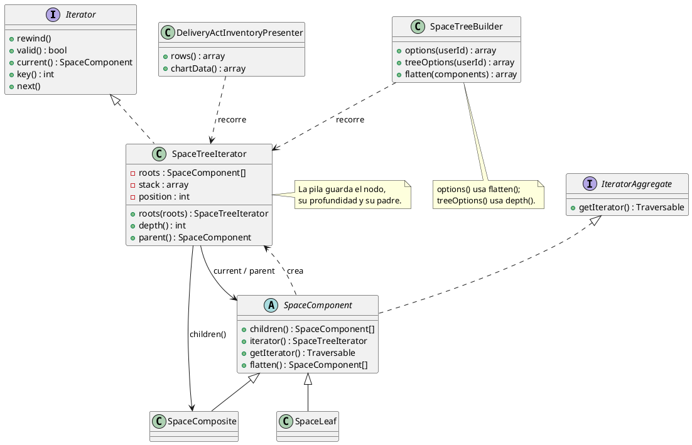
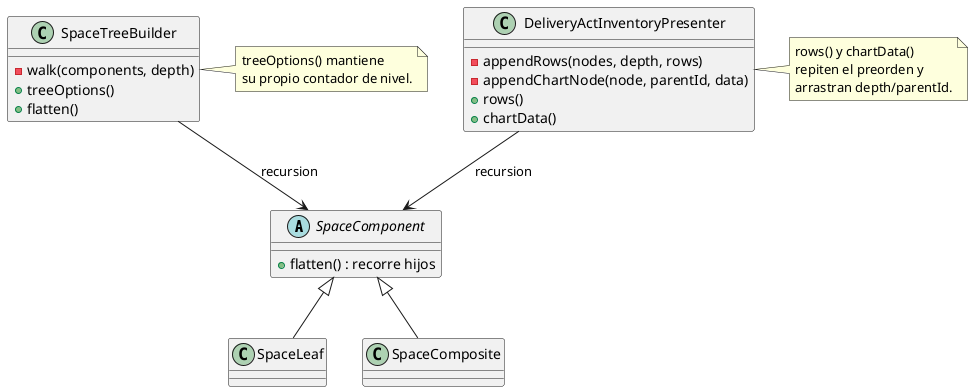
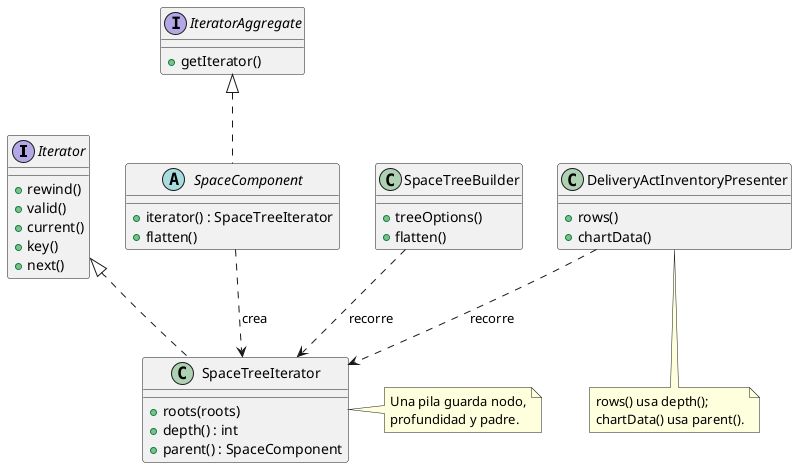

# Iterator

## 1. Nombre y propósito

**Iterator** da acceso secuencial a los elementos de una estructura sin exponer cómo está construida. El cliente pide un iterador, avanza con `current()`/`next()` y consulta los datos del recorrido que necesita; no abre los hijos ni repite la recursión.

En Prometheus se aplica al **árbol de espacios** que ya modela Composite: `SpaceComponent`, `SpaceLeaf` y `SpaceComposite`. Antes, cada consumidor recorría el árbol por su cuenta. Ahora `SpaceTreeIterator` concentra el preorden, la profundidad y el padre, y `SpaceTreeBuilder` y `DeliveryActInventoryPresenter` consumen ese recorrido.

## 2. Problema que resuelve en Prometheus

El Composite existía, pero el recorrido estaba duplicado:

- `SpaceComponent::flatten()` se llamaba recursivamente sobre cada hijo.
- `SpaceTreeBuilder::treeOptions()` tenía un `$walk` recursivo con un contador de profundidad.
- `SpaceTreeBuilder::flatten()` concatenaba los `flatten()` de cada raíz.
- `DeliveryActInventoryPresenter::appendRows()` repetía el preorden y arrastraba `$depth`.
- `DeliveryActInventoryPresenter::appendChartNode()` repetía el preorden y arrastraba el `parentId`.

Eso producía tres problemas:

1. **Cinco implementaciones del mismo orden.** Un cambio en el recorrido exigía tocar cinco lugares.
2. **Datos del recorrido dispersos.** La profundidad y el padre se calculaban en parámetros recursivos, no en un objeto que los expusiera.
3. **Pruebas fragmentadas.** Solo se verificaba el resultado final de cada cliente; no había un contrato único del recorrido.

Iterator no agrega una pantalla ni una regla nueva: unifica la forma en que el dominio recorre su propia jerarquía.

## 3. Solución y roles del patrón

| Rol GoF | Implementación en Prometheus | Responsabilidad |
| --- | --- | --- |
| **Aggregate** | `SpaceComponent` (`IteratorAggregate`) | Entrega un iterador de su subárbol. |
| **ConcreteAggregate** | `SpaceComposite` / `SpaceLeaf` | Responden `children()`; el iterador usa esa respuesta. |
| **Iterator** | `SpaceTreeIterator` (`Iterator`) | Avanza en preorden y expone el nodo actual. |
| **ConcreteIterator** | `SpaceTreeIterator` | Mantiene la pila de pendientes con profundidad y padre. |
| **Client** | `SpaceTreeBuilder` | Genera opciones y aplana listas de raíces. |
| **Client** | `DeliveryActInventoryPresenter` | Genera filas de tabla y datos del organigrama. |

**Contrato del iterador**

| Miembro | Qué devuelve |
| --- | --- |
| `rewind()` / `valid()` / `next()` | Control estándar de `Iterator`. |
| `current()` | `SpaceComponent` actual. |
| `key()` | Posición en el recorrido (0, 1, 2…). |
| `depth()` | 0 para raíces; +1 por nivel. |
| `parent()` | `SpaceComponent` padre o `null` en raíces. |
| `SpaceComponent::iterator()` | Iterador del subárbol que empieza en el nodo. |
| `SpaceComponent::getIterator()` | Igual que `iterator()`, para `foreach ($component as $node)`. |
| `SpaceTreeIterator::roots($roots)` | Iterador sobre varias raíces, en el orden recibido. |

## 4. Diagrama de clases



## 5. Clases participantes y valoración

| Clase | Ruta | Rol | Participación |
| --- | --- | --- | --- |
| `SpaceTreeIterator` | `app/Iterators/SpaceTreeIterator.php` | Iterator / ConcreteIterator | Preorden, profundidad y padre en una sola pila. |
| `SpaceComponent` | `app/Models/SpaceComponent.php` | Aggregate | Implementa `IteratorAggregate`; `flatten()` delega en el iterador. |
| `SpaceLeaf` | `app/Models/SpaceLeaf.php` | ConcreteAggregate | Sin hijos; el iterador no empuja pendientes. |
| `SpaceComposite` | `app/Models/SpaceComposite.php` | ConcreteAggregate | Devuelve sus hijos en el orden construido. |
| `SpaceTreeBuilder` | `app/Services/Acts/SpaceTreeBuilder.php` | Client | `treeOptions()` y `flatten()` usan el iterador. |
| `DeliveryActInventoryPresenter` | `app/Services/Acts/DeliveryActInventoryPresenter.php` | Client | `rows()` y `chartData()` usan el iterador. |

### 5.1. Ventajas

- **Un solo recorrido:** el preorden, la profundidad y el padre viven en `SpaceTreeIterator`.
- **Clientes más simples:** `treeOptions()`, `flatten()`, `rows()` y `chartData()` pierden sus helpers recursivos.
- **Contrato testeable:** el iterador se prueba por sí mismo, sin pasar por una pantalla.
- **Compatible con PHP:** `IteratorAggregate` permite `foreach ($component as $node)` sin cambiar el Composite.
- **Sin cambios observables:** mismo orden, mismos `depth`, mismos `parentId`, mismos arrays.

### 5.2. Desventajas

- **Una clase más en un árbol pequeño.** La ganancia es evitar cinco recorridos duplicados, no microoptimizar.
- **Estado mutable en el iterador.** `current()`, `depth()` y `parent()` dependen de la posición; usarlos después de `valid() === false` lanza `OutOfBoundsException`.
- **Profundidad y padre fuera de `Iterator`.** PHP no los estandariza; los expone la clase concreta y los clientes que los necesitan la tipan.
- **`prune()` sigue recursivo.** Reconstruye el árbol filtrado con nodos nuevos; no es un recorrido de lectura y convertirlo en iterador no aportaría claridad.

## 6. Flujo de una llamada

**Tabla de inventario:**

1. `DeliveryActInventoryPresenter::rows()` pide `tree()` (ramas con elementos).
2. Crea `SpaceTreeIterator::roots($this->tree())`.
3. Cada `next()` saca el nodo actual y empuja sus hijos invertidos, para conservar el orden.
4. La fila usa `$iterator->depth()` como nivel y los datos del nodo.
5. Al vaciarse la pila, el recorrido termina.

**Organigrama:**

1. `chartData()` agrega la raíz sintética del acta.
2. Recorre el mismo iterador.
3. Para cada nodo, `$iterator->parent()` decide el `parentId`: la raíz sintética o el espacio padre.
4. El resultado conserva el orden y la jerarquía que consume d3-org-chart.

**Selectores:**

1. `SpaceTreeBuilder::treeOptions()` recorre el árbol con el iterador.
2. `depth()` decide cuántas guías `— ` anteponer.
3. `options()` reutiliza `flatten()`, que ahora también usa el iterador, y ordena por ruta.

## 7. Pruebas

| Prueba / evidencia | Qué respalda |
| --- | --- |
| `tests/Feature/SpaceTreeIteratorTest.php` | Preorden con profundidad y padre; componente iterable y coincidencia con `flatten()`; conjunto vacío; orden de raíces. |
| `tests/Feature/SpaceHierarchyCompositeTest.php` | El Composite sigue armando el árbol y los selectores conservan sus etiquetas. |
| `tests/Feature/DeliveryActInventoryViewTest.php` | Las filas conservan `depth`, y el organigrama conserva `kind` y `parentId`. |
| `tests/Feature/SpaceCatalogFieldTest.php` | Los selectores de espacios siguen mostrando la jerarquía. |
| `tests/Feature/DeliveryActBuilderTest.php` | El acta sigue construyendo su inventario sobre el árbol. |

Resultado de la implementación: **4 pruebas nuevas** (7 aserciones) y **68 pruebas relacionadas en verde** (325 aserciones). Suite completa: **399 pruebas, 1863 aserciones, OK**, corrida en dos procesos (`388 + 11`) por el `set_time_limit(300)` de `ListIpcSeries`; no es un fallo de código.

## 8. Decisión de alcance

Se documenta **Iterator** como patrón de comportamiento **implementado** sobre el Composite de espacios. La implementación:

- agrega `SpaceTreeIterator` con preorden, `depth()` y `parent()`;
- hace que `SpaceComponent` sea `IteratorAggregate` y que `flatten()` delegue en el iterador;
- reemplaza los recorridos duplicados de `SpaceTreeBuilder` y `DeliveryActInventoryPresenter`;
- conserva el orden de hijos, la profundidad, el `parentId` y los arrays de salida;
- no cambia Filament, mensajes, validaciones ni datos;
- deja `prune()` recursivo a propósito, porque reconstruye el árbol filtrado;
- deja fuera `Space::descendants()` y `asComponent()`, que trabajan contra Eloquent y no sobre el Composite.

**Cuándo usar el patrón:** cuando una estructura compuesta se recorre desde varios clientes o cuando el recorrido necesita metadatos (nivel, padre, ruta). **Cuándo no:** si solo hay un recorrido trivial y local, un iterador añadiría una clase sin valor.

## 9. Evidencia de implementación: antes y después

El patrón no cambió el árbol: unificó cómo se recorre. El contraste se muestra con UML; el código queda solo para el mecanismo que el diagrama no expresa. Los diagramas «antes» corresponden a `cffb7f0` (commit anterior a este patrón); los «después», al estado actual.

**Por qué era necesario.** El Composite ya sabía devolver hijos, pero cada cliente volvía a recorrerlos. La profundidad y el padre viajaban como parámetros de funciones recursivas, así que no existía un objeto que representara «el recorrido del árbol».

**Antes — cinco recursiones sobre la misma estructura**



**Después — un iterador y clientes que lo consumen**



El mecanismo imprescindible es el avance de la pila: al sacar el nodo actual se empujan sus hijos en orden inverso, con su nivel y su padre.

```php
public function next(): void
{
    $frame = array_pop($this->stack);
    $this->position++;

    foreach (array_reverse($frame['node']->children()) as $child) {
        $this->stack[] = [
            'node' => $child,
            'depth' => $frame['depth'] + 1,
            'parent' => $frame['node'],
        ];
    }
}
```

**Qué evidencia**

- `SpaceTreeIterator` implementa `Iterator` y expone `depth()`/`parent()`.
- `SpaceComponent` implementa `IteratorAggregate`; `flatten()` ya no se llama a sí mismo.
- `SpaceTreeBuilder::treeOptions()` y `flatten()` usan el iterador.
- `DeliveryActInventoryPresenter` elimina `appendRows()` y `appendChartNode()`.
- `SpaceLeaf`/`SpaceComposite` no cambian: el iterador usa `children()`.
- No cambian el orden, los niveles, los `parentId` ni los textos de la UI.
