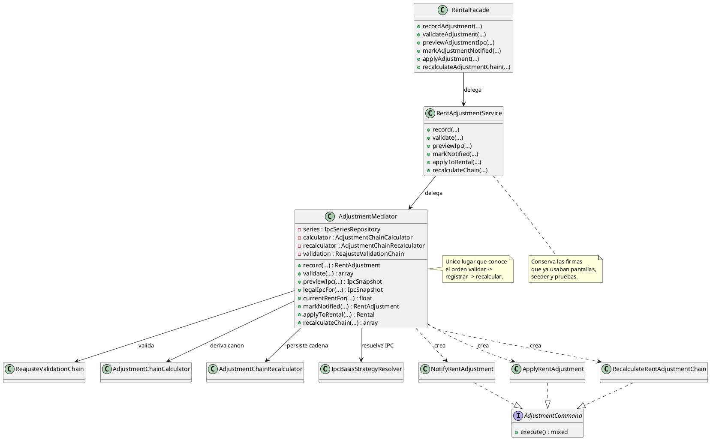
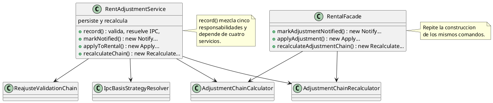
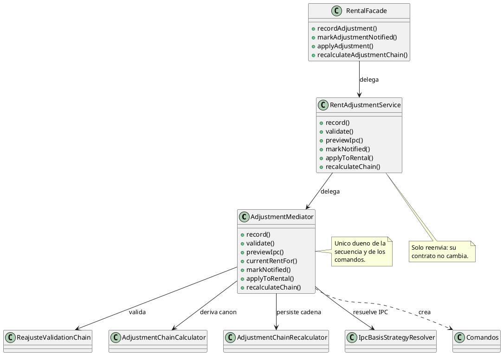

# Mediator

## 1. Nombre y propósito

**Mediator** centraliza la forma en que un conjunto de objetos interactúa. En lugar de que cada cliente conozca y llame a varios colaboradores en un orden determinado, habla con un solo coordinador; el mediador conoce a los colegas, decide la secuencia y los mantiene independientes entre sí.

En Prometheus se aplica al **flujo de reajustes**. `AdjustmentMediator` coordina la resolución del IPC, la validación legal, la persistencia del ajuste y el recálculo de la cadena. `RentAdjustmentService` conserva su firma como puerta compatible y `RentalFacade` sigue siendo la puerta de las pantallas, pero ambas delegan en el mediador en lugar de orquestar por su cuenta.

## 2. Problema que resuelve en Prometheus

Antes del patrón, `RentAdjustmentService` era a la vez puerta pública y orquestador:

- `record()` hacía cinco cosas: validaba la entrada, resolvía la estrategia de IPC, armaba el contexto legal, persistía el ajuste y disparaba el recálculo. Eran unas 130 líneas y dependía de cuatro servicios inyectados más dos resoluciones por `app()`.
- `RentalFacade` y `RentAdjustmentService` **duplicaban** la construcción de `NotifyRentAdjustment`, `ApplyRentAdjustment` y `RecalculateRentAdjustmentChain`.
- La fachada inyectaba `AdjustmentChainCalculator` y `AdjustmentChainRecalculator` solo para reenviar llamadas que ya existían en el servicio.
- Cambiar la secuencia (validar → registrar → recalcular) obligaba a tocar el servicio, que además era el contrato que usaban las pruebas, el seeder y las pantallas.

Los colegas reales del flujo son `IpcBasisStrategyResolver` con sus estrategias y `PactadoCapDecorator`, `ReajusteValidationChain`, `AdjustmentChainCalculator`, `AdjustmentChainRecalculator`, los modelos `Rental`/`RentAdjustment` y los tres comandos. Ninguno necesita conocer a los demás; solo el mediador sabe en qué orden participan.

## 3. Solución y roles del patrón

| Rol GoF | Implementación en Prometheus | Responsabilidad |
| --- | --- | --- |
| **Mediator** | `AdjustmentMediator` | Único punto que conoce la secuencia y arma los comandos. |
| **ConcreteMediator** | `AdjustmentMediator` | Implementa la coordinación concreta del flujo. |
| **Colleague** | `IpcBasisStrategyResolver` + estrategias + `PactadoCapDecorator` | Resuelven el IPC legal y el aplicado. |
| **Colleague** | `ReajusteValidationChain` | Evalúa las reglas del artículo 18 y 20. |
| **Colleague** | `AdjustmentChainCalculator` | Deriva canon vigente, secuencia y geografía. |
| **Colleague** | `AdjustmentChainRecalculator` | Persiste el reproceso y devuelve el memento. |
| **Colleague** | `Rental` / `RentAdjustment` | Persistencia de la cadena. |
| **Colleague** | `NotifyRentAdjustment`, `ApplyRentAdjustment`, `RecalculateRentAdjustmentChain` | Encapsulan las acciones. |
| **Client** | `RentAdjustmentService` | Puerta compatible; delega en el mediador. |
| **Client** | `RentalFacade` | Puerta de las pantallas; delega en el servicio. |

**Mediador unidireccional.** El mediador conoce a sus colegas, pero los colegas no guardan una referencia al mediador. Es una variante deliberada: evita dependencias circulares y conserva la independencia que ya tenían las piezas. El acoplamiento que se elimina es el de los clientes con la secuencia, no el de los colegas entre sí, porque esos colegas nunca se llamaban directamente.

**Métodos del mediador**

| Método | Qué coordina |
| --- | --- |
| `record()` | Ancla → estrategia de IPC → contexto → cadena de reglas → consentimiento/justificación → persistencia → recálculo. |
| `validate()` | Resuelve el IPC legal, arma el contexto y devuelve resumen y mensajes. |
| `previewIpc()` | Resuelve la cifra aplicada sin escribir nada. |
| `legalIpcFor()` | Devuelve el IPC del artículo 20 sin pacto. |
| `currentRentFor()` | Canon vigente según la cadena aplicada. |
| `markNotified()` | Ejecuta `NotifyRentAdjustment`. |
| `applyToRental()` | Ejecuta `ApplyRentAdjustment`. |
| `recalculateChain()` | Ejecuta `RecalculateRentAdjustmentChain`. |

## 4. Diagrama de clases



## 5. Clases participantes y valoración

| Clase | Ruta | Rol | Participación |
| --- | --- | --- | --- |
| `AdjustmentMediator` | `app/Services/Adjustment/AdjustmentMediator.php` | Mediator / ConcreteMediator | Coordina IPC, reglas, persistencia, recálculo y comandos. |
| `RentAdjustmentService` | `app/Services/RentAdjustmentService.php` | Client | Conserva la puerta pública y delega. |
| `RentalFacade` | `app/Services/RentalFacade.php` | Client | Deja de inyectar calculador y recalculador; delega en el servicio. |
| `ReajusteValidationChain` | `app/Services/Adjustment/Validation/ReajusteValidationChain.php` | Colleague | Valida sin conocer al mediador ni al calculador. |
| `AdjustmentChainCalculator` | `app/Services/Adjustment/AdjustmentChainCalculator.php` | Colleague | Deriva canon, secuencia y geografía. |
| `AdjustmentChainRecalculator` | `app/Services/Adjustment/AdjustmentChainRecalculator.php` | Colleague | Persiste y devuelve el memento. |
| `IpcBasisStrategyResolver` | `app/Services/Adjustment/Strategies/IpcBasisStrategyResolver.php` | Colleague | Entrega la estrategia de IPC. |
| `NotifyRentAdjustment` / `ApplyRentAdjustment` / `RecalculateRentAdjustmentChain` | `app/Commands/Adjustment/` | Colleagues | Acciones que el mediador construye en un solo lugar. |

### 5.1. Ventajas

- **Una sola secuencia:** validar, registrar y recalcular viven en `AdjustmentMediator`.
- **Clientes más simples:** `RentAdjustmentService` pasa de cuatro dependencias a una; `RentalFacade` elimina calculador y recalculador.
- **Comandos en un solo lugar:** la fachada y el servicio ya no los construyen por separado.
- **Contratos intactos:** las firmas públicas de servicio y fachada se conservan, y las pantallas no cambian.
- **Colegas independientes:** la cadena de reglas, el calculador, el recalculador y las estrategias no se conocen entre sí.

### 5.2. Desventajas

- **Una clase más en un flujo pequeño.** La ganancia es concentrar una secuencia legal sensible, no reducir líneas por sí mismo.
- **El mediador puede crecer.** Si se agregan muchas operaciones nuevas, conviene separar por subflujo en lugar de acumular métodos.
- **Mediador unidireccional.** Los colegas no notifican al mediador; es una variante más estricta que la del libro, adecuada aquí porque los colegas son servicios pasivos.
- **Sigue habiendo dos puertas públicas.** `RentAdjustmentService` se conserva por compatibilidad; eliminarla sería un cambio de contrato, no parte de este patrón.

## 6. Flujo de una llamada

**Registrar un reajuste:**

1. La pantalla llama `RentalFacade::recordAdjustment()`.
2. La fachada delega en `RentAdjustmentService::record()`.
3. El servicio delega en `AdjustmentMediator::record()`.
4. El mediador valida el canon, comprueba el ancla y resuelve la estrategia de IPC.
5. Calcula el canon de entrada con `AdjustmentChainCalculator` y arma `AdjustmentContext`.
6. `ReajusteValidationChain` decide si hay bloqueo.
7. El mediador exige consentimiento y justificación cuando la combinación se aparta del artículo 20.
8. Persiste el ajuste y llama al recalculador con `syncRentalRent: false`.
9. Devuelve el ajuste refrescado.

**Notificar, aplicar y recalcular:**

1. El cliente llama al método correspondiente del servicio o de la fachada.
2. El mediador construye el comando con el receptor correcto.
3. El comando ejecuta la acción y devuelve el resultado de siempre.

**Validar y previsualizar:**

1. El formulario pide `validateAdjustment()` o `previewAdjustmentIpc()`.
2. La fachada delega en el servicio y este en el mediador.
3. El mediador resuelve el IPC y devuelve el resumen o el snapshot, sin escribir nada.

## 7. Pruebas

| Prueba / evidencia | Qué respalda |
| --- | --- |
| `tests/Feature/AdjustmentMediatorTest.php` | Registro con cadena coherente; preview y validación; notificar/aplicar/recalcular; paridad de servicio y fachada. |
| `tests/Feature/RentAdjustmentServiceTest.php` | Cálculo del tope, IPC congelado, exceso, comunicación y aplicación. |
| `tests/Feature/AdjustmentChainTest.php` | Recálculo de la cadena y canon vigente. |
| `tests/Feature/AdjustmentCommandsTest.php` | Los comandos siguen produciendo el mismo resultado. |
| `tests/Feature/RentalFacadeTest.php` | La fachada conserva sus métodos y su instancia singleton. |
| `tests/Feature/RentAdjustmentFormTest.php` y `ReajusteScreensRenderTest.php` | El formulario y las pantallas siguen funcionando. |

Resultado de la implementación: **4 pruebas nuevas** (19 aserciones) y **134 pruebas relacionadas en verde** (822 aserciones). Suite completa: **407 pruebas, 1910 aserciones, OK** (396 + 11 en dos procesos por el `set_time_limit(300)` de `ListIpcSeries`).

## 8. Decisión de alcance

Se documenta **Mediator** como patrón de comportamiento **implementado** en el flujo de reajustes. La implementación:

- agrega `AdjustmentMediator` con la coordinación de registro, validación, preview, comandos y canon vigente;
- mueve a él los privados de desviación, justificación y resolución de estrategia;
- deja `RentAdjustmentService` como puerta compatible que delega;
- hace que `RentalFacade` delegue en el servicio y deje de construir comandos;
- registra el mediador como singleton en `AppServiceProvider`;
- conserva reglas, cálculos, mensajes, excepciones y resultados observables;
- **no** absorbe las consultas de catálogo de `IpcSeriesRepository` que hace el formulario: son datos de referencia y ya existía la decisión de no moverlas a la fachada;
- no agrega pantallas, columnas, colas, reintentos ni historial.

**Cuándo usar el patrón:** cuando varios clientes repiten una secuencia de llamadas a colegas y esa secuencia es sensible o cambiante. **Cuándo no:** si solo hay un cliente y un colaborador, o si el coordinador se limitaría a reenviar una llamada.

## 9. Evidencia de implementación: antes y después

El patrón no cambió las reglas ni la salida: movió la coordinación a un punto explícito. El contraste se muestra con UML; el código queda solo para el mecanismo que el diagrama no expresa. Los diagramas «antes» corresponden a `3b404c0` (commit anterior a este patrón); los «después», al estado actual.

**Por qué era necesario.** `RentAdjustmentService` era la puerta pública y, al mismo tiempo, el orquestador. La fachada construía los mismos comandos y cargaba dos dependencias solo para reenviar. La secuencia legal más sensible del módulo no tenía un dueño único.

**Antes — el servicio orquesta y la fachada duplica comandos**



**Después — un mediador y clientes que delegan**



El mecanismo imprescindible es que el mediador sea el único que arma la secuencia y los comandos. Los clientes se limitan a delegar.

```php
public function record(Rental $rental, float $newRent, \DateTimeInterface $effectiveFrom): RentAdjustment
{
    // ... validacion, estrategia de IPC y cadena de reglas ...

    $adjustment = $rental->rentAdjustments()->create([...]);

    $this->recalculator->recalculate($rental, syncRentalRent: false);

    return $adjustment->refresh();
}
```

```php
public function applyToRental(RentAdjustment $adjustment): Rental
{
    return (new ApplyRentAdjustment($this->recalculator, $adjustment))->execute();
}
```

**Qué evidencia**

- `AdjustmentMediator` concentra `record()`, `validate()`, `previewIpc()`, `legalIpcFor()`, `currentRentFor()` y los tres comandos.
- `RentAdjustmentService` pasa de cuatro dependencias a una y delega todas sus firmas.
- `RentalFacade` deja de inyectar `AdjustmentChainCalculator`/`AdjustmentChainRecalculator` y de construir comandos.
- `AppServiceProvider` registra el mediador como singleton.
- Los colegas no cambian: reglas, estrategias, calculador y recalculador conservan su contrato.
- No cambian los mensajes, los cálculos, las excepciones ni la salida de las pantallas.
