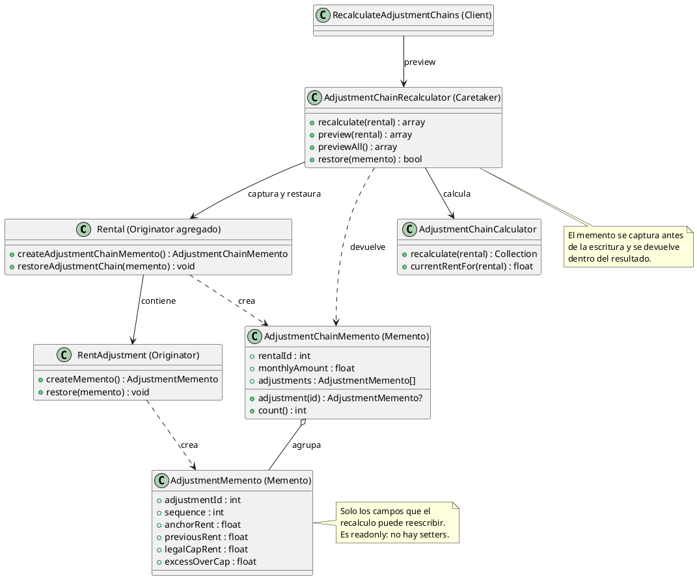
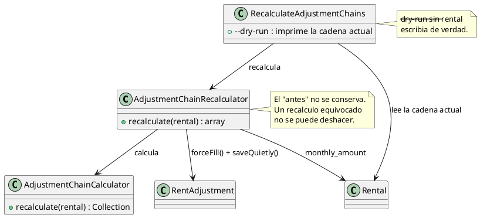
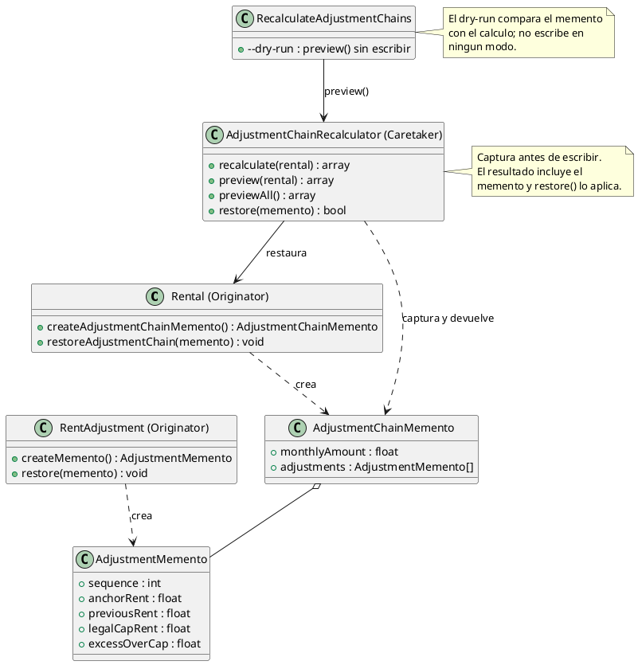

# Memento

## 1. Nombre y propósito

**Memento** captura y externaliza el estado interno de un objeto, sin romper su encapsulación, para poder devolverlo a ese estado más tarde. El objeto que se fotografía es el **Originator**; la fotografía es el **Memento**; quien la guarda y decide cuándo restaurarla es el **Caretaker**.

En Prometheus se aplica al **recálculo de la cadena de reajustes**. Ese proceso es destructivo: reescribe `sequence`, `previous_rent`, `legal_cap_rent`, `excess_over_cap` y el `monthly_amount` del alquiler. Antes de escribir, `AdjustmentChainRecalculator` captura la cadena en `AdjustmentChainMemento`; si el resultado no era el esperado, puede restaurarla. La misma fotografía permite que `--dry-run` muestre un **antes → después** real y no solo el estado actual.

No hay tabla de historial ni pantalla de “deshacer”: el memento vive en memoria y el cuidador decide cuánto lo conserva.

## 2. Problema que resuelve en Prometheus

El recálculo corrige datos derivados cuando cambia un IPC, se edita un reajuste o el DANE publica una cifra nueva. Es idempotente y transaccional, pero **no reversible**: una vez escritas las filas, el valor anterior desaparece. Si una corrección se aplica sobre una cadena mal armada, no queda forma de volver atrás salvo restaurar una copia de la base.

El comando de mantenimiento tenía además dos problemas concretos:

- `--dry-run` imprimía la cadena **actual**, no la que resultaría del cálculo;
- `--dry-run` sin `--rental` ignoraba la bandera y **reprocesaba de verdad**.

Y el cálculo arrastraba una inconsistencia: devolvía como `anchor_rent` el canon de entrada de cada ajuste, cuando ese campo significa el **canon base del alquiler** y debe ser el mismo en toda la cadena. Cualquier reproceso que tocara otro campo podía sobrescribirlo con el valor equivocado.

Memento no agrega una funcionalidad de negocio nueva: hace explícito y reutilizable el “antes” que el recálculo necesitaba para ser seguro.

## 3. Solución y roles del patrón

| Rol GoF | Implementación en Prometheus | Responsabilidad |
| --- | --- | --- |
| **Originator** | `Rental` | Captura y restaura la cadena completa, incluido su `monthly_amount`. |
| **Originator** | `RentAdjustment` | Captura y restaura los campos derivados de un ajuste. |
| **Memento** | `AdjustmentChainMemento` | Fotografía inmutable del alquiler y de sus reajustes, indexada por id. |
| **Memento** | `AdjustmentMemento` | Fotografía inmutable de un ajuste. |
| **Caretaker** | `AdjustmentChainRecalculator` | Captura antes de escribir, devuelve el memento, simula y restaura. |
| **Client** | `RecalculateAdjustmentChains` | Usa `preview()` para el `--dry-run`; no conoce los campos internos. |
| **Client** | `RentAdjustmentService`, `RentalFacade` | Reciben el memento en el resultado del recálculo y pueden conservarlo. |

**Qué captura el memento**

| Campo | Por qué entra |
| --- | --- |
| `sequence` | El recálculo renumera la cadena completa. |
| `anchor_rent` | Debe ser el canon base del alquiler; el reproceso corrige desviaciones. |
| `previous_rent` | Es derivado y cambia cuando cambia el ajuste anterior. |
| `legal_cap_rent` | Depende del canon de entrada y del IPC legal. |
| `excess_over_cap` | Depende del canon pedido y del tope recalculado. |
| `monthly_amount` del alquiler | El recálculo lo sincroniza con el último ajuste aplicado. |

**Qué NO captura.** `new_rent`, las fechas (`effective_from`, `notified_on`, `applied_on`), el estado y las relaciones no los modifica el recálculo. Incluirlos convertiría el memento en un historial completo y daría una falsa sensación de que el patrón puede deshacer cualquier operación del reajuste.

## 4. Diagrama de clases



## 5. Clases participantes y valoración

| Clase | Ruta | Rol | Participación |
| --- | --- | --- | --- |
| `AdjustmentMemento` | `app/ValueObjects/AdjustmentMemento.php` | Memento | Valores de un ajuste; inmutable y sin acceso a BD. |
| `AdjustmentChainMemento` | `app/ValueObjects/AdjustmentChainMemento.php` | Memento | Alquiler + reajustes indexados por id. |
| `Rental` | `app/Models/Rental.php` | Originator | `createAdjustmentChainMemento()` y `restoreAdjustmentChain()`. |
| `RentAdjustment` | `app/Models/RentAdjustment.php` | Originator | `createMemento()` y `restore()`. |
| `AdjustmentChainRecalculator` | `app/Services/Adjustment/AdjustmentChainRecalculator.php` | Caretaker | Captura, simula, escribe y restaura. |
| `AdjustmentChainCalculator` | `app/Services/Adjustment/AdjustmentChainCalculator.php` | Colaborador | Produce los valores derivados; calcula también el exceso. |
| `RecalculateAdjustmentChains` | `app/Console/Commands/RecalculateAdjustmentChains.php` | Client | `--dry-run` seguro en modo global y por alquiler. |

### 5.1. Ventajas

- **Recálculo reversible sin esquema nuevo:** no hay tabla, migración ni retención de datos que mantener.
- **Simulación fiel:** el `--dry-run` compara el memento con el resultado del cálculo y solo muestra lo que cambiaría.
- **Encapsulación del cambio:** el memento expone exactamente los campos que el recálculo puede pisar; no todo el modelo.
- **Restauración atómica:** alquiler y ajustes se restauran dentro de una transacción.
- **Pruebas aisladas:** el memento unitario no necesita base de datos; la restauración se prueba con la cadena real.
- **Contratos intactos:** `recalculate()` solo agrega la clave `memento` al array que ya devolvía.

### 5.2. Desventajas

- **Vive en memoria:** si el proceso termina, el memento se pierde. No sustituye una copia de seguridad ni un historial de auditoría.
- **No resucita filas:** los ajustes borrados después del memento se omiten; los creados después no se tocan. Restaura el estado de lo que existía, no la historia completa.
- **Encapsulación parcial en PHP:** el memento es `readonly` y no tiene setters, pero el cuidador puede leer sus valores porque los necesita para comparar y mostrar el diff. PHP no ofrece visibilidad de paquete para cerrar más el contrato sin añadir interfaces artificiales.
- **Un memento por recálculo:** no se guarda una pila de estados. Si se necesita “deshacer varias veces”, habría que añadir un caretaker con colección y decidir su persistencia.

## 6. Flujo de una llamada

**Recalcular y conservar el “antes”:**

1. El cliente llama a `AdjustmentChainRecalculator::recalculate($rental)`.
2. El recalculador refresca el alquiler y captura `createAdjustmentChainMemento()`.
3. `AdjustmentChainCalculator` calcula `sequence`, `anchor_rent`, `previous_rent`, `legal_cap_rent` y `excess_over_cap` de cada ajuste.
4. El recalculador escribe solo los ajustes que difieren y sincroniza `monthly_amount` con el canon vigente.
5. Devuelve `touched`, `current_rent`, `changed_ids` y `memento`.

**Simular sin escribir:**

1. El comando llama a `preview($rental)` o `previewAll()`.
2. El recalculador captura el memento, calcula los valores nuevos y compara campo por campo.
3. Devuelve solo los ajustes que cambiarían, con el memento del “antes” y los valores del “después”.
4. No hay ninguna escritura: ni en los ajustes ni en el alquiler.

**Restaurar:**

1. El cliente conserva el memento que devolvió `recalculate()`.
2. Llama a `restore($memento)`.
3. El recalculador abre una transacción, busca el alquiler por `rentalId` y delega en `restoreAdjustmentChain()`.
4. `Rental` restaura su `monthly_amount` y cada `RentAdjustment` restaura sus cinco campos derivados.
5. Si el alquiler ya no existe, devuelve `false` sin escribir.

## 7. Pruebas

| Prueba / evidencia | Qué respalda |
| --- | --- |
| `tests/Unit/AdjustmentMementoTest.php` | El memento de la cadena indexa y localiza cada ajuste por id. |
| `tests/Feature/AdjustmentChainMementoTest.php` | El memento conserva el estado anterior; la restauración devuelve canon y campos derivados; la simulación no escribe; un memento de otro alquiler se rechaza. |
| `tests/Feature/RecalculateAdjustmentChainsCommandTest.php` | `--dry-run` no escribe en modo global ni por alquiler; el recálculo normal sigue funcionando. |
| `tests/Feature/AdjustmentChainTest.php` | La cadena se encadena sobre el canon que rigió, el tope se calcula por ajuste, el recálculo es idempotente y el `anchor_rent` es el canon base del alquiler. |
| `tests/Feature/RentAdjustmentServiceTest.php` | Registro, notificación y aplicación conservan su comportamiento. |
| `tests/Feature/ReajusteScreensRenderTest.php` | Render de las pantallas de reajuste. |
| `tests/Feature/RentAdjustmentFormTest.php` | Formulario y acciones visibles. |
| `tests/Feature/ReajusteCalculationTest.php` | Panel de comprobaciones y cálculo. |
| `tests/Feature/RentalFacadeTest.php` | La fachada mantiene su contrato. |

Resultado de la implementación: **91 pruebas relacionadas en verde** (8 nuevas + 83 de integración). Suite completa: **389 pruebas, 1859 aserciones, OK**, corrida en dos procesos (`378 + 11`) por el `set_time_limit(300)` de `ListIpcSeries`; no es un fallo de código.

## 8. Decisión de alcance

Se documenta **Memento** como patrón de comportamiento **implementado** en el recálculo de cadenas. La implementación:

- no agrega tablas, migraciones ni columnas;
- no agrega una pantalla de historial ni de “deshacer”;
- captura solo los campos que el recálculo escribe;
- devuelve el memento en el resultado del recálculo y ofrece restauración transaccional;
- usa el memento para que `--dry-run` sea una simulación real y segura;
- corrige `anchor_rent` para que sea el canon base del alquiler y no el canon de entrada de cada ajuste.

**Cuándo usar el patrón:** cuando una operación reescribe varios campos y el costo de equivocarse es alto, pero no se necesita un historial consultable. **Cuándo no:** si se requiere auditoría completa, “deshacer” repetido o trazabilidad entre usuarios, hace falta persistencia y un caretaker con colección; el memento en memoria no alcanza.

## 9. Evidencia de implementación: antes y después

El patrón no creó el recálculo: lo hizo reversible y convirtió el `--dry-run` en una simulación real. El contraste se muestra con UML; el código queda solo para el mecanismo que el diagrama no expresa. Los diagramas «antes» corresponden a `74df879` (commit anterior a este patrón); los «después», al estado actual.

**Por qué era necesario.** Antes el recalculador escribía directamente y no conservaba el estado anterior. El comando de simulación leía la cadena actual, y sin `--rental` escribía igual. Además, el cálculo devolvía como `anchor_rent` el canon de entrada de cada ajuste, de modo que un reproceso podía reemplazar el canon base del alquiler por el de un tramo intermedio.

**Antes — escritura directa, sin fotografía del estado anterior**



**Después — originator, memento y cuidador**



El código imprescindible es la captura y la restauración; el resto es la estructura que ya muestra el UML:

```php
// Antes de escribir, el cuidador fotografia la cadena.
$memento = $rental->createAdjustmentChainMemento();

// El resultado transporta el "antes" para que el llamador decida.
return [... 'memento' => $memento];

// Restaurar es delegar en el originator, dentro de una transaccion.
$rental->restoreAdjustmentChain($memento);
```

**Qué evidencia**

- `Rental` y `RentAdjustment` crean y restauran su propio estado; el cuidador no reconstruye campos a mano.
- `AdjustmentMemento` y `AdjustmentChainMemento` son `readonly` y no acceden a la base de datos.
- `recalculate()` devuelve `memento`; `restore()` lo aplica en una transacción.
- `--dry-run` usa `preview()`/`previewAll()` y nunca escribe, ni siquiera en modo global.
- `anchor_rent` vuelve a ser el canon base del alquiler en toda la cadena, no el canon de entrada de cada ajuste.
- El diff no cambia `new_rent`, las fechas, el estado, los mensajes ni las validaciones del servicio.
