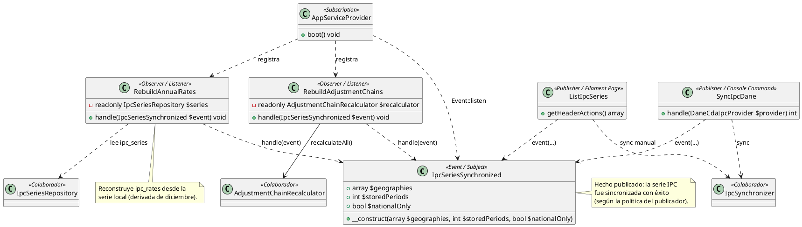

# Observer

## 1. Nombre y propósito

**Observer** es un patrón de comportamiento que define una relación de notificación entre objetos: cuando un sujeto publica un evento o cambia de estado relevante, sus observadores suscritos reaccionan sin que el sujeto conozca los detalles de cada reacción.

En Prometheus se aplica a la **sincronización de la serie IPC del DANE**. `IpcSeriesSynchronized` representa el evento publicado; `RebuildAnnualRates` y `RebuildAdjustmentChains` son listeners/observadores registrados en `AppServiceProvider`; y los publicadores (`SyncIpcDane` y la acción de sincronización manual en `ListIpcSeries`) disparan el evento tras una sincronización nacional exitosa.

La implementación usa el **mecanismo de eventos/listeners de Laravel**, preservando la intención GoF: desacoplar el hecho “la serie IPC cambió” de los trabajos derivados (reconstruir tasas anuales y reprocesar cadenas de reajuste).

## 2. Problema que resuelve en Prometheus

Sincronizar la serie IPC no termina cuando los datos llegan a la base local. Después de una sincronización correcta, el sistema debe:

1. **Reconstruir `ipc_rates`** (tasas anuales derivadas), porque esa tabla alimenta cálculos/compatibilidad y puede quedar desfasada si el DANE corrige datos.
2. **Reprocesar cadenas de reajuste**, porque los topes/cifras calculadas con una serie anterior pueden diferir de la serie nueva.

Si `SyncIpcDane` hiciera ambos trabajos directamente:

- el comando conocería detalles internos de tasas y recálculo de cadenas;
- agregar una reacción nueva obligaría a modificar el comando/UI;
- sería más difícil reutilizar la misma reacción desde otros puntos de entrada (CLI y pantalla Filament);
- el orden y la responsabilidad de cada trabajo quedarían mezclados.

El patrón permite publicar **un solo hecho de dominio/técnico** (`IpcSeriesSynchronized`) y dejar que cada listener ejecute su responsabilidad.

## 3. Solución y roles del patrón

`IpcSeriesSynchronized` es el **evento/sujeto notificado** (mensaje inmutable con contexto). `RebuildAnnualRates` y `RebuildAdjustmentChains` son **Observers/Listeners** suscritos explícitamente. `AppServiceProvider::boot()` registra las suscripciones con `Event::listen(...)`. `SyncIpcDane` y `ListIpcSeries` actúan como **publicadores**: disparan el evento solo cuando la sincronización nacional fue exitosa (y, en CLI, si no se usa `--no-events`).

| Rol GoF (adaptado) | Clase / componente | Responsabilidad |
| --- | --- | --- |
| **Subject / evento** | `IpcSeriesSynchronized` | Transporta `geographies`, `storedPeriods`, `nationalOnly`. |
| **Observer / Listener** | `RebuildAnnualRates` | Reconstruye tasas anuales (`ipc_rates`) desde `ipc_series` (diciembre/variación anual). |
| **Observer / Listener** | `RebuildAdjustmentChains` | Recalcula cadenas de reajuste vía `AdjustmentChainRecalculator`. |
| **Registro de suscripción** | `AppServiceProvider` | Asocia `IpcSeriesSynchronized` con ambos listeners en `boot()`. |
| **Publisher (CLI)** | `SyncIpcDane` | Sincroniza; si el nacional fue OK y no hay `--no-events`, dispara el evento. |
| **Publisher (UI)** | `ListIpcSeries` (acción `ipc_sync`) | Sincroniza manualmente el nacional y, si fue OK, dispara el evento. |
| **Servicios colaboradores** | `IpcSynchronizer`, `IpcSeriesRepository`, `AdjustmentChainRecalculator` | Sincronizan datos, consultan serie y recalculan cadenas. |

Composición/flujo de publicación:

```text
SyncIpcDane / ListIpcSeries
  -> IpcSynchronizer::syncGeography(...)
  -> event(new IpcSeriesSynchronized(...))   [si nacional OK]
       -> RebuildAnnualRates::handle(...)
       -> RebuildAdjustmentChains::handle(...)
            -> AdjustmentChainRecalculator::recalculateAll()
```

Detalles verificados:
- `SyncIpcDane` usa `event(new IpcSeriesSynchronized(...))` con argumentos posicionales (no `dispatch()` del trait), pasando geografías exitosas, periodos guardados y `nationalOnly`.
- `ListIpcSeries` dispara el mismo evento tras sync manual exitosa del nacional (`nationalOnly: true`).
- `RebuildAdjustmentChains` documenta que el recálculo es idempotente: si el DANE no cambió datos relevantes, no debería mover filas innecesariamente.
- `--no-events` en `SyncIpcDane` permite omitir la reconstrucción/recálculo cuando se desea solo sincronizar datos.

## 4. Diagrama de clases



## 5. Clases participantes y valoración

| Clase | Ruta | Rol | Participación |
| --- | --- | --- | --- |
| `IpcSeriesSynchronized` | `app/Events/IpcSeriesSynchronized.php` | Evento | Payload de la sincronización exitosa. |
| `RebuildAnnualRates` | `app/Listeners/RebuildAnnualRates.php` | Listener | Reconstruye tasas anuales desde `ipc_series`. |
| `RebuildAdjustmentChains` | `app/Listeners/RebuildAdjustmentChains.php` | Listener | Dispara `AdjustmentChainRecalculator::recalculateAll()`. |
| `AppServiceProvider` | `app/Providers/AppServiceProvider.php` | Suscripción | Registra `Event::listen(IpcSeriesSynchronized::class, ...)` para ambos listeners. |
| `SyncIpcDane` | `app/Console/Commands/SyncIpcDane.php` | Publisher | CLI `ipc:sync`; publica evento tras éxito nacional (salvo `--no-events`). |
| `ListIpcSeries` | `app/Filament/Resources/IpcSeriesResource/Pages/ListIpcSeries.php` | Publisher | Acción manual de sync en UI; publica evento tras éxito. |
| `AdjustmentChainRecalculator` | `app/Services/Adjustment/AdjustmentChainRecalculator.php` | Colaborador | Recalcula cadenas; usado por listener/comandos/servicios. |
| `IpcSynchronizer` / `IpcSeriesRepository` | `app/Services/Ipc/` | Colaboradores | Sincronización y lectura de serie local. |

### 5.1. Ventajas

- **Desacoplamiento:** los publicadores no dependen de cómo se reconstruyen tasas ni cómo se recalculan cadenas.
- **Reutilización del disparo:** el mismo evento se publica desde CLI y desde Filament.
- **Extensibilidad:** añadir una reacción nueva implica crear/registrar otro listener sin modificar los publicadores.
- **Responsabilidad clara:** cada listener encapsula un trabajo derivado concreto.
- **Consistencia post-sync:** evita que la serie nueva conviva con tasas/cadenas calculadas con datos viejos (bajo la política de publicación).
- **Control operativo:** `--no-events` permite sincronizar sin ejecutar efectos derivados cuando se requiere.

### 5.2. Desventajas

- **Flujo menos explícito:** la reacción ocurre por suscripción; seguir el comportamiento completo exige conocer `Event::listen` y los listeners.
- **Orden implícito/operativo:** ambos listeners responden al mismo evento; si en el futuro existiera dependencia estricta entre sus resultados, habría que hacer el orden explícito (hoy la intención está documentada en listeners/comando).
- **Ejecución síncrona en el contexto actual:** la acción manual de UI advierte que la sync corre en la misma petición (no hay cola configurada como requisito aquí); los listeners se ejecutan según el despacho del evento.
- **Observabilidad:** sin pruebas/eventos de auditoría adicionales, fallos de listeners pueden ser menos visibles que un flujo imperativo directo.
- **Cobertura de pruebas no evidente:** CodeGraph no reportó tests directos para `RebuildAnnualRates`/`RebuildAdjustmentChains`/disparo del evento; la evidencia principal es el código y el flujo de sincronización. Conviene agregar tests de integración si se formaliza la garantía.

## 6. Flujo de una llamada

### 6.1. Sincronización por comando (`ipc:sync`)

1. `SyncIpcDane::handle()` crea `IpcSynchronizer` y sincroniza nacional (y opcionalmente ciudades).
2. Si no hubo sincronizaciones exitosas, termina en fallo conservando la última serie buena.
3. Si el **nacional** fue exitoso y no se pasó `--no-events`, publica `IpcSeriesSynchronized` con geografías exitosas y total de periodos.
4. Laravel despacha el evento a los listeners registrados.
5. `RebuildAnnualRates` reconstruye `ipc_rates` desde `ipc_series`.
6. `RebuildAdjustmentChains` invoca `AdjustmentChainRecalculator::recalculateAll()`.

### 6.2. Sincronización manual en UI

1. El usuario confirma la acción `ipc_sync` en `ListIpcSeries`.
2. La página ejecuta `IpcSynchronizer::syncGeography(Geography::nationalCode())`.
3. Si la sync es exitosa, publica `IpcSeriesSynchronized` (`nationalOnly: true`) y notifica al usuario.
4. Los mismos listeners reaccionan y actualizan tasas/cadenas.

## 7. Pruebas

| Prueba / evidencia | Qué respalda |
| --- | --- |
| Código fuente de `SyncIpcDane` | Publica `IpcSeriesSynchronized` solo con nacional OK y sin `--no-events`; reporta resultados por geografía. |
| Código fuente de `ListIpcSeries` | La acción manual sincroniza nacional y publica el mismo evento tras éxito. |
| Código fuente de `RebuildAnnualRates` | Reconstrucción de `ipc_rates` desde observaciones de diciembre/variación anual en `ipc_series`. |
| Código fuente de `RebuildAdjustmentChains` | Delegación del recálculo completo al recalculador de cadenas. |
| `app/Providers/AppServiceProvider.php` | Suscripción explícita `Event::listen(IpcSeriesSynchronized::class, ...)`. |
| `tests/Feature/IpcSeriesResourceTest.php` (evidencia parcial) | Cubre la pantalla/listado IPC; no se verificó aquí un assert directo del dispatch/listeners (revisar al ampliar cobertura). |

> Nota: CodeGraph no reportó tests directos para los listeners ni para el evento dentro del radio analizado. El patrón está **claramente implementado** en código y cableado; la brecha principal es de cobertura automatizada específica del evento/efectos.

## 8. Decisión de alcance

Se documenta **Observer** como patrón de comportamiento **claramente implementado** mediante eventos/listeners de Laravel en el flujo de sincronización IPC. No se incluyen en este documento:

- Comandos Artisan como GoF **Command** (descartados por no cumplir roles invoker/receiver/undo de dominio).
- Patrones parciales (**Template Method**, **Chain of Responsibility**, **State**) ni no implementados, según la decisión de alcance aprobada.

Cambios futuros que añadan efectos post-sincronización deben preferir un listener suscrito a `IpcSeriesSynchronized` (o un evento más específico si el dominio lo exige), manteniendo a los publicadores libres de lógica derivada.
