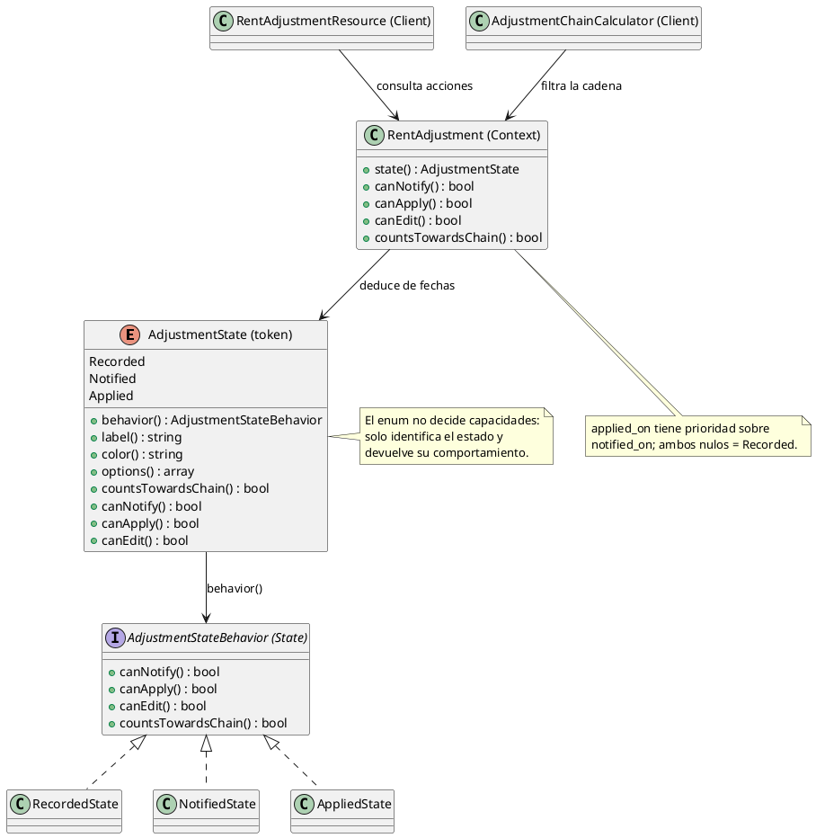
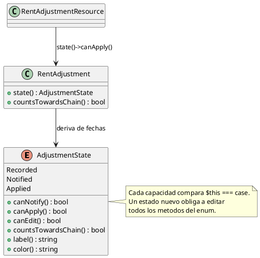
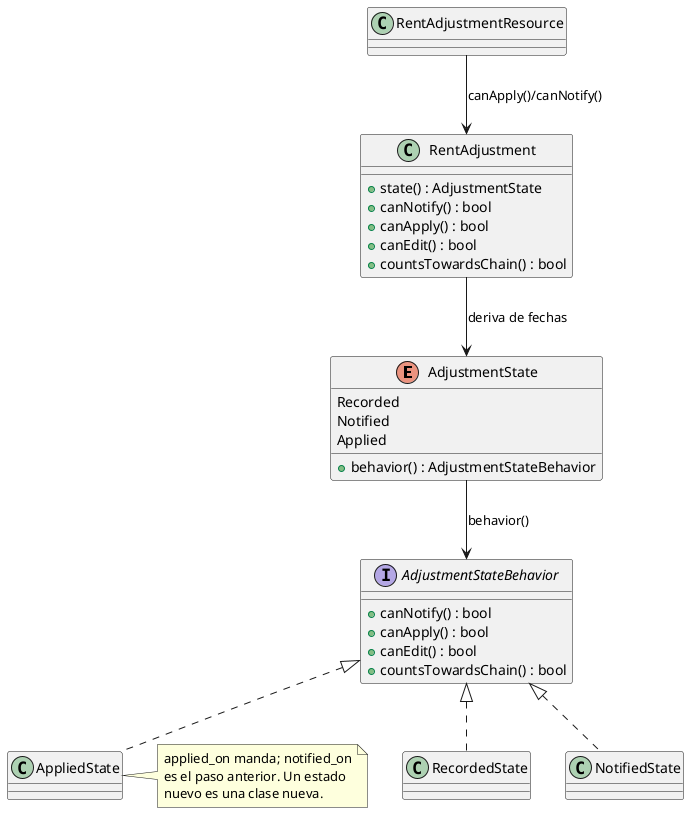

# State

## 1. Nombre y propósito

**State** permite que un objeto cambie su comportamiento cuando cambia su estado interno, sin que el cliente tenga que evaluar condicionales por estado. Cada estado se representa con un objeto que decide qué operaciones están permitidas.

En Prometheus se aplica al **ciclo de vida de un reajuste del canon**. `AdjustmentState` sigue siendo el identificador estable (`recorded`, `notified`, `applied`), pero las reglas de qué se puede hacer en cada momento viven en `RecordedState`, `NotifiedState` y `AppliedState`, todas detrás de `AdjustmentStateBehavior`. `RentAdjustment` es el contexto y delega en su estado actual.

El estado **no se guarda en una columna**: se deriva de `notified_on` y `applied_on`, que son las fechas con valor probatorio. El patrón reorganiza el comportamiento, no el almacenamiento ni las transiciones.

## 2. Problema que resuelve en Prometheus

Antes de este cambio, `AdjustmentState` concentraba dos responsabilidades distintas:

- identificar el estado (`Recorded`, `Notified`, `Applied`);
- decidir todas las capacidades comparando `$this === self::...` dentro del mismo enum.

Eso funcionaba mientras los estados fueron tres y las capacidades cuatro. Pero cada estado nuevo obligaba a editar todos los métodos del enum, y la matriz de lo permitido quedaba repartida entre el enum, el modelo y las pantallas. Además, el recurso de Filament consultaba `$record->state()->canApply()`, de modo que la UI conocía el enum y no una operación del reajuste.

El problema no era el cálculo: era que **agregar o cambiar un estado** implicaba tocar varios métodos y volver a razonar la matriz completa. State hace explícito que el estado es una unidad de comportamiento.

## 3. Solución y roles del patrón

`AdjustmentState` conserva la identidad y delega en un objeto de comportamiento. `RentAdjustment` expone `canNotify()`, `canApply()`, `canEdit()` y `countsTowardsChain()` como operaciones del dominio, y las pantallas preguntan al reajuste, no al enum.

| Rol GoF | Implementación en Prometheus | Responsabilidad |
| --- | --- | --- |
| **Context** | `RentAdjustment` | Deriva su estado de las fechas y delega las capacidades. |
| **State** | `AdjustmentStateBehavior` | Contrato de `canNotify`, `canApply`, `canEdit` y `countsTowardsChain`. |
| **ConcreteState** | `RecordedState` | Se puede notificar y editar; no se aplica ni cuenta para la cadena. |
| **ConcreteState** | `NotifiedState` | Se puede aplicar y editar; ya no se notifica ni cuenta para la cadena. |
| **ConcreteState** | `AppliedState` | Cerró el ciclo: no se notifica, no se aplica, no se edita y sí cuenta para la cadena. |
| **Token / fábrica de estado** | `AdjustmentState` | Identifica el estado y devuelve su comportamiento con `behavior()`. |
| **Client** | `RentAdjustmentResource` | Muestra las acciones según `$record->canNotify()`/`canApply()`. |
| **Client** | `AdjustmentChainCalculator` | Filtra con `$adjustment->countsTowardsChain()`. |

**Matriz de capacidades**

| Estado | `canNotify` | `canApply` | `canEdit` | `countsTowardsChain` |
| --- | --- | --- | --- | --- |
| `Recorded` | sí | no | sí | no |
| `Notified` | no | sí | sí | no |
| `Applied` | no | no | no | sí |

**Por qué `Notified` no cuenta para la cadena.** El artículo 20 cuenta los doce meses «bajo un mismo precio». Notificar hace oponible el incremento, pero el canon del alquiler solo cambia al aplicar. Encadenar un reajuste notificado haría calcular el siguiente sobre una cifra que nunca rigió.

**Por qué `Applied` no se edita.** Corregir un reajuste ya aplicado obliga a reprocesar la cadena completa. El sistema prefiere que esa corrección pase por el recálculo explícito y no por una edición silenciosa.

## 4. Diagrama de clases



`label()` y `color()` permanecen en el enum porque son identidad y presentación del token, no reglas de negocio por estado.

## 5. Clases participantes y valoración

| Clase | Ruta | Rol | Participación |
| --- | --- | --- | --- |
| `AdjustmentState` | `app/Enums/AdjustmentState.php` | Token / fábrica | Identifica el estado y devuelve su comportamiento; conserva `label()` y `color()`. |
| `AdjustmentStateBehavior` | `app/States/Adjustment/AdjustmentStateBehavior.php` | State | Contrato de las cuatro capacidades. |
| `RecordedState` | `app/States/Adjustment/RecordedState.php` | ConcreteState | Estado inicial: notificar y editar. |
| `NotifiedState` | `app/States/Adjustment/NotifiedState.php` | ConcreteState | Estado comunicado: aplicar y editar. |
| `AppliedState` | `app/States/Adjustment/AppliedState.php` | ConcreteState | Estado final: solo cuenta para la cadena. |
| `RentAdjustment` | `app/Models/RentAdjustment.php` | Context | Deriva el estado y delega las capacidades. |
| `RentAdjustmentResource` | `app/Filament/Resources/RentAdjustmentResource.php` | Client | Decide visibilidad de acciones con el modelo. |
| `AdjustmentChainCalculator` | `app/Services/Adjustment/AdjustmentChainCalculator.php` | Client | Filtra los ajustes que cuentan para la cadena. |

### 5.1. Ventajas

- **Una responsabilidad por estado:** cada clase responde solo por su momento del ciclo.
- **Extensión localizada:** un estado nuevo es una clase nueva y una rama en `behavior()`; no hay que reescribir las cuatro capacidades en todos los estados existentes.
- **Pruebas aisladas:** la matriz se verifica estado por estado, sin base de datos ni pantalla.
- **UI desacoplada del enum:** el recurso pregunta `$record->canApply()` en lugar de conocer la matriz de estados.
- **Sin cambio de comportamiento:** las capacidades y la derivación por fechas son las mismas que antes.
- **Contratos intactos:** `state()` sigue devolviendo `AdjustmentState`; `countsTowardsChain()` conserva su firma pública.

### 5.2. Desventajas

- **Más clases para cuatro métodos:** el patrón se justifica porque las capacidades son reglas de dominio que crecerán; si el ciclo se quedara en tres estados y cuatro métodos para siempre, el enum actual bastaría.
- **Estado y comportamiento separados:** quien lea solo el enum no ve la matriz; tiene que abrir `app/States/Adjustment`.
- **Transiciones fuera del patrón:** el paso de un estado a otro no vive en los estados concretos, sino en las fechas que escribe `RentAdjustmentService`. Es deliberado: el State GoF clásico suele incluir transiciones, pero aquí la fuente de verdad son las fechas.
- **Objetos sin datos:** cada consulta crea un objeto de comportamiento. Son inmutables y baratos; no se cachean para no agregar estado global.

## 6. Flujo de una llamada

**Consultar qué puede hacer un reajuste (pantalla o servicio):**

1. El cliente llama a `$adjustment->canApply()`.
2. `RentAdjustment` obtiene su estado con `state()`: si hay `applied_on` es `Applied`; si hay `notified_on` es `Notified`; si no, `Recorded`.
3. `state()` devuelve el token del enum y `canApply()` delega en `behavior()`.
4. `behavior()` instancia el estado concreto y responde según su matriz.
5. La pantalla muestra u oculta la acción; el servicio conserva sus validaciones propias.

**Registrar, notificar y aplicar:**

1. `RentAdjustmentService::record()` crea el reajuste sin fechas: nace `Recorded`.
2. `markNotified()` escribe `notified_on` y `notification_method`; el estado pasa a `Notified`.
3. `applyToRental()` escribe `applied_on`; el estado pasa a `Applied`.
4. No se agregan guardas nuevas en esos métodos: el estado describe capacidades, y las validaciones de servicio siguen siendo las que deciden si la operación se ejecuta.

**Filtrar la cadena:**

1. `AdjustmentChainCalculator` recorre los reajustes del alquiler.
2. Conserva solo los que devuelven `countsTowardsChain() === true`.
3. Hoy eso equivale a `Applied`; la regla queda encapsulada en `AppliedState`.

## 7. Pruebas

| Prueba / evidencia | Qué respalda |
| --- | --- |
| `tests/Unit/AdjustmentStateBehaviorTest.php` | Matriz completa de los tres estados, correspondencia enum → estado concreto y conservación de los atajos del enum. |
| `tests/Feature/AdjustmentStateTest.php` | El modelo delega las capacidades y la derivación por fechas sigue igual. |
| `tests/Feature/AdjustmentChainTest.php` | Notificar no cuenta para la cadena; aplicar cierra el ciclo; el estado avanza en el flujo real. |
| `tests/Feature/RentAdjustmentServiceTest.php` | Registro, notificación y aplicación con el estado derivado. |
| `tests/Feature/ReajusteScreensRenderTest.php` | Render de las pantallas de reajuste. |
| `tests/Feature/RentAdjustmentFormTest.php` | Formulario y acciones visibles según el estado. |
| `tests/Feature/ReajusteCalculationTest.php` | Panel de comprobaciones y cálculo del reajuste. |
| `tests/Feature/RentalFacadeTest.php` | La fachada mantiene su contrato. |

Resultado de la implementación: **91 pruebas relacionadas en verde** (8 nuevas + 83 de integración). La suite completa quedó en **381 pruebas, 1837 aserciones, OK** (en dos procesos por el `set_time_limit` de `ListIpcSeries`).

## 8. Decisión de alcance

Se documenta **State** como patrón de comportamiento **implementado** en el ciclo de vida del reajuste. La implementación:

- no agrega una columna de estado ni un workflow nuevo;
- conserva la derivación por fechas y la prioridad `applied_on` > `notified_on`;
- mantiene la matriz de capacidades existente;
- no agrega guardas nuevas a `markNotified()` ni `applyToRental()`;
- deja el enum como token estable para formularios, tablas y pruebas;
- mueve la decisión de capacidades a `app/States/Adjustment`.

**Cuándo usar el patrón:** cuando un objeto cambia lo que puede hacer según un estado interno y esa matriz se repite en varios clientes. **Cuándo no:** si el estado es solo una etiqueta sin comportamiento propio; en ese caso el enum basta.

Si en el futuro se agrega un estado:

1. crear la clase en `app/States/Adjustment` implementando `AdjustmentStateBehavior`;
2. añadir el caso al enum y su rama en `behavior()`;
3. decidir cómo se deriva de las fechas en `RentAdjustment::state()`;
4. actualizar la matriz de pruebas unitarias;
5. revisar las acciones de Filament que usan `canNotify()`/`canApply()`.

## 9. Evidencia de implementación: antes y después

El patrón no creó el ciclo de vida: reorganizó el comportamiento que ya vivía en el enum. El contraste se muestra con UML; el código queda solo para el mecanismo de despacho.

**Por qué era necesario.** En el diseño anterior el enum era a la vez identidad y comportamiento: cada capacidad se resolvía con `$this === self::...`. Agregar un estado obligaba a editar todos los métodos, y la pantalla seguía consultando `$record->state()->canApply()` en lugar de una operación del reajuste.

**Antes — el enum concentraba identidad y capacidades**



**Después — cada estado decide; el enum solo despacha**



El código imprescindible es el despacho del enum; el resto es la estructura que ya muestra el UML:

```php
public function behavior(): AdjustmentStateBehavior
{
    return match ($this) {
        self::Recorded => new RecordedState,
        self::Notified => new NotifiedState,
        self::Applied => new AppliedState,
    };
}
```

**Qué evidencia**

- `AdjustmentState` dejó de decidir capacidades: solo identifica el estado y devuelve su comportamiento.
- Cada `ConcreteState` encapsula su fila de la matriz; `AppliedState` es el único que devuelve `countsTowardsChain() === true`.
- `RentAdjustment` expone `canNotify()`, `canApply()` y `canEdit()` como operaciones del contexto.
- `RentAdjustmentResource` ya no conoce el enum: pregunta al reajuste.
- El diff no cambia la derivación por fechas, las capacidades, los mensajes ni las validaciones del servicio.
