# Strategy

## 1. Nombre y propósito

**Strategy** es un patrón de comportamiento que define una familia de algoritmos, encapsula cada uno detrás de una interfaz común y permite intercambiarlos sin cambiar al cliente que los usa.

En Prometheus se aplica al **cálculo de la base IPC de un reajuste**. `IpcBasisStrategy` declara el contrato; `AnnualVariationStrategy`, `IndexRatioStrategy` y `FrozenSnapshotStrategy` implementan formas distintas de resolver el porcentaje; `IpcBasisStrategyResolver` selecciona la estrategia nombrada por el formulario; y `RentAdjustmentService` actúa como contexto, componiendo además `PactadoCapDecorator` (Decorator, ya documentado) sobre la estrategia elegida.

La variante usada combina **Strategy + resolución por nombre** y, en el caso de año explícito, una **composición directa** de `FrozenSnapshotStrategy` desde el servicio. El criterio clave no es solo “calcular distinto”, sino **qué resultado puede alimentar el tope legal** del artículo 20: lo expresa `isStatutory()`.

## 2. Problema que resuelve en Prometheus

El reajuste del canon puede requerir porcentajes derivados de la serie IPC con reglas distintas:

- la **variación anual de diciembre** del año anterior al de vigencia, que es la base legal del artículo 20 (Ley 820 de 2003);
- una **razón entre índices** de dos periodos, útil como dato comparativo o cuando el contrato pactó ese método, pero no equivalente a lo que ordena el artículo;
- un **snapshot ya conocido/congelado**, cuando el formulario fija explícitamente un año IPC y la cifra ya fue consultada para esa fila concreta.

Si esta decisión se resolviera con condicionales dentro de `RentAdjustmentService` o en las pantallas:

- el servicio mezclaría selección de algoritmo, consulta de serie, reglas legales y persistencia;
- añadir otra forma de cálculo obligaría a modificar el contexto y duplicar validaciones;
- sería fácil confundir una cifra informativa con el tope legal;
- el porcentaje pactado (Decorator) tendría que aplicarse en cada rama por separado.

El patrón permite que el cliente pida “resolver el IPC para esta fecha/geografía” y que la estrategia encapsule **cómo** se obtiene, manteniendo separado **qué significa legalmente** el resultado.

## 3. Solución y roles del patrón

`IpcBasisStrategy` es la **Strategy**. Las estrategias concretas implementan el mismo contrato pero responden preguntas distintas. `IpcBasisStrategyResolver` actúa como punto único de selección para las estrategias registradas por nombre. `RentAdjustmentService` es el **Context**: obtiene/elige la estrategia, la envuelve con `PactadoCapDecorator` cuando corresponde y usa `resolve()`/la cifra legal resultante para registrar, validar o previsualizar el reajuste.

| Rol GoF | Clase | Responsabilidad |
| --- | --- | --- |
| **Strategy** | `IpcBasisStrategy` | Contrato: `name()`, `resolve($effectiveFrom, $geographyCode)`, `isStatutory()`, `description()`. |
| **ConcreteStrategy** | `AnnualVariationStrategy` | Variación anual de diciembre del año anterior; marcada como legal (`isStatutory() = true` cuando aplica base nacional/statutory). |
| **ConcreteStrategy** | `IndexRatioStrategy` | Razón entre índice de corte y base anterior; informativa (`isStatutory() = false`). |
| **ConcreteStrategy** | `FrozenSnapshotStrategy` | Devuelve un `IpcSnapshot` ya resuelto; útil para año explícito o pruebas con IPC fijo. |
| **Selector / fábrica de estrategias** | `IpcBasisStrategyResolver` | Registra y resuelve estrategias por nombre (`annual_variation`, `index_ratio`); valida nombres y expone opciones. |
| **Context** | `RentAdjustmentService` | Resuelve la estrategia, compone `PactadoCapDecorator`, consulta/valida y persiste el reajuste. |
| **Colaborador** | `IpcSeriesRepository` | Fuente local de observaciones/series usada por estrategias que consultan IPC. |
| **Resultado** | `IpcSnapshot` | DTO con porcentaje, periodo, geografía, fuente, explicación y marca legal/informativa. |

Composición típica:

```text
RentAdjustmentService (Context)
  -> IpcBasisStrategyResolver (selección por nombre, cuando aplica)
  -> IpcBasisStrategy (ConcreteStrategy)
  -> PactadoCapDecorator (Decorator, composición adicional)
       -> IpcBasisStrategy envuelta
```

Notas de diseño verificadas en código:
- `IpcBasisStrategyResolver` registra `annual_variation` e `index_ratio`; un nombre desconocido lanza `InvalidArgumentException` (y el contexto puede caer a la estrategia legal según su flujo).
- Cuando el usuario elige un **año IPC explícito**, `RentAdjustmentService::resolveStrategy()` consulta diciembre de ese año y construye `FrozenSnapshotStrategy::of(...)` directamente, porque el dato viene de una fila concreta y no de deducción por fecha.
- `isStatutory()` separa el resultado que puede sostener el tope legal de los resultados informativos/acordados.

## 4. Diagrama de clases

```plantuml
@startuml strategy_ipc_clases
top to bottom direction

interface IpcBasisStrategy <<Strategy>> {
  +name() string
  +resolve(DateTimeInterface $effectiveFrom, ?string $geographyCode) IpcSnapshot
  +isStatutory() bool
  +description() string
}

class AnnualVariationStrategy <<ConcreteStrategy>> {
  -readonly IpcSeriesRepository $series
  +name() string
  +resolve(DateTimeInterface $effectiveFrom, ?string $geographyCode) IpcSnapshot
  +isStatutory() bool
  +description() string
}

class IndexRatioStrategy <<ConcreteStrategy>> {
  -readonly IpcSeriesRepository $series
  +name() string
  +resolve(DateTimeInterface $effectiveFrom, ?string $geographyCode) IpcSnapshot
  +isStatutory() bool
  +description() string
}

class FrozenSnapshotStrategy <<ConcreteStrategy>> {
  -readonly IpcSnapshot $snapshot
  +{static} of(IpcSnapshot $snapshot) self
  +resolve(DateTimeInterface $effectiveFrom, ?string $geographyCode) IpcSnapshot
  +isStatutory() bool
}

class IpcBasisStrategyResolver <<Selector>> {
  -array $strategies
  +resolve(?string $name, array $container = []) IpcBasisStrategy
  +all() array
  +options() array
  +has(string $name) bool
}

class RentAdjustmentService <<Context>> {
  -resolveStrategy(...) PactadoCapDecorator
  +record(...)
  +previewIpc(...)
  +validate(...)
  +legalIpcFor(...)
}

class PactadoCapDecorator <<Decorator - documentado aparte>> {
  -readonly IpcBasisStrategy $inner
  -readonly ?float $pactadoPercentage
  +resolve(...) IpcSnapshot
  +legalSnapshot(...) IpcSnapshot
}

class IpcSnapshot <<DTO / Resultado>>

IpcBasisStrategy <|.. AnnualVariationStrategy
IpcBasisStrategy <|.. IndexRatioStrategy
IpcBasisStrategy <|.. FrozenSnapshotStrategy
IpcBasisStrategy <|.. PactadoCapDecorator

RentAdjustmentService ..> IpcBasisStrategyResolver : selecciona
RentAdjustmentService ..> PactadoCapDecorator : envuelve
RentAdjustmentService ..> FrozenSnapshotStrategy : año explícito
PactadoCapDecorator --> IpcBasisStrategy : inner
AnnualVariationStrategy ..> IpcSnapshot
IndexRatioStrategy ..> IpcSnapshot
FrozenSnapshotStrategy --> IpcSnapshot

note right of IpcBasisStrategy
  isStatutory() distingue la cifra
  que puede alimentar el tope legal
  de resultados informativos.
end note

note bottom of RentAdjustmentService
  El Context no implementa el algoritmo:
  lo delega a la Strategy y compone
  el límite pactado con Decorator.
end note
@enduml
```



## 5. Clases participantes y valoración

| Clase | Ruta | Rol | Participación |
| --- | --- | --- | --- |
| `IpcBasisStrategy` | `app/Services/Adjustment/Strategies/IpcBasisStrategy.php` | Strategy | Define el contrato común de resolución y marca legalidad. |
| `AnnualVariationStrategy` | `app/Services/Adjustment/Strategies/AnnualVariationStrategy.php` | ConcreteStrategy | Calcula variación anual (diciembre/año anterior) desde la serie IPC. |
| `IndexRatioStrategy` | `app/Services/Adjustment/Strategies/IndexRatioStrategy.php` | ConcreteStrategy | Calcula razón entre índices; resultado informativo/no statutory. |
| `FrozenSnapshotStrategy` | `app/Services/Adjustment/Strategies/FrozenSnapshotStrategy.php` | ConcreteStrategy | Reutiliza un `IpcSnapshot` ya resuelto. |
| `IpcBasisStrategyResolver` | `app/Services/Adjustment/Strategies/IpcBasisStrategyResolver.php` | Selector | Resuelve estrategias registradas y expone opciones para UI. |
| `RentAdjustmentService` | `app/Services/RentAdjustmentService.php` | Context | Orquesta selección, composición con Decorator, validación y registro. |
| `PactadoCapDecorator` | `app/Services/Adjustment/Decorators/PactadoCapDecorator.php` | Decorator | Limita porcentaje aplicado sin alterar la cifra legal (ver `docs/Patrones estructurales/Decorator.md`). |
| `IpcSnapshot` | `app/Dto/IpcSnapshot.php` | Resultado | Transporta porcentaje, metadatos, fuente y explicación. |

### 5.1. Ventajas

- **Intercambio de algoritmo:** el cálculo IPC varía por estrategia sin condicionales dispersos en el cliente.
- **Separación legal/informativa:** `isStatutory()` hace explícita qué cifra puede sostener el tope del artículo 20.
- **Punto único de selección:** `IpcBasisStrategyResolver` evita switches duplicados al elegir estrategia por nombre.
- **Composición con Decorator:** el pacto por debajo del IPC se aplica envolviendo la estrategia, no modificándola.
- **Extensibilidad:** agregar una nueva estrategia implica implementar la interfaz y registrarla/resolverla según el flujo.
- **Trazabilidad:** las estrategias producen `IpcSnapshot` con explicación, fuente y metadatos.
- **Prueba focalizada:** una estrategia puede probarse aislando el repositorio/snapshot, y el límite pactado se prueba en el decorador.

### 5.2. Desventajas

- **Registro parcial en el resolver:** `FrozenSnapshotStrategy` no está en el mapa del resolver; se compone en `RentAdjustmentService` para el caso de año explícito. Es correcto por el dominio, pero añade una ruta especial de construcción.
- **Contexto con varias responsabilidades:** `RentAdjustmentService` orquesta selección, composición, validación, persistencia y recálculo; Strategy reduce la complejidad algorítmica, no toda la orquestación.
- **Dependencia de datos locales:** las estrategias dependen de `IpcSeriesRepository`/series sincronizadas; sin datos, el cálculo falla por dominio aunque el patrón esté bien aplicado.
- **Nombre desconocido / fallback:** el manejo de nombres no registrados debe mantenerse consistente para no bloquear reajustes por un selector auxiliar.
- **Acoplamiento semántico con Decorator:** el cliente conoce `PactadoCapDecorator` para acceder a `legalSnapshot()`; la transparencia pura por interfaz es parcial (decisión ya documentada en Decorator).

## 6. Flujo de una llamada

Caso típico (estrategia por nombre, sin año explícito forzado como snapshot congelado en UI):

1. La pantalla/fachada invoca a `RentalFacade`/`RentAdjustmentService` para validar, previsualizar o registrar.
2. `RentAdjustmentService::resolveStrategy()` determina la estrategia (`annual_variation` por defecto o `index_ratio` si está registrada).
3. `IpcBasisStrategyResolver::resolve()` instancia la estrategia (vía contenedor).
4. El servicio envuelve la estrategia con `PactadoCapDecorator` (con o sin porcentaje pactado).
5. El decorador obtiene el snapshot legal y calcula el porcentaje aplicado.
6. El servicio guarda/retorna las cifras necesarias (legal vs aplicada), validaciones y metadatos IPC.

Caso con año IPC explícito:
1. El servicio consulta la observación de diciembre del año elegido en la serie local.
2. Construye un `IpcSnapshot` y lo envuelve en `FrozenSnapshotStrategy::of(...)`.
3. Aplica el mismo `PactadoCapDecorator` para respetar el pacto sin confundir tope legal y cifra aplicada.

## 7. Pruebas

| Prueba / evidencia | Qué respalda |
| --- | --- |
| `tests/Unit/PactadoCapDecoratorTest.php` | Verifica el contrato/uso de `IpcBasisStrategy` desde el decorador (identidad delegada, límite pactado, separación legal/aplicado). |
| `tests/Feature/AdjustmentChainTest.php` | Ejercita registro/cadena de reajustes con IPC (base ciudad/pacto, tope, encadenamiento), donde el servicio resuelve estrategias y snapshots. |
| `tests/Feature/RentAdjustmentServiceTest.php` | Cubre reglas de registro/validación de reajustes (evidencia indirecta del contexto que consume la estrategia). |
| Código fuente | `IpcBasisStrategy`, estrategias concretas, resolver y `RentAdjustmentService::resolveStrategy()`/`legalIpcFor()` definen el comportamiento y el criterio `isStatutory`. |

> Nota: CodeGraph no reportó pruebas dedicadas por *cada* estrategia concreta (`AnnualVariationStrategy`/`IndexRatioStrategy`/`FrozenSnapshotStrategy`) dentro del radio analizado; la cobertura se apoya en pruebas unitarias del decorador y pruebas de integración/feature del flujo de reajustes. Al documentar cambios futuros, conviene añadir o verificar tests específicos por estrategia si se modifica su resolución.

## 8. Decisión de alcance

Se documenta **Strategy** como patrón de comportamiento **claramente implementado** en el subsistema de ajustes IPC. No se incluyen en este documento, salvo referencia, los patrones ya cubiertos que se componen con él:

- **Decorator** (`PactadoCapDecorator`): `docs/Patrones estructurales/Decorator.md`.
- Posible solapamiento **Template Method/Factory Method** en planes de pago: se excluye por decisión explícita del alcance actual.

Cualquier nueva estrategia IPC debe implementar `IpcBasisStrategy`, declarar correctamente `isStatutory()` y preservar la separación entre cifra legal, cifra aplicada y explicación trazable.
