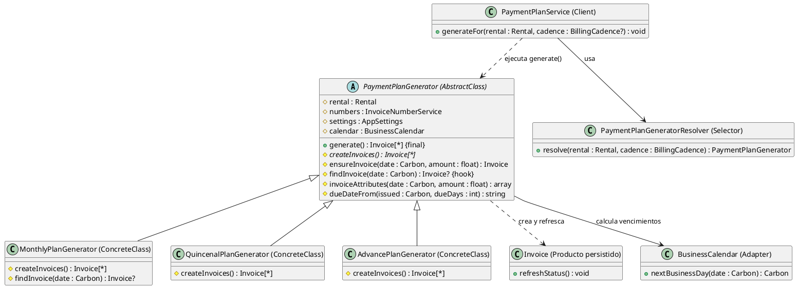
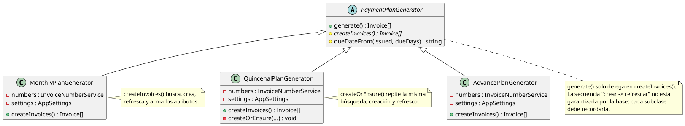
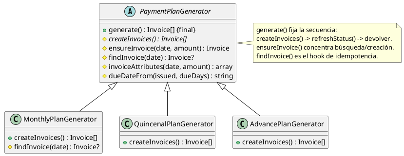

# Template Method

## 1. Nombre y propósito

**Template Method** es un patrón de comportamiento que define el esqueleto de un algoritmo en una clase base y delega en las subclases los pasos que varían, sin permitirles alterar el orden de la secuencia.

En Prometheus se aplica a la **generación del plan de cobros**. `PaymentPlanGenerator` es la clase abstracta; `generate()` es el método plantilla (`final`) que fija la secuencia común; `createInvoices()` es la operación primitiva que implementa cada cadencia; `ensureInvoice()`, `invoiceAttributes()` y `dueDateFrom()` son pasos concretos compartidos; y `findInvoice()` es un **hook** que la cadencia mensual sobrescribe para conservar su criterio de idempotencia.

La misma jerarquía ya estaba documentada como **Factory Method** (`docs/Patrones creacionales/Factory Method.md`). No son implementaciones alternativas: son dos lecturas del mismo diseño. Factory Method explica **quién crea** las facturas; Template Method explica **en qué orden** se ejecuta el algoritmo y dónde están los puntos de variación.

## 2. Problema que resuelve en Prometheus

Un alquiler puede cobrarse de tres formas: mensual, quincenal o anticipo. Las tres comparten una secuencia que no debe cambiar:

1. decidir los cortes (fechas y montos);
2. buscar si el corte ya fue facturado para no duplicarlo;
3. crear la factura con los mismos campos (número, concepto, periodo, emisión, vencimiento, estado, alquiler y usuario);
4. refrescar el estado de cada factura para que los periodos ya transcurridos queden vencidos.

Antes de formalizar el patrón, `generate()` era un simple `return $this->createInvoices();` y cada subclase repetía la búsqueda, la creación y el `refreshStatus()`. Eso tenía tres consecuencias:

- una cadencia nueva podía olvidar el refresco de estado o crear la factura con campos distintos;
- cualquier cambio en la forma de emitir facturas había que replicarlo en tres sitios;
- el orden "crear y después refrescar" no estaba garantizado por la base, sino por la disciplina de cada subclase.

La única diferencia real entre cadencias —además de los cortes— está en **cómo se deduplica**:

- la mensual identifica el corte por `rental + user + period`, porque un mes ya facturado no debe duplicarse aunque cambie la fecha exacta;
- la quincenal y el anticipo identifican por `rental + user + period + issued_at`, porque la quincenal emite dos facturas dentro del mismo mes.

## 3. Solución y roles del patrón

`PaymentPlanGenerator` fija el algoritmo y expone los puntos de extensión. Las tres subclases solo aportan sus cortes y, cuando hace falta, ajustan el hook de idempotencia.

```text
generate()                         // método plantilla (final)
  -> createInvoices()              // operación primitiva (abstracta)
       -> ensureInvoice()          // paso concreto compartido
            -> findInvoice()       // hook: criterio de deduplicación
            -> invoiceAttributes() // paso concreto compartido
  -> refreshStatus() por factura   // paso fijo del esqueleto
  -> devolver facturas
```

| Rol GoF | Implementación en Prometheus | Responsabilidad |
| --- | --- | --- |
| **AbstractClass** | `PaymentPlanGenerator` | Declarar el esqueleto, las operaciones primitivas y los pasos compartidos. |
| **Template Method** | `PaymentPlanGenerator::generate()` | Fijar la secuencia `createInvoices()` → `refreshStatus()` → devolver. Es `final`. |
| **Primitive operation** | `PaymentPlanGenerator::createInvoices()` | Paso abstracto que cada cadencia implementa con sus cortes. |
| **Concrete operation** | `ensureInvoice()`, `invoiceAttributes()`, `dueDateFrom()` | Pasos comunes heredados; no varían por cadencia. |
| **Hook** | `PaymentPlanGenerator::findInvoice()` | Criterio de deduplicación por defecto (periodo + emisión); la mensual lo sobrescribe. |
| **ConcreteClass** | `MonthlyPlanGenerator` | Un corte por mes; deduplica solo por periodo. |
| **ConcreteClass** | `QuincenalPlanGenerator` | Dos cortes por mes (días 1 y 15); usa el hook por defecto. |
| **ConcreteClass** | `AdvancePlanGenerator` | Un único corte por el total del contrato; usa el hook por defecto. |
| **Client** | `PaymentPlanService` / `PaymentPlanGeneratorResolver` | Elegir la cadencia, obtener el generador y ejecutar `generate()`. |
| **Colaboradores** | `InvoiceNumberService`, `AppSettings`, `BusinessCalendar`, `Invoice` | Numerar, aportar días de plazo, calcular días hábiles y persistir. |

**Constructor único.** La clase base recibe `Rental`, `InvoiceNumberService`, `AppSettings` y `BusinessCalendar`. Las tres subclases ya no declaran constructor propio: heredan el de la base con la misma firma y orden que usa `PaymentPlanGeneratorResolver`, por lo que el resolver y el servicio no cambian.

**Hook de idempotencia.** El hook por defecto busca por `rental_id`, `user_id`, `period` y `issued_at`. `MonthlyPlanGenerator` lo sobrescribe para buscar solo por `rental_id`, `user_id` y `period`, que es el comportamiento que ya tenía. Así el patrón no homogeniza una diferencia real del dominio.

**Sin ganchos vacíos.** No se añadieron pasos `beforeGenerate()`/`afterGenerate()` que no hicieran nada. El esqueleto solo contiene pasos con efecto verificable: crear los cortes y refrescar su estado.

## 4. Diagrama de clases



`PaymentPlanGeneratorResolver` no forma parte del patrón: es el selector que construye la clase concreta. Los colaboradores `InvoiceNumberService` y `AppSettings` se omiten del diagrama para no repetir dependencias en cada subclase.

## 5. Clases participantes y valoración

| Clase | Ruta | Rol | Participación |
| --- | --- | --- | --- |
| `PaymentPlanGenerator` | `app/Services/PaymentPlans/PaymentPlanGenerator.php` | AbstractClass | Declara `generate()` final, `createInvoices()` abstracto, los pasos comunes y el hook `findInvoice()`. |
| `MonthlyPlanGenerator` | `app/Services/PaymentPlans/MonthlyPlanGenerator.php` | ConcreteClass | Genera un corte por mes y deduplica por periodo. |
| `QuincenalPlanGenerator` | `app/Services/PaymentPlans/QuincenalPlanGenerator.php` | ConcreteClass | Genera dos cortes por mes y usa el hook por defecto. |
| `AdvancePlanGenerator` | `app/Services/PaymentPlans/AdvancePlanGenerator.php` | ConcreteClass | Genera un único corte por el total del contrato. |
| `PaymentPlanService` | `app/Services/PaymentPlanService.php` | Client | Resuelve la cadencia y ejecuta `generate()`. |
| `PaymentPlanGeneratorResolver` | `app/Services/PaymentPlans/PaymentPlanGeneratorResolver.php` | Selector | Construye la clase concreta; no decide el algoritmo. |
| `Invoice` | `app/Models/Invoice.php` | Producto persistido | Guarda la factura y recalcula su estado con `refreshStatus()`. |
| `BusinessCalendar` | `app/Contracts/BusinessCalendar.php` | Colaborador | Resuelve el siguiente día hábil para el vencimiento. |
| `InvoiceNumberService` | `app/Services/InvoiceNumberService.php` | Colaborador | Asigna el número de factura por usuario y año. |
| `AppSettings` | `app/Settings/AppSettings.php` | Colaborador | Aporta los días de plazo del vencimiento. |

### 5.1. Ventajas

- **Secuencia garantizada:** el orden crear → refrescar → devolver vive en un único método `final`; ninguna subclase puede alterarlo.
- **Menos duplicación:** la búsqueda idempotente, los atributos de la factura y el cálculo de vencimiento están en la base, no repetidos tres veces.
- **Punto único de cambio:** modificar un campo de la factura emitida o la forma de refrescar el estado se hace una sola vez.
- **Diferencias explícitas:** el único criterio que varía de verdad (la deduplicación mensual) está aislado en un hook documentado.
- **Constructores más simples:** las tres subclases dejaron de repetir las mismas dependencias.
- **Contratos intactos:** `generate()` sigue siendo público y devuelve `array<Invoice>`; `createInvoices()` sigue siendo el paso protegido que implementan las cadencias; el resolver y el servicio no cambiaron.
- **Pruebas existentes reutilizadas:** la suite de planes, periodos, vencimientos, idempotencia y seed valida el refactor sin necesidad de cambiar expectativas.

### 5.2. Desventajas

- **Esqueleto corto:** el método plantilla solo fija dos pasos (crear y refrescar). El valor está tanto en el orden como en los pasos comunes que absorbe, no en una secuencia larga.
- **Dos patrones sobre la misma jerarquía:** Factory Method y Template Method describen las mismas clases. Se documentan por separado porque responden preguntas distintas; el riesgo es duplicar explicaciones si no se mantienen sincronizadas.
- **Hook con caso especial:** la mensual necesita un criterio de deduplicación distinto. El hook lo resuelve sin condicionales dentro de la base, pero obliga a conocer esa diferencia para entender el flujo.
- **Persistencia dentro del algoritmo:** las operaciones primitivas consultan y escriben en base de datos; no es un Template Method puro en memoria y exige pruebas con base.
- **Refresco posterior:** el estado se refresca después de crear todos los cortes, no después de cada creación. El resultado final es el mismo porque cada factura se calcula sobre sus propios pagos, pero es una diferencia interna respecto del código anterior que conviene recordar al depurar.
- **`final` en `generate()`:** impide que una subclase futura cambie la secuencia. Es intencional; si un caso nuevo necesitara otro orden, el diseño correcto sería otro método plantilla o composición, no sobrescribir `generate()`.

## 6. Flujo de una llamada

**Generación del plan desde la pantalla de alquiler:**

1. `CreateRental` guarda el alquiler y llama a `RentalFacade::generatePaymentPlan()`.
2. La fachada delega en `PaymentPlanService::generateFor()`.
3. El servicio toma la cadencia explícita o la del alquiler y pide el generador a `PaymentPlanGeneratorResolver`.
4. El resolver construye la clase concreta con `Rental`, `InvoiceNumberService`, `AppSettings` y `BusinessCalendar` (constructor heredado de la base).
5. El servicio invoca `generate()`.
6. `generate()` ejecuta el esqueleto:
   - `createInvoices()` recorre los cortes de la cadencia;
   - por cada corte, `ensureInvoice()` busca con `findInvoice()` y crea la factura con `invoiceAttributes()` si no existe;
   - al terminar, la base llama a `refreshStatus()` sobre todas las facturas devueltas;
   - devuelve el arreglo de facturas.
7. El servicio muestra la notificación de facturas creadas; el arreglo no se usa en ese punto, pero queda disponible para quien lo necesite.

**Comportamiento por cadencia:**

- **Mensual:** un corte por cada mes del contrato, con `addMonthsNoOverflow()`; busca por periodo para no duplicar un mes ya facturado.
- **Quincenal:** dos cortes por mes (día 1 y día 15), monto mensual dividido entre dos; busca por periodo y fecha de emisión.
- **Anticipo:** un corte en la fecha de inicio por `monthly_amount * total_months`; busca por periodo y fecha de emisión.

En las tres, el vencimiento se calcula con `dueDateFrom()` (días de plazo de `AppSettings` + siguiente día hábil de `BusinessCalendar`) y la factura nace con estado `EMITIDA` y sin pagos.

## 7. Pruebas

| Prueba / evidencia | Qué respalda |
| --- | --- |
| `tests/Feature/PaymentPlanGeneratorTest.php` | Resolución de las tres cadencias, cantidad de cortes, montos, fechas, meses de distinta duración y facturas sin pagos. |
| `tests/Feature/InvoicePeriodTest.php` | Periodo por factura, vencimiento calculado desde la emisión, periodos pasados vencidos y numeración distinta para facturas del mismo mes. |
| `tests/Feature/BusinessCalendarTest.php` | Vencimiento en día hábil y herencia de festivos del calendario. |
| `tests/Feature/SeedingTest.php` | Facturas emitidas sin pagos, estado coherente con el vencimiento y regeneración idempotente del plan. |
| Suite completa | `php artisan test` → **368 pruebas, 1764 aserciones**, todas en verde tras el refactor. |
| Laravel Pint | `vendor/bin/pint app/Services/PaymentPlans` sin cambios pendientes. |

> El caso de idempotencia mensual (mismo periodo con distinta fecha de emisión) queda cubierto de forma indirecta por la prueba de regeneración del plan. Si en el futuro se cambia el hook `findInvoice()`, conviene añadir una prueba específica que fije ese criterio.

## 8. Decisión de alcance

Se documenta **Template Method** como patrón de comportamiento **implementado** en la generación de planes de cobro. La implementación:

- no agrega funcionalidad nueva ni cambia reglas de facturación, montos, periodos, vencimientos o estados;
- mantiene los contratos públicos de `PaymentPlanGenerator`, `PaymentPlanService`, `PaymentPlanGeneratorResolver` y `RentalFacade`;
- conserva la diferencia de idempotencia de la cadencia mensual mediante un hook explícito;
- no introduce ganchos vacíos ni pasos sin efecto.

La jerarquía también participa de **Factory Method** (`docs/Patrones creacionales/Factory Method.md`). Al modificar el plan de cobros hay que actualizar ambas lecturas: la de creación (qué subclase se elige y qué producto produce) y la de secuencia (qué pasos fija `generate()` y dónde están los puntos de variación).

Si en el futuro se agrega una cadencia nueva:

1. implementar `createInvoices()` con sus cortes;
2. reutilizar `ensureInvoice()` en lugar de repetir consultas y atributos;
3. sobrescribir `findInvoice()` solo si su clave de deduplicación es distinta de `period + issued_at`;
4. registrar la cadencia en `BillingCadence` y en `PaymentPlanGeneratorResolver`;
5. ejecutar las pruebas de planes, periodos, vencimientos e idempotencia.

## 9. Evidencia de implementación: antes y después

Este patrón no creó una funcionalidad nueva: reorganizó la generación de planes que ya existía. El contraste se muestra con UML; el código queda solo para el mecanismo que el diagrama no expresa por sí solo. Los diagramas «antes» corresponden a `dda5732` (commit anterior a este patrón); los «después», al estado actual tras `e32dd90`.

**Por qué era necesario.** En el diseño anterior `generate()` solo delegaba y cada subclase repetía la búsqueda, la creación y el `refreshStatus()`. Una cadencia nueva podía olvidar el refresco o crear la factura con campos distintos, y el orden crear → refrescar dependía de la disciplina de cada subclase, no de la base.

**Antes — cada subclase resolvía la secuencia completa**



**Después — la base fija la secuencia y expone el hook**



El único código que hace falta retener es el método plantilla, porque es lo que el UML marca como `final`:

```php
final public function generate(): array
{
    $invoices = $this->createInvoices();

    foreach ($invoices as $invoice) {
        $invoice->refreshStatus();
    }

    return $invoices;
}
```

**Qué evidencia**

- `generate()` pasó a ser `final`: el orden crear → refrescar → devolver ya no depende de cada subclase (**Template Method**).
- `createInvoices()` sigue siendo la operación primitiva: cada cadencia decide sus cortes.
- `ensureInvoice()` e `invoiceAttributes()` son operaciones concretas compartidas; la búsqueda y los atributos dejaron de estar duplicados.
- `findInvoice()` es el **hook**: el comportamiento por defecto (periodo + emisión) y la excepción mensual (solo periodo) quedan explícitos en un solo punto.
- El diff elimina de `MonthlyPlanGenerator` y `QuincenalPlanGenerator` la creación de facturas y el `refreshStatus()` repetidos; no cambia montos, fechas, periodos ni estados.
