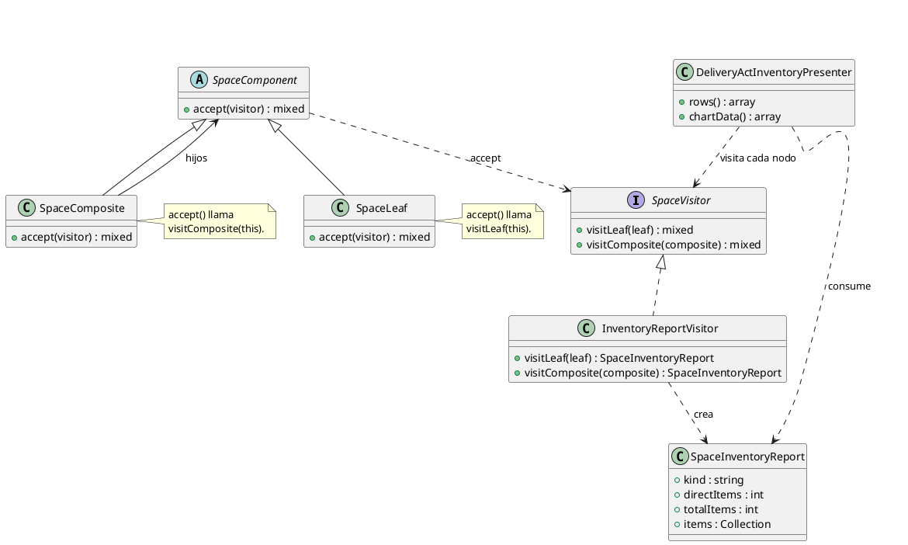
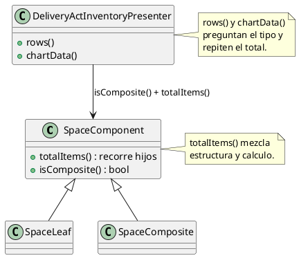
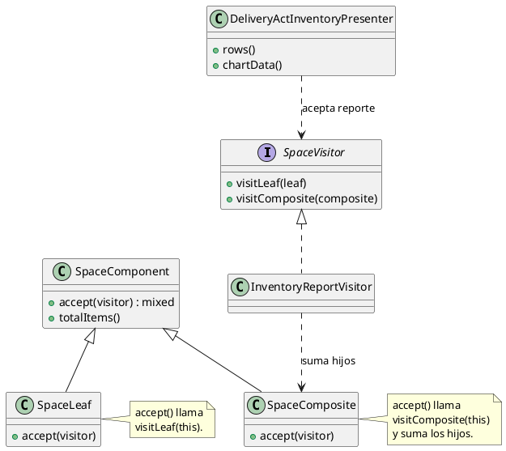

# Visitor

## 1. Nombre y propósito

**Visitor** separa una operación de la estructura sobre la que se aplica. Cada elemento recibe un visitante con `accept()` y lo redirige a su método concreto (`visitLeaf` o `visitComposite`). Así se agregan operaciones nuevas sin modificar las clases de los elementos ni llenar al cliente de condicionales por tipo.

En Prometheus se aplica al **Composite de espacios**. `InventoryReportVisitor` resume un espacio para la pantalla del acta: la hoja aporta sus elementos y su total; el compuesto conserva los propios y suma el total de cada hijo mediante doble despacho. El presenter deja de preguntar `isComposite()` y de calcular el total por su cuenta.

## 2. Problema que resuelve en Prometheus

El presenter del acta necesitaba dos cosas de cada nodo: su tipo y su total. Las resolvía así:

- `rows()` usaba `$node->isComposite()` para el booleano `composite`.
- `chartData()` usaba `$node->isComposite()` para el `kind` (`leaf`/`composite`).
- Ambos llamaban `$node->totalItems()`, que dentro del modelo recorría los hijos recursivamente.
- El cálculo del total y la diferencia hoja/compuesto vivían en el modelo, mientras la presentación repetía la pregunta por el tipo.

Eso dejaba tres problemas:

1. **Condicionales por tipo en el cliente.** Cada nueva pantalla o reporte repetiría `isComposite()`.
2. **La operación “resumir un espacio” no existía como objeto.** El total estaba en el modelo y el resto en el presenter.
3. **Agregar otro reporte obligaba a tocar el presenter o el modelo**, en vez de añadir un visitante.

Visitor no agrega datos nuevos: hace explícita la operación que ya existía y la resuelve según el tipo de nodo.

## 3. Solución y roles del patrón

| Rol GoF | Implementación en Prometheus | Responsabilidad |
| --- | --- | --- |
| **Visitor** | `SpaceVisitor` | Contrato `visitLeaf()` / `visitComposite()`. |
| **ConcreteVisitor** | `InventoryReportVisitor` | Construye el reporte de cada nodo y suma los totales de los hijos. |
| **Element** | `SpaceComponent` | Declara `accept()`. |
| **ConcreteElement** | `SpaceLeaf` | Redirige a `visitLeaf()`. |
| **ConcreteElement** | `SpaceComposite` | Redirige a `visitComposite()`. |
| **ObjectStructure** | Árbol de espacios | Se recorre con `SpaceTreeIterator` (Iterator). |
| **Client** | `DeliveryActInventoryPresenter` | Pide el reporte y arma filas y organigrama. |

**Qué devuelve el visitante**

`SpaceInventoryReport` es inmutable y reúne lo que la pantalla necesita:

| Campo | Significado |
| --- | --- |
| `kind` | `leaf` o `composite`, decidido por el nodo concreto. |
| `directItems` | Elementos colgados directamente del espacio. |
| `totalItems` | Elementos propios más los de todo el subárbol. |
| `items` | Colección de elementos directos, para serializar y contar estados. |

**Diferencia real entre tipos**

- `visitLeaf()`: `directItems` y `totalItems` son el conteo de sus elementos.
- `visitComposite()`: parte del conteo propio y suma `totalItems` de cada hijo llamando `$child->accept($this)`.

## 4. Diagrama de clases



## 5. Clases participantes y valoración

| Clase | Ruta | Rol | Participación |
| --- | --- | --- | --- |
| `SpaceVisitor` | `app/Visitors/Space/SpaceVisitor.php` | Visitor | Contrato de doble despacho. |
| `InventoryReportVisitor` | `app/Visitors/Space/InventoryReportVisitor.php` | ConcreteVisitor | Reporte por nodo y suma de totales. |
| `SpaceInventoryReport` | `app/Visitors/Space/SpaceInventoryReport.php` | Resultado | DTO inmutable con tipo, conteos y elementos. |
| `SpaceComponent` | `app/Models/SpaceComponent.php` | Element | Declara `accept()`; `totalItems()` delega en el visitante. |
| `SpaceLeaf` | `app/Models/SpaceLeaf.php` | ConcreteElement | Redirige a `visitLeaf()`. |
| `SpaceComposite` | `app/Models/SpaceComposite.php` | ConcreteElement | Redirige a `visitComposite()`. |
| `DeliveryActInventoryPresenter` | `app/Services/Acts/DeliveryActInventoryPresenter.php` | Client | Usa el reporte en filas, organigrama y total raíz. |

### 5.1. Ventajas

- **Sin condicionales por tipo en el cliente:** `rows()` y `chartData()` consumen `kind` del reporte.
- **Operación explícita:** «resumir un espacio» tiene nombre, clase y pruebas propias.
- **Total en un solo lugar:** `totalItems()` y el reporte comparten el mismo cálculo.
- **Extensible:** otro reporte (exportación, estadísticas, etiquetas) puede ser un visitante nuevo sin tocar `SpaceLeaf`/`SpaceComposite`.
- **Contratos preservados:** `totalItems()`, `isComposite()`, `rows()` y `chartData()` mantienen su firma y su salida.

### 5.2. Desventajas

- **Más clases para una operación pequeña.** La ganancia es quitar el condicional por tipo y centralizar el total; no es una optimización de rendimiento.
- **El contrato devuelve `mixed`.** PHP no expresa el tipo genérico del resultado; el visitante concreto lo estrecha y los clientes lo documentan con `@var`.
- **El compuesto sigue recorriendo hijos.** El visitante agrega el total recursivamente; el cambio es de responsabilidad, no de complejidad algorítmica.
- **`prune()` queda fuera.** Reconstruye el árbol filtrado con nodos nuevos; no es una operación de lectura sobre elementos existentes.

## 6. Flujo de una llamada

**Filas de la tabla:**

1. `DeliveryActInventoryPresenter::rows()` obtiene el árbol filtrado.
2. Recorre los nodos con `SpaceTreeIterator` y crea un `InventoryReportVisitor`.
3. Por cada nodo llama `$node->accept($visitor)`.
4. La hoja entra a `visitLeaf()`; el compuesto a `visitComposite()`.
5. El compuesto suma `totalItems` de los reportes de sus hijos.
6. El presenter usa `kind`, `directItems`, `totalItems` e `items` para armar la fila.

**Organigrama:**

1. `chartData()` usa el mismo visitante.
2. `kind` sale del reporte, sin preguntar `isComposite()`.
3. `directItems` limita la vista previa a tres elementos y calcula `moreItems`.

**Total de la raíz sintética:**

1. `totalItems()` privado del presenter visita cada raíz.
2. Suma los `totalItems` de sus reportes.
3. El nodo sintético muestra el total del acta.

## 7. Pruebas

| Prueba / evidencia | Qué respalda |
| --- | --- |
| `tests/Feature/SpaceVisitorTest.php` | Doble despacho hoja/compuesto; reporte de hoja; total acumulado del compuesto; `totalItems()` conserva el resultado anterior. |
| `tests/Feature/DeliveryActInventoryViewTest.php` | Filas, `depth`, `kind`, `parentId` y render del acta sin cambios. |
| `tests/Feature/SpaceHierarchyCompositeTest.php` | El árbol, los selectores y el total del acta siguen igual. |
| `tests/Feature/SpaceTreeIteratorTest.php` | El recorrido que consume el visitante conserva preorden, profundidad y padre. |
| `tests/Feature/SpaceCatalogFieldTest.php` | Los selectores de espacios no se ven afectados. |

Resultado de la implementación: **4 pruebas nuevas** (13 aserciones) y **72 pruebas relacionadas en verde** (338 aserciones). Suite completa: **403 pruebas, 1916 aserciones, OK**, corrida en dos procesos (`392 + 11`) por el `set_time_limit(300)` de `ListIpcSeries`; no es un fallo de código.

## 8. Decisión de alcance

Se documenta **Visitor** como patrón de comportamiento **implementado** sobre el Composite de espacios. La implementación:

- agrega `SpaceVisitor`, `InventoryReportVisitor` y `SpaceInventoryReport`;
- implementa `accept()` en `SpaceLeaf` y `SpaceComposite`;
- hace que `SpaceComponent::totalItems()` delegue en el visitante;
- elimina `isComposite()` de `rows()` y `chartData()`;
- conserva `isComposite()` para la vista Blade y la construcción del árbol;
- deja `prune()` recursivo porque reconstruye el árbol filtrado;
- no toca `allItems()`, el esquema, Filament, validaciones ni reglas legales.

**Cuándo usar el patrón:** cuando hay operaciones que varían según el tipo de nodo y se quieren agregar sin modificar la estructura. **Cuándo no:** si solo hay un tipo de nodo o una operación trivial; un visitante añadiría indirección sin valor.

## 9. Evidencia de implementación: antes y después

El patrón no cambió el árbol ni la pantalla: movió la operación al visitante. El contraste se muestra con UML; el código queda solo para el mecanismo que el diagrama no expresa. Los diagramas «antes» corresponden a `0afce5a` (commit anterior a este patrón); los «después», al estado actual.

**Por qué era necesario.** El presenter preguntaba el tipo con `isComposite()` y pedía el total al modelo. La diferencia entre una hoja y un compuesto existía, pero no estaba encapsulada en una operación; cada cliente debía conocerla.

**Antes — condicional por tipo y total en el modelo**



**Después — accept y visitante concreto**



El mecanismo imprescindible es el doble despacho: el elemento concreto elige el método del visitante y el compuesto agrega los reportes de sus hijos.

```php
public function accept(SpaceVisitor $visitor): mixed
{
    return $visitor->visitComposite($this);
}
```

```php
foreach ($composite->children() as $child) {
    /** @var SpaceInventoryReport $report */
    $report = $child->accept($this);

    $totalItems += $report->totalItems;
}
```

**Qué evidencia**

- `SpaceVisitor` declara `visitLeaf()`/`visitComposite()`.
- `SpaceLeaf` y `SpaceComposite` implementan `accept()` con doble despacho.
- `InventoryReportVisitor` decide `kind`, `directItems` y `totalItems` por tipo.
- `SpaceComponent::totalItems()` delega en el visitante.
- `DeliveryActInventoryPresenter` ya no pregunta `isComposite()` en filas ni organigrama.
- No cambian la salida, los textos, los íconos ni los niveles.
