# Adapter

## 1. Nombre y propósito

**Adapter** convierte la interfaz de una clase en otra que el cliente espera. Permite que colaboradores con interfaces incompatibles trabajen juntos sin que el dominio conozca los detalles del origen de los datos.

En Prometheus el patrón tiene dos aplicaciones verificadas:

- **Días hábiles:** el dominio pregunta si una fecha es hábil y cuál es el siguiente día hábil; el adaptador traduce la respuesta de Nager.Date.
- **IPC:** el dominio pide series, geografías y años; los adaptadores traducen el CDA del DANE y la copia local en `ipc_series`.

## 2. Problema que resuelve en Prometheus

**Días hábiles.** El vencimiento de una factura, el fin de un contrato y la fecha propuesta para un reajuste necesitan saber si un día es hábil. Esa información viene de un servicio externo que devuelve un arreglo JSON de festivos por año y país. El dominio no debe conocer la URL, el código de país, la forma del JSON ni la caché; tampoco puede quedar acoplado a que Nager.Date esté disponible.

**IPC.** Las cartas de reajuste necesitan la variación anual del IPC. El DANE no publica una API REST estable: el dato sale de un CDA de Pentaho sin documentación, con comas decimales, meses abreviados, códigos a los que se les pierde el cero y respuestas 502 intermitentes. Una carta emitida por correo no puede fallar porque el DANE esté caído, ni cambiar su texto si el DANE corrige un dato después.

Sin Adapter, las reglas de facturación, contratos y reajustes tendrían que hablar HTTP, JSON, SQL y columnas del DANE. El dominio quedaría acoplado a dos servicios externos, las pruebas dependerían de la red y cambiar de fuente obligaría a tocar varios módulos.

## 3. Solución y roles

| Rol GoF | Días hábiles | IPC |
| --- | --- | --- |
| **Target** | `BusinessCalendar` | `IpcProvider` |
| **Adapter** | `NagerDateBusinessCalendar` | `DaneCdaIpcProvider` (remoto) y `LocalSeriesIpcProvider` (local) |
| **Adaptee** | API pública Nager.Date | CDA del DANE / tabla local `ipc_series` |
| **Cliente** | `PaymentPlanGenerator`, `PaymentPlanGeneratorResolver`, `RentalPeriod`, `InvoiceResource`, `AdjustmentDateProposer` | `IpcSynchronizer`, `SyncIpcDane`, `SyncIpcGeographies`, `IpcDoctor` |
| **Respaldo / doble** | `WeekendBusinessCalendar` (no es Adapter) | `InMemoryIpcProvider` (no es Adapter) |

**Días hábiles.** `BusinessCalendar` declara `isBusinessDay()` y `nextBusinessDay()`. `NagerDateBusinessCalendar` implementa el Target envolviendo la API de Nager.Date: consulta los festivos del año, los cachea por país y año, y traduce las fechas al contrato del dominio. Es un adaptador de objeto: compone la fuente externa y el calendario de respaldo, no hereda de ella.

El adaptador es el único punto que conoce la URL base, el país y la forma del JSON. Si la API falla, `holidaysFor()` devuelve un arreglo vacío y el comportamiento práctico queda como calendario de fin de semana; además, `nextBusinessDay()` tiene un tope de 366 días y un respaldo explícito en `WeekendBusinessCalendar`.

El binding cambia por entorno en `AppServiceProvider`: en `testing` se usa `WeekendBusinessCalendar`; en el resto, `NagerDateBusinessCalendar` con `services.holidays.base_url` y `services.holidays.country`. `WeekendBusinessCalendar` implementa el Target directamente y solo evita sábados y domingos; no envuelve una interfaz incompatible, por eso no es un Adapter.

**IPC.** `IpcProvider` declara `fetchSeries()`, `fetchGeographies()`, `fetchAvailableYears()` y `name()`. Hay dos adaptadores reales:

- `DaneCdaIpcProvider` envuelve el CDA de Pentaho. Construye la consulta con `CdaQueryFactory`, envía un formulario al endpoint, reintenta con espera creciente y normaliza la respuesta: coma decimal, meses abreviados, `PAI_ID` con ceros a la izquierda, columnas por nombre y celdas vacías como `null`.
- `LocalSeriesIpcProvider` envuelve la copia local. Traduce `IpcSeries` a `IpcObservation`, lee geografías desde `Geography` y años desde `IpcSeriesRepository`.

`InMemoryIpcProvider` implementa el Target para pruebas; no adapta ninguna fuente externa y por eso se marca como doble de prueba, no como Adapter.

El binding por defecto es `IpcProvider -> LocalSeriesIpcProvider`; `DaneCdaIpcProvider` y `LocalSeriesIpcProvider` también se registran como singleton. La sincronización usa el adaptador remoto de forma explícita: los comandos `ipc:sync` y `ipc:sync:geographies` inyectan `DaneCdaIpcProvider`, y `IpcSynchronizer` lo recibe como `IpcProvider` para traer la serie. El flujo es de una sola vía: el comando trae del DANE y guarda en `ipc_series`; las pantallas y los cálculos leen la copia local.

**Diferencia entre las dos aplicaciones.** En días hábiles el cliente consulta el Target en tiempo de ejecución y el adaptador remoto es el que se usa en producción. En IPC el adaptador remoto se usa para sincronizar, mientras que la lectura normal se apoya en la copia local y, en varios recursos, directamente en `IpcSeriesRepository`. Esa diferencia es deliberada por disponibilidad, pero conviene tenerla presente al evaluar el alcance real de la abstracción.

## 4. Diagrama de clases

**Días hábiles**

```plantuml
@startuml

interface "BusinessCalendar (Target)" as BusinessCalendar {
  + isBusinessDay(date : CarbonInterface) : bool
  + nextBusinessDay(date : CarbonInterface) : CarbonInterface
}

class "NagerDateBusinessCalendar (Adapter)" as NagerDateBusinessCalendar {
  - baseUrl : string
  - country : string
  - fallback : WeekendBusinessCalendar
  + isBusinessDay(date : CarbonInterface) : bool
  + nextBusinessDay(date : CarbonInterface) : CarbonInterface
  - holidaysFor(year : int) : string[*]
  - fetchHolidays(year : int) : string[*]
}

class "Nager.Date API (Adaptee)" as NagerDateApi {
  + holidays(year : int, country : string) : Holiday[*]
}

class "WeekendBusinessCalendar (Implementación de respaldo - no Adapter)" as WeekendBusinessCalendar {
  + isBusinessDay(date : CarbonInterface) : bool
  + nextBusinessDay(date : CarbonInterface) : CarbonInterface
}

class "PaymentPlanGenerator (Cliente)" as PaymentPlanGenerator {
  # calendar : BusinessCalendar
  # dueDateFrom(issued : Carbon, dueDays : int) : string
}

class "PaymentPlanGeneratorResolver (Cliente)" as PaymentPlanGeneratorResolver {
  + resolve(rental : Rental, cadence : BillingCadence) : PaymentPlanGenerator
}

class "RentalPeriod (Cliente)" as RentalPeriod {
  + endDate() : CarbonInterface
  + endDateFormatted() : string
}

class "InvoiceResource (Cliente)" as InvoiceResource {
  + form(schema : Schema) : Schema
}

class "AdjustmentDateProposer (Cliente)" as AdjustmentDateProposer {
  + suggestedDate(date : DateTimeInterface) : DateTimeInterface
  + isBusinessDay(date : DateTimeInterface) : bool
}

NagerDateBusinessCalendar ..|> BusinessCalendar
WeekendBusinessCalendar ..|> BusinessCalendar
NagerDateBusinessCalendar --> NagerDateApi : consulta
NagerDateBusinessCalendar --> WeekendBusinessCalendar : respaldo

PaymentPlanGenerator --> BusinessCalendar : usa
PaymentPlanGeneratorResolver --> BusinessCalendar : inyecta
RentalPeriod --> BusinessCalendar : usa
InvoiceResource --> BusinessCalendar : usa
AdjustmentDateProposer --> BusinessCalendar : usa
@enduml
```

**IPC**

```plantuml
@startuml

interface "IpcProvider (Target)" as IpcProvider {
  + fetchSeries(geographyCode : string, fromYear : int?, toYear : int?) : IpcObservation[*]
  + fetchGeographies() : Geography[*]
  + fetchAvailableYears() : int[*]
  + name() : string
}

class "DaneCdaIpcProvider (Adapter - remoto)" as DaneCdaIpcProvider {
  - queries : CdaQueryFactory
  + fetchSeries(geographyCode : string, fromYear : int?, toYear : int?) : IpcObservation[*]
  + fetchGeographies() : Geography[*]
  + fetchAvailableYears() : int[*]
  + name() : string
}

class "LocalSeriesIpcProvider (Adapter - local)" as LocalSeriesIpcProvider {
  - series : IpcSeriesRepository
  + fetchSeries(geographyCode : string, fromYear : int?, toYear : int?) : IpcObservation[*]
  + fetchGeographies() : Geography[*]
  + fetchAvailableYears() : int[*]
  + name() : string
}

class "InMemoryIpcProvider (Doble de prueba - no Adapter)" as InMemoryIpcProvider {
  + fetchSeries(geographyCode : string, fromYear : int?, toYear : int?) : IpcObservation[*]
  + fetchGeographies() : Geography[*]
  + fetchAvailableYears() : int[*]
  + name() : string
}

class "DANE CDA / Pentaho (Adaptee)" as DaneCda {
  + doQuery(query : array) : CdaResponse
}

class "IpcSeriesRepository / ipc_series (Adaptee local)" as IpcSeriesRepository {
  + series(geographyCode : string, fromYear : int?, toYear : int?) : Collection
  + availableYears(geographyCode : string?) : int[*]
}

class "CdaQueryFactory (Colaborador - no GoF)" as CdaQueryFactory {
  + seriesQuery(...) : array
  + simpleQuery(...) : array
}

class "IpcSynchronizer (Cliente)" as IpcSynchronizer {
  + syncGeography(code : string, fromYear : int?, toYear : int?) : array
  + syncGeographies(geographies : Geography[*]) : int
}

class "SyncIpcDane (Cliente - comando)" as SyncIpcDane {
  + handle(provider : DaneCdaIpcProvider) : int
}

class "SyncIpcGeographies (Cliente - comando)" as SyncIpcGeographies {
  + handle(provider : DaneCdaIpcProvider) : int
}

class "IpcDoctor (Cliente - diagnóstico)" as IpcDoctor {
  + handle(series : IpcSeriesRepository, remote : DaneCdaIpcProvider) : int
}

DaneCdaIpcProvider ..|> IpcProvider
LocalSeriesIpcProvider ..|> IpcProvider
InMemoryIpcProvider ..|> IpcProvider

DaneCdaIpcProvider --> DaneCda : consulta
DaneCdaIpcProvider --> CdaQueryFactory : construye consulta
LocalSeriesIpcProvider --> IpcSeriesRepository : lee copia local

IpcSynchronizer --> IpcProvider : usa
SyncIpcDane --> IpcSynchronizer : crea
SyncIpcDane --> DaneCdaIpcProvider : pasa el adaptador remoto
SyncIpcGeographies --> DaneCdaIpcProvider : consulta catálogo
IpcDoctor --> DaneCdaIpcProvider : consulta en vivo
@enduml
```

## 5. Clases participantes y valoración

| Clase | Rol | Aplicación | Ruta | Responsabilidad |
| --- | --- | --- | --- | --- |
| `BusinessCalendar` | Target | Días hábiles | `app/Contracts/BusinessCalendar.php` | Definir las operaciones de día hábil que espera el dominio. |
| `NagerDateBusinessCalendar` | Adapter | Días hábiles | `app/Infrastructure/Holidays/NagerDateBusinessCalendar.php` | Traducir Nager.Date al Target, cachear festivos y degradar si falla. |
| `WeekendBusinessCalendar` | Respaldo (no Adapter) | Días hábiles | `app/Infrastructure/Holidays/WeekendBusinessCalendar.php` | Implementar el Target evitando solo fines de semana. |
| Nager.Date API | Adaptee | Días hábiles | Servicio externo | Entregar festivos por año y país en JSON. |
| `PaymentPlanGenerator` | Cliente | Días hábiles | `app/Services/PaymentPlans/PaymentPlanGenerator.php` | Calcular vencimientos de facturas con el Target. |
| `PaymentPlanGeneratorResolver` | Cliente | Días hábiles | `app/Services/PaymentPlans/PaymentPlanGeneratorResolver.php` | Inyectar el Target en los generadores concretos. |
| `RentalPeriod` | Cliente | Días hábiles | `app/ValueObjects/RentalPeriod.php` | Calcular el fin del contrato con el Target. |
| `InvoiceResource` | Cliente | Días hábiles | `app/Filament/Resources/InvoiceResource.php` | Proponer el vencimiento de una factura con el Target. |
| `AdjustmentDateProposer` | Cliente | Días hábiles | `app/Services/Adjustment/AdjustmentDateProposer.php` | Proponer la fecha hábil de un reajuste. |
| `IpcProvider` | Target | IPC | `app/Contracts/Ipc/IpcProvider.php` | Definir series, geografías, años y nombre de la fuente. |
| `DaneCdaIpcProvider` | Adapter remoto | IPC | `app/Infrastructure/Ipc/DaneCdaIpcProvider.php` | Traducir el CDA del DANE al Target y normalizar sus datos. |
| `LocalSeriesIpcProvider` | Adapter local | IPC | `app/Infrastructure/Ipc/LocalSeriesIpcProvider.php` | Traducir `ipc_series` y el repositorio al Target. |
| `InMemoryIpcProvider` | Doble de prueba (no Adapter) | IPC | `app/Infrastructure/Ipc/InMemoryIpcProvider.php` | Implementar el Target con datos controlados para pruebas. |
| `IpcSynchronizer` | Cliente | IPC | `app/Services/Ipc/IpcSynchronizer.php` | Sincronizar una serie usando un `IpcProvider`. |
| `SyncIpcDane` | Cliente | IPC | `app/Console/Commands/SyncIpcDane.php` | Comando que sincroniza el DANE a la copia local. |
| `SyncIpcGeographies` | Cliente | IPC | `app/Console/Commands/SyncIpcGeographies.php` | Comando que sincroniza el catálogo de ciudades con IPC. |
| `IpcDoctor` | Cliente diagnóstico | IPC | `app/Console/Commands/IpcDoctor.php` | Comparar la copia local con el adaptador remoto. |
| `IpcSeriesRepository` | Adaptee local | IPC | `app/Services/Ipc/IpcSeriesRepository.php` | Entregar filas y años de `ipc_series` al adaptador local. |
| `CdaQueryFactory` | Colaborador (no GoF) | IPC | `app/Services/Ipc/CdaQueryFactory.php` | Construir las consultas que espera el CDA. |
| `AppServiceProvider` | Configuración (no GoF) | Ambas | `app/Providers/AppServiceProvider.php` | Elegir adaptadores por entorno y registrar bindings. |

### 5.1. Ventajas

- **Dominio aislado:** las reglas de facturas, contratos y reajustes no conocen URLs, JSON, SQL ni columnas del DANE.
- **Fuentes intercambiables:** se puede cambiar Nager.Date, el CDA o la copia local sin tocar a los clientes.
- **Adaptador remoto encapsulado:** Nager.Date queda detrás de una sola clase; URL, país, caché y fallback viven ahí.
- **Normalización en la frontera:** `DaneCdaIpcProvider` convierte comas decimales, meses abreviados, códigos sin ceros y columnas del CDA antes de entregar datos al dominio.
- **Disponibilidad:** la copia local permite emitir cartas de reajuste aunque el DANE esté caído; el sincronizador conserva la última serie buena.
- **Pruebas deterministas:** `WeekendBusinessCalendar` e `InMemoryIpcProvider` permiten probar sin red ni base externa; los adaptadores reales se prueban con `Http::fake()`.
- **Configuración por entorno:** el calendario se elige en `AppServiceProvider`; en pruebas no se consulta Nager.Date.
- **Reutilización:** el mismo `BusinessCalendar` sirve para vencimientos, fin de contrato y fechas de reajuste.
- **Errores explícitos:** el adaptador del DANE lanza `DaneIpcUnavailable` cuando no puede consultar; el sincronizador decide conservar la copia local.
- **Adaptadores de objeto:** todos los adaptadores componen la fuente; no heredan de APIs externas ni de Eloquent.

### 5.2. Desventajas

- **Degradación incompleta:** si Nager.Date falla, `holidaysFor()` devuelve `[]` y los festivos entre semana se tratan como hábiles; el respaldo efectivo es solo de fin de semana. El fallback explícito de `nextBusinessDay()` queda después de 366 intentos y en la práctica no es el camino normal.
- **Fallo silencioso del calendario:** una respuesta HTTP no exitosa de Nager.Date devuelve `null` sin registrar el motivo; solo se registra una excepción. La fecha puede quedar mal sin una señal clara.
- **Cobertura limitada de la degradación:** la prueba de fallo del calendario usa un sábado; no cubre un festivo entre semana cuando la API no responde.
- **Caché de un día:** un cambio o corrección de festivos puede tardar hasta un día en reflejarse.
- **Dos rutas para el IPC:** el adaptador remoto se usa para sincronizar y el local para leer; la sincronización es un paso operativo que puede quedar desactualizado.
- **Abstracción incompleta en lectura:** las pantallas de IPC y reajustes consultan `IpcSeriesRepository` directamente; el binding `IpcProvider -> LocalSeriesIpcProvider` no cubre todos los consumidores.
- **Dependencia concreta en los comandos:** `SyncIpcDane`, `SyncIpcGeographies` e `IpcDoctor` inyectan `DaneCdaIpcProvider`, no el Target. La abstracción se usa dentro de `IpcSynchronizer`, pero no en todos los puntos de entrada.
- **Mantenimiento del CDA:** el adaptador depende de un servicio sin documentación, de nombres de columnas y de `config/dane_ipc_sql.php`; un cambio del DANE obliga a ajustar el adaptador.
- **Fallos lentos:** el adaptador remoto usa timeout de 90 segundos y varios reintentos; una caída puede tardar varios minutos antes de conservar la copia local.
- **Doble adaptador para IPC:** remoto y local deben mantener el mismo contrato; una diferencia de normalización entre ambos puede producir resultados distintos según el camino.
- **Respaldo no inyectado:** `NagerDateBusinessCalendar` crea su `WeekendBusinessCalendar` internamente, lo que reduce la capacidad de sustituirlo en pruebas.
