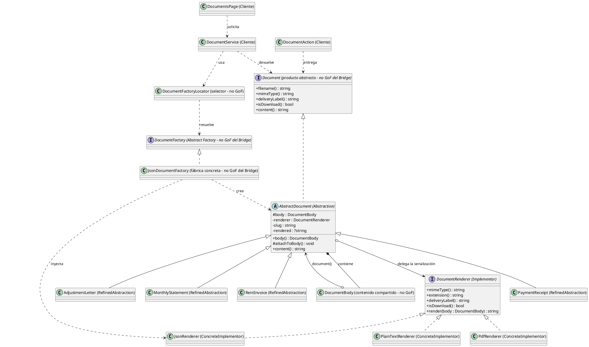

# Bridge

## 1. Nombre y propósito

**Bridge** es un patrón estructural de objetos, también conocido como **Handle/Body**. Desacopla una abstracción de su implementación para que ambas puedan variar de forma independiente.

En Prometheus, la abstracción es **qué documento se entrega** —factura, comprobante, carta de reajuste o estado de cuenta— y la implementación es **cómo se serializa** —texto plano, PDF o JSON—. El documento no contiene ramas por formato: conserva su cuerpo y delega la presentación en un renderizador intercambiable.

La implementación es real y está verificada en el código. La estructura permite doce combinaciones —cuatro documentos por tres formatos— sin duplicar la lógica de negocio de cada documento.

## 2. Problema que resuelve en Prometheus

El módulo de documentos construye cuatro productos de dominio:

| Documento | Clase | Datos principales |
| --- | --- | --- |
| Factura de arrendamiento | `RentInvoice` | Factura, alquiler, periodo, vencimiento y pagos |
| Comprobante de pago | `PaymentReceipt` | Abonos, saldo y forma de pago |
| Carta de reajuste | `AdjustmentLetter` | IPC, canon anterior, canon nuevo y advertencias legales |
| Estado de cuenta | `MonthlyStatement` | Facturas de un periodo y saldo real |

Cada documento arma un `DocumentBody` con título, campos, tablas, notas, advertencias, pie y metadatos. El cuerpo contiene los datos de presentación, pero no HTML, PDF ni JSON.

El problema tiene dos dimensiones que cambian por separado:

- cuatro tipos de documento;
- tres formatos de entrega: texto plano, PDF y JSON estructurado.

Si cada documento decidiera su formato, las doce combinaciones terminarían en condicionales repartidos por el dominio. Además, antes de completar el Bridge, la entrega del PDF estaba duplicada: `DocumentAction` y `DocumentsPage` llamaban directamente a FlexPDF y repetían la selección de plantilla que ya vivía en `PdfRenderer`.

También existía un error de referencia: `PaymentReceipt`, `RentInvoice` y `AdjustmentLetter` adjuntaban al `DocumentBody` el modelo (`Invoice` o `RentAdjustment`) en lugar del documento. Como `PdfRenderer::selectView()` compara clases de documento, esos tres productos caían en la plantilla genérica cuando se renderizaban por `content()`.

La aplicación necesitaba agregar JSON sin tocar la lógica de negocio de los cuatro documentos, sin duplicar la entrega del PDF y sin que la pantalla conociera el formato.

## 3. Solución y roles

Bridge separa las dos jerarquías y las conecta por **composición**:

- La abstracción `AbstractDocument` contiene un `DocumentBody` y un `DocumentRenderer`, y delega en este último el nombre, el MIME, la etiqueta de entrega, el modo de descarga y el contenido final.
- Las abstracciones refinadas construyen su cuerpo y conservan sus datos de dominio.
- El implementador `DocumentRenderer` declara cómo se entrega un cuerpo.
- Los implementadores concretos serializan el mismo cuerpo en texto, PDF o JSON.

| Rol GoF | Clase en Prometheus | Archivo | Responsabilidad |
| --- | --- | --- | --- |
| **Abstraction** | `AbstractDocument` | `app/Documents/AbstractDocument.php` | Guardar el cuerpo y el renderizador; delegar la entrega y memorizar el contenido. |
| **RefinedAbstraction** | `RentInvoice` | `app/Documents/RentInvoice.php` | Factura de arrendamiento. |
| **RefinedAbstraction** | `PaymentReceipt` | `app/Documents/PaymentReceipt.php` | Comprobante de una factura pagada. |
| **RefinedAbstraction** | `AdjustmentLetter` | `app/Documents/AdjustmentLetter.php` | Carta de comunicación del reajuste. |
| **RefinedAbstraction** | `MonthlyStatement` | `app/Documents/MonthlyStatement.php` | Estado de cuenta de un periodo. |
| **Implementor** | `DocumentRenderer` | `app/Documents/Rendering/DocumentRenderer.php` | Contrato de serialización y metadatos de entrega. |
| **ConcreteImplementor** | `PlainTextRenderer` | `app/Documents/Rendering/PlainTextRenderer.php` | Texto plano para copiar o previsualizar. |
| **ConcreteImplementor** | `PdfRenderer` | `app/Documents/Rendering/PdfRenderer.php` | PDF con plantilla según el documento. |
| **ConcreteImplementor** | `JsonRenderer` | `app/Documents/Rendering/JsonRenderer.php` | JSON estructurado para importación. |
| **Client** | `DocumentService` | `app/Documents/DocumentService.php` | Pedir el documento a la familia elegida. |
| **Client** | `DocumentsPage` | `app/Filament/Pages/DocumentsPage.php` | Elegir el formato y entregar desde la pantalla. |
| **Client** | `DocumentAction` | `app/Filament/Support/DocumentAction.php` | Descargar o mostrar el documento sin conocer su formato. |
| Colaborador (no GoF) | `DocumentBody` | `app/Documents/Rendering/DocumentBody.php` | Contener los datos sin formato que comparten las tres implementaciones. |
| Colaborador (no GoF) | `DocumentFactory` y sus fábricas concretas | `app/Documents/Factories/` | Seleccionar la familia completa e inyectar el renderizador correspondiente. |
| Colaborador (no GoF) | `DocumentFactoryLocator` | `app/Documents/DocumentFactoryLocator.php` | Traducir `text`, `pdf` o `json` a una fábrica concreta. |

**Bridge y Abstract Factory colaboran, pero no son lo mismo.** El Bridge es la estructura que hace que un documento no sepa en qué formato se serializa. La Abstract Factory es la que elige una familia completa —texto, PDF o JSON— e inyecta el renderizador adecuado. `DocumentFactoryLocator` es el selector de familia, no un participante del Bridge.

Los documentos se adjuntan al cuerpo después de crear la instancia mediante `AbstractDocument::attachToBody()`. Esa referencia permite que `PdfRenderer` elija la plantilla específica y que `JsonRenderer` informe `document_type`. Los documentos no contienen ningún `if ($format === ...)`.

## 4. Diagrama de clases

`JsonDocumentFactory` aparece como ejemplo de una de las tres fábricas concretas; las familias de texto y PDF tienen la misma estructura e inyectan `PlainTextRenderer` y `PdfRenderer`, respectivamente.

## 5. Clases participantes y valoración

| Clase | Rol | Ruta | Responsabilidad |
| --- | --- | --- | --- |
| `AbstractDocument` | Abstraction | `app/Documents/AbstractDocument.php` | Recibir cuerpo y renderizador; delegar `filename()`, `mimeType()`, `deliveryLabel()`, `isDownload()` y `content()`. |
| `RentInvoice` | RefinedAbstraction | `app/Documents/RentInvoice.php` | Construir la factura de arrendamiento y adjuntarse al cuerpo. |
| `PaymentReceipt` | RefinedAbstraction | `app/Documents/PaymentReceipt.php` | Construir el comprobante y validar que la factura esté pagada. |
| `AdjustmentLetter` | RefinedAbstraction | `app/Documents/AdjustmentLetter.php` | Construir la carta con datos del IPC y advertencias legales. |
| `MonthlyStatement` | RefinedAbstraction | `app/Documents/MonthlyStatement.php` | Construir el estado de cuenta de un periodo. |
| `DocumentRenderer` | Implementor | `app/Documents/Rendering/DocumentRenderer.php` | Declarar MIME, extensión, etiqueta, modo de entrega y `render()`. |
| `PlainTextRenderer` | ConcreteImplementor | `app/Documents/Rendering/PlainTextRenderer.php` | Serializar en texto plano; se muestra y se copia. |
| `PdfRenderer` | ConcreteImplementor | `app/Documents/Rendering/PdfRenderer.php` | Serializar con FlexPDF; elige la plantilla del documento. |
| `JsonRenderer` | ConcreteImplementor | `app/Documents/Rendering/JsonRenderer.php` | Serializar en JSON estructurado; se descarga. |
| `DocumentBody` | Colaborador (no GoF) | `app/Documents/Rendering/DocumentBody.php` | Conservar los datos sin formato y la referencia al documento. |
| `DocumentFactory` | Colaborador: Abstract Factory (no GoF del Bridge) | `app/Documents/Factories/DocumentFactory.php` | Declarar los cuatro productos y el formato de la familia. |
| `TextDocumentFactory` | Colaborador: ConcreteFactory (no GoF del Bridge) | `app/Documents/Factories/TextDocumentFactory.php` | Crear los cuatro documentos con `PlainTextRenderer`. |
| `PdfDocumentFactory` | Colaborador: ConcreteFactory (no GoF del Bridge) | `app/Documents/Factories/PdfDocumentFactory.php` | Crear los cuatro documentos con `PdfRenderer`. |
| `JsonDocumentFactory` | Colaborador: ConcreteFactory (no GoF del Bridge) | `app/Documents/Factories/JsonDocumentFactory.php` | Crear los cuatro documentos con `JsonRenderer`. |
| `DocumentFactoryLocator` | Colaborador: selector (no GoF) | `app/Documents/DocumentFactoryLocator.php` | Resolver `text`, `pdf` o `json`; fallar ante un formato desconocido. |
| `DocumentService` | Cliente | `app/Documents/DocumentService.php` | Construir el documento pedido por la pantalla. |
| `DocumentsPage` | Cliente | `app/Filament/Pages/DocumentsPage.php` | Elegir el formato y entregar el documento. |
| `DocumentAction` | Cliente / entrega | `app/Filament/Support/DocumentAction.php` | Descargar o mostrar usando `content()`, `filename()` y `mimeType()`. |

### 5.1. Ventajas

- **Dos dimensiones independientes:** agregar un formato no modifica la lógica de datos de los cuatro documentos; agregar JSON solo requirió un renderizador, una fábrica y su registro.
- **Sin ramas por formato en el dominio:** los documentos no preguntan si son texto, PDF o JSON.
- **Un mismo cuerpo para tres salidas:** texto, PDF y JSON consumen el mismo `DocumentBody`; cambia la representación, no el dato de negocio.
- **Entrega desacoplada:** `DocumentAction` no conoce el formato; obedece `content()`, `filename()`, `mimeType()` e `isDownload()`.
- **Interfaz consistente:** la pantalla elige el formato una vez y la fábrica entrega todos los productos de esa familia.
- **Extensibilidad por implementador:** un nuevo formato se agrega con un `DocumentRenderer` y su fábrica, sin duplicar la lógica de los documentos.
- **Renderizado memorizado:** `AbstractDocument` guarda el contenido generado; un PDF costoso no se reconstruye en cada llamada.
- **Fallo temprano:** el locator rechaza formatos no soportados en lugar de entregar silenciosamente otro formato.

### 5.2. Desventajas

- **Agregar un documento no es gratis:** exige actualizar `DocumentFactory`, las tres fábricas concretas y la selección de plantilla de `PdfRenderer`. El Bridge abarata agregar formatos, no productos.
- **El implementador PDF conoce las abstracciones refinadas:** `PdfRenderer::selectView()` compara clases concretas para elegir la plantilla, lo que reduce parte del desacoplamiento teórico.
- **El JSON es de presentación:** los campos ya vienen formateados (`$ 1.500.000`, fechas legibles), no son un feed contable crudo. Para eso habría que enriquecer `DocumentBody`.
- **`meta` se excluye del JSON:** la imagen del comprobante viaja como data URI y no debe incorporarse al archivo contable.
- **La interfaz del implementador es más amplia que la clásica:** además de `render()`, `DocumentRenderer` declara MIME, extensión, etiqueta y modo de entrega.
- **El cuerpo conserva una referencia débil al documento:** `DocumentBody` recibe un `object` y no una interfaz específica; la corrección depende de que los constructores llamen a `attachToBody()`.
- **La fábrica devuelve tipos concretos:** los métodos de `DocumentFactory` declaran `PaymentReceipt`, `RentInvoice`, etc., en lugar de `Document`; es una desviación del modelo más abstracto.
- **Dependencia de FlexPDF para el PDF:** la familia PDF sigue dependiendo de dompdf y sus plantillas; el texto plano es la familia más fácil de probar sin esa dependencia.
