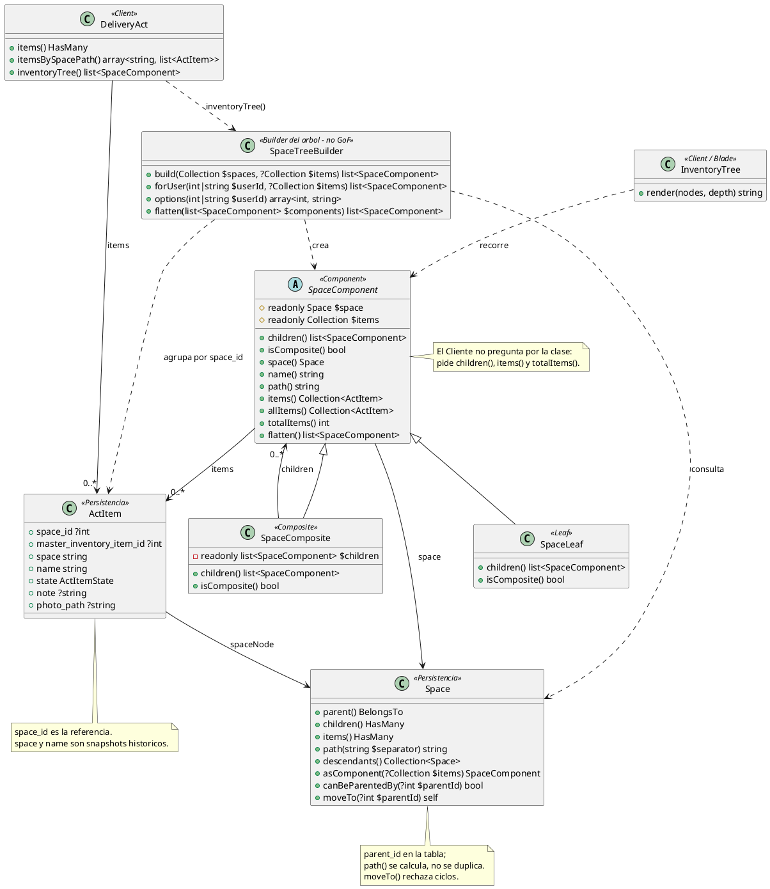

# Composite

## 1. Nombre y propósito

**Composite** es un patrón estructural que permite tratar de la misma forma un objeto individual y una composición de objetos. El cliente habla con un **Component** común; una **Hoja** representa un nodo sin hijos y un **Compuesto** representa un nodo que contiene otros Components.

En Prometheus se aplica al **catálogo de espacios del acta de entrega**. Un espacio puede ser una hoja (`Alacena`) o un compuesto (`Casa`, que contiene `Cocina`, que a su vez contiene `Alacena`). La vista del inventario y el cálculo del total no preguntan si el nodo tiene hijos: piden `name()`, `path()`, `items()`, `totalItems()` y `children()` sobre `SpaceComponent`.

La variante usada es un **árbol inmutable de composición**: el árbol se arma una vez por consulta, las hojas y los compuestos comparten la misma interfaz y no existen operaciones `add()`/`remove()` sobre el Component. El alta, el renombrado y el movimiento se hacen sobre el modelo Eloquent `Space`; el Composite solo representa el resultado.

## 2. Problema que resuelve en Prometheus

El inventario de un acta se organiza por espacios. Antes, `spaces` era un catálogo plano por arrendador: cada elemento del acta apuntaba a un nombre y la vista agrupaba por ese nombre. Ese diseño tiene tres problemas:

- **No representa jerarquía:** una casa con cocina, alcena y balcón se veía como una lista de nombres sin relación.
- **No distingue nombres repetidos:** dos ramas pueden tener un espacio `Baño`; agrupar solo por nombre mezcla sus elementos.
- **Obliga al cliente a preguntar por el tipo:** la vista tendría que recorrer hijos, calcular totales y decidir si un nodo es hoja o carpeta con condicionales dispersos.

La solución necesita:

- guardar la jerarquía sin duplicar la ruta completa en cada fila;
- ofrecer una interfaz uniforme para hojas y compuestos;
- calcular la ruta desde la raíz y usarla como identidad visible;
- sumar los elementos directos y los de todos los descendientes;
- renderizar el árbol de forma recursiva sin ramas por clase concreta;
- conservar la referencia (`space_id`) y el nombre histórico (`space`) en cada elemento del acta;
- validar que un movimiento no cree un ciclo.

## 3. Solución y roles del patrón

`SpaceComponent` es el **Component**: una clase abstracta con el espacio, sus elementos directos y las operaciones comunes. `SpaceLeaf` es la **Leaf**: `children()` devuelve una lista vacía y `isComposite()` devuelve `false`. `SpaceComposite` es el **Composite**: guarda los hijos y devuelve `true` en `isComposite()`. `SpaceTreeBuilder` es el **Builder del árbol** (no un rol GoF del Composite): convierte filas planas de `spaces` en Components y enlaza los padres en memoria. `DeliveryAct` y la vista Blade son **Clientes**: consumen `SpaceComponent` sin conocer la clase concreta.

| Rol GoF | Clase | Responsabilidad |
| --- | --- | --- |
| **Component** | `SpaceComponent` | Contrato común: `children()`, `isComposite()`, `space()`, `name()`, `path()`, `items()`, `allItems()`, `totalItems()` y `flatten()`. |
| **Leaf** | `SpaceLeaf` | Nodo sin hijos; devuelve `[]` y `false`. |
| **Composite** | `SpaceComposite` | Nodo con hijos; delega el recorrido y la suma en la interfaz común. |
| **Builder del árbol** | `SpaceTreeBuilder` | Ensambla los Components desde filas planas y precarga las relaciones de padre. |
| **Cliente** | `DeliveryAct` | Expone `inventoryTree()` e `itemsBySpacePath()` para la vista y la impresión. |
| **Cliente** | `resources/views/filament/acts/inventory-tree.blade.php` | Recorre nodos, muestra la tabla directa y se incluye a sí misma para los hijos. |
| **Modelo de persistencia** | `Space` | Guarda `parent_id`, valida hermanos y evita ciclos al mover. |

### 3.1. Estructura de datos

La tabla `spaces` guarda una fila por espacio y una autorreferencia:

| Columna | Uso |
| --- | --- |
| `id` | Identidad del espacio. |
| `user_id` | Arrendador dueño del catálogo. |
| `parent_id` | Padre en el árbol; `null` para una raíz. FK a `spaces` con `nullOnDelete`. |
| `name` | Nombre visible dentro de su rama. |

La migración `2026_10_25_100000_add_parent_id_to_spaces_table.php` elimina el unique anterior `(name, user_id)`, agrega `parent_id` y crea el unique `(user_id, parent_id, name)`. La unicidad de **raíces** no puede depender de ese índice porque en SQL los `NULL` no colisionan entre sí; por eso `Space::assertSiblingNameIsUnique()` refuerza la regla en el evento `saving`.

La ruta no se guarda como columna. `Space::path()` sube por `parent` y arma `Casa / Cocina / Alacena`. Guardar una ruta duplicada obligaría a reescribir todas las filas del inventario cada vez que se renombra o se mueve un espacio. El método incluye una guarda contra ciclos para no quedar en un bucle si los datos llegaran corruptos.

### 3.2. Ensamblado del árbol

`SpaceTreeBuilder::forUser($userId, $items)`:

1. consulta todos los espacios del arrendador ordenados por nombre;
2. indexa las filas por id y enlaza cada `parent` con la instancia en memoria;
3. agrupa los espacios por `parent_id` (`0` representa la raíz);
4. agrupa los elementos del acta por `space_id`;
5. construye recursivamente un `SpaceLeaf` o un `SpaceComposite` según tenga o no hijos;
6. devuelve como raíces los nodos sin padre y también los huérfanos cuyo padre no está en la colección.

El enlace del padre en memoria es importante: `path()` puede recorrer la cadena sin una consulta por nivel. El Builder no usa `Space::asComponent()`, que también existe pero consulta hijos de forma recursiva; el Builder prefiere una sola consulta y repartir las filas en memoria.

`SpaceTreeBuilder::options()` aplana el árbol y devuelve `id => ruta` ordenado por ruta. Ese formato permite que el selector distinga dos espacios con el mismo nombre en ramas distintas y que guarde el id, no el texto.

### 3.3. Operaciones comunes

| Método | Hoja | Compuesto |
| --- | --- | --- |
| `children()` | `[]`. | Lista de hijos. |
| `isComposite()` | `false`. | `true`. |
| `items()` | Elementos colgados directamente del espacio. | Igual. |
| `allItems()` | Copia de `items()`. | Elementos propios más los de todos los descendientes. |
| `totalItems()` | Cantidad de elementos directos. | Suma recursiva de propios e hijos. |
| `flatten()` | Se devuelve a sí misma. | Se devuelve y concatena el preorden de cada hijo. |
| `path()` | Ruta del espacio. | Ruta del espacio. |

`items()` y `allItems()` son distintos a propósito. La vista muestra en cada nodo **solo** los elementos directos y usa `totalItems()` para el contador acumulado. Si la tabla usara `allItems()`, los elementos de `Alacena` aparecerían también en `Cocina` y en `Casa`, duplicando filas en la impresión.

### 3.4. Snapshot y compatibilidad

`act_items` conserva dos datos históricos además de la referencia:

- `space_id`: FK nullable a `spaces`, con `nullOnDelete`;
- `space`: nombre del espacio al momento del acta.

`act_items.name` también es un snapshot del elemento de inventario. Si un espacio se renombra o se elimina, el acta firmada sigue imprimiendo el nombre que tenía. `DeliveryActBuilder::withInventory()` resuelve `space_id` contra el catálogo del dueño del alquiler, rechaza un id de otro arrendador y guarda el nombre resuelto como snapshot.

## 4. Diagrama de clases

## 5. Clases participantes y valoración

| Clase | Ruta | Rol | Participación |
| --- | --- | --- | --- |
| `SpaceComponent` | `app/Models/SpaceComponent.php` | Component | Interfaz uniforme y operaciones recursivas. |
| `SpaceLeaf` | `app/Models/SpaceLeaf.php` | Leaf | Nodo terminal. |
| `SpaceComposite` | `app/Models/SpaceComposite.php` | Composite | Nodo con hijos. |
| `Space` | `app/Models/Space.php` | Persistencia | `parent_id`, ruta, descendientes, validación de hermanos y movimiento sin ciclos. |
| `SpaceTreeBuilder` | `app/Services/Acts/SpaceTreeBuilder.php` | Builder del árbol | Ensambla filas planas y produce opciones para el selector. |
| `DeliveryAct` | `app/Models/DeliveryAct.php` | Client | `inventoryTree()` e `itemsBySpacePath()`. |
| `DeliveryActBuilder` | `app/Services/Acts/DeliveryActBuilder.php` | Client / escritura | Valida `space_id`, rechaza otro arrendador y guarda referencias y snapshots. |
| `ActItem` | `app/Models/ActItem.php` | Elemento | Conserva `space_id` y `space`; `spaceNode()` evita el choque con la columna histórica. |
| `SpaceCatalogField` | `app/Filament/Support/SpaceCatalogField.php` | Client | Selector `id => ruta` con alta y edición de espacios. |
| `inventory-tree.blade.php` | `resources/views/filament/acts/inventory-tree.blade.php` | Client / vista | Render recursivo de nodos, tabla directa y contador acumulado. |

### 5.1. Ventajas

- **Uniformidad:** la vista y los cálculos tratan igual una hoja y un compuesto.
- **Recursión localizada:** `allItems()`, `totalItems()` y `flatten()` viven en el Component; el cliente no repite recorridos.
- **Rutas sin duplicación:** `path()` se calcula desde `parent_id`; renombrar o mover no reescribe el inventario.
- **Nombres repetidos:** la ruta distingue `Casa / Baño` de `Oficina / Baño`; el selector guarda el id.
- **Snapshot histórico:** el acta conserva `space` y `name` aunque el catálogo cambie o la fila se elimine.
- **Aislamiento por arrendador:** el árbol se construye solo con los espacios del dueño del acta.
- **Consultas acotadas:** el Builder carga todos los espacios en una consulta y enlaza padres en memoria.
- **Ciclos bloqueados:** `canBeParentedBy()` y `moveTo()` impiden mover un nodo bajo su descendiente.
- **Raíces consistentes:** la unicidad de hermanos se refuerza en la aplicación, incluido el caso de los `NULL`.

### 5.2. Desventajas

- **Árbol inmutable:** no hay `add()`/`remove()` en el Component; el cliente debe persistir por `Space` y volver a construir el árbol. Es una decisión deliberada, no una limitación accidental.
- **Dos caminos de construcción:** `Space::asComponent()` y `SpaceTreeBuilder` producen la misma forma, pero el primero consulta hijos por nivel. Tener ambos puede confundir; la aplicación usa el Builder.
- **Validación de raíces en aplicación:** el unique de base de datos no cubre dos raíces con el mismo nombre porque `parent_id` es `NULL`. Una escritura fuera de Eloquent podría saltarse la regla.
- **Orden por nombre:** el árbol y las opciones se ordenan alfabéticamente; no hay orden manual ni posición configurable.
- **Ruta calculada en el acta:** `itemsBySpacePath()` carga `spaceNode` pero no toda la cadena de padres; en actas con muchas filas, `path()` puede añadir consultas.
- **Espacios huérfanos:** el Builder los muestra como raíces. Es una degradación útil, pero oculta que el padre ya no existe salvo por el nombre guardado.
- **Sin borrado lógico:** al eliminar un espacio, `space_id` queda en `null` y el acta depende del snapshot textual.
- **Sin control de profundidad:** nada impide un árbol muy profundo; la interfaz y la recursión no imponen un máximo.

## 6. Flujo de una llamada

### 6.1. Guardar un acta con inventario

1. El formulario envía `space_id`, `master_inventory_item_id`, estado, nota y foto.
2. `DeliveryActBuilder::withInventory()` obtiene el dueño del alquiler y carga **sus** espacios.
3. `resolveSpace()` busca por id; si no existe en el catálogo, falla con `act.errors.space_not_in_catalog`.
4. El nombre resuelto se guarda en `act_items.space` como snapshot.
5. `build()` crea el acta y sus elementos con `createMany()`.
6. La vista llama `DeliveryAct::inventoryTree()`.
7. `SpaceTreeBuilder::forUser()` arma los Components y agrupa los elementos por `space_id`.
8. La vista muestra cada nodo, su tabla directa y el contador `totalItems()`.

### 6.2. Mostrar la ruta de un espacio

1. El árbol se construye con los padres enlazados en memoria.
2. `SpaceComponent::path()` delega en `Space::path()`.
3. `Space::path()` sube por `parent`, antepone cada nombre y corta si detecta un ciclo.
4. El resultado se usa en el selector (`Casa / Cocina / Alacena`) y en la agrupación del acta.

### 6.3. Mover un espacio

1. El cliente llama `Space::moveTo($parentId)`.
2. `canBeParentedBy()` acepta `null`, rechaza el propio id, exige que el padre sea del mismo dueño y comprueba que no sea un descendiente.
3. Si el movimiento crea un ciclo, lanza `RuntimeException` con `act.errors.invalid_space_parent`.
4. Si es válido, actualiza `parent_id` y guarda; el evento `saving` vuelve a validar el nombre entre hermanos.

## 7. Pruebas

| Prueba | Qué fija |
| --- | --- |
| `el_arbol_trata_igual_una_hoja_y_un_compuesto` | El árbol contiene `SpaceComposite` y `SpaceLeaf`; `isComposite()` y `path()` se comportan igual desde el Component. |
| `las_opciones_usan_el_id_y_muestran_la_ruta` | El selector devuelve `id => ruta` y distingue ramas. |
| `una_raiz_no_puede_repetir_nombre_pero_una_rama_si` | La validación de hermanos rechaza una raíz duplicada. |
| `dos_ramas_pueden_tener_el_mismo_nombre` | Dos espacios con el mismo nombre en padres distintos conviven y tienen rutas distintas. |
| `mover_un_espacio_bajo_su_descendiente_crea_un_ciclo_y_se_rechaza` | `moveTo()` impide el ciclo. |
| `el_acta_guarda_la_referencia_y_el_snapshot_y_arma_el_arbol` | Se guardan `space_id` y `space`; `itemsBySpacePath()` agrupa por ruta; `totalItems()` suma el subárbol; la vista renderiza. |
| `un_espacio_de_otro_arrendador_no_se_acepta_por_id` | La resolución por id respeta el dueño del acta. |

El archivo `tests/Feature/SpaceHierarchyCompositeTest.php` contiene las siete pruebas. También se apoyan en el patrón `DeliveryActBuilderTest`, `CreateDeliveryActTest` y las pruebas de edición del selector, que ejercitan el guardado real del inventario.

## 8. Decisión de alcance

El Composite se implementó como **representación de lectura** del árbol, no como API mutable. Esa decisión mantiene el patrón pequeño y evita duplicar la validación de Eloquent:

- la jerarquía se persiste en `spaces.parent_id`;
- la unicidad y los ciclos se validan en `Space`;
- el árbol se arma en `SpaceTreeBuilder`;
- las hojas y los compuestos solo exponen operaciones de consulta;
- la vista depende de `SpaceComponent`, no de las clases concretas.

La desviación principal frente al ejemplo clásico de GoF es la ausencia de `add()`, `remove()` y `getChild()` en el Component. En Prometheus, agregar o mover un espacio es una operación de persistencia con reglas de negocio; el árbol es una foto de ese estado. Mezclar ambas responsabilidades habría puesto validaciones de dueño, nombre y ciclo dentro de objetos que se reconstruyen en cada consulta.
