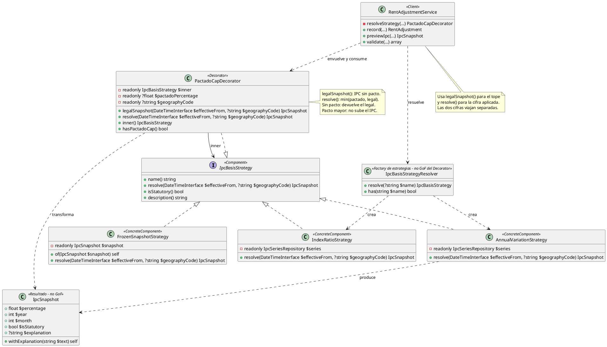

# Decorator

## 1. Nombre y propósito

**Decorator** es un patrón estructural que añade responsabilidades a un objeto **envolviéndolo con otro objeto de la misma interfaz**. El cliente sigue hablando con el contrato original; el decorador intercepta la llamada, decide si la modifica y delega en el objeto envuelto.

En Prometheus se aplica al **porcentaje pactado del reajuste**. `PactadoCapDecorator` implementa `IpcBasisStrategy`, envuelve a la estrategia que resolvió el IPC y limita lo que se aplica al porcentaje que las partes pactaron por debajo del IPC.

La variante usada es un **decorador de límite superior**: no añade datos nuevos ni cambia la fuente, solo reduce la cifra aplicada y conserva intacta la cifra legal.

## 2. Problema que resuelve en Prometheus

El artículo 20 de la Ley 820 de 2003 autoriza a reajustar el canon **"hasta"** el 100 % del IPC. Ese "hasta" permite que las partes acuerden menos. En la práctica es lo habitual: un arrendador puede pactar la mitad del IPC para conservar al inquilino.

El sistema necesita, entonces, dos porcentajes distintos y simultáneos:

- el **IPC legal**, que es el máximo que permite la ley y que la carta debe citar;
- el **porcentaje aplicado**, que puede ser menor porque las partes pactaron.

El problema no es calcular el mínimo. El problema es **dónde** calcularlo sin contaminar la estrategia que responde "qué dice la ley".

Si el mínimo viviera dentro de `AnnualVariationStrategy` o `IndexRatioStrategy`:

- la estrategia dejaría de responder una pregunta legal y pasaría a depender de un dato contractual;
- al pedir el IPC para mostrarlo en la carta se devolvería el pactado, que es justo la cifra que debe mostrarse aparte;
- el tope y la cifra acordada se confundirían, y un reajuste pactado al 3 % parecería tener un tope legal del 3 %.

La solución necesita:

- conservar una estrategia que solo hable del IPC;
- añadir el límite pactado sin reescribir esa estrategia;
- exponer por separado la cifra legal y la aplicada;
- poder activar o desactivar el límite sin cambiar de clase;
- mantener el resto de metadatos del snapshot: año, mes, geografía, fuente y explicación.

## 3. Solución y roles del patrón

`IpcBasisStrategy` es el **Component**. Define `resolve()` y la identidad de la estrategia. `AnnualVariationStrategy` e `IndexRatioStrategy` son los **ConcreteComponent**: calculan el IPC sin saber que existe un pacto. `PactadoCapDecorator` es el **Decorator**: implementa la misma interfaz, guarda la estrategia envuelta y modifica únicamente lo que devuelve `resolve()`. `RentAdjustmentService` es el **Client**: resuelve la estrategia, la envuelve y usa el resultado para registrar el reajuste.

| Rol GoF | Clase | Responsabilidad |
| --- | --- | --- |
| **Component** | `IpcBasisStrategy` | Contrato común: `resolve()`, `isStatutory()`, `description()` y `name()`. |
| **ConcreteComponent** | `AnnualVariationStrategy` | Calcula la variación anual de diciembre, que es lo que ordena el artículo 20. |
| **ConcreteComponent** | `IndexRatioStrategy` | Calcula una razón entre índices; se marca como no legal. |
| **ConcreteComponent** | `FrozenSnapshotStrategy` | Devuelve un snapshot ya congelado cuando el formulario eligió un año explícito. |
| **Decorator** | `PactadoCapDecorator` | Envuelve una estrategia y aplica el mínimo entre el pacto y el IPC. |
| **Client** | `RentAdjustmentService` | Resuelve la estrategia, la decora y consume `legalSnapshot()` y `resolve()`. |

La composición normal es:

```text
RentAdjustmentService
  -> PactadoCapDecorator          (Decorator)
       -> AnnualVariationStrategy (ConcreteComponent)
            -> IpcSeriesRepository
```

Cuando el formulario fija un año explícito, la composición cambia solo en el componente envuelto:

```text
PactadoCapDecorator
  -> FrozenSnapshotStrategy
```

El decorador es el mismo. Eso es lo que permite que el límite pactado se aplique igual a cualquier estrategia.

`PactadoCapDecorator` no forma parte de la interfaz original en sentido estricto: añade `legalSnapshot()`, `inner()` y `hasPactadoCap()`. El cliente conoce esos métodos porque `resolveStrategy()` devuelve el decorador concreto. El resto del sistema sigue dependiendo de `IpcBasisStrategy`.

### 3.1. `legalSnapshot()` frente a `resolve()`

La decisión central del patrón está en separar las dos preguntas:

| Método | Pregunta que responde | Efecto del pacto |
| --- | --- | --- |
| `legalSnapshot()` | ¿Cuál es el IPC que permite el artículo 20? | **Ninguno**. Siempre devuelve el IPC de la estrategia envuelta. |
| `resolve()` | ¿Qué porcentaje se aplica a este reajuste? | Aplica `min(pactado, legal)`. |

`legalSnapshot()` no reenvía a `resolve()` del componente, sino que llama directamente a su `resolve()`. Esa aparente redundancia es deliberada: si llamara a `$this->resolve()`, el decorador se aplicaría a sí mismo y devolvería el pactado como si fuera el IPC legal.

`resolve()` hace:

1. obtiene el snapshot legal con `legalSnapshot()`;
2. si no hay pacto, devuelve ese mismo snapshot sin cambios;
3. si hay pacto, aplica `min($pactadoPercentage, $legal->percentage)`;
4. conserva todos los metadatos del snapshot legal;
5. cambia la explicación solo cuando el pacto queda por debajo del IPC.

El decorador **solo puede bajar, nunca subir**. Si el pacto es 15 % y el IPC es 9,28 %, el resultado es 9,28 %. No se usa `max()` porque un pacto por encima del IPC no es un tope: es un incremento. Ese caso lo decide el arrendador en la pantalla, donde se avisa que excede el IPC; el decorador no lo convierte en legal.

### 3.2. Por qué no se reimplementa

El patrón ya existía en el código y funcionaba. La Fase 6 no lo reescribe: lo documenta, verifica su cobertura y deja explícito por qué el límite vive en un decorador y no dentro de las estrategias.

No se movió el cálculo a `RentAdjustmentService` porque el servicio ya tiene una responsabilidad amplia: resolver IPC, validar, registrar, recalcular y notificar. Añadir allí el mínimo habría mezclado la decisión contractual con la orquestación.

No se movió a `IpcSnapshot` porque un snapshot describe un IPC concreto, no una decisión de las partes. Un snapshot "pactado" dejaría de ser una fotografía de la fuente.

## 4. Diagrama de clases



## 5. Clases participantes y valoración

| Clase | Ruta | Rol | Participación |
| --- | --- | --- | --- |
| `IpcBasisStrategy` | `app/Services/Adjustment/Strategies/IpcBasisStrategy.php` | Component | Contrato que comparten estrategias y decorador. |
| `AnnualVariationStrategy` | `app/Services/Adjustment/Strategies/AnnualVariationStrategy.php` | ConcreteComponent | Variación anual de diciembre; fuente legal del artículo 20. |
| `IndexRatioStrategy` | `app/Services/Adjustment/Strategies/IndexRatioStrategy.php` | ConcreteComponent | Razón entre índices; informativa y no legal. |
| `FrozenSnapshotStrategy` | `app/Services/Adjustment/Strategies/FrozenSnapshotStrategy.php` | ConcreteComponent | Snapshot congelado para un año elegido explícitamente. |
| `PactadoCapDecorator` | `app/Services/Adjustment/Decorators/PactadoCapDecorator.php` | Decorator | Aplica el mínimo entre pacto e IPC y conserva la cifra legal. |
| `RentAdjustmentService` | `app/Services/RentAdjustmentService.php` | Client | Resuelve, decora, valida y registra el reajuste. |
| `IpcBasisStrategyResolver` | `app/Services/Adjustment/Strategies/IpcBasisStrategyResolver.php` | Composición | Elige la estrategia concreta antes de decorarla. |
| `IpcSnapshot` | `app/Dto/IpcSnapshot.php` | Resultado | Transporta porcentaje, año, geografía, fuente y explicación. |

### 5.1. Ventajas

- **Responsabilidad única:** la estrategia responde qué dice la ley; el decorador decide qué se aplica.
- **Cifras separadas:** `legalSnapshot()` y `resolve()` permiten que la carta muestre el IPC legal y la cifra pactada sin confundirlos.
- **Composición transparente:** el cliente sigue usando `IpcBasisStrategy`; cambiar de estrategia no exige tocar el decorador.
- **Límite uniforme:** el pacto se aplica igual a la variación anual, a la razón de índices o a un snapshot congelado.
- **Sin duplicación:** el mínimo se implementa una sola vez, no en cada estrategia.
- **Trazabilidad conservada:** el snapshot resultante mantiene año, mes, geografía, fuente y `syncedAt`; solo cambia el porcentaje y la explicación.
- **Pacto opcional:** con `null`, el decorador devuelve exactamente el snapshot legal, sin ramas en el cliente.
- **No permite subir:** el uso de `min()` impide que un pacto alto se presente como si fuera el IPC.
- **Explicación contextual:** cuando el pacto baja la cifra, el snapshot explica que se aplicó el pactado; cuando coincide, conserva la explicación legal.

### 5.2. Desventajas

- **Interfaz ampliada:** `legalSnapshot()`, `inner()` y `hasPactadoCap()` no están en `IpcBasisStrategy`; el cliente conoce el decorador concreto. Es una desviación deliberada para exponer la cifra legal, pero rompe la sustitución pura por el Component.
- **Siempre se decora:** incluso sin pacto, `resolveStrategy()` devuelve `PactadoCapDecorator`. El cliente nunca recibe directamente la estrategia concreta, lo que complica las pruebas que esperan `AnnualVariationStrategy`.
- **Decorador con estado de configuración:** guarda `pactadoPercentage` y `geographyCode`. Un decorador reutilizado con otra configuración produciría resultados distintos; por eso se construye por operación.
- **Explicación en español fijo:** el texto del pacto está escrito en el decorador y no pasa por traducciones, a diferencia de otras cadenas del módulo.
- **Dos métodos que parecen intercambiables:** `legalSnapshot()` y `resolve()` devuelven el mismo tipo y, sin pacto, el mismo valor. Confundirlos no falla de inmediato; solo se nota cuando hay pacto y la carta muestra la cifra equivocada.
- **El pacto por encima del IPC no se bloquea aquí:** el decorador lo recorta al IPC. Avisar del exceso es responsabilidad de las reglas de validación y de la pantalla, no del decorador.
- **Cobertura repartida:** antes de esta fase no había una prueba unitaria específica del decorador; el comportamiento se ejercitaba de forma indirecta desde la cadena y el formulario. `PactadoCapDecoratorTest` cubre ahora las cuatro decisiones del límite.

## 6. Flujo de una llamada

Para un reajuste con IPC legal de 9,28 % y un pacto del 3 %:

1. `RentAdjustmentService::resolveStrategy()` resuelve `AnnualVariationStrategy`.
2. La envuelve con `new PactadoCapDecorator($strategy, 3.0, $code)`.
3. `legalSnapshot()` delega en la estrategia y devuelve 9,28 %.
4. `resolve()` calcula `min(3.0, 9.28)` y devuelve 3,0 %.
5. El servicio guarda `legal_pct = 9.28` y `applied_pct = 3.0` en el reajuste.
6. La carta usa el 9,28 % como tope legal y el 3 % como cifra pactada.

Si no hay pacto:

1. El decorador se construye igual con `pactadoPercentage = null`.
2. `legalSnapshot()` devuelve el IPC legal.
3. `resolve()` devuelve ese mismo snapshot, con la misma explicación y los mismos metadatos.

Si el pacto es 15 %:

1. `resolve()` calcula `min(15.0, 9.28)`.
2. Devuelve 9,28 %, no 15 %.
3. El exceso se trata fuera del decorador, como una decisión del arrendador que la validación avisa.

## 7. Pruebas

| Prueba | Qué fija |
| --- | --- |
| `tests/Unit/PactadoCapDecoratorTest.php` | El pacto baja `resolve()` pero no `legalSnapshot()`; un pacto mayor no sube el IPC; sin pacto se devuelve el snapshot legal; la identidad de la estrategia se delega. |
| `tests/Feature/AdjustmentChainTest.php` | Un reajuste con pacto conserva la diferencia entre tope legal y porcentaje aplicado dentro de la cadena. |
| `tests/Feature/ReajusteCalculationTest.php` | La pantalla exige confirmación cuando el pacto difiere del IPC y autocompleta el porcentaje del año. |
| `tests/Feature/RentAdjustmentServiceTest.php` | El registro guarda las cifras y la explicación que luego imprime la carta. |

El decorador se prueba sin base de datos en `PactadoCapDecoratorTest`: una estrategia anónima entrega un IPC fijo y el test verifica las dos rutas del límite. Las pruebas de integración cubren lo que el decorador no decide: persistencia, validación y presentación.

## 8. Decisión de alcance

La Fase 6 **no reimplementa** el Decorator ni modifica el código de producción. El patrón ya estaba en `PactadoCapDecorator` y su lugar es correcto:

- el Component sigue siendo la estrategia;
- el ConcreteComponent sigue calculando el IPC;
- el Decorator sigue aplicando el límite contractual;
- el Client sigue decidiendo cuándo usarlo.

La única incorporación es la prueba unitaria explícita que faltaba y este documento. Cualquier cambio futuro del pacto debe hacerse en el decorador o en las reglas de validación, nunca dentro de las estrategias que representan el IPC legal.
