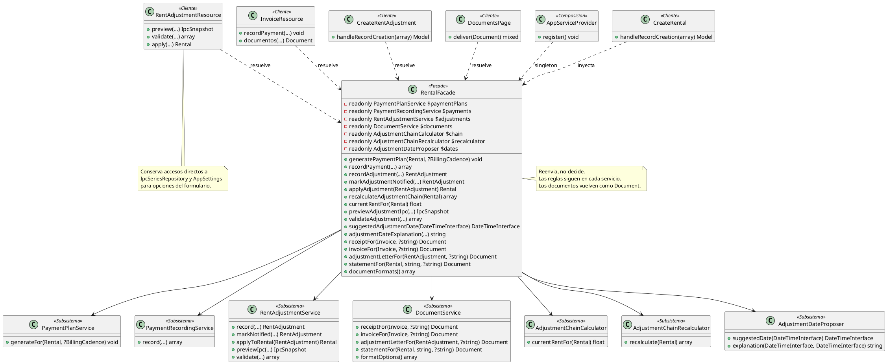

# Facade

## 1. Nombre y propósito

**Facade** es un patrón estructural que ofrece una **interfaz única y simplificada** para un conjunto de clases o subsistemas. El cliente deja de resolver y coordinar cada dependencia por su cuenta; habla con la fachada, que reenvía la operación al servicio correspondiente.

En Prometheus se aplica a las **operaciones del alquiler**. `RentalFacade` reúne el plan de cobros, el registro de pagos, los reajustes, la cadena de cálculo, la propuesta de fechas y la generación de documentos. Las pantallas de alquileres, facturas, reajustes y documentos piden la operación a la fachada en lugar de construir cada servicio.

La variante usada es una **fachada de orquestación sin lógica de negocio**. No decide reglas nuevas, no mueve notificaciones y no absorbe los accesos auxiliares del formulario. Solo conserva las dependencias y reenvía con los mismos contratos de los servicios.

## 2. Problema que resuelve en Prometheus

Las pantallas de Filament necesitan varias operaciones relacionadas con un alquiler:

- generar las facturas de un contrato;
- registrar un abono y conocer el estado de la factura;
- registrar, aplicar, notificar y recalcular un reajuste;
- consultar el canon vigente y previsualizar el IPC;
- validar un reajuste antes de guardarlo;
- proponer una fecha de aplicación y explicar la diferencia legal;
- entregar comprobantes, facturas, cartas y estados de cuenta.

Sin una fachada, cada pantalla tendría que resolver entre cinco y ocho servicios, recordar el orden de las llamadas y repetir la construcción de dependencias. Esa coordinación dispersa produce tres riesgos:

- **Duplicación:** dos pantallas pueden llamar al mismo servicio con parámetros distintos o en distinto orden.
- **Acoplamiento a la implementación:** la pantalla conoce clases que no necesita, como el calculador de cadena o el proponedor de fechas.
- **Cambios costosos:** mover una dependencia o cambiar su firma obliga a tocar varios recursos y páginas.

La fachada no elimina la complejidad del dominio; concentra el **punto de entrada** para que el cliente vea una sola puerta y los servicios sigan siendo los dueños de las reglas.

## 3. Solución y roles del patrón

`RentalFacade` es la **Facade**. Recibe siete dependencias por constructor y expone métodos con nombres de caso de uso. `PaymentPlanService`, `PaymentRecordingService`, `RentAdjustmentService`, `DocumentService`, `AdjustmentChainCalculator`, `AdjustmentChainRecalculator` y `AdjustmentDateProposer` son el **subsistema**. Las pantallas de Filament son los **Clientes**. `AppServiceProvider` registra la fachada como **singleton** y el contenedor la inyecta o la resuelve.

| Rol GoF | Clase | Responsabilidad |
| --- | --- | --- |
| **Facade** | `RentalFacade` | Único punto de entrada; reenvía operaciones y conserva las dependencias. |
| **Subsistema** | `PaymentPlanService` | Genera las facturas según la cadencia del contrato. |
| **Subsistema** | `PaymentRecordingService` | Registra abonos y devuelve pago, factura y si quedó saldada. |
| **Subsistema** | `RentAdjustmentService` | Registra, valida, aplica y notifica reajustes; calcula la previsualización del IPC. |
| **Subsistema** | `DocumentService` | Selecciona la familia de documento y devuelve un `Document` protegido por Proxy. |
| **Subsistema** | `AdjustmentChainCalculator` | Calcula el canon vigente de la cadena. |
| **Subsistema** | `AdjustmentChainRecalculator` | Recalcula la cadena completa de un alquiler. |
| **Subsistema** | `AdjustmentDateProposer` | Propone la fecha de aplicación y explica la diferencia con la fecha legal. |
| **Cliente** | `CreateRental` | Pide el plan de cobros después de crear el alquiler. |
| **Cliente** | `InvoiceResource` | Consulta pagos y documentos de facturas. |
| **Cliente** | `RentAdjustmentResource` | Consulta canon, previsualiza, valida, aplica, notifica, recalcula y genera cartas. |
| **Cliente** | `CreateRentAdjustment` | Registra el reajuste desde el formulario. |
| **Cliente** | `DocumentsPage` | Consulta formatos y entrega documentos. |
| **Composición** | `AppServiceProvider` | Registra `RentalFacade` como singleton. |

### 3.1. Interfaz de la fachada

| Grupo | Método | Reenvía a | Resultado |
| --- | --- | --- | --- |
| Cobros | `generatePaymentPlan(Rental $rental, ?BillingCadence $cadence = null)` | `PaymentPlanService::generateFor()` | `void` |
| Cobros | `recordPayment(...)` | `PaymentRecordingService::record()` | `array{payment, invoice, just_settled}` |
| Reajustes | `recordAdjustment(...)` | `RentAdjustmentService::record()` | `RentAdjustment` |
| Reajustes | `markAdjustmentNotified(...)` | `RentAdjustmentService::markNotified()` | `RentAdjustment` |
| Reajustes | `applyAdjustment(RentAdjustment $adjustment)` | `RentAdjustmentService::applyToRental()` | `Rental` |
| Reajustes | `recalculateAdjustmentChain(Rental $rental)` | `AdjustmentChainRecalculator::recalculate()` | `array{touched, current_rent, changed_ids}` |
| Reajustes | `currentRentFor(Rental $rental)` | `AdjustmentChainCalculator::currentRentFor()` | `float` |
| Reajustes | `previewAdjustmentIpc(...)` | `RentAdjustmentService::previewIpc()` | `IpcSnapshot` |
| Reajustes | `validateAdjustment(...)` | `RentAdjustmentService::validate()` | `array{summary, messages}` |
| Fechas | `suggestedAdjustmentDate(DateTimeInterface $date)` | `AdjustmentDateProposer::suggestedDate()` | `DateTimeInterface` |
| Fechas | `adjustmentDateExplanation(...)` | `AdjustmentDateProposer::explanation()` | `string` |
| Documentos | `receiptFor(Invoice $invoice, ?string $format = null)` | `DocumentService::receiptFor()` | `Document` |
| Documentos | `invoiceFor(Invoice $invoice, ?string $format = null)` | `DocumentService::invoiceFor()` | `Document` |
| Documentos | `adjustmentLetterFor(RentAdjustment $adjustment, ?string $format = null)` | `DocumentService::adjustmentLetterFor()` | `Document` |
| Documentos | `statementFor(Rental $rental, string $period, ?string $format = null)` | `DocumentService::statementFor()` | `Document` |
| Documentos | `documentFormats()` | `DocumentService::formatOptions()` | `array<string, string>` |

La fachada **no reemplaza** los contratos de los servicios. Recibe los mismos tipos, conserva los nombres de los parámetros y devuelve los mismos resultados. Un cliente que necesite una regla que la fachada no expone todavía puede seguir usando el servicio directamente; la fachada no pretende ser la única API interna del dominio.

### 3.2. Qué queda fuera de la fachada

La fachada no absorbe todo lo que toca una pantalla de reajustes. Quedan fuera, deliberadamente:

- los accesos directos a `IpcSeriesRepository` y `AppSettings` que usa el formulario para poblar opciones;
- las notificaciones y los mensajes de Filament;
- las reglas de validación legal, que siguen en `RentAdjustmentService` y en la cadena de reglas;
- la autorización y el filtrado por arrendador, que dependen de las relaciones y consultas de cada modelo;
- las transacciones, que no se centralizan aquí.

Ese límite evita convertir la fachada en un **God Object**. Si empezara a contener reglas, consultas auxiliares y presentación, dejaría de ser una puerta de entrada y se convertiría en una segunda implementación del dominio.

### 3.3. Registro y clientes

`AppServiceProvider` registra:

```php
$this->app->singleton(RentalFacade::class);
```

No tiene estado propio; el singleton evita reconstruir el grafo en cada llamada dentro de la misma petición. Las dependencias conservan su propio ciclo de vida: `DocumentService` y los servicios de reajuste se resuelven según sus bindings, y los documentos que devuelve la fachada siguen siendo `DocumentProxy`.

Los clientes usan dos formas de acceso:

- `CreateRental` inyecta la fachada en el constructor y llama `generatePaymentPlan()` después de crear el registro;
- los recursos y páginas de Filament la resuelven con `app(RentalFacade::class)` dentro de acciones y callbacks, porque esos métodos son estáticos o se ejecutan en cierres de la interfaz.

## 4. Diagrama de clases



## 5. Clases participantes y valoración

| Clase | Ruta | Rol | Participación |
| --- | --- | --- | --- |
| `RentalFacade` | `app/Services/RentalFacade.php` | Facade | Punto de entrada y reenvío de 16 operaciones. |
| `PaymentPlanService` | `app/Services/PaymentPlanService.php` | Subsistema | Genera facturas según la cadencia. |
| `PaymentRecordingService` | `app/Services/PaymentRecordingService.php` | Subsistema | Registra abonos y recalcula el estado de la factura. |
| `RentAdjustmentService` | `app/Services/RentAdjustmentService.php` | Subsistema | Registra, valida, aplica y notifica reajustes. |
| `DocumentService` | `app/Documents/DocumentService.php` | Subsistema | Construye descriptores y devuelve documentos con Proxy. |
| `AdjustmentChainCalculator` | `app/Services/Adjustment/AdjustmentChainCalculator.php` | Subsistema | Canon vigente de la cadena. |
| `AdjustmentChainRecalculator` | `app/Services/Adjustment/AdjustmentChainRecalculator.php` | Subsistema | Recálculo completo de la cadena. |
| `AdjustmentDateProposer` | `app/Services/Adjustment/AdjustmentDateProposer.php` | Subsistema | Fecha sugerida y explicación legal. |
| `CreateRental` | `app/Filament/Resources/RentalResource/Pages/CreateRental.php` | Cliente | Inyección por constructor; genera el plan. |
| `InvoiceResource` | `app/Filament/Resources/InvoiceResource.php` | Cliente | Registra pagos y entrega documentos. |
| `RentAdjustmentResource` | `app/Filament/Resources/RentAdjustmentResource.php` | Cliente | Previsualiza, valida, aplica, notifica y recalcula. |
| `CreateRentAdjustment` | `app/Filament/Resources/RentAdjustmentResource/Pages/CreateRentAdjustment.php` | Cliente | Registra el reajuste. |
| `DocumentsPage` | `app/Filament/Pages/DocumentsPage.php` | Cliente | Consulta formatos y entrega documentos. |
| `AppServiceProvider` | `app/Providers/AppServiceProvider.php` | Composición | Registra la fachada como singleton. |

### 5.1. Ventajas

- **Punto de entrada único:** las pantallas no construyen siete servicios para una operación.
- **Menos duplicación:** el orden de las llamadas y los parámetros quedan en un solo lugar.
- **Acoplamiento reducido:** el cliente depende de `RentalFacade` y de los modelos/DTO, no de cada implementación del subsistema.
- **Contratos conservados:** los métodos devuelven los mismos tipos que los servicios; no se creó un modelo paralelo.
- **Documentos protegidos:** las operaciones documentales siguen pasando por `DocumentService` y devuelven `Document`, por lo que el Proxy y la auditoría no se pierden.
- **Cambio de implementación localizado:** sustituir un servicio o cambiar su firma se resuelve en la fachada y sus llamadas, no en cada recurso.
- **Singleton sin estado:** no hay datos de usuario ni de petición guardados en la fachada.
- **Fácil de probar como puerta:** `RentalFacadeTest` verifica que la fachada devuelve los mismos resultados que los servicios, no que reimplementa sus reglas.
- **Límites explícitos:** la documentación y el código dejan claro qué no absorbe la fachada.

### 5.2. Desventajas

- **Interfaz amplia:** 16 métodos mezclan cobros, reajustes, fechas y documentos. Una fachada más pequeña por área podría ser más cohesiva.
- **Riesgo de crecer sin control:** cada nueva pantalla puede pedir “un método más” y convertir la fachada en un punto central de todo el dominio.
- **Duplicación de firmas:** los parámetros de `recordAdjustment()`, `previewAdjustmentIpc()` y `validateAdjustment()` repiten los del servicio; un cambio de firma exige tocar ambos.
- **No hay interfaz de fachada:** los clientes dependen de la clase concreta `RentalFacade`, no de un contrato sustituible.
- **Resolución por contenedor:** varias pantallas usan `app(RentalFacade::class)` dentro de métodos estáticos o callbacks; la dependencia queda menos visible que una inyección por constructor.
- **Singleton no obligatorio:** como no tiene estado, el singleton es una decisión de composición, no una necesidad del patrón.
- **No centraliza transacciones:** una operación que abarca varios servicios no queda envuelta en una transacción por la fachada.
- **No centraliza autorización:** la fachada no comprueba que el alquiler, la factura o el reajuste pertenezcan al usuario; esa responsabilidad sigue en las consultas y relaciones.
- **No elimina accesos directos:** `RentAdjustmentResource` sigue usando `IpcSeriesRepository` y `AppSettings` para opciones del formulario. Es una frontera deliberada, pero significa que la fachada no es la única puerta de la pantalla.

## 6. Flujo de una llamada

### 6.1. Crear un alquiler y generar el plan

1. `CreateRental` recibe los datos del formulario y crea el `Rental` con `parent::handleRecordCreation()`.
2. Llama `RentalFacade::generatePaymentPlan($rental)`.
3. La fachada reenvía a `PaymentPlanService::generateFor($rental, null)`.
4. El servicio resuelve el generador de la cadencia y crea las facturas.
5. La pantalla no conoce `PaymentPlanGeneratorResolver` ni las subclases del generador.

### 6.2. Registrar un abono

1. `InvoiceResource` llama `RentalFacade::recordPayment($invoice, $amount, $method, $reference, $paidAt, $receiptImage)`.
2. La fachada reenvía a `PaymentRecordingService::record()`.
3. El servicio guarda el pago, actualiza la factura y devuelve el arreglo con `payment`, `invoice` y `just_settled`.
4. La pantalla usa el mismo resultado para notificar y refrescar la tabla.

### 6.3. Validar y registrar un reajuste

1. El formulario consulta `currentRentFor()` y `previewAdjustmentIpc()` a través de la fachada.
2. Antes de guardar, llama `validateAdjustment()` y muestra el resumen y los mensajes.
3. `CreateRentAdjustment` llama `recordAdjustment()` con los datos confirmados.
4. La fachada reenvía a `RentAdjustmentService::record()`.
5. El servicio aplica las reglas, decora la estrategia de IPC, guarda el reajuste y conserva las cifras legal y aplicada.
6. Si el usuario aplica o notifica el reajuste, la pantalla usa `applyAdjustment()` o `markAdjustmentNotified()`.

### 6.4. Entregar un documento

1. La pantalla llama `receiptFor()`, `invoiceFor()`, `adjustmentLetterFor()` o `statementFor()`.
2. La fachada reenvía a `DocumentService`.
3. El servicio valida el caso, elige la fábrica y devuelve un `DocumentProxy`.
4. El Proxy construye el documento real al primer uso y audita únicamente cuando se pide el contenido.
5. La pantalla entrega el `Document` sin conocer la familia ni el formato concreto.

## 7. Pruebas

| Prueba | Qué fija |
| --- | --- |
| `la_fachada_es_un_singleton` | `app(RentalFacade::class)` devuelve la misma instancia. |
| `genera_el_plan_de_cobros` | La fachada crea las facturas del contrato a través del servicio. |
| `registra_un_abono_con_las_mismas_reglas_del_servicio` | El pago queda saldado y la factura cambia de estado con el resultado del servicio. |
| `marca_un_reajuste_como_notificado` | La notificación conserva fecha y método. |
| `expone_la_cadena_y_los_documentos_sin_cambiar_sus_contratos` | `currentRentFor()`, `documentFormats()` y `receiptFor()` devuelven los mismos tipos y valores que el subsistema. |

`tests/Feature/RentalFacadeTest.php` contiene las cinco pruebas. No prueba reglas de negocio que ya cubren los servicios; prueba que la fachada es una puerta y no una segunda implementación.

## 8. Decisión de alcance

La fachada se agregó para **reducir la coordinación en los clientes**, no para reordenar el dominio. Por eso:

- las reglas siguen en los servicios;
- las notificaciones siguen donde estaban;
- los accesos auxiliares del formulario no se movieron;
- la fachada no abrió transacciones ni añadió autorización;
- los documentos siguen pasando por `DocumentService` y su Proxy.

La desviación principal frente a una fachada “pura” es que los clientes todavía conocen algunos detalles del subsistema, en particular `IpcSeriesRepository` y `AppSettings`. Es una frontera aceptada: esos datos alimentan opciones de formulario y no representan una operación de alquiler. Si en el futuro la pantalla necesita más operaciones, la decisión debe tomarse por caso: si es una regla de negocio, pertenece al servicio; si es solo coordinación de una operación existente, puede entrar en la fachada.
