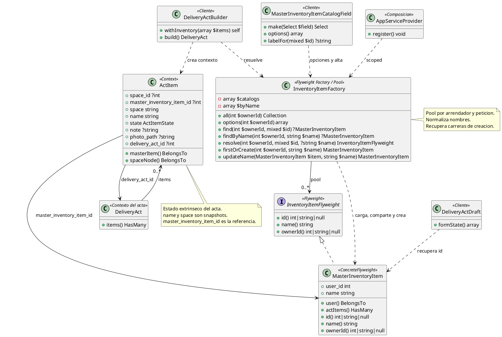

# Flyweight

## 1. Nombre y propósito

**Flyweight** es un patrón estructural que permite compartir el **estado intrínseco** de muchos objetos para reducir la memoria o la duplicación de datos. El estado que cambia por contexto —el **estado extrínseco**— se mantiene fuera del objeto compartido y se pasa cuando se necesita.

En Prometheus se aplica al **catálogo maestro de elementos de inventario**. Un `MasterInventoryItem` representa “Refrigerador” para un arrendador: su identidad, su nombre y su dueño son intrínsecos. Lo que cambia en cada acta —espacio, estado, nota, foto y la relación con el acta— es extrínseco y vive en `ActItem`.

La variante usada es un **pool de flyweights por petición y por arrendador**. `InventoryItemFactory` comparte la misma instancia de `MasterInventoryItem` durante una petición, pero el estado persistente compartido es la fila de `master_inventory_items`; el pool se descarta al terminar la petición y nunca se comparte entre usuarios.

## 2. Problema que resuelve en Prometheus

Antes, cada elemento de un acta guardaba su nombre como texto y el catálogo de elementos se repetía en cada acta. Eso producía:

- **Duplicación de datos:** dos actas con el mismo refrigerador repetían el nombre y no había una identidad común.
- **Renombrado inconsistente:** corregir “Refrigerador” en un acta no corregía las demás, y no existía un lugar único para el catálogo.
- **Catálogo sin dueño:** el texto libre no distinguía el catálogo de un arrendador del de otro.
- **Opciones repetidas:** el selector de inventario tenía que deduplicar nombres escritos a mano.

La solución necesita:

- una fila maestra por elemento y arrendador;
- una referencia desde cada acta al elemento maestro;
- un pool que evite cargar y crear el mismo elemento dos veces dentro de una petición;
- separar el estado propio del acta del estado compartido del catálogo;
- conservar el nombre como snapshot para que una firma antigua no cambie al renombrar el catálogo;
- resolver correctamente mayúsculas, espacios y carreras de creación;
- rechazar un elemento de otro arrendador aunque el nombre coincida.

## 3. Solución y roles del patrón

`InventoryItemFlyweight` es el **Flyweight**: declara el estado intrínseco mínimo (`id()`, `name()`, `ownerId()`). `MasterInventoryItem` es el **ConcreteFlyweight** y a la vez el modelo Eloquent que persiste ese estado. `InventoryItemFactory` es la **Flyweight Factory** y el **pool**: carga el catálogo por dueño, normaliza nombres, comparte instancias y crea o renombra elementos. `ActItem` es el **Context**: guarda el estado extrínseco y una referencia al flyweight. `DeliveryActBuilder` y `MasterInventoryItemCatalogField` son **Clientes** de la fábrica.

| Rol GoF | Clase | Responsabilidad |
| --- | --- | --- |
| **Flyweight** | `InventoryItemFlyweight` | Contrato del estado intrínseco: id, nombre y arrendador. |
| **ConcreteFlyweight** | `MasterInventoryItem` | Fila del catálogo por arrendador; implementa el contrato. |
| **Flyweight Factory / Pool** | `InventoryItemFactory` | Carga, comparte, busca, crea y renombra flyweights por dueño. |
| **Context** | `ActItem` | Estado extrínseco del acta y referencia `master_inventory_item_id`. |
| **Cliente** | `DeliveryActBuilder` | Resuelve el flyweight y guarda la referencia y el snapshot. |
| **Cliente** | `MasterInventoryItemCatalogField` | Selector con opciones, alta y renombrado desde el formulario. |
| **Cliente** | `DeliveryActDraft` | Recupera la referencia para editar un acta existente. |
| **Composición** | `AppServiceProvider` | Registra la fábrica como `scoped`. |

### 3.1. Estado intrínseco y extrínseco

| Estado | Dónde vive | Por qué |
| --- | --- | --- |
| Identidad del elemento | `master_inventory_items.id` | Es la referencia compartida entre actas. |
| Nombre del catálogo | `master_inventory_items.name` | Es el dato que se administra una sola vez por arrendador. |
| Dueño | `master_inventory_items.user_id` | Aísla el catálogo y permite validar la referencia. |
| Nombre histórico | `act_items.name` | Snapshot: una firma antigua no cambia si el catálogo se renombra. |
| Espacio | `act_items.space_id` y `act_items.space` | Referencia al árbol y snapshot del nombre. |
| Estado físico | `act_items.state` | Depende de cada entrega. |
| Nota | `act_items.note` | Depende de cada entrega. |
| Foto | `act_items.photo_path` | Depende de cada entrega. |
| Acta | `act_items.delivery_act_id` | Une el contexto con su acta. |

El nombre aparece dos veces a propósito. En el flyweight es el valor actual del catálogo; en el acta es el valor que se imprimió y firmó. El sistema no reescribe actas históricas cuando alguien corrige el catálogo.

### 3.2. La fábrica y el pool

`InventoryItemFactory` mantiene dos estructuras por arrendador:

- `$catalogs[$ownerId]`: colección de `MasterInventoryItem` indexada por id;
- `$byName[$ownerId][$nombreNormalizado]`: índice para resolver por nombre.

`catalog($ownerId)` carga una sola vez todas las filas del dueño y llena ambos índices. `normalise()` aplica `mb_strtolower(trim($name))`, de modo que `  REFRIGERADOR ` y `Refrigerador` resuelven al mismo elemento dentro del pool.

La fábrica ofrece:

| Método | Uso |
| --- | --- |
| `all(int $ownerId)` | Devuelve la colección del catálogo. |
| `options(int $ownerId)` | Devuelve `id => name` ordenado por nombre para el selector. |
| `find(int $ownerId, mixed $id)` | Busca por id solo dentro del catálogo del dueño. |
| `findByName(int $ownerId, string $name)` | Busca por nombre normalizado. |
| `resolve(int $ownerId, mixed $id, ?string $name = null)` | Resuelve la referencia nueva por id o la antigua por nombre. |
| `firstOrCreate(int $ownerId, string $name)` | Crea el elemento si no existe y actualiza el pool. |
| `updateName(MasterInventoryItem $item, string $name)` | Renombra, valida duplicados y actualiza los índices. |

`resolve()` es la puerta que usa el Builder:

1. si llega un id, busca en el catálogo del dueño; si no está, falla. **No** cae al nombre cuando el id pertenece a otro arrendador;
2. si no hay id, exige un nombre no vacío;
3. busca por nombre normalizado;
4. si no existe, lo crea con `firstOrCreate()`.

`firstOrCreate()` consulta primero el pool, después la base con `LOWER(name) = ?` y finalmente inserta. Si dos peticiones intentan crear el mismo nombre a la vez, captura `QueryException`, vuelve a consultar y reutiliza la fila ganadora.

### 3.3. Ciclo de vida scoped

`AppServiceProvider` registra:

```php
$this->app->scoped(InventoryItemFactory::class, fn (): InventoryItemFactory => new InventoryItemFactory);
```

`scoped` significa una instancia por petición (o por ciclo de vida de la aplicación en pruebas). El pool:

- comparte el mismo objeto durante una petición;
- no sobrevive a `forgetScopedInstances()`;
- no se comparte entre arrendadores;
- no se comparte entre procesos ni workers.

La identidad persistente no es el objeto PHP, sino la fila de `master_inventory_items`. Dos peticiones distintas obtienen objetos distintos que apuntan al mismo id. Eso es correcto para un Flyweight de persistencia: lo que se comparte es el dato, no la instancia en memoria entre peticiones.

### 3.4. Integración con el acta

`DeliveryActBuilder::withInventory()`:

1. resuelve el dueño del catálogo desde el alquiler o, en su defecto, desde la sesión;
2. carga los espacios del dueño;
3. para cada elemento, resuelve `space_id` y `master_inventory_item_id`;
4. llama `InventoryItemFactory::resolve($ownerId, $masterItemId, $name)`;
5. guarda en `act_items` la FK, el nombre del flyweight como snapshot, el espacio, el estado, la nota y la foto.

`ActItem::spaceNode()` existe porque la columna histórica `space` ocupa el nombre del atributo y ganaría sobre un método `space()`. La relación real al árbol se consulta con `spaceNode`; la relación al flyweight se llama `masterItem()`.

`DeliveryActDraft` conserva `space_id` y `master_inventory_item_id` al editar. Para actas antiguas sin FK, resuelve el id por el nombre guardado, de modo que el formulario nuevo pueda mostrar la opción sin romper el registro histórico.

## 4. Diagrama de clases



## 5. Clases participantes y valoración

| Clase | Ruta | Rol | Participación |
| --- | --- | --- | --- |
| `InventoryItemFlyweight` | `app/Contracts/InventoryItemFlyweight.php` | Flyweight | Contrato mínimo del estado intrínseco. |
| `MasterInventoryItem` | `app/Models/MasterInventoryItem.php` | ConcreteFlyweight | Fila del catálogo por arrendador. |
| `InventoryItemFactory` | `app/Services/InventoryItemFactory.php` | Factory / Pool | Carga, comparte, resuelve, crea y renombra. |
| `ActItem` | `app/Models/ActItem.php` | Context | Estado extrínseco y FK al flyweight. |
| `DeliveryActBuilder` | `app/Services/Acts/DeliveryActBuilder.php` | Cliente | Resuelve el flyweight y guarda el snapshot. |
| `MasterInventoryItemCatalogField` | `app/Filament/Support/MasterInventoryItemCatalogField.php` | Cliente | Selector `id => nombre`, alta y renombrado. |
| `DeliveryActDraft` | `app/Services/Acts/DeliveryActDraft.php` | Cliente | Conserva o recupera la referencia al editar. |
| `AppServiceProvider` | `app/Providers/AppServiceProvider.php` | Composición | Registra la fábrica como `scoped`. |
| `master_inventory_items` | `database/migrations/2026_10_25_110000_create_master_inventory_items_table.php` | Persistencia | Id, dueño, nombre y unique `(user_id, name)`. |
| `act_items.master_inventory_item_id` | `database/migrations/2026_10_25_110100_add_master_inventory_item_id_to_act_items_table.php` | Persistencia | FK nullable con `nullOnDelete` para compatibilidad. |

### 5.1. Ventajas

- **Datos compartidos:** un elemento se define una vez por arrendador y muchas actas lo referencian.
- **Catálogo único:** el selector, el alta y el renombrado operan sobre la misma fuente.
- **Aislamiento:** el catálogo y la búsqueda están acotados por `user_id`; un id de otro arrendador se rechaza.
- **Pool eficiente:** una petición carga el catálogo una vez y comparte instancias entre resoluciones.
- **Normalización:** mayúsculas, minúsculas y espacios no crean elementos distintos dentro del pool.
- **Carreras controladas:** `firstOrCreate()` recupera la fila creada por otra petición.
- **Snapshot histórico:** renombrar el catálogo no reescribe actas firmadas.
- **Compatibilidad:** la FK es nullable y el Builder acepta el nombre antiguo; las actas previas siguen funcionando.
- **Integración con Composite:** el espacio del acta sigue siendo independiente del elemento maestro y conserva su propio snapshot.
- **Integración con Prototype:** `ActItem::__clone()` conserva `space_id` y `master_inventory_item_id`; copiar un acta no duplica el catálogo.

### 5.2. Desventajas

- **Pool por petición, no global:** no evita consultas entre peticiones; la memoria se libera al terminar, pero cada petición vuelve a cargar el catálogo.
- **Catálogo completo en memoria:** `catalog($ownerId)` trae todas las filas del dueño. Con catálogos muy grandes, el costo se paga aunque solo se use un elemento.
- **Dos fuentes de nombre:** el nombre del flyweight y el snapshot del acta pueden divergir. Es intencional, pero exige explicar cuál se muestra en cada lugar.
- **Unicidad sensible al motor:** el unique `(user_id, name)` depende de la colación. La fábrica compara con `LOWER(name)`, pero no hay un índice funcional que garantice la unicidad sin distinguir mayúsculas en todos los motores.
- **Pool potencialmente obsoleto:** si otra petición crea o renombra un elemento, el pool actual no lo ve hasta que se recarga o se crea desde la propia fábrica.
- **Renombrado sin propagación:** `updateName()` no actualiza `act_items.name`; las actas conservan el nombre anterior. Es correcto para la historia, pero un usuario puede esperar lo contrario.
- **Borrado del maestro:** `master_inventory_item_id` usa `nullOnDelete`; el acta queda con el snapshot, pero pierde el vínculo al catálogo.
- **Resolución por nombre legacy:** las actas antiguas resuelven por nombre y pueden chocar con un catálogo renombrado. `DeliveryActDraft` lo maneja, pero no recupera una referencia que nunca existió.
- **Sin carga diferida por id:** `find()` consulta el catálogo completo si aún no está cargado; no hace una consulta puntual por id.

## 6. Flujo de una llamada

### 6.1. Resolver un elemento al guardar un acta

1. El formulario envía `master_inventory_item_id`, `space_id`, estado, nota y foto.
2. `DeliveryActBuilder::withInventory()` obtiene el `ownerId` del alquiler.
3. Llama `InventoryItemFactory::resolve($ownerId, $masterItemId, $name)`.
4. Si hay id, `find()` busca en el catálogo del dueño. Si el id no pertenece, lanza `act.errors.master_item_not_in_catalog`.
5. Si no hay id, normaliza el nombre, busca en el pool y en la base; si no existe, lo crea.
6. El Builder guarda `master_inventory_item_id`, `name` y el resto del estado extrínseco en `act_items`.
7. Al construir el acta, `createMany()` inserta los contextos; el flyweight no se duplica.

### 6.2. Crear un elemento desde el selector

1. `MasterInventoryItemCatalogField::make()` configura el select con `createOptionUsing`.
2. El usuario escribe un nombre.
3. El callback llama `InventoryItemFactory::firstOrCreate($userId, $name)`.
4. La fábrica normaliza, consulta el pool, consulta la base y crea si hace falta.
5. `remember()` agrega la instancia al catálogo y al índice por nombre.
6. El selector recibe el id como valor y el elemento queda disponible sin recargar la página.

### 6.3. Renombrar un elemento

1. El `updateOptionUsing` busca la instancia con `find()`.
2. Llama `InventoryItemFactory::updateName($item, $nuevoNombre)`.
3. La fábrica valida que no exista otro elemento con ese nombre para el mismo dueño.
4. Actualiza la fila y corrige los índices `$byName`; el `$catalogs` conserva la misma instancia.
5. Las actas anteriores mantienen su snapshot `name`; las nuevas resoluciones usan el nombre actualizado.

### 6.4. Nueva petición

1. El contenedor crea una nueva `InventoryItemFactory` por el binding `scoped`.
2. `$catalogs` y `$byName` están vacíos.
3. La primera resolución carga el catálogo del dueño desde `master_inventory_items`.
4. Las resoluciones siguientes dentro de la misma petición comparten las instancias cargadas.
5. Al terminar la petición, el contenedor descarta la fábrica y su pool.

## 7. Pruebas

| Prueba | Qué fija |
| --- | --- |
| `el_catalogo_y_las_opciones_son_por_arrendador` | Las opciones usan el id como valor, el nombre como etiqueta y no mezclan elementos de otro dueño. |
| `la_fabrica_comparte_la_misma_instancia_para_el_mismo_elemento` | Resolver por id, por id en texto y por nombre normalizado devuelve la misma instancia. |
| `el_pool_es_scoped_y_no_sobrevive_a_la_peticion` | `forgetScopedInstances()` descarta el pool; la nueva instancia conserva la misma identidad persistente. |
| `un_elemento_no_se_comparte_con_otro_arrendador` | `find()` no encuentra el elemento ajeno y `firstOrCreate()` crea una fila propia. |
| `crear_y_renombrar_desde_el_selector_actualiza_el_pool` | El alta reutiliza el mismo id con distinto caso; el renombrado actualiza opciones y etiqueta. |

`tests/Feature/InventoryItemFlyweightTest.php` contiene las cinco pruebas. El trait `tests/SeedsMasterInventoryCatalog.php` centraliza la siembra del catálogo para no repetir `firstOrCreate()` en cada escenario.

## 8. Decisión de alcance

El Flyweight se implementó sobre el **catálogo de elementos**, no sobre los espacios. Los espacios ya tienen una identidad propia y un árbol; los elementos son los que se repetían entre actas y no tenían una fila maestra.

La decisión principal es compartir el **dato** y no el objeto entre peticiones:

- la fila de `master_inventory_items` es la identidad persistente;
- el pool de `InventoryItemFactory` comparte instancias solo dentro de la petición;
- `ActItem` conserva el estado extrínseco y los snapshots;
- `ActItem::__clone()` conserva las referencias, pero no duplica el catálogo;
- la FK es nullable para no romper actas anteriores.

La desviación frente a un Flyweight clásico es que el objeto compartido es un modelo Eloquent con relaciones y no una estructura inmutable de solo lectura. Se aceptó porque el catálogo necesita alta, renombrado y consulta por dueño. El precio es que el pool debe mantenerse sincronizado cuando la propia fábrica escribe; por eso `firstOrCreate()` y `updateName()` actualizan los índices, y el resto del sistema no debe modificar `MasterInventoryItem` por fuera de la fábrica si espera ver el cambio en el pool actual.
