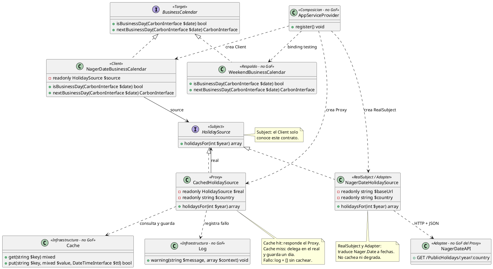
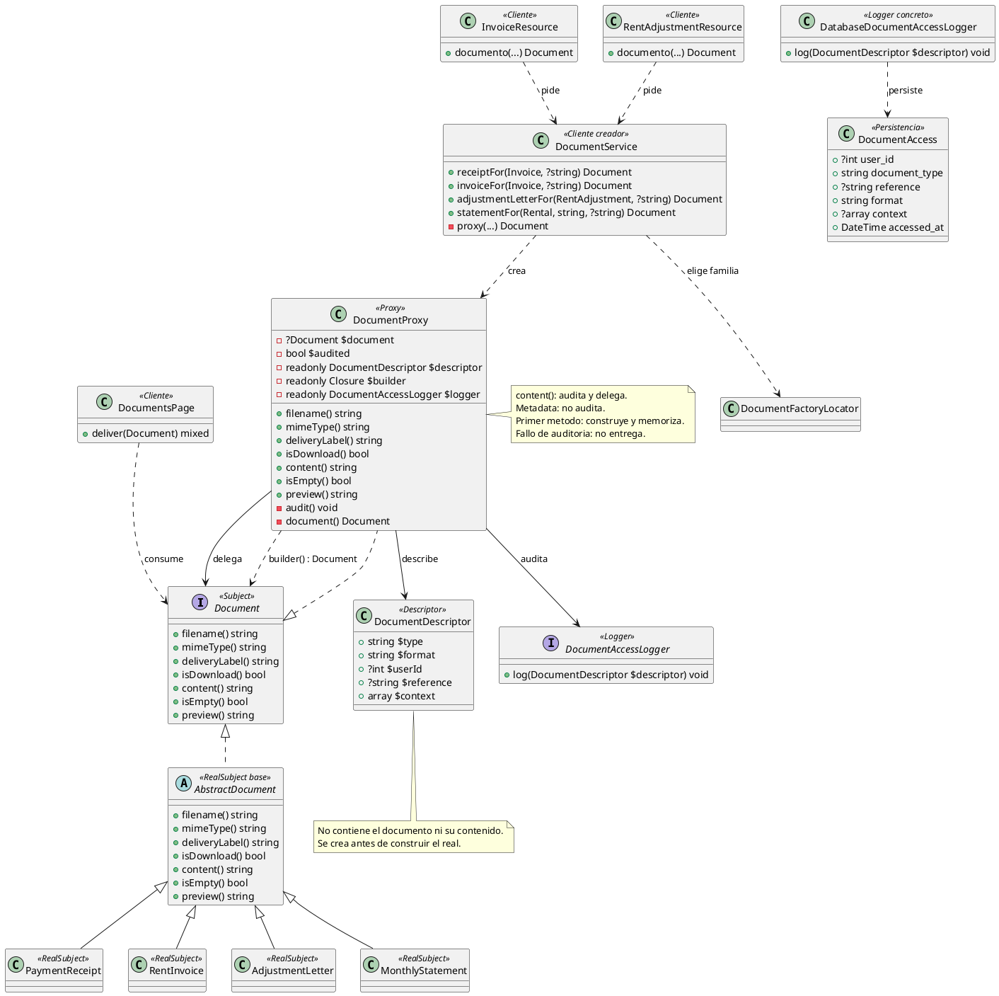

# Proxy

## 1. Nombre y propósito

**Proxy** es un patrón estructural que coloca un objeto con la **misma interfaz** que otro delante de él para **controlar el acceso**. El cliente depende del Subject y no sabe si habla con el objeto real o con el intermediario.

En Prometheus el patrón se aplica en dos puntos distintos:

| Caso | Subject | Proxy | RealSubject | Variante |
| --- | --- | --- | --- | --- |
| Festivos | `HolidaySource` | `CachedHolidaySource` | `NagerDateHolidaySource` | Proxy de caché con degradación controlada. |
| Documentos | `Document` | `DocumentProxy` | Documento producido por la fábrica (`PaymentReceipt`, `RentInvoice`, `AdjustmentLetter`, `MonthlyStatement`). | Proxy de protección y carga diferida con auditoría. |

El primer caso evita llamadas repetidas a Nager.Date y absorbe sus fallos. El segundo controla la entrega del contenido: registra el acceso y difiere la construcción hasta el primer uso y el renderizado hasta `content()`. Los dos comparten la misma idea —un intermediario con el contrato del objeto real—, pero resuelven problemas diferentes.

## 2. Problema que resuelve en Prometheus

### 2.1. Proxy de festivos

Los generadores de facturas, `RentalPeriod`, `AdjustmentDateProposer` y las pantallas de reajustes necesitan saber si una fecha es hábil. Para eso consultan `BusinessCalendar`, cuyo adaptador de producción obtiene los festivos de Nager.Date.

La consulta original mezclaba tres responsabilidades en `NagerDateBusinessCalendar`:

- traducir HTTP/JSON a una lista de fechas;
- cachear la respuesta por país y año;
- decidir qué hacer cuando la API falla.

Esa mezcla viola responsabilidad única y hace que un cambio de política de caché obligue a modificar el adaptador. Además, el dominio no debe conocer la URL, el país, la forma del JSON ni la disponibilidad de un servicio externo.

La solución necesita:

- una interfaz común para pedir festivos;
- un objeto real que solo hable con Nager.Date;
- un intermediario que cachee y degrade sin cambiar el contrato del cliente;
- una composición explícita en el contenedor;
- la posibilidad de sustituir el intermediario por un doble en pruebas.

### 2.2. Proxy de documentos

`DocumentService` produce comprobantes, facturas, cartas de reajuste y estados de cuenta. La pantalla y las acciones de Filament solo necesitan un `Document`: nombre, MIME, etiqueta, contenido y vista previa. Sin un intermediario, cada entrega tendría que resolver dos problemas adicionales:

- **Auditoría:** saber qué documento se entregó, a quién, en qué formato y sobre qué referencia.
- **Costo de construcción:** cargar relaciones y renderizar un PDF aunque el usuario solo abra un modal o consulte el nombre del archivo.

La solución necesita:

- conservar el contrato `Document` para que la pantalla no cambie;
- registrar el acceso al **contenido**, no a la metadata;
- construir el documento real una sola vez por proxy;
- no auditar dos veces el mismo contenido aunque Filament evalúe el modal varias veces;
- bloquear la entrega si la auditoría falla;
- mantener la validación del comprobante pagado como un fallo inmediato, antes de crear el Proxy;
- permitir que la auditoría cambie de destino sin tocar el servicio ni las pantallas.

## 3. Solución y roles del patrón

### 3.1. Proxy de festivos

Se creó `HolidaySource` como **Subject**. `NagerDateHolidaySource` es el **RealSubject**: implementa esa interfaz, conoce la URL, el país y el JSON, y lanza una excepción si la API no responde correctamente. `CachedHolidaySource` es el **Proxy**: implementa el mismo Subject, consulta la caché, delega en el real en caso de fallo de caché y captura los errores del real. `NagerDateBusinessCalendar` es el **Client**: calcula días hábiles usando únicamente `HolidaySource`.

| Rol GoF | Clase | Responsabilidad |
| --- | --- | --- |
| **Subject** | `HolidaySource` | Declara `holidaysFor(int $year): array`; es el contrato compartido entre Proxy y RealSubject. |
| **RealSubject** | `NagerDateHolidaySource` | Traduce HTTP/JSON de Nager.Date a fechas ISO; no cachea ni degrada. |
| **Proxy** | `CachedHolidaySource` | Controla el acceso: responde desde caché, delega en el real o devuelve `[]` si el real falla. |
| **Client** | `NagerDateBusinessCalendar` | Usa `HolidaySource` para calcular días hábiles; no conoce la API ni la caché. |

La composición en producción es:

```text
NagerDateBusinessCalendar
  -> CachedHolidaySource        (Proxy)
       -> NagerDateHolidaySource (RealSubject / Adapter)
```

`NagerDateHolidaySource` cumple **dos roles**: es el RealSubject del Proxy y, a la vez, el Adapter que traduce Nager.Date a `HolidaySource`. Los patrones se componen; el Proxy se coloca delante del Adapter.

El flujo del Proxy es:

1. Construye la clave `holidays:{country}:{year}`.
2. Si `Cache::get()` devuelve un arreglo, lo retorna sin llamar al real.
3. Si no hay caché, llama a `$real->holidaysFor($year)`.
4. Guarda el resultado un día con `Cache::put(..., now()->addDay())`.
5. Si el real lanza `Throwable`, registra un `Log::warning` y devuelve `[]` **sin cachear el fallo**.

`NagerDateBusinessCalendar` sigue aplicando su propia política de respaldo: si el Proxy devuelve una lista vacía, los días de semana se consideran hábiles y solo se excluyen sábados y domingos. Si `nextBusinessDay()` supera 366 iteraciones, usa `WeekendBusinessCalendar`. El Proxy no reemplaza ese respaldo; solo evita que un fallo de red llegue como excepción al cálculo.

`AppServiceProvider` arma la cadena en producción y mantiene `WeekendBusinessCalendar` para `testing`. La caché y el `Log` se usan mediante las fachadas de Laravel; las pruebas los controlan con `Cache::flush()` y `Http::fake()`.

### 3.2. Proxy de documentos

`Document` es el **Subject**. `DocumentProxy` es el **Proxy**: implementa el mismo contrato, guarda un `DocumentDescriptor`, un `Closure` que construye el documento real y un `DocumentAccessLogger`. El documento real es cualquier producto de las fábricas de documentos, normalmente un `AbstractDocument`. `DocumentService` es el **Cliente que crea el Proxy** y las pantallas son los **Clientes que lo consumen**.

| Rol GoF | Clase | Responsabilidad |
| --- | --- | --- |
| **Subject** | `Document` | Contrato de entrega: `filename()`, `mimeType()`, `deliveryLabel()`, `isDownload()`, `content()`, `isEmpty()` y `preview()`. |
| **Proxy** | `DocumentProxy` | Controla el acceso, audita el contenido y memoriza el documento real. |
| **RealSubject** | Documento concreto de la fábrica | Genera el contenido y la presentación reales. |
| **Descriptor** | `DocumentDescriptor` | Datos de auditoría: tipo, formato, usuario, referencia y contexto. |
| **Logger** | `DocumentAccessLogger` / `DatabaseDocumentAccessLogger` | Registra el acceso efectivo. |
| **Cliente creador** | `DocumentService` | Elige la fábrica, valida el comprobante pagado y construye el Proxy. |
| **Clientes** | `DocumentsPage`, `InvoiceResource`, `RentAdjustmentResource` | Consumen `Document` sin conocer el producto concreto. |

La composición es:

```text
DocumentService
  -> DocumentProxy              (Proxy)
       -> Closure(): Document   (construcción diferida)
            -> DocumentFactory  (familia texto/PDF/JSON)
            -> Document         (RealSubject)
  -> DatabaseDocumentAccessLogger
       -> DocumentAccess        (tabla document_accesses)
```

`DocumentService` crea el descriptor y el closure de construcción:

| Documento | `type` | `reference` | `context` |
| --- | --- | --- | --- |
| Comprobante | `payment_receipt` | Número de factura | `invoice_id` |
| Factura | `rent_invoice` | Número de factura | `invoice_id` |
| Carta de reajuste | `adjustment_letter` | `REAJUSTE-{id}` | `rent_adjustment_id`, `rental_id` |
| Estado de cuenta | `monthly_statement` | `ALQUILER-{id} · {periodo}` | `rental_id`, `period` |

`DocumentDescriptor` es inmutable (`final readonly`) y contiene `type`, `format`, `userId` nullable, `reference` y `context`. `userId` se toma de `auth()->id()` al crear el Proxy; si no hay sesión, queda `null`. `DatabaseDocumentAccessLogger` persiste una fila en `document_accesses` con esos datos y `accessed_at = now()`.

La migración `2026_10_25_120000_create_document_accesses_table.php` crea:

| Columna | Uso |
| --- | --- |
| `user_id` | Usuario que accedió; FK nullable con `nullOnDelete` para conservar el histórico si se borra el usuario. |
| `document_type` | Tipo lógico (`rent_invoice`, `payment_receipt`, etc.). |
| `reference` | Referencia legible del documento. |
| `format` | `text`, `pdf` o `json`. |
| `context` | JSON con ids o periodo. |
| `accessed_at` | Momento del acceso. |
| `timestamps` | Creación y actualización de la fila. |

También crea índices por `(user_id, accessed_at)` y `(document_type, accessed_at)`.

#### Qué se audita y cuándo

| Método | Audita | Construye el real | Observación |
| --- | --- | --- | --- |
| `content()` | Sí, antes de delegar. | Sí. | Si la auditoría falla, el builder no se ejecuta. |
| `filename()` | No. | En la primera llamada. | La metadata no revela contenido. |
| `mimeType()` | No. | En la primera llamada. | Igual. |
| `deliveryLabel()` | No. | En la primera llamada. | Igual. |
| `isDownload()` | No. | En la primera llamada. | Igual. |
| `isEmpty()` | No. | En la primera llamada. | Igual. |
| `preview()` | No. | En la primera llamada. | Es metadata de presentación; puede requerir renderizado. |

El Proxy se construye sin ejecutar el builder. El **primer método delegado** —aunque sea de metadata— construye y memoriza el documento real. Por eso la construcción es diferida hasta el primer uso, pero no exclusiva de `content()`. Lo que se difiere y se controla de forma estricta es la **auditoría del contenido**: solo `content()` la dispara.

Una llamada a `filename()` no registra un acceso, pero sí materializa el documento real. El código anterior describía esto como “metadata sin costo”; la lectura correcta es “metadata sin auditoría y con construcción al primer uso”. La prueba `la_metadata_no_registra_un_acceso` fija la parte de auditoría, no que el builder no se ejecute.

#### Auditoría una sola vez y fail-closed

`DocumentProxy` guarda `$audited` y `$document`. `audit()`:

1. si `$audited` es `true`, no hace nada;
2. llama `$logger->log($descriptor)`;
3. solo después de que el logger termina, marca `$audited = true`.

Si la auditoría lanza, `$audited` queda en `false` y `content()` no llega a `document()`. El contenido queda bloqueado. El comentario del código es explícito: “si la auditoría falla, un segundo intento vuelve a intentarla y el contenido sigue bloqueado”. Es una política **fail-closed**: es preferible no entregar el documento a entregar uno cuyo acceso no quedó registrado.

La auditoría es por **instancia de Proxy**, no por documento lógico. Dos llamadas a `DocumentService::invoiceFor()` producen dos proxies y dos filas, aunque sean la misma factura y el mismo formato. Dentro del mismo proxy, `content()` varias veces produce una sola fila.

#### Guard del comprobante pagado

`DocumentService::receiptFor()` llama `PaymentReceipt::ensureInvoiceIsPaid($invoice)` **antes** de crear el Proxy. Una factura sin pagar lanza `DomainException` de inmediato y no deja una entrega diferida que falle después. La auditoría no reemplaza esa validación: son controles distintos.

## 4. Diagramas de clases

### 4.1. Proxy de festivos



### 4.2. Proxy de documentos



## 5. Clases participantes y valoración

| Clase | Ruta | Rol | Participación |
| --- | --- | --- | --- |
| `HolidaySource` | `app/Contracts/HolidaySource.php` | Subject | Contrato de un solo método; permite intercambiar Proxy y RealSubject. |
| `CachedHolidaySource` | `app/Infrastructure/Holidays/CachedHolidaySource.php` | Proxy | Cachea por país/año, delega en el real y degrada a `[]` si falla. |
| `NagerDateHolidaySource` | `app/Infrastructure/Holidays/NagerDateHolidaySource.php` | RealSubject / Adapter | Consulta Nager.Date, valida la respuesta y extrae las fechas; lanza `RuntimeException` si falla. |
| `NagerDateBusinessCalendar` | `app/Infrastructure/Holidays/NagerDateBusinessCalendar.php` | Client | Implementa `BusinessCalendar`; consulta festivos, salta fines de semana y aplica el tope de 366 días. |
| `BusinessCalendar` | `app/Contracts/BusinessCalendar.php` | Target contextual | Contrato del dominio; no forma parte del Proxy. |
| `WeekendBusinessCalendar` | `app/Infrastructure/Holidays/WeekendBusinessCalendar.php` | Respaldo / doble | Implementación de fin de semana usada por `testing` y como último respaldo. |
| `Document` | `app/Documents/Contracts/Document.php` | Subject | Contrato de entrega que comparten Proxy y documentos reales. |
| `DocumentProxy` | `app/Documents/DocumentProxy.php` | Proxy | Audita `content()` y memoriza el documento real. |
| `DocumentDescriptor` | `app/Documents/DocumentDescriptor.php` | Descriptor | Datos de auditoría sin contenido. |
| `DocumentAccessLogger` | `app/Contracts/DocumentAccessLogger.php` | Logger | Contrato de registro del acceso. |
| `DatabaseDocumentAccessLogger` | `app/Documents/Audit/DatabaseDocumentAccessLogger.php` | Logger concreto | Persiste una fila en `document_accesses`. |
| `DocumentAccess` | `app/Models/DocumentAccess.php` | Persistencia | Histórico de accesos con contexto JSON. |
| `DocumentService` | `app/Documents/DocumentService.php` | Cliente creador | Valida, elige fábrica, crea descriptor y Proxy. |
| `DocumentsPage` | `app/Filament/Pages/DocumentsPage.php` | Cliente | Consulta formatos y entrega documentos. |
| `InvoiceResource` | `app/Filament/Resources/InvoiceResource.php` | Cliente | Entrega facturas y comprobantes. |
| `RentAdjustmentResource` | `app/Filament/Resources/RentAdjustmentResource.php` | Cliente | Entrega cartas de reajuste. |
| `AppServiceProvider` | `app/Providers/AppServiceProvider.php` | Composición | Une Client, Proxy y RealSubject de festivos; enlaza el logger de documentos. |
| `Cache` / `Log` | Fachadas de Laravel | Infraestructura | Almacenamiento temporal y registro de fallos del Proxy de festivos. |
| API Nager.Date | Servicio externo | Adaptee | Origen remoto de los festivos. |

### 5.1. Ventajas

**Festivos**

- **Transparencia:** el Client sigue dependiendo de `HolidaySource`; no cambia cuando se agrega o se quita el Proxy.
- **Menos llamadas remotas:** un año ya cacheado se responde sin tocar Nager.Date.
- **Aislamiento del fallo:** el RealSubject puede lanzar; el Proxy decide degradar y el calendario no recibe la excepción.
- **Caché no envenenada:** un fallo no se guarda, por lo que el siguiente intento vuelve a consultar la API.
- **Responsabilidad única:** la traducción HTTP/JSON queda en `NagerDateHolidaySource`; la política de acceso, en `CachedHolidaySource`.
- **Composición con Adapter:** el mismo objeto real puede ser RealSubject y Adapter sin duplicar la traducción.

**Documentos**

- **Contrato intacto:** la pantalla sigue recibiendo `Document`; no hay un tipo nuevo de retorno.
- **Auditoría centralizada:** el registro vive en el Proxy y el logger se puede cambiar por binding.
- **Contenido auditado una sola vez:** `$audited` evita filas duplicadas dentro de la misma instancia.
- **Construcción memorizada:** `$document ??= builder()` evita renderizar dos veces el mismo documento.
- **Fail-closed:** si la auditoría falla, el contenido no se entrega.
- **Metadata separada:** `filename()`, `mimeType()` y `isEmpty()` no registran accesos.
- **Validación inmediata preservada:** el comprobante sin pagar falla antes de crear el Proxy.
- **Trazabilidad útil:** tipo, referencia, formato, usuario, contexto y fecha permiten reconstruir qué se entregó.
- **Bajo acoplamiento:** el logger depende de `DocumentDescriptor`, no del documento real.

### 5.2. Desventajas

**Festivos**

- **Datos con hasta un día de antigüedad:** el TTL de un día puede retrasar la incorporación de un festivo corregido o publicado tarde.
- **Degradación ambigua:** el Client recibe `[]` tanto si no hay festivos como si la API falló; la diferencia solo queda en el log.
- **Cálculo potencialmente incorrecto:** al degradar, los días de semana se tratan como hábiles aunque sean festivos; el respaldo solo cubre fines de semana.
- **Sin reintentos ni backoff:** cada fallo de caché puede esperar el timeout de la petición; el Proxy no reintenta.
- **Invalidación limitada:** no hay tags ni versión de clave; para limpiar la caché en pruebas se usa `Cache::flush()`.
- **País duplicado en la composición:** el país se pasa al Proxy y al RealSubject; una construcción inconsistente produciría claves y consultas distintas.
- **Dependencias por fachada:** `Cache` y `Log` no se inyectan; se controlan con las utilidades de Laravel, pero no con dobles explícitos del constructor.
- **Dos responsabilidades en el real:** `NagerDateHolidaySource` es RealSubject y Adapter a la vez; es correcto por composición, pero exige explicar ambos roles.
- **Tope de 366 días:** si el Proxy devuelve una lista vacía durante un período largo, `nextBusinessDay()` puede agotar el tope y usar el respaldo de fin de semana.

**Documentos**

- **Metadata con costo de construcción:** el primer método, aunque sea `filename()`, ejecuta el builder. Lo diferido es la auditoría y el contenido, no toda la construcción.
- **Auditoría por instancia:** pedir dos veces el mismo documento lógico crea dos proxies y dos filas. Es correcto para registrar entregas, pero no sirve como contador único de “documentos vistos”.
- **Sin identidad de entrega:** la fila no guarda IP, user agent, ruta de descarga ni un id de entrega; el contexto es el que arma `DocumentService`.
- **Usuario nullable:** si el Proxy se crea fuera de una sesión autenticada, `user_id` queda `null`. La tabla lo permite para no perder el histórico.
- **Crecimiento sin retención:** no hay purga ni política de retención de `document_accesses`; el volumen depende de las entregas.
- **Auditoría no transaccional:** el log se escribe antes de entregar, pero no dentro de una transacción que abarque la respuesta HTTP. Si el envío falla después del log, la fila queda registrada igual.
- **Fallo de auditoría visible como error:** si la base no está disponible, el usuario no recibe el documento. Es la política elegida, pero convierte la auditoría en una dependencia de disponibilidad.
- **Metadata no auditada:** consultar `filename()` o `isEmpty()` no deja rastro. Es deliberado, pero significa que el histórico solo cubre contenido efectivamente pedido.
- **Acoplamiento al contenedor:** `DocumentService` resuelve el logger por constructor, pero el usuario lo toma de `auth()` en el momento de crear el Proxy; una creación fuera de la petición puede perder el contexto.
- **Preview puede construir:** `preview()` es metadata para la interfaz, pero puede requerir el documento real. La separación es lógica (auditoría), no de costo.

## 6. Flujo de una llamada

### 6.1. Festivos

1. `NagerDateBusinessCalendar` llama `HolidaySource::holidaysFor($year)`.
2. `CachedHolidaySource` construye `holidays:{country}:{year}` y consulta `Cache`.
3. Si hay arreglo, lo devuelve.
4. Si no, llama al `NagerDateHolidaySource`.
5. Si el real responde, guarda el resultado un día y lo devuelve.
6. Si el real falla, registra `Log::warning` y devuelve `[]` sin guardar.
7. El calendario interpreta `[]` como “sin festivos” y aplica su respaldo de fin de semana.

### 6.2. Documentos

#### Entrega normal

1. La pantalla llama `RentalFacade::invoiceFor()` o `DocumentService::invoiceFor()`.
2. `DocumentService` elige la fábrica, arma el descriptor y crea un closure que producirá el documento.
3. Devuelve `DocumentProxy`; el builder aún no se ejecutó.
4. La pantalla consulta `filename()` para el botón. El Proxy construye y memoriza el documento real, pero **no audita**.
5. El usuario confirma la entrega; la pantalla llama `content()`.
6. El Proxy ejecuta `audit()`: `DatabaseDocumentAccessLogger` inserta la fila.
7. Si la inserción funciona, `$audited = true` y el Proxy delega `content()` en el documento real.
8. Si el usuario vuelve a pedir `content()` sobre el mismo Proxy, no hay segunda fila ni segunda construcción.

#### Auditoría fallida

1. La pantalla llama `content()`.
2. `audit()` llama al logger.
3. El logger lanza una excepción.
4. `$audited` no se marca y el builder no se ejecuta.
5. La excepción llega al cliente; el contenido no se entrega.
6. Un segundo intento vuelve a llamar al logger; si vuelve a fallar, sigue bloqueado.

#### Comprobante sin pagar

1. La pantalla llama `DocumentService::receiptFor($invoice)`.
2. `PaymentReceipt::ensureInvoiceIsPaid()` detecta que la factura no está pagada.
3. Lanza `DomainException` antes de crear descriptor, closure o Proxy.
4. No se registra ningún acceso porque no hubo entrega.

#### Dos documentos distintos

1. La pantalla pide `invoiceFor($invoice, 'text')` y `invoiceFor($invoice, 'json')`.
2. Se crean dos proxies, cada uno con su descriptor y su closure.
3. Cada `content()` registra su propia fila.
4. La tabla muestra dos formatos distintos para la misma factura.

## 7. Pruebas

| Prueba | Qué fija |
| --- | --- |
| `el_proxy_cachea_los_festivos_y_no_vuelve_a_golpear_la_api` | La segunda consulta del mismo año sale de caché; solo hay una petición HTTP. |
| `el_proxy_degrada_a_lista_vacia_si_la_api_falla` | Un error del real se convierte en `[]`. |
| `el_proxy_no_cachea_el_fallo_y_reintenta_en_el_siguiente_intento` | El fallo no envenena la caché; el segundo intento consulta de nuevo. |
| `el_proxy_y_el_real_son_intercambiables_para_el_cliente` | Ambos implementan `HolidaySource` y el calendario los usa igual. |
| `la_metadata_no_registra_un_acceso` | `filename()`, `mimeType()`, `deliveryLabel()`, `isDownload()`, `preview()` e `isEmpty()` no crean filas. |
| `el_contenido_registra_un_unico_acceso_aunque_se_pida_varias_veces` | Dos `content()` sobre el mismo Proxy producen una fila con usuario, tipo, referencia, formato, contexto y fecha. |
| `cada_proxy_registra_su_propio_acceso` | Dos proxies distintos producen dos filas, una por formato. |
| `el_documento_real_se_construye_una_sola_vez` | El builder se ejecuta una vez para dos `content()` sobre el mismo Proxy. |
| `una_auditoria_fallida_bloquea_el_contenido` | Si el logger lanza, el builder no se ejecuta y el contenido no se entrega. |
| `el_comprobante_sin_pagar_falla_antes_de_crear_el_proxy` | El guard del comprobante lanza `DomainException` antes de la creación diferida. |

`tests/Feature/CachedHolidaySourceTest.php` contiene las cuatro pruebas del Proxy de festivos. `tests/Feature/DocumentProxyTest.php` contiene las seis pruebas del Proxy de documentos. El repositorio tiene además pruebas de integración de documentos (`DocumentFactoryTest`, `DocumentsPageTest`, acciones de factura) que verifican que los clientes siguen consumiendo `Document`.

## 8. Decisión de alcance

### 8.1. Dos variantes, un mismo patrón

Los dos casos usan Proxy porque ambos colocan un intermediario con la misma interfaz del objeto real, pero el control es distinto:

- **Festivos:** controla el acceso a un recurso remoto costoso. La política es caché + degradación.
- **Documentos:** controla el acceso a un recurso sensible. La política es auditoría + construcción diferida + fail-closed.

No se intentó unificar ambos en una sola clase. Tienen Subjects, dependencias y políticas incompatibles. Lo que se comparte es la estructura: Client -> Subject -> Proxy -> RealSubject.

### 8.2. Por qué el Proxy de documentos no autoriza

`DocumentProxy` audita, pero **no comprueba permisos**. La autorización sigue en las consultas y relaciones de `DocumentService`: la factura se obtiene desde el usuario autenticado y el alcance se aplica antes de crear el descriptor. El Proxy no recibe el modelo ni el usuario completo, solo el descriptor, así que no está en posición de decidir si el usuario puede ver el documento.

Esa separación evita dos problemas:

- duplicar reglas de autorización en un objeto que solo debería controlar la entrega;
- dar una falsa sensación de seguridad si alguien crea un Proxy con un descriptor manual.

Si en el futuro se necesita un control de permisos, debe vivir antes de `DocumentService` o en un decorador/guard específico, no dentro del logger.

### 8.3. Por qué se audita `content()` y no la metadata

El acceso relevante es la entrega del contenido. Consultar el nombre del archivo o si está vacío no revela el cuerpo del documento y ocurre muchas veces durante el renderizado de Filament. Auditarlo produciría filas por cada evaluación del modal y ocultaría las entregas reales.

La contrapartida es que la metadata puede construir el documento real. Se acepta porque:

- el costo principal suele estar en el renderizado de `content()`, que se memoriza de todos modos;
- la pantalla necesita `filename()`, `mimeType()` e `isEmpty()` para decidir la entrega;
- separar la construcción de la metadata exigiría dos objetos o una construcción perezosa por método, con más complejidad que beneficio.

La prueba y la documentación deben describir el comportamiento real: **metadata sin auditoría, no necesariamente sin construcción**. Si en el futuro el costo de construir para metadata se vuelve relevante, la solución sería un descriptor con metadata propia o un Proxy de dos fases, no relajar la auditoría.

### 8.4. Límites aceptados

- una fila por Proxy, no por documento lógico;
- sin IP, user agent ni identificador de entrega;
- sin retención ni purga automática;
- sin interfaz de consulta de accesos;
- auditoría fail-closed, con dependencia de disponibilidad de la base;
- el guard del comprobante pagado sigue fuera del Proxy;
- el Proxy de festivos sigue sin reintentos ni invalidación por tags.

Estos límites son parte del alcance de la entrega. Cambiarlos exige una decisión explícita sobre seguridad, retención y disponibilidad, no solo una modificación del Proxy.
