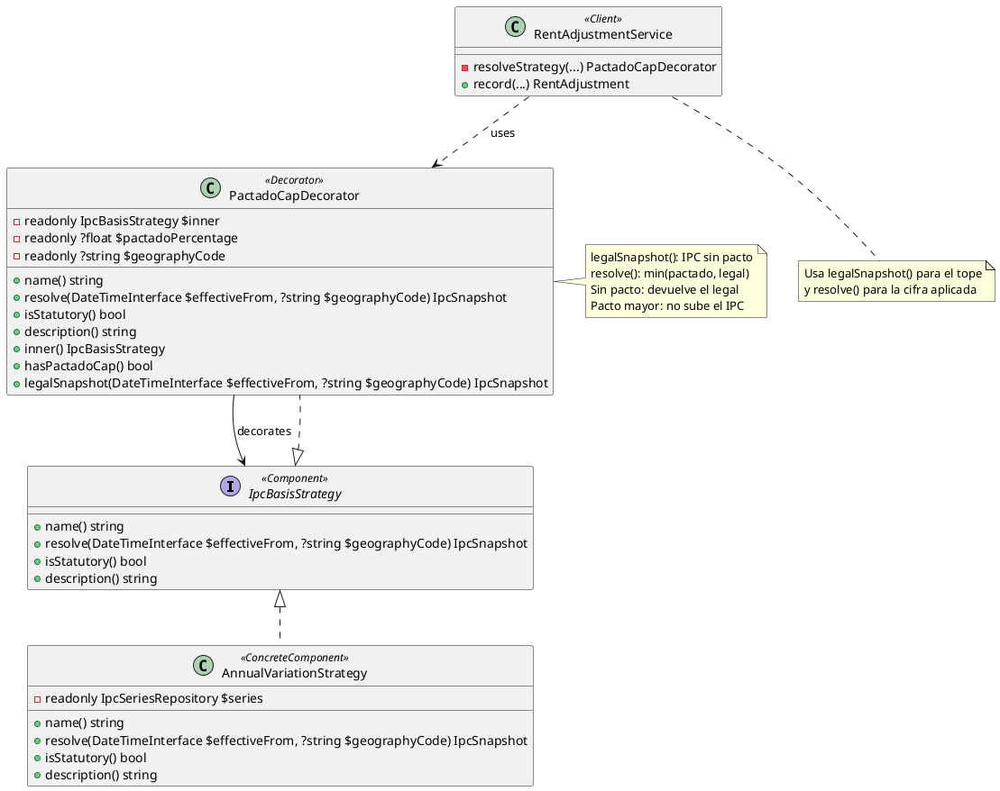
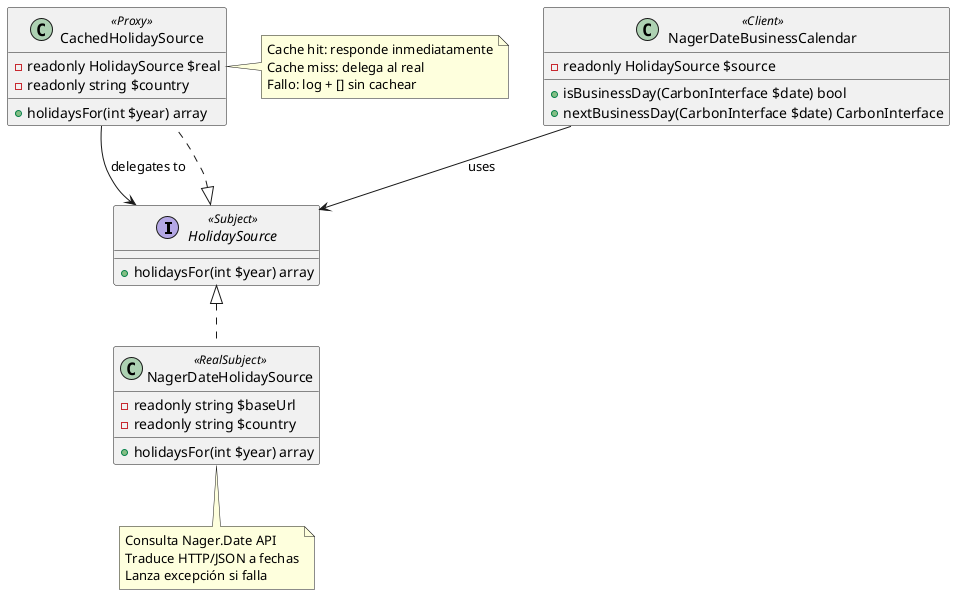
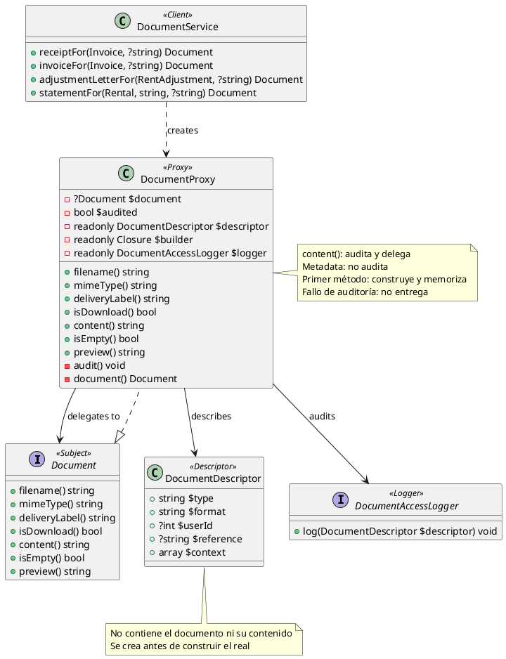

# Diagramas UML GOF - Patrones Decorator y Proxy

Este documento contiene los diagramas UML estilo GoF de los patrones Decorator y Proxy implementados en la aplicación, basados en el código real.

---

## Patrón Decorator - Pactado del IPC

El patrón Decorator se aplica para limitar el IPC al porcentaje pactado por las partes, manteniendo separadas la cifra legal y la aplicada.

### Clases Participantes

| Rol GoF | Clase | Ruta |
| --- | --- | --- |
| **Component** | `IpcBasisStrategy` | `app/Services/Adjustment/Strategies/IpcBasisStrategy.php` |
| **ConcreteComponent** | `AnnualVariationStrategy` | `app/Services/Adjustment/Strategies/AnnualVariationStrategy.php` |
| **Decorator** | `PactadoCapDecorator` | `app/Services/Adjustment/Decorators/PactadoCapDecorator.php` |
| **Client** | `RentAdjustmentService` | `app/Services/RentAdjustmentService.php` |

### Diagrama UML

---

## Patrón Proxy - Festivos (Cache con Degradación)

El patrón Proxy se aplica para controlar el acceso a la fuente de festivos de Nager.Date, implementando caché y degradación controlada ante fallos.

### Clases Participantes

| Rol GoF | Clase | Ruta |
| --- | --- | --- |
| **Subject** | `HolidaySource` | `app/Contracts/HolidaySource.php` |
| **Proxy** | `CachedHolidaySource` | `app/Infrastructure/Holidays/CachedHolidaySource.php` |
| **RealSubject** | `NagerDateHolidaySource` | `app/Infrastructure/Holidays/NagerDateHolidaySource.php` |
| **Client** | `NagerDateBusinessCalendar` | `app/Infrastructure/Holidays/NagerDateBusinessCalendar.php` |

### Diagrama UML

---

## Patrón Proxy - Documentos (Protección y Auditoría)

El patrón Proxy se aplica para controlar el acceso a los documentos, registrando la auditoría del contenido y diferiendo la construcción del documento real.

### Clases Participantes

| Rol GoF | Clase | Ruta |
| --- | --- | --- |
| **Subject** | `Document` | `app/Documents/Contracts/Document.php` |
| **Proxy** | `DocumentProxy` | `app/Documents/DocumentProxy.php` |
| **RealSubject** | Documentos de fábricas (AbstractDocument) | `app/Documents/Documents/AbstractDocument.php` |
| **Descriptor** | `DocumentDescriptor` | `app/Documents/DocumentDescriptor.php` |
| **Logger** | `DocumentAccessLogger` | `app/Contracts/DocumentAccessLogger.php` |
| **Client** | `DocumentService` | `app/Documents/DocumentService.php` |

### Diagrama UML

---

## Notas

- Los diagramas incluyen únicamente las clases relevantes para mostrar el patrón según GoF
- Los métodos corresponden exactamente a los implementados en el código real
- Se respetan las firmas de métodos tal como aparecen en las clases PHP
- Las relaciones de composición y delegación reflejan la estructura del código
