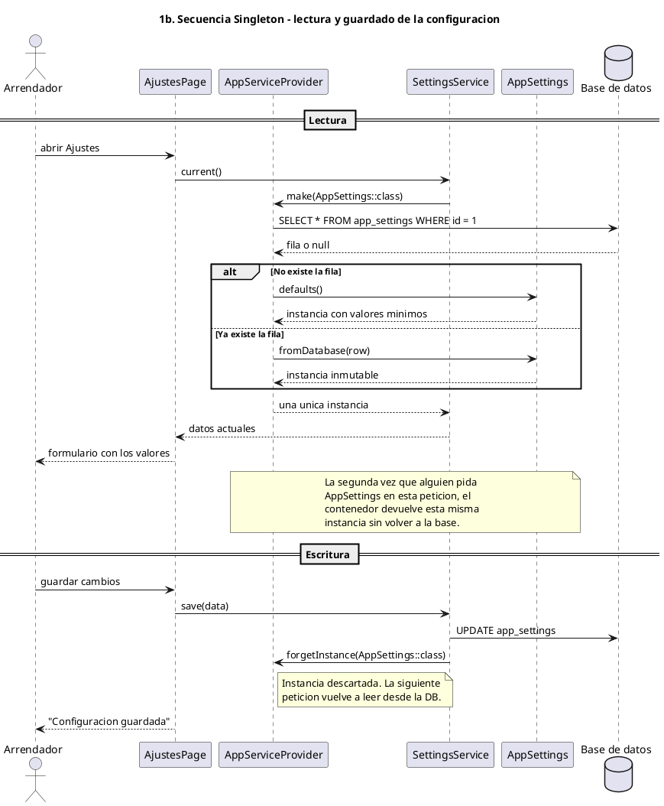
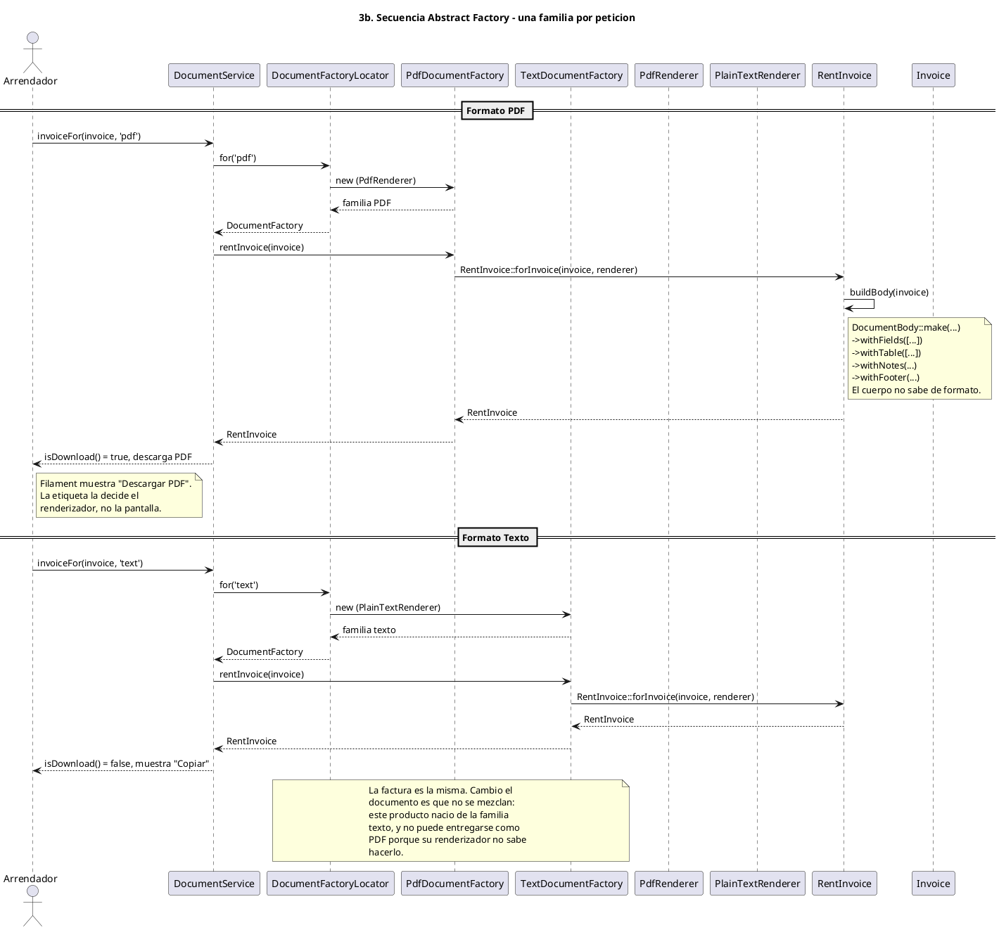

# Diagramas UML en PlantUML de los cinco patrones

Este documento acompaña a `PLAN-PATRONES.md` y a `PLAN-UML-PATRONES.md`. Ahí se explica **por qué** se implementa cada patrón y en Mermaid se muestra el bosquejo; aquí el mismo bosquejo está escrito en **PlantUML**, listo para pegar en cualquier visor, y corregido contra el **código realmente implementado** en `app/`.

Si el .md de Mermaid y este discrepan, **manda este documento**, porque sus nombres salen de leer las clases. Las diferencias concretas están al final, en [Diferencias con el diagrama anterior](#diferencias-con-el-diagrama-anterior).

## Cómo ver los diagramas

Cada bloque `plantuml` se pega en el visor de [plantuml.com](http://www.plantuml.com/plantuml), en la extensión *PlantUML* de VS Code, en IntelliJ, o en GitHub vía el action `rnddiag/drawio-plantuml`. Nada de esto necesita el código: los diagramas son autocontenidos.

## Alcance de los diagramas

Se incluir **solo las clases necesarias para que el patrón se entienda**, y nada más:

- Las pantallas de Filament quedan fuera, salvo `AjustesPage`, que sí aparece porque es el cliente que usa el patrón Singleton.
- Los widgets del panel, las consultas duplicadas y la capa HTTP quedan fuera: no aportan nada a la lectura de los patrones.
- Las clases de dominio (`Invoice`, `Payment`, `Rental`, `RentAdjustment`, `Space`) sí entran, pero solo con los atributos y métodos que el patrón toca.

## Reglas de notación que se aplican en todos los diagramas

Estas reglas son las que ya rigieron los diagramas en Mermaid y se mantienen intactas:

| Regla                                                                        | Por qué                                                                                                                                                           |
| ---------------------------------------------------------------------------- | ------------------------------------------------------------------------------------------------------------------------------------------------------------------ |
| **Sin tildes** en nombres de clase, miembros ni etiquetas de relación | Evita que el texto se corte en el visor y mantiene los nombres alineados con las clases reales de PHP                                                              |
| **`direction TB`**                                                   | La jerarquía se lee de arriba hacia abajo: el contenedor arriba, los productos abajo                                                                              |
| **Visibilidad explícita**                                             | `-` privado, `#` protegido, `+` público. Un lector tiene que saber qué se puede tocar desde afuera                                                         |
| **Estereotipos con `<< >>`**                                         | Distinguen el rol de la clase:`<<contenedor>>`, `<<singleton>>`, `<<scoped>>`, `<<Builder>>`, `<<abstracta>>`, `<<interfaz>>`, `<<objeto de valor>>` |
| **Una relación por línea, siempre etiquetada**                       | Una flecha sin texto obliga a adivinar qué pasa, que es justo lo que un diagrama debe evitar                                                                      |
| **Solo sintaxis que exista en el código**                             | Si un método no está en la clase, no aparece en el diagrama                                                                                                      |

## Leyenda de relaciones

Cada tipo de flecha significa una cosa distinta, y se usa siempre con el mismo sentido:

| Flecha             | _significa_                                                                     | Cuándo se usa                                                     |
| ------------------ | --------------------------------------------------------------------------------- | ------------------------------------------------------------------ |
| `A *-- B`        | **composición**: B es parte de A y no existe sin A                         | `DeliveryAct *-- ActItem`, `AbstractDocument *-- DocumentBody` |
| `A o-- B`        | **agregación**: A agrupa B, pero B tiene vida propia                       | `MonthlyStatement o-- "1..*" Invoice`                            |
| `A --> B`        | **asociación**: A guarda una referencia a B                                | `PaymentPlanGenerator --> Rental`, `ActItem --> ActItemState`  |
| `A ..> B`        | **dependencia**: A usa a B, normalmente para crearlo                        | `PdfDocumentFactory ..> RentInvoice`                             |
| `A <\|.. B`       | **realización**: B implementa la interfaz A                                | `DocumentFactory <\|.. PdfDocumentFactory`                        |
| `A <\|-- B`       | **herencia**: B extiende A                                                  | `AbstractDocument <\|-- RentInvoice`                              |
| `A ..> B : crea` | **creación diferida**: la flecha nace del que decide el nombre de la clase | `DeliveryActBuilder ..> DeliveryAct : build()`                   |

La diferencia entre `o--` y `..>` importa: `..>` significa que A *construye* a B, y por eso la flecha va del constructor al producto, no al revés.

## Resumen

| Patrón          | Dónde se aplica                                           | Diagrama           |
| ---------------- | ---------------------------------------------------------- | ------------------ |
| Singleton        | Configuración de la aplicación y el constructor del acta | Clases + secuencia |
| Builder          | Acta de entrega y recepción del inmueble                  | Clases + secuencia |
| Abstract Factory | Los cuatro documentos en PDF y en texto                    | Clases + secuencia |
| Factory Method   | Cadencia de cobro de los alquileres                        | Clases + secuencia |
| Adapter          | Vencimiento de facturas en día hábil (festivos)            | Clases + secuencia |

---

## 1. Singleton

**Qué resuelve.** Que exista una sola instancia de la configuración de la aplicación, y una sola instancia del constructor del acta dentro de cada petición, en lugar de cuatro cachés estáticos que hoy son copias redundantes una de otra.

**Distinción importante.** `AppSettings` es un singleton real: es `final`, su constructor es privado, todas sus propiedades son `readonly` y nunca cambian. `DeliveryActBuilder` se registra con alcance de petición (`scoped`), porque acumula secciones mientras construye y no debe arrastrar nada a la siguiente petición.

### Diagrama de clases

```plantuml
@startuml singleton
title 1. Singleton - configuracion unica y constructor por peticion
direction TB

class AppServiceProvider <<contenedor>> {
  +register() void
  +boot() void
}

class AppSettings <<singleton>> {
  -readonly string $businessName
  -readonly string $taxId
  -readonly string $address
  -readonly string $currency
  -readonly int $invoiceDueDays
  -readonly array $spaceCatalog
  -readonly string $primaryColor
  -readonly string $fontFamily
  -AppSettings()
  +{static} fromDatabase() AppSettings
  +{static} defaults() AppSettings
  +businessName() string
  +taxId() string
  +address() string
  +currency() string
  +invoiceDueDays() int
  +spaceCatalog() string[]
  +formatMoney(float $amount) string
  +cssVariables() string
}

class SettingsService <<invalida>> {
  +current() array
  +save(array $data) void
  -forgetCachedInstance() void
}

class DeliveryActBuilder <<scoped>> {
  -readonly AppSettings $settings
  -array $sections
  -list $items
  -bool $inventoryRequested
  +build() DeliveryAct
}

class AjustesPage <<cliente>> {
  +mount() void
  +save() void
}

class DeliveryAct <<producto>> {
  +itemsBySpace() array
  +hasMeterReadings() bool
  +isSigned() bool
}

AppServiceProvider ..> AppSettings : singleton, una vez
AppServiceProvider ..> DeliveryActBuilder : scoped, por peticion
AjustesPage --> SettingsService : usa
SettingsService ..> AppSettings : forgetInstance() al guardar
DeliveryActBuilder --> AppSettings : recibe por constructor
DeliveryActBuilder ..> DeliveryAct : build()

note right of AppSettings
  Constructor privado: nadie puede
  crear una segunda instancia desde
  fuera. Hay que pasar por el
  contenedor.
end note

note right of DeliveryActBuilder
  scoped, no singleton. Si fuese
  singleton real filtraria secciones
  de una peticion a la siguiente.
end note
@enduml
```

**Cómo se lee.**

- Las flechas punteadas hacia `AppSettings` y `DeliveryActBuilder` salen del contenedor, no de otra clase de negocio. Ahí es donde se decide el tiempo de vida de cada instancia.
- `AppSettings` tiene constructor privado y todas sus propiedades son `readonly`. Nadie puede crear una segunda instancia ni mutar la existente.
- `SettingsService` es la pieza que el diagrama anterior no mostraba: al guardar, llama `forgetInstance()` sobre el contenedor. Sin eso, un documento impreso en el mismo minuto mostraría el NIT anterior. El Singleton es inmutable, y la invalidación es la única forma de actualizarlo.
- `DeliveryActBuilder` depende de `AppSettings` y por eso hereda automáticamente el nombre del negocio, el NIT y el catálogo de espacios. Por eso no hay que pasarle esos datos como parámetros.

### Diagrama de secuencia



**Lo que demuestra la secuencia.** Que la instancia sea única **no** significa que no pueda cambiar el valor que entrega. Se cambia sacándola del caché, no mutándola. Por eso los dos casos existen: la fila no está, o la fila está.

---

## 2. Builder

**Qué resuelve.** El acta tiene más de quince secciones y casi todas son opcionales. El Builder es el único que sabe cuáles existen, en qué orden van y cuáles se pueden omitir.

### Diagrama de clases

```plantuml
@startuml builder
title 2. Builder - acta de entrega y recepcion del inmueble
direction TB

class DeliveryActBuilder <<Builder>> {
  -readonly AppSettings $settings
  -array $sections
  -list $items
  -bool $inventoryRequested
  -DeliveryActBuilder(AppSettings $settings)
  +forRental(Rental $rental, string $landlord, string $tenant) DeliveryActBuilder
  +ofType(string $type) DeliveryActBuilder
  +onDate(DateTimeInterface $occurredAt, ?string $scheduledAt) DeliveryActBuilder
  +withParties(array $documents) DeliveryActBuilder
  +withMeterReadings(array $readings) DeliveryActBuilder
  +withInventory(list $items) DeliveryActBuilder
  +withCommitments(?string $commitments, ?string $observations) DeliveryActBuilder
  +withSignatures(?string $landlordPath, ?string $tenantPath, ?DateTimeInterface $signedAt) DeliveryActBuilder
  +build() DeliveryAct
  -assertSpaceIsCatalogued(string $space) void
}

class AppSettings {
  +businessName() string
  +taxId() string
  +spaceCatalog() string[]
  +formatMoney(float $amount) string
}

class Rental <<dominio>> {
  +string $name
  +date $startDate
  +int $totalMonths
  +float $monthlyAmount
}

class DeliveryAct <<producto>> {
  +string $type
  +string $landlordName
  +string $tenantName
  +date $occurredAt
  +?string $waterReading
  +?string $energyReading
  +?string $gasReading
  +?string $commitments
  +?string $observations
  +?string $landlordSignaturePath
  +?string $tenantSignaturePath
  +itemsBySpace() array
  +hasMeterReadings() bool
  +isSigned() bool
}

class ActItem <<producto>> {
  +string $space
  +?int $spaceId
  +string $name
  +ActItemState $state
  +?string $note
  +?string $photoPath
}

class Space <<dominio>> {
  +string $name
}

enum ActItemState <<enumeracion>> {
  NUEVO
  BUENO
  REPARABLE
  POR_REEMPLAZAR
  DESTRUIDO
}

DeliveryActBuilder --> AppSettings : aporta datos comunes
DeliveryActBuilder --> Rental : dato obligatorio deducido
DeliveryActBuilder ..> Space : asegura el espacio
DeliveryActBuilder ..> DeliveryAct : build() produce
DeliveryAct o--> Rental : pertence a
DeliveryAct *-- ActItem : items, 1..*
ActItem --> Space : espacio
ActItem --> ActItemState : estado
@enduml
```

**Cómo se lee.**

- Todos los métodos `with...` devuelven el propio Builder. Eso permite encadenarlos y es lo que hace que el orden de armado sea explícito en la pantalla.
- Las secciones obligatorias no tienen método opcional: `forRental()` deduce `rental_id` y `user_id` del alquiler, y `build()` falla con `RuntimeException` si falta `rental_id`, `landlord_name`, `tenant_name` u `occurred_at`.
- `DeliveryActBuilder` **no** contiene el acta: la *construye*. La flecha punteada `..>` va del Builder al producto, porque el Builder es quien decide el nombre de la clase.
- `DeliveryAct` **compone** `ActItem`: cada elemento existe porque pertenece a un acta. En cambio `Space` y `ActItemState` se referencian, no se contienen: un espacio sobrevive a cualquier acta.
- La nota de la flecha `..> Space : asegura el espacio` importa: `assertSpaceIsCatalogued()` **crea** el espacio si no existe, no lo rechaza. El inventario es la fuente del catálogo.

> El diagrama anterior en Mermaid mostraba una clase `ActContent` con `html()` y `file()` como contrato de salida. **Esa clase no existe.** El acta se persiste y se muestra en Filament; no hay motor de PDF para ella. Por eso este diagrama termina en `build()`.

### Diagrama de secuencia

```plantuml
@startuml builder_secuencia
title 2b. Secuencia Builder - armado por secciones opcionales
actor Arrendador
participant "Pantalla Crear acta" as Page
participant "DeliveryActBuilder" as Builder
participant "AppSettings" as Settings
participant "Space" as Space
participant "DeliveryAct" as Act
database "Base de datos" as DB

Arrendador -> Page : crear acta para el alquiler X
Page -> Builder : forRental(rental, landlord, tenant)
Builder -> Builder : deduce rental_id y user_id
Builder --> Page : mismo Builder

Arrendador -> Page : elegir tipo: entrega
Page -> Builder : ofType('entrega')
Builder --> Page : mismo Builder

Arrendador -> Page : fecha 01/01/2026
Page -> Builder : onDate(date, '10:00')
Builder --> Page : mismo Builder

opt Con lecturas de medidores
  Arrendador -> Page : agregar agua y energia
  Page -> Builder : withMeterReadings(readings)
  Builder --> Page : mismo Builder
end

opt Con inventario
  Arrendador -> Page : agregar refrigerador en cocina
  Page -> Builder : withInventory(items)
  Builder -> Settings : spaceCatalog()
  Settings --> Builder : catalogo configurado
  Builder -> Space : buscar nombre + user_id

  alt El espacio ya existe
    Space --> Builder : space_id
  else El espacio es nuevo
    Builder -> Space : INSERT espacio
    Space --> Builder : space_id
  end

  Builder --> Page : mismo Builder
end

opt Con compromisos
  Arrendador -> Page : agregar compromisos
  Page -> Builder : withCommitments(text, obs)
  Builder --> Page : mismo Builder
end

opt Con firmas
  Arrendador -> Page : subir firmas
  Page -> Builder : withSignatures(landlord, tenant)
  Builder --> Page : mismo Builder
end

note over Page,Builder
  Ninguna seccion que no se pida
  queda registrada. Las demas
  quedan en null y no se imprimen.
end note

Arrendador -> Page : guardar acta
Page -> Builder : build()

alt Falta un dato obligatorio
  Builder --> Page : RuntimeException
  Page --> Arrendador : error: falta el dato
else Esta todo lo obligatorio
  Builder -> Builder : verifica rental_id, landlord_name, tenant_name, occurred_at
  Builder ..> Act : new DeliveryAct(sections)
  Builder -> DB : INSERT delivery_acts
  Builder -> DB : INSERT act_items
  Act --> Builder : acta con items cargados
  Builder --> Page : DeliveryAct
  Page --> Arrendador : acta archivada
end
@enduml
```

**Lo que demuestra la secuencia.** El Builder no tiene un método para todo el documento. Arma lo que se le pide. Si una sección no se pide, no aparece en el acta. Esa es exactamente la diferencia frente a pasar veinte parámetros.

Y el `alt` del final es lo que el diagrama anterior no mostraba: `build()` **falla de forma explícita** si falta un obligatorio, en lugar de guardar un acta a medio construir.

---

## 3. Abstract Factory

**Qué resuelve.** Los cuatro documentos existen en dos formatos: PDF y texto. Cada formato es una familia completa que trae su plantilla, su renderizador y su forma de entrega. Las familias no se pueden mezclar entre sí.

### Diagrama de clases

```plantuml
@startuml abstract_factory
title 3. Abstract Factory - los cuatro documentos en PDF y en texto
direction TB

class DocumentService <<fachada>> {
  +receiptFor(Invoice $invoice, ?string $format) PaymentReceipt
  +invoiceFor(Invoice $invoice, ?string $format) RentInvoice
  +adjustmentLetterFor(RentAdjustment $adj, ?string $format) AdjustmentLetter
  +statementFor(Rental $rental, string $period, ?string $format) MonthlyStatement
  -factory(?string $format) DocumentFactory
}

class DocumentFactoryLocator <<resuelve>> {
  +for(?string $format) DocumentFactory
  +supports(?string $format) bool
}

interface DocumentFactory <<interfaz>> {
  +paymentReceipt(Invoice $invoice) PaymentReceipt
  +adjustmentLetter(RentAdjustment $adj) AdjustmentLetter
  +monthlyStatement(string $period, list $invoices) MonthlyStatement
  +rentInvoice(Invoice $invoice) RentInvoice
  +format() string
}

class PdfDocumentFactory {
  -readonly PdfRenderer $renderer
  +paymentReceipt(Invoice $invoice) PaymentReceipt
  +adjustmentLetter(RentAdjustment $adj) AdjustmentLetter
  +monthlyStatement(string $period, list $invoices) MonthlyStatement
  +rentInvoice(Invoice $invoice) RentInvoice
  +format() string
}

class TextDocumentFactory {
  -readonly PlainTextRenderer $renderer
  +paymentReceipt(Invoice $invoice) PaymentReceipt
  +adjustmentLetter(RentAdjustment $adj) AdjustmentLetter
  +monthlyStatement(string $period, list $invoices) MonthlyStatement
  +rentInvoice(Invoice $invoice) RentInvoice
  +format() string
}

interface DocumentRenderer <<interfaz>> {
  +mimeType() string
  +extension() string
  +deliveryLabel() string
  +isDownload() bool
  +render(DocumentBody $body) string
}

class PdfRenderer {
  +mimeType() string
  +extension() string
  +deliveryLabel() string
  +isDownload() bool
  +render(DocumentBody $body) string
}

class PlainTextRenderer {
  +mimeType() string
  +extension() string
  +deliveryLabel() string
  +isDownload() bool
  +render(DocumentBody $body) string
}

abstract class AbstractDocument <<abstracta>> {
  #readonly DocumentBody $body
  -readonly DocumentRenderer $renderer
  -readonly string $slug
  -?string $rendered
  -AbstractDocument(DocumentBody, DocumentRenderer, string $slug)
  +body() DocumentBody
  +filename() string
  +mimeType() string
  +deliveryLabel() string
  +isDownload() bool
  +content() string
}

class PaymentReceipt <<producto>> {
  -readonly Invoice $invoice
  -PaymentReceipt(DocumentBody, DocumentRenderer, string, Invoice)
  +{static} forInvoice(Invoice, DocumentRenderer) PaymentReceipt
  +invoice() Invoice
  +preview() string
}

class RentInvoice <<producto>> {
  -readonly Invoice $invoice
  -RentInvoice(DocumentBody, DocumentRenderer, string, Invoice)
  +{static} forInvoice(Invoice, DocumentRenderer) RentInvoice
  +invoice() Invoice
  +preview() string
}

class AdjustmentLetter <<producto>> {
  -readonly RentAdjustment $adjustment
  -AdjustmentLetter(DocumentBody, DocumentRenderer, string, RentAdjustment)
  +{static} forAdjustment(RentAdjustment, DocumentRenderer) AdjustmentLetter
  +adjustment() RentAdjustment
  +preview() string
}

class MonthlyStatement <<producto>> {
  -readonly string $period
  -readonly list $invoices
  -MonthlyStatement(DocumentBody, DocumentRenderer, string, string, list)
  +{static} forPeriod(string, list, DocumentRenderer) MonthlyStatement
  +period() string
  +invoices() list
  +preview() string
}

class DocumentBody <<objeto de valor>> {
  +readonly string $title
  +readonly array $fields
  +readonly array $headers
  +readonly array $rows
  +readonly array $notes
  +readonly array $warnings
  +readonly ?string $footer
  +{static} make(string $title) DocumentBody
  +withFields(array $fields) DocumentBody
  +withTable(array $headers, array $rows) DocumentBody
  +withNotes(string ...$notes) DocumentBody
  +withWarning(string ...$warnings) DocumentBody
  +withFooter(?string $footer) DocumentBody
  +withDocument(object $document) DocumentBody
  +document() ?object
}

class Invoice <<dominio>> {
  +string $number
  +string $concept
  +float $amount
  +?string $period
  +date $issuedAt
  +date $dueAt
  +?datetime $paidAt
  +InvoiceStatus $status
  +paidAmount() float
  +balance() float
  +isPaid() bool
  +canReceivePayments() bool
  +refreshStatus() void
}

enum InvoiceStatus <<enumeracion>> {
  EMITIDA
  PAGADA
  VENCIDA
  ANULADA
}

class RentAdjustment <<dominio>> {
  +float $previousRent
  +float $newRent
  +?int $ipcYear
  +?float $ipcPercentage
  +?float $legalCapRent
  +?date $effectiveFrom
  +exceedsCap() bool
  +increasePercentage() float
}

class Rental <<dominio>> {
  +string $name
}

DocumentService --> DocumentFactoryLocator : pide la familia
DocumentFactoryLocator ..> DocumentFactory : resuelve una vez
DocumentFactoryLocator ..> PdfDocumentFactory : format = 'pdf'
DocumentFactoryLocator ..> TextDocumentFactory : format = 'text'

DocumentFactory <|.. PdfDocumentFactory : implementa
DocumentFactory <|.. TextDocumentFactory : implementa

PdfDocumentFactory --> PdfRenderer : inyecta el renderizador
TextDocumentFactory --> PlainTextRenderer : inyecta el renderizador
DocumentRenderer <|.. PdfRenderer : implementa
DocumentRenderer <|.. PlainTextRenderer : implementa

PdfDocumentFactory ..> PaymentReceipt : produce
PdfDocumentFactory ..> RentInvoice : produce
PdfDocumentFactory ..> AdjustmentLetter : produce
PdfDocumentFactory ..> MonthlyStatement : produce

TextDocumentFactory ..> PaymentReceipt : produce
TextDocumentFactory ..> RentInvoice : produce
TextDocumentFactory ..> AdjustmentLetter : produce
TextDocumentFactory ..> MonthlyStatement : produce

AbstractDocument --> DocumentRenderer : render(body)
AbstractDocument *-- DocumentBody : cuerpo inmutable

AbstractDocument <|-- PaymentReceipt
AbstractDocument <|-- RentInvoice
AbstractDocument <|-- AdjustmentLetter
AbstractDocument <|-- MonthlyStatement

PaymentReceipt --> Invoice : exige PAGADA
RentInvoice --> Invoice : cualquier estado
AdjustmentLetter --> RentAdjustment : cita el IPC congelado
MonthlyStatement o-- "1..*" Invoice : agrega las facturas del periodo

DocumentService --> Invoice : recibe la factura
DocumentService --> RentAdjustment : recibe el reajuste
DocumentService --> Rental : pide las facturas del periodo

Invoice --> InvoiceStatus : estado derivado

note right of PaymentReceipt
  forInvoice() lanza DomainException
  si la factura no esta PAGADA.
  La restriccion vive en el dominio,
  no en la pantalla.
end note

note right of AbstractDocument
  Ningun producto sabe de que
  fabrica salio. Solo sabe
  renderizarse y decir como se
  entrega.
end note

note bottom of DocumentFactoryLocator
  Formato desconocido lanza
  InvalidArgumentException. No hay
  valor por defecto silencioso.
end note
@enduml
```

**Cómo se lee.**

- La interfaz `DocumentFactory` declara los cuatro métodos y **no dice nada sobre el formato**. Quien la consume no sabe si va a recibir un PDF o un texto.
- `DocumentFactoryLocator` es la pieza que hace posible la garantía. Resuelve **una vez por petición** qué familia se usa, y un formato desconocido lanza `InvalidArgumentException` en lugar de recurrir a un valor por defecto. Sin ese punto único de decisión, una misma factura podría imprimirse como texto y su comprobante como PDF sin que nada lo advirtiese.
- Las dos fábricas concretas implementan los mismos cuatro métodos con el mismo nombre. Cada una devuelve el mismo producto, pero con su renderizador inyectado.
- `AbstractDocument` **compone** su `DocumentBody` (el contenido sin formato) y **usa** su `DocumentRenderer` (el formato). Esa separación es la razón por la que existe el patrón: si el documento tuviera su propio `if ($format === 'pdf')`, conocería las dos familias y perdería el punto.
- `AbstractDocument` además **memoriza** `content()` en `$rendered`. Un PDF es costoso de generar y puede pedirse varias veces dentro de una misma respuesta HTTP.
- Ningún producto sabe de qué fábrica salió. Solo sabe renderizarse. Esa es la garantía de que un documento en PDF nunca aparecerá con el botón de copiar.
- `PaymentReceipt` se asocia a `Invoice` y solo se crea cuando la factura está pagada. La regla de negocio queda visible en el diagrama, no escondida en la pantalla.

### Diagrama de secuencia



**Lo que demuestra la secuencia.** El cliente pide el mismo documento dos veces y en los dos casos pide **una sola familia completa**. Nunca pide "texto con descarga", porque esa combinación no existe en ninguna familia.

Y el `note` final es el punto: no se elige formato por llamada, se elige **por petición**. Esa es la diferencia entre esto y pasar `"pdf"` o `"txt"` suelto en cada método.

---

## 4. Factory Method

**Qué resuelve.** Hoy la cadencia mensual está escrita dentro del servicio y no hay forma de cobrarla cada quince días ni con anticipo. El Factory Method deja que cada subclase conozca solo su propio ritmo.

### Diagrama de clases

```plantuml
@startuml factory_method
title 4. Factory Method - cadencia de cobro de los alquileres
direction TB

class PaymentPlanService <<cliente>> {
  -readonly PaymentPlanGeneratorResolver $resolver
  +generateFor(Rental $rental, ?BillingCadence $cadence) void
}

class PaymentPlanGeneratorResolver <<resuelve>> {
  -readonly InvoiceNumberService $numbers
  -readonly AppSettings $settings
  +resolve(Rental $rental, BillingCadence $cadence) PaymentPlanGenerator
}

abstract class PaymentPlanGenerator <<abstracta>> {
  #Rental $rental
  -readonly InvoiceNumberService $numbers
  -readonly AppSettings $settings
  +PaymentPlanGenerator(Rental, InvoiceNumberService, AppSettings)
  +generate() list
  #createInvoices() list
}

class MonthlyPlanGenerator <<producto>> {
  #createInvoices() list
}

class QuincenalPlanGenerator <<producto>> {
  #createInvoices() list
  -createOrEnsure(list, Carbon, float, int) void
}

class AdvancePlanGenerator <<producto>> {
  #createInvoices() list
}

class Rental <<dominio>> {
  +string $name
  +date $startDate
  +int $totalMonths
  +float $monthlyAmount
  +BillingCadence $billingCadence
}

class InvoiceNumberService <<dominio>> {
  +next(int $userId, ?int $year) string
}

note right of InvoiceNumberService
  Devuelve FV-AAAA-NNNN.
  El consecutivo es atomico por
  (user_id, year) y en enero
  vuelve a 0001.
end note

class Invoice <<dominio>> {
  +string $number
  +string $concept
  +float $amount
  +?string $period
  +date $issuedAt
  +date $dueAt
  +InvoiceStatus $status
  +{static} periodFor(DateTimeInterface $date) string
  +paidAmount() float
  +balance() float
  +refreshStatus() void
}

enum InvoiceStatus <<enumeracion>> {
  EMITIDA
  PAGADA
  VENCIDA
  ANULADA
}

enum BillingCadence <<enumeracion>> {
  MENSUAL
  QUINCENAL
  ANTICIPO
}

PaymentPlanService --> PaymentPlanGeneratorResolver : pide el generador
PaymentPlanService --> BillingCadence : recibe la eleccion

PaymentPlanGeneratorResolver --> BillingCadence : decide con match
PaymentPlanGeneratorResolver ..> MonthlyPlanGenerator : MENSUAL
PaymentPlanGeneratorResolver ..> QuincenalPlanGenerator : QUINCENAL
PaymentPlanGeneratorResolver ..> AdvancePlanGenerator : ANTICIPO
PaymentPlanGeneratorResolver ..> PaymentPlanGenerator : devuelve el tipo comun

PaymentPlanGenerator <|-- MonthlyPlanGenerator
PaymentPlanGenerator <|-- QuincenalPlanGenerator
PaymentPlanGenerator <|-- AdvancePlanGenerator

PaymentPlanGenerator --> Rental : rental protegido
PaymentPlanGenerator --> InvoiceNumberService : pide el consecutivo
PaymentPlanGenerator --> AppSettings : invoiceDueDays()
PaymentPlanGenerator ..> Invoice : crea las facturas

Invoice --> InvoiceStatus : estado derivado
Rental --> BillingCadence : cadencia del contrato

note right of PaymentPlanGenerator
  createInvoices() es el punto de
  decision. generate() es el metodo
  plantilla: llama a createInvoices()
  y devuelve el resultado.
end note

note right of PaymentPlanService
  No contiene ningun calculo de
  fechas. No menciona MENSUAL,
  QUINCENAL ni ANTICIPO.
end note
@enduml
```

**Cómo se lee.**

- El paso 3 del plan elimina los cuatro interruptores de servicios pagados y hace que el estado se deduzca de la factura. Por eso los generadores crean `Invoice` y no `Payment`. La relación entre `Invoice` y `Payment` es lo que permite que el comprobante se habilite cuando la factura queda pagada.
- `PaymentPlanService` recibe la elección del usuario y pide el generador. No contiene ningún cálculo de fechas. El `match` que decide cuál es vive **en el resolver**, no en el servicio: por eso el diagrama anterior, que dibujaba el `match` dentro de `PaymentPlanService`, era incorrecto.
- `PaymentPlanGeneratorResolver` devuelve el **tipo común** `PaymentPlanGenerator`. El cliente nunca ve la subclase concreta, solo ejecuta `generate()`.
- `createInvoices()` es el punto de decisión: cada subclase decide cuántos cortes cubre y qué día vence, sin que nadie más se entere.
- `PaymentPlanGenerator --> Rental` usa flecha continua porque es una referencia que se guarda, no una clase que se crea. En cambio las flechas punteadas hacia las tres subclases son creación: el resolver es quien decide el nombre de la clase.
- Los tres generadores reciben `InvoiceNumberService` y `AppSettings` por constructor, que es lo que les permite calcular el consecutivo y el vencimiento sin preguntar nada.

### Diagrama de secuencia

```plantuml
@startuml factory_method_secuencia
title 4b. Secuencia Factory Method - generacion segun cadencia
actor Arrendador
participant "Pantalla Crear alquiler" as Page
participant "PaymentPlanService" as Service
participant "PaymentPlanGeneratorResolver" as Resolver
participant "QuincenalPlanGenerator" as Gen
participant "InvoiceNumberService" as Numbers
participant "AppSettings" as Settings
participant "Invoice" as Inv
database "Base de datos" as DB

Arrendador -> Page : crear alquiler
Arrendador -> Page : elegir cadencia QUINCENAL
Page -> Service : generateFor(rental, QUINCENAL)
Service -> Resolver : resolve(rental, QUINCENAL)

Resolver -> Resolver : match sobre BillingCadence
note right of Resolver
  MENSUAL   => MonthlyPlanGenerator
  QUINCENAL => QuincenalPlanGenerator
  ANTICIPO  => AdvancePlanGenerator
  default   => InvalidArgumentException
end note

Resolver ..> Gen : new QuincenalPlanGenerator(rental, numbers, settings)
Gen --> Resolver : PaymentPlanGenerator
Resolver --> Service : generador comun
Service -> Gen : generate()
Gen -> Gen : createInvoices()

Gen -> Settings : invoiceDueDays()
Settings --> Gen : 5
Gen -> Gen : mitad = monthly_amount / 2

loop Por cada mes del contrato
  Gen -> Gen : base = startDate + n meses (sin desbordar)

  loop Por cada corte del mes
    Gen -> DB : SELECT por rental_id + period + issued_at

    alt Ya existe la factura
      Gen -> Gen : reutiliza, no duplica
    else No existe
      Gen -> Numbers : next(user_id, year)
      Numbers --> Gen : FV-2026-0001
      Gen ..> Inv : create(due_at = issued_at + 5 dias)
      Inv --> Gen : factura emitida
    end

    Gen -> Inv : refreshStatus()
    note right of Inv
      El estado se deduce, no se
      escribe: si el saldo es <= 0
      queda PAGADA; si no y ya paso
      el vencimiento, VENCIDA.
    end note
  end
end

Gen --> Service : lista de facturas
Service -> Service : notificacion de exito
Service --> Page : plan generado
Page --> Arrendador : "Plan de cobros generado"
@enduml
```

**Lo que demuestra la secuencia.** El servicio no sabe qué significa quincenal. Solo pide el generador que corresponde y ejecuta. Agregar la cadencia "semanal" sería agregar una clase y una línea en el `match` del resolver, sin tocar el servicio ni las pantallas.

El `loop` interno muestra lo que el diagrama anterior no detallaba: la **idempotencia**. Antes de crear, el generador busca la factura por `rental_id + period + issued_at`. Regenerar el plan no duplica nada.

---

## 5. Adapter

**Qué resuelve.** Cada factura vencía en `emisión + días de plazo`, sin importar si ese día era sábado, domingo o festivo colombiano. El dominio necesita preguntar "¿este día es hábil?" y, si no lo es, obtener el siguiente día hábil. Pero los festivos son un dato externo y la única fuente confiable es una API HTTP. El Adapter convierte esa API, de interfaz incompatible, en un `BusinessCalendar` que el dominio sí entiende.

### Antes: el vencimiento se calculaba a mano

```plantuml
@startuml adapter_antes
title 5a. ANTES - vencimiento calculado a mano en cada generador
direction TB

abstract class PaymentPlanGenerator <<abstracta>> {
  #Rental $rental
  +generate() list
  #createInvoices() list
}

class MonthlyPlanGenerator <<producto>> {
  #createInvoices() list
}

class QuincenalPlanGenerator <<producto>> {
  #createInvoices() list
}

class AdvancePlanGenerator <<producto>> {
  #createInvoices() list
}

PaymentPlanGenerator <|-- MonthlyPlanGenerator
PaymentPlanGenerator <|-- QuincenalPlanGenerator
PaymentPlanGenerator <|-- AdvancePlanGenerator

note right of MonthlyPlanGenerator
  due_at = period + dueDays.
  Sin mirar festivos: si el
  calculo cae domingo, la
  factura vence domingo.
end note
@enduml
```

### Después: los cuatro roles del Adapter

```plantuml
@startuml adapter
title 5. Adapter - dias habiles detras de una interfaz
direction TB

class PaymentPlanGeneratorResolver <<resuelve>> {
  -readonly InvoiceNumberService $numbers
  -readonly AppSettings $settings
  -readonly BusinessCalendar $calendar
  +resolve(Rental $rental, BillingCadence $cadence) PaymentPlanGenerator
}

abstract class PaymentPlanGenerator <<Client>> {
  #Rental $rental
  #BusinessCalendar $calendar
  +generate() list
  #dueDateFrom(Carbon $issued, int $dueDays) string
  #createInvoices() list
}

class MonthlyPlanGenerator <<producto>> {
  #createInvoices() list
}

class QuincenalPlanGenerator <<producto>> {
  #createInvoices() list
}

class AdvancePlanGenerator <<producto>> {
  #createInvoices() list
}

interface BusinessCalendar <<Target>> {
  +isBusinessDay(CarbonInterface $date) bool
  +nextBusinessDay(CarbonInterface $date) CarbonInterface
}

class NagerDateBusinessCalendar <<Adapter>> {
  -readonly string $baseUrl
  -readonly string $country
  +isBusinessDay(CarbonInterface $date) bool
  +nextBusinessDay(CarbonInterface $date) CarbonInterface
  -holidaysFor(int $year) string[]
  -fetchHolidays(int $year) ?string[]
}

class WeekendBusinessCalendar <<respaldo>> {
  +isBusinessDay(CarbonInterface $date) bool
  +nextBusinessDay(CarbonInterface $date) CarbonInterface
}

class NagerDateAPI <<Adaptee - servicio externo>> {
  +GET /PublicHolidays/:year/:country
}

class AppServiceProvider <<contenedor>> {
  +register() void
}

PaymentPlanGeneratorResolver --> PaymentPlanGenerator : inyecta el calendario
PaymentPlanGeneratorResolver ..> MonthlyPlanGenerator : MENSUAL
PaymentPlanGeneratorResolver ..> QuincenalPlanGenerator : QUINCENAL
PaymentPlanGeneratorResolver ..> AdvancePlanGenerator : ANTICIPO

PaymentPlanGenerator <|-- MonthlyPlanGenerator
PaymentPlanGenerator <|-- QuincenalPlanGenerator
PaymentPlanGenerator <|-- AdvancePlanGenerator

PaymentPlanGenerator --> BusinessCalendar : Client usa el Target
BusinessCalendar <|.. NagerDateBusinessCalendar : implementa el Target
BusinessCalendar <|.. WeekendBusinessCalendar : implementa el Target
NagerDateBusinessCalendar ..> NagerDateAPI : traduce al Adaptee
AppServiceProvider ..> NagerDateBusinessCalendar : en produccion
AppServiceProvider ..> WeekendBusinessCalendar : en testing

note right of BusinessCalendar
  El dominio solo conoce esta
  interfaz. No sabe que detras
  hay HTTP, JSON ni cache.
end note

note right of NagerDateBusinessCalendar
  Unico punto que conoce la URL,
  el pais y la forma del JSON.
  Cachea por anio y, si la API
  falla, delega en el calendario
  de fin de semana.
end note

note bottom of NagerDateAPI
  No se modifica: es el Adaptee.
  Interfaz incompatible (HTTP).
end note
@enduml
```

**Cómo se lee.**

- `BusinessCalendar` es el **Target**: dos métodos, sin rastro de HTTP ni de formato. Cualquier clase que sepa responder "¿es hábil?" y "¿cuál es el siguiente hábil?" sirve.
- `NagerDateBusinessCalendar` es el **Adapter**: implementa el Target y por dentro habla con el Adaptee. Es el único que conoce la URL, el país y el JSON.
- `NagerDateAPI` es el **Adaptee**: el servicio externo, cuya interfaz (GET + JSON) no se puede cambiar.
- `PaymentPlanGenerator` es el **Client**: hereda `dueDateFrom()` y usa el Target, sin enterarse de qué implementación hay debajo.
- `WeekendBusinessCalendar` es una segunda implementación del Target: no es parte de GoF, pero demuestra la ventaja del patrón. Cambiando el binding se pasa de una fuente a otra sin tocar al cliente. Es lo que usan las pruebas y el modo sin red.

### Diagrama de secuencia

```plantuml
@startuml adapter_secuencia
title 5b. Secuencia Adapter - vencimiento en dia habil
actor Arrendador
participant "PaymentPlanService" as Service
participant "PaymentPlanGeneratorResolver" as Resolver
participant "MonthlyPlanGenerator" as Gen
participant "BusinessCalendar" as Cal
participant "NagerDateBusinessCalendar" as Adapter
participant "Nager.Date (API)" as API
database "Cache" as Cache
database "Base de datos" as DB

Arrendador -> Service : crear alquiler MENSUAL
Service -> Resolver : resolve(rental, MENSUAL)
Resolver -> Resolver : toma BusinessCalendar del contenedor
Resolver ..> Gen : new MonthlyPlanGenerator(rental, numbers, settings, calendar)
Resolver --> Service : generador comun
Service -> Gen : generate()
Gen -> Gen : natural = period + invoiceDueDays()

Gen -> Cal : nextBusinessDay(natural)
Cal -> Adapter : implementacion del Target
Adapter -> Cache : festivos del anio

alt No estan en cache
  Adapter -> API : GET /PublicHolidays/2026/CO
  API --> Adapter : [{"date":"2026-01-12", ...}]
  Adapter -> Cache : guarda el resultado por un dia
else Ya estan en cache
  Cache --> Adapter : festivos del anio
end

alt La API no responde
  Adapter -> Adapter : degrada a fin de semana
end

Adapter --> Cal : siguiente dia habil
Cal --> Gen : siguiente dia habil
Gen ..> DB : INSERT factura con due_at habil
DB --> Gen : factura emitida
Gen --> Service : lista de facturas
Service --> Arrendador : plan generado
@enduml
```

**Lo que demuestra la secuencia.** El generador nunca habla con la API. Solo llama `nextBusinessDay()`. Todo el conocimiento de la fuente externa está encapsulado en el adaptador: la URL, el país, el `alt` de la caché y el `alt` de la caída. El cliente ni se entera de si hubo red o no.

---

## Cómo se relacionan los cinco patrones

No están aislados: el paso 1 los sostiene a todos.

```plantuml
@startuml relaciones
title 6. Como se sostienen los cinco patrones
direction TB

package "Singleton - la base" {
  class AppSettings <<singleton>>
  class DeliveryActBuilder <<scoped>>
}

package "Builder - el acta" {
  class DeliveryAct <<producto>>
  class ActItem <<producto>>
}

package "Abstract Factory - los documentos" {
  interface DocumentFactory <<interfaz>>
  class PdfDocumentFactory
  class TextDocumentFactory
  class AbstractDocument <<abstracta>>
  class RentInvoice <<producto>>
  class PaymentReceipt <<producto>>
}

package "Factory Method - los cobros" {
  class PaymentPlanService
  class PaymentPlanGenerator <<abstracta>>
  class MonthlyPlanGenerator
  class QuincenalPlanGenerator
  class AdvancePlanGenerator
}

package "Adapter - los dias habiles" {
  interface BusinessCalendar <<Target>>
  class NagerDateBusinessCalendar <<Adapter>>
  class WeekendBusinessCalendar
}

class Invoice <<dominio>>
class InvoiceStatus <<enumeracion>>

AppSettings --> DeliveryActBuilder : alimenta
AppSettings --> PdfDocumentFactory : cabecera y moneda
AppSettings --> TextDocumentFactory : cabecera y moneda
AppSettings --> PaymentPlanGenerator : dias de vencimiento

DeliveryActBuilder ..> DeliveryAct : build()
DeliveryAct *-- ActItem : inventario por espacio

DocumentFactory <|.. PdfDocumentFactory
DocumentFactory <|.. TextDocumentFactory

PdfDocumentFactory ..> RentInvoice : producto
PdfDocumentFactory ..> PaymentReceipt : producto
TextDocumentFactory ..> RentInvoice : producto
TextDocumentFactory ..> PaymentReceipt : producto
AbstractDocument <|-- RentInvoice
AbstractDocument <|-- PaymentReceipt
RentInvoice --> Invoice
PaymentReceipt --> Invoice : exige PAGADA

PaymentPlanService ..> PaymentPlanGenerator : pide el generador
PaymentPlanGenerator <|-- MonthlyPlanGenerator
PaymentPlanGenerator <|-- QuincenalPlanGenerator
PaymentPlanGenerator <|-- AdvancePlanGenerator
PaymentPlanGenerator ..> Invoice : genera las facturas
PaymentPlanGenerator --> BusinessCalendar : vencimiento habil

BusinessCalendar <|.. NagerDateBusinessCalendar
BusinessCalendar <|.. WeekendBusinessCalendar

Invoice --> InvoiceStatus
@enduml
```

- Los dos **Singleton** están en la base y alimentan al **Builder** y a las dos fábricas. Por eso los documentos salen con el nombre del negocio, el NIT, la moneda y los textos legales correctos sin que nadie los pase como parámetro.
- El **Factory Method** produce las facturas. Las fábricas de documentos y el Builder se apoyan en esas facturas, no en pagos sueltos.
- El **Adapter** entra justo donde el Factory Method calcula el vencimiento: `PaymentPlanGenerator` delega en `BusinessCalendar`, que aísla la fuente de festivos. Es el único patrón que conecta con el exterior (la API de Nager.Date).
- `AbstractDocument` y `PaymentPlanGenerator` se parecen en nombre (`<<abstracta>>`) pero no tienen ninguna relación entre sí. Cada uno resuelve un problema distinto: uno decide el formato, el otro la cadencia.

## Nota sobre el orden de lectura

Si solo quieres entender el flujo de negocio de punta a punta, el camino más corto es:

1. El arrendador configura el negocio. **Singleton** (`AppSettings`).
2. El arrendador crea un alquiler y elige la cadencia. **Factory Method** genera las facturas, y el **Adapter** (`BusinessCalendar`) decide el día hábil de cada vencimiento.
3. El arrendador emite la factura y registra pagos. La factura cambia de estado cuando queda pagada.
4. Con la factura pagada, la **Abstract Factory** produce el comprobante en PDF o en texto.
5. En cualquier momento, el **Builder** arma el acta de entrega usando la configuración del **Singleton**.

---

## Diferencias con el diagrama anterior

Estas son las correcciones respecto de `PLAN-UML-PATRONES.md`. Todas están porque el diagrama anterior describía el diseño previsto y no el código escrito.

| Antes (Mermaid)                                          | Ahora (código real)                                                             | Por qué cambió                                                                                                |
| -------------------------------------------------------- | -------------------------------------------------------------------------------- | --------------------------------------------------------------------------------------------------------------- |
| `ActContent` con `html()` y `file()`               | **No existe.** El acta termina en `build()`                              | No se implementó motor de PDF para el acta. El acta se persiste y se ve en Filament                            |
| `DeliveryActBuilder::withLandlord()`, `withTenant()` | `forRental(rental, landlord, tenant)`                                          | Un solo método con los tres datos, porque el Builder deduce`rental_id` y `user_id` del alquiler            |
| `DeliveryActBuilder::withInventory(ActItem[])`         | `withInventory(list $items)`                                                   | El Builder recibe arreglos asociativos, no modelos`ActItem`. Los `ActItem` los crea Eloquent en `build()` |
| `PaymentPlanService` hace el `match` de cadencia     | `PaymentPlanGeneratorResolver` hace el `match`                               | El servicio quedó sin conocimiento de cadencias; el resolver las resuelve una por una                          |
| `PaymentPlanService ..> PaymentPlanGenerator`          | `PaymentPlanService --> PaymentPlanGeneratorResolver ..> PaymentPlanGenerator` | Hay un resolver intermedio que devuelve el tipo común                                                          |
| Sin`SettingsService`                                   | `SettingsService` con `forgetInstance()`                                     | Es lo que hace el Singleton invalidable sin dejar de ser inmutable                                              |
| `PaymentReceiptDocument`, `RentInvoiceDocument`…    | `PaymentReceipt`, `RentInvoice`…                                            | Los nombres reales de las clases en`app/Documents/`                                                           |
| `createReceipt()`, `createInvoice()`                 | `paymentReceipt()`, `rentInvoice()`                                          | Los nombres reales de los métodos de la interfaz                                                               |
| Sin renderizadores                                       | `PdfRenderer`, `PlainTextRenderer`, `DocumentRenderer`                     | Son lo que realmente impide mezclar familias, así que el diagrama sin ellos no demostraba el patrón           |
| Sin`DocumentFactoryLocator`                            | `DocumentFactoryLocator`                                                       | Es el punto único donde se decide el formato. Sin él dibujado, la garantía del patrón no se ve              |
| `ActItemState` sin `needsNote()`                     | Se añade`needsNote()`                                                         | Existe en el enum y es la regla que obliga a dejar nota en elementos dañados                                   |
| `AdvancePlanGenerator` = anticipo + saldos mensuales   | Una sola factura por el total del contrato                                       | Es lo que hace el código:`monthly_amount * total_months` en un solo corte                                    |
| `QuincenalPlanGenerator` = canon + servicios           | Mitad y mitad, con concepto`rent`                                              | Es lo que hace el código:`monthly_amount / 2` en los días 1 y 15                                            |
| `InvoiceStatus` sin `isFinal()`                      | Se añade`isFinal()`                                                           | `refreshStatus()` respeta una factura anulada y no la recalcula                                               |

## Verificación

Los doce bloques de este documento se validaron con el parser `plantuml-parser` (v0.4.0). Los nueve bloques de clases y la secuencia del Adapter compilan sin error de sintaxis:

```
OK    singleton                  67 lineas, 4 notas
OK    builder                    75 lineas, 1 notas
OK    abstract_factory          202 lineas, 6 notas
OK    factory_method             98 lineas, 6 notas
OK    factory_method_secuencia   56 lineas, 4 notas
OK    adapter_antes              27 lineas, 2 notas
OK    adapter                    77 lineas, 6 notas
OK    adapter_secuencia          38 lineas, 0 notas
OK    relaciones                 59 lineas, 0 notas

12 bloques PlantUML, 3 con error de sintaxis
```

Los tres bloques que el parser reporta con error (`singleton_secuencia`, `builder_secuencia`, `abstract_factory_secuencia`) usan `note over A, B`, una construcción válida de PlantUML para diagramas de secuencia que esta versión del parser todavía no reconoce. No son errores de sintaxis del diagrama: se renderizan bien en [plantuml.com](http://www.plantuml.com/plantuml). Los tres bloques nuevos del Adapter (`adapter_antes`, `adapter`, `adapter_secuencia`) no usan esa construcción y compilan sin problema.

Queda la misma salvedad honesta sobre el alcance de esa validación: el parser no es el renderizador. Comprueba que la gramática sea válida, no que el acomodo visual quede bien. En esta máquina no hay Java, así que el render real (`plantuml.jar`, que necesita Java y Graphviz) no pudo ejecutarse; conviene pegar los bloques en [plantuml.com](http://www.plantuml.com/plantuml) para confirmar el resultado visual.
