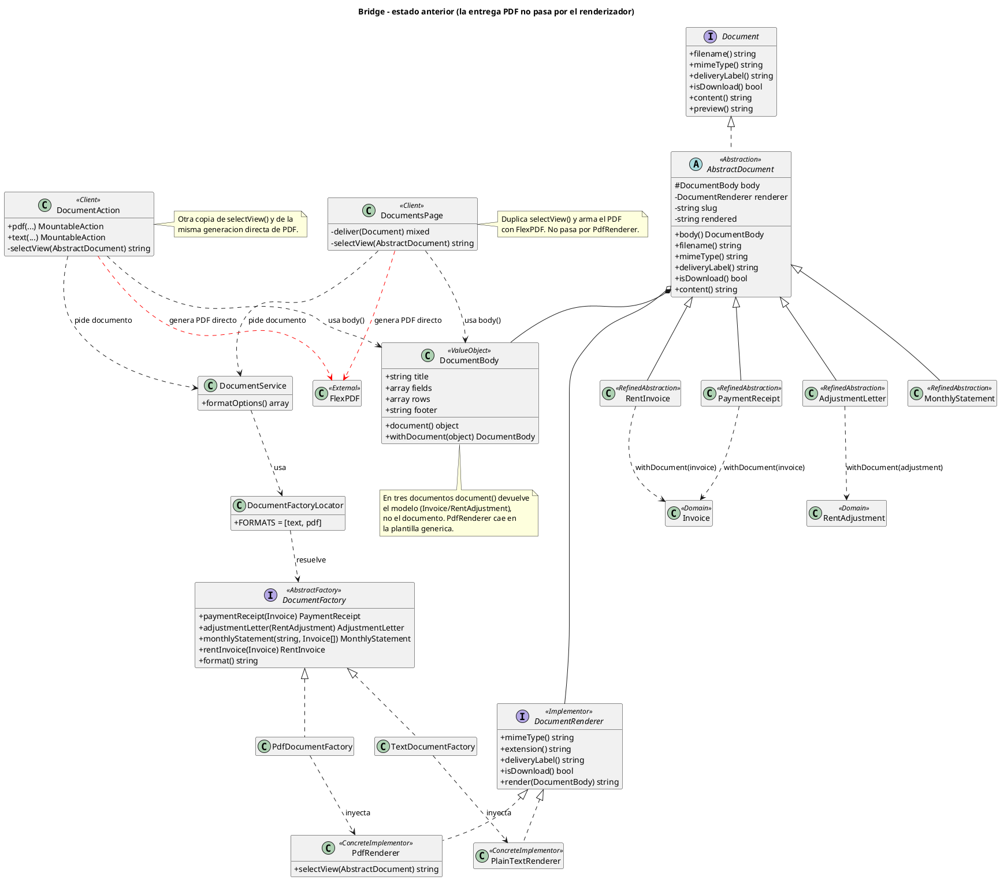
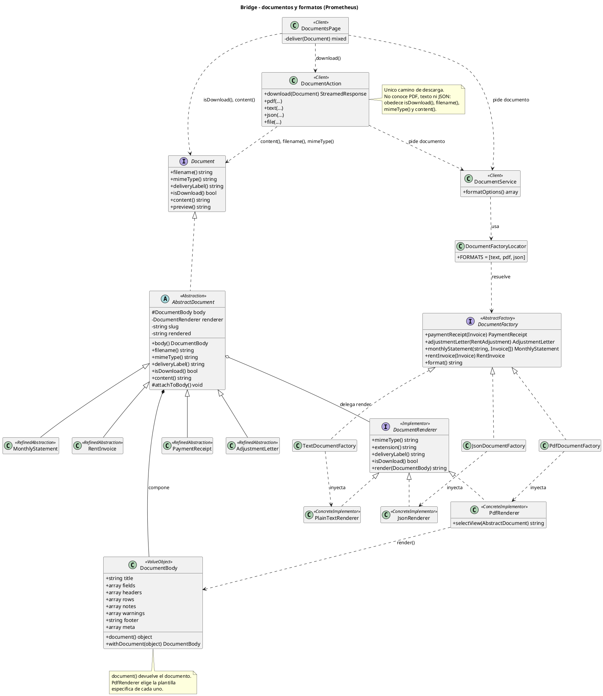

# Bridge — documentos y formatos

> Documentación del patrón **Bridge** aplicado al módulo de documentos de
> Prometheus. Describe la implementación real, no una propuesta: cada clase y
> cada prueba mencionada existe en el repositorio.
>
> Verificación: 25 de octubre de 2026.

---

## 1. Nombre y clasificación

| Campo                  | Valor                                                                                                  |
| ---------------------- | ------------------------------------------------------------------------------------------------------ |
| Patrón                | **Bridge**                                                                                       |
| Categoría GoF         | **Estructural**                                                                                  |
| Alcance                | De objetos                                                                                             |
| También conocido como | Handle/Body                                                                                            |
| Propósito GoF         | Desacoplar una abstracción de su implementación para que ambas puedan variar de forma independiente. |

En Prometheus, la abstracción es **qué documento se entrega** (factura,
comprobante, carta o estado de cuenta) y la implementación es **cómo se
serializa** (texto, PDF o JSON). Ninguna de las dos jerarquías conoce los detalles
de la otra.

---

## 2. Problema

### 2.1 Contexto

El módulo de documentos construye cuatro productos de dominio:

| Documento                | Clase                | Datos que aporta                                        |
| ------------------------ | -------------------- | ------------------------------------------------------- |
| Factura de arrendamiento | `RentInvoice`      | Factura, alquiler, periodo, vencimiento y pagos         |
| Comprobante de pago      | `PaymentReceipt`   | Abonos, saldo y forma de pago                           |
| Carta de reajuste        | `AdjustmentLetter` | IPC, canon anterior, canon nuevo y advertencias legales |
| Estado de cuenta         | `MonthlyStatement` | Facturas de un periodo y saldo real                     |

Cada documento arma un `DocumentBody`: un objeto de valor con título, campos,
tabla, notas, advertencias, pie y metadatos. El cuerpo contiene los datos ya
formateados para presentación; no contiene HTML, PDF ni JSON.

Se necesitaba agregar un tercer formato, **JSON estructurado**, para que un
contador pudiera importar los documentos a un sistema contable sin interpretar
un PDF ni texto plano.

### 2.2 Fuerzas del problema

1. **Dos dimensiones independientes.** Cuatro tipos de documento y tres formatos
   producen doce combinaciones. Si cada documento decidiera su formato, esas doce
   combinaciones se convertirían en doce ramas condicionales repartidas por el
   dominio.
2. **El PDF ya tenía una plantilla por documento.** `PdfRenderer::selectView()`
   elige `documents.invoice`, `documents.receipt`,
   `documents.adjustment-letter` o `documents.monthly-statement` comparando la
   clase del documento. Esa decisión pertenece al renderizador, no a la pantalla.
3. **La entrega estaba duplicada.** Antes, `DocumentAction::pdf()` y
   `DocumentsPage::deliver()` llamaban directamente a FlexPDF con
   `$document->body()`. Eso repetía la lógica de `PdfRenderer` y dejaba la
   entrega de PDF fuera de `content()`.
4. **El cuerpo apuntaba al modelo equivocado.** `PaymentReceipt`, `RentInvoice` y
   `AdjustmentLetter` hacían `withDocument($invoice)` o
   `withDocument($adjustment)`, no `withDocument($this)`. Como
   `PdfRenderer::selectView()` compara contra las clases de los documentos, esos
   tres productos caían en la plantilla genérica `documents.document` cuando se
   renderizaban por `content()`.
5. **La pantalla no debía conocer formatos.** El selector de `DocumentsPage` ya
   se alimentaba de `DocumentService::formatOptions()`. Agregar JSON no debía
   obligar a un `if ($formato === 'json')` en la vista ni en cada documento.

### 2.3 Consecuencia de no aplicar el patrón

Sin Bridge, la solución natural sería preguntar por el formato dentro de cada
documento o dentro de la pantalla:

```php
if ($format === 'pdf') {
    // generar PDF
} elseif ($format === 'json') {
    // generar JSON
} else {
    // generar texto
}
```

Ese código tendría que repetirse en los cuatro documentos, o concentrarse en un
servicio que conocería a la vez los cuatro tipos de documento y los tres
formatos. En ambos casos, agregar un formato obliga a modificar clases de
dominio que no deberían cambiar por una decisión de presentación.

---

## 3. Solución

Bridge separa las dos jerarquías y las conecta por **composición**:

- La **abstracción** (`AbstractDocument`) guarda un `DocumentBody` y un
  `DocumentRenderer`, y delega el renderizado en este último.
- Las **abstracciones refinadas** (`RentInvoice`, `PaymentReceipt`,
  `AdjustmentLetter`, `MonthlyStatement`) construyen su cuerpo y conservan sus
  datos de dominio.
- El **implementador** (`DocumentRenderer`) declara cómo se entrega un cuerpo:
  MIME, extensión, etiqueta, si es descarga y `render(DocumentBody)`.
- Los **implementadores concretos** (`PdfRenderer`, `PlainTextRenderer`,
  `JsonRenderer`) serializan el mismo cuerpo en su formato.

El documento no sabe si terminará siendo PDF, texto o JSON. Solo sabe que tiene
un renderizador que acepta su `DocumentBody`.

### 3.1 División de responsabilidades

| Responsabilidad                            | Clase                                                                           |
| ------------------------------------------ | ------------------------------------------------------------------------------- |
| Armar los datos del documento              | `RentInvoice`, `PaymentReceipt`, `AdjustmentLetter`, `MonthlyStatement` |
| Contener los datos sin formato             | `DocumentBody`                                                                |
| Decidir el formato de serialización       | `PdfRenderer`, `PlainTextRenderer`, `JsonRenderer`                        |
| Elegir una familia completa de productos   | `DocumentFactory` y sus implementaciones                                      |
| Resolver la familia pedida por la interfaz | `DocumentFactoryLocator`                                                      |
| Orquestar la construcción del documento   | `DocumentService`                                                             |
| Entregar el resultado                      | `DocumentAction`, `DocumentsPage`                                           |

### 3.2 Bridge y Abstract Factory colaboran, pero no son lo mismo

| Pregunta                     | Bridge                                             | Abstract Factory                                                                               |
| ---------------------------- | -------------------------------------------------- | ---------------------------------------------------------------------------------------------- |
| ¿Qué separa?               | La abstracción del documento de su serialización | La creación de una familia completa de productos                                              |
| ¿Qué permite variar?       | El formato sin tocar los documentos                | La familia de productos sin mezclar formatos                                                   |
| ¿Dónde vive en Prometheus? | `AbstractDocument` + `DocumentRenderer`        | `DocumentFactory` + `PdfDocumentFactory`, `TextDocumentFactory`, `JsonDocumentFactory` |
| ¿Qué NO es?                | El locator no es parte del Bridge                  | El locator no es una fábrica; solo resuelve cuál usar                                        |

El Bridge es la estructura que hace que un documento sea agnóstico al formato.
La Abstract Factory es la que elige el renderizador correcto para los cuatro
productos de una misma familia.

---

## 4. Estructura

### 4.1 Participantes reales

| Rol GoF                       | Clase en Prometheus   | Archivo                                           | Responsabilidad                                                              |
| ----------------------------- | --------------------- | ------------------------------------------------- | ---------------------------------------------------------------------------- |
| **Abstraction**         | `AbstractDocument`  | `app/Documents/AbstractDocument.php`            | Guarda el cuerpo y el renderizador; delega `content()` y expone la entrega |
| **RefinedAbstraction**  | `RentInvoice`       | `app/Documents/RentInvoice.php`                 | Factura de arrendamiento                                                     |
| **RefinedAbstraction**  | `PaymentReceipt`    | `app/Documents/PaymentReceipt.php`              | Comprobante de pago; exige factura pagada                                    |
| **RefinedAbstraction**  | `AdjustmentLetter`  | `app/Documents/AdjustmentLetter.php`            | Carta de reajuste con datos legales                                          |
| **RefinedAbstraction**  | `MonthlyStatement`  | `app/Documents/MonthlyStatement.php`            | Estado de cuenta de un periodo                                               |
| **Implementor**         | `DocumentRenderer`  | `app/Documents/Rendering/DocumentRenderer.php`  | Contrato de serialización y entrega                                         |
| **ConcreteImplementor** | `PdfRenderer`       | `app/Documents/Rendering/PdfRenderer.php`       | PDF con plantilla por documento                                              |
| **ConcreteImplementor** | `PlainTextRenderer` | `app/Documents/Rendering/PlainTextRenderer.php` | Texto plano para copiar                                                      |
| **ConcreteImplementor** | `JsonRenderer`      | `app/Documents/Rendering/JsonRenderer.php`      | JSON estructurado para importación                                          |
| **Colaborador**         | `DocumentBody`      | `app/Documents/Rendering/DocumentBody.php`      | Objeto de valor con el contenido sin formato; no es un rol GoF               |
| **Cliente**             | `DocumentService`   | `app/Documents/DocumentService.php`             | Pide el documento a la familia elegida                                       |
| **Cliente**             | `DocumentsPage`     | `app/Filament/Pages/DocumentsPage.php`          | Solicita y entrega desde la pantalla                                         |
| **Cliente**             | `DocumentAction`    | `app/Filament/Support/DocumentAction.php`       | Acciones de descarga en tablas y páginas                                    |

### 4.2 Flujo de colaboración

```text
DocumentsPage / DocumentAction
        ↓
DocumentService
        ↓
DocumentFactoryLocator  →  JsonDocumentFactory
        ↓
PaymentReceipt::forInvoice($invoice, JsonRenderer)
        ↓
DocumentBody + JsonRenderer
        ↓
content()  →  JsonRenderer::render($body)
        ↓
DocumentAction::download($document)
```

La pantalla no decide cómo se serializa. Pide un documento a
`DocumentService`, recibe un `Document` y obedece lo que ese documento declara:
`isDownload()`, `filename()`, `mimeType()` y `content()`.

### 4.3 Límites de la estructura

- `DocumentFactoryLocator` **no** es parte del Bridge: es el selector de familia
  que usa la aplicación para traducir `"text"`, `"pdf"` o `"json"` a una fábrica
  concreta.
- `DocumentBody` **no** es parte del Bridge: es el dato compartido entre las dos
  jerarquías. Sin él, cada renderizador tendría que extraer los datos del
  documento de dominio, y el desacoplamiento se perdería.
- Los documentos **no** contienen `if ($format === ...)`. La única decisión de
  formato ocurre al elegir la fábrica.

---

## 5. Implementación clásica GoF

El ejemplo clásico más pequeño tiene una abstracción que contiene un
implementador, dos abstracciones refinadas y dos implementadores concretos.

```php
<?php

interface Renderer
{
    public function render(string $content): string;
}

class HtmlRenderer implements Renderer
{
    public function render(string $content): string
    {
        return "<html><body>{$content}</body></html>";
    }
}

class PlainRenderer implements Renderer
{
    public function render(string $content): string
    {
        return strip_tags($content);
    }
}

abstract class Report
{
    public function __construct(
        protected Renderer $renderer,
    ) {}

    abstract public function content(): string;

    public function output(): string
    {
        return $this->renderer->render($this->content());
    }
}

class SalesReport extends Report
{
    public function content(): string
    {
        return '<h1>Ventas</h1><p>Total: 1500</p>';
    }
}

class InventoryReport extends Report
{
    public function content(): string
    {
        return '<h1>Inventario</h1><p>Items: 42</p>';
    }
}

// Cliente
$report = new SalesReport(new HtmlRenderer());
echo $report->output();
```

Lo importante del ejemplo no es la cantidad de clases, sino la dirección de la
dependencia:

- `Report` **tiene un** `Renderer`; no hereda de él.
- `SalesReport` e `InventoryReport` no saben si se renderizan en HTML o texto.
- `HtmlRenderer` y `PlainRenderer` no saben qué tipo de reporte reciben.
- Se pueden agregar reportes sin tocar los renderizadores y renderizadores sin
  tocar los reportes.

En el ejemplo clásico el cliente elige el implementador con `new`. En
Prometheus esa elección se delegó a una Abstract Factory para que la pantalla
pudiera pedir una familia completa sin combinar productos incompatibles.

---

## 6. Aplicación en el proyecto

### 6.1 Prerrequisito: el cuerpo debe conocer al documento

`DocumentBody` se construye antes de que exista la instancia del documento. Por
eso el documento se adjunta al final, desde su constructor estático. El método
vive en `AbstractDocument`:

```php
// app/Documents/AbstractDocument.php:51
protected function attachToBody(): void
{
    $this->body = $this->body->withDocument($this);
}
```

Los cuatro documentos lo llaman después de crear la instancia:

| Documento            | Constructor estático                                            | Llamada                                       |
| -------------------- | ---------------------------------------------------------------- | --------------------------------------------- |
| `PaymentReceipt`   | `forInvoice()` en `app/Documents/PaymentReceipt.php:36`      | `$document->attachToBody()` en la línea 52 |
| `RentInvoice`      | `forInvoice()` en `app/Documents/RentInvoice.php:27`         | `$document->attachToBody()` en la línea 36 |
| `AdjustmentLetter` | `forAdjustment()` en `app/Documents/AdjustmentLetter.php:45` | `$document->attachToBody()` en la línea 54 |
| `MonthlyStatement` | `forPeriod()` en `app/Documents/MonthlyStatement.php:39`     | `$document->attachToBody()` en la línea 51 |

Antes de este cambio, los tres primeros adjuntaban el modelo (`Invoice` o
`RentAdjustment`). `PdfRenderer::selectView()` compara contra
`PaymentReceipt::class`, `RentInvoice::class`, `AdjustmentLetter::class` y
`MonthlyStatement::class`; por eso el PDF de esos tres caía en la vista genérica.
La corrección es independiente de JSON: es un prerrequisito para que cualquier
renderizador pueda identificar el documento real.

### 6.2 `JsonRenderer`: el tercer implementador concreto

Archivo: `app/Documents/Rendering/JsonRenderer.php`.

```php
class JsonRenderer implements DocumentRenderer
{
    public function mimeType(): string
    {
        return 'application/json';
    }

    public function extension(): string
    {
        return 'json';
    }

    public function deliveryLabel(): string
    {
        return __('invoice.documents.download_json');
    }

    public function isDownload(): bool
    {
        return true;
    }

    public function render(DocumentBody $body): string
    {
        $document = $body->document();

        return json_encode([
            'title' => $body->title,
            'document_type' => $document === null ? null : class_basename($document),
            'fields' => $body->fields,
            'table' => $body->headers === [] ? null : [
                'headers' => $body->headers,
                'rows' => $body->rows,
            ],
            'warnings' => $body->warnings,
            'notes' => $body->notes,
            'footer' => $body->footer,
        ], JSON_PRETTY_PRINT | JSON_UNESCAPED_UNICODE | JSON_UNESCAPED_SLASHES);
    }
}
```

Decisiones concretas:

- **No incluye `meta`.** `PaymentReceipt` guarda `receipt_image` como data URI
  base64. Un JSON contable no debe cargar una imagen embebida. El test
  `los_cuatro_documentos_se_exportan_como_json_valido` verifica que la clave
  `meta` no exista y que el contenido no contenga `data:image`.
- **La tabla es `null` cuando no hay encabezados.** El estado de cuenta vacío
  exporta `table: null`, no una tabla con listas vacías.
- **`document_type` usa `body->document()`.** Por eso el prerrequisito 6.1 es
  obligatorio: sin él, el JSON no podría informar el tipo de documento.
- **Los `fields` son cadenas ya formateadas.** Es una exportación de
  presentación (`$ 1.500.000`, `01/02/2026`), no un feed contable crudo. Para un
  feed crudo habría que agregar datos estructurados al `DocumentBody`; eso es
  otro alcance.

### 6.3 `JsonDocumentFactory`: la familia JSON

Archivo: `app/Documents/Factories/JsonDocumentFactory.php`.

```php
class JsonDocumentFactory implements DocumentFactory
{
    public function __construct(
        private readonly JsonRenderer $renderer,
    ) {}

    public function paymentReceipt(Invoice $invoice): PaymentReceipt
    {
        return PaymentReceipt::forInvoice($invoice, $this->renderer);
    }

    public function adjustmentLetter(RentAdjustment $adjustment): AdjustmentLetter
    {
        return AdjustmentLetter::forAdjustment($adjustment, $this->renderer);
    }

    public function monthlyStatement(string $period, array $invoices): MonthlyStatement
    {
        return MonthlyStatement::forPeriod($period, $invoices, $this->renderer);
    }

    public function rentInvoice(Invoice $invoice): RentInvoice
    {
        return RentInvoice::forInvoice($invoice, $this->renderer);
    }

    public function format(): string
    {
        return 'json';
    }
}
```

La fábrica replica la familia de texto y la de PDF con un único cambio: el
renderizador inyectado. Los cuatro productos siguen armando el mismo
`DocumentBody` y aplicando las mismas reglas de negocio.

### 6.4 Registro de la familia

`DocumentFactoryLocator` declara el formato y la implementación:

```php
// app/Documents/DocumentFactoryLocator.php:28
public const FORMATS = ['text', 'pdf', 'json'];

// app/Documents/DocumentFactoryLocator.php:33
private const IMPLEMENTATIONS = [
    'text' => Factories\TextDocumentFactory::class,
    'pdf' => Factories\PdfDocumentFactory::class,
    'json' => Factories\JsonDocumentFactory::class,
];
```

`DocumentService::formatOptions()` expone el formato a la interfaz:

```php
// app/Documents/DocumentService.php:73
public function formatOptions(): array
{
    return [
        'text' => __('invoice.documents.format.text'),
        'pdf' => __('invoice.documents.format.pdf'),
        'json' => __('invoice.documents.format.json'),
    ];
}
```

Las claves de traducción están en `lang/es/invoice.php` y
`lang/en/invoice.php`: `documents.format.json` y `documents.download_json`.

### 6.5 Entrega unificada por `content()`

Antes, `DocumentsPage::deliver()` y `DocumentAction::pdf()` generaban el PDF
directamente con FlexPDF. Eso duplicaba la lógica de `PdfRenderer` y saltaba
`content()`. Ahora la entrega obedece al documento:

```php
// app/Filament/Pages/DocumentsPage.php:304
private function deliver(Document $document): mixed
{
    if ($document->isDownload()) {
        return DocumentAction::download($document);
    }

    $this->textPreview = $document->content();

    return null;
}
```

`DocumentAction::download()` es el único camino de descarga:

```php
// app/Filament/Support/DocumentAction.php:138
public static function download(Document $document): StreamedResponse
{
    return response()->streamDownload(
        fn () => print($document->content()),
        $document->filename(),
        ['Content-Type' => $document->mimeType()],
    );
}
```

`DocumentAction::pdf()` ahora construye el documento con `'pdf'` y llama a
`download()`. `DocumentAction::json()` hace lo mismo con `'json'`, y
`DocumentAction::file()` es un alias de `json()` para las pantallas que nombran
la acción por su archivo. El método `selectView()` se eliminó de
`DocumentAction`: la selección de plantilla quedó en `PdfRenderer`, que es su
lugar.

### 6.6 Interfaz de usuario

- `DocumentsPage` ya usaba `formatOptions()`; al agregar `json`, el selector
  muestra el tercer formato sin cambiar la vista Blade.
- `InvoiceResource` agrega `receipt_json` e `invoice_json` con
  `DocumentAction::file()`.
- `RentAdjustmentResource` agrega `letter_json` con `DocumentAction::file()`.
- El estado de cuenta se genera desde `DocumentsPage`, que ya tenía el selector
  de formato.

Cada acción conserva las reglas de visibilidad existentes: el comprobante solo
aparece en facturas pagadas; la factura y la carta se pueden descargar en
cualquier estado permitido.

### 6.7 Evidencia de pruebas

| Prueba                                                | Resultado                    |
| ----------------------------------------------------- | ---------------------------- |
| `tests/Feature/JsonDocumentBridgeTest.php`          | 6 pruebas, 68 aserciones     |
| `tests/Feature/DocumentFactoryTest.php`             | 14 pruebas, 84 aserciones    |
| `tests/Feature/DocumentsPageTest.php`               | 13 pruebas, 41 aserciones    |
| `tests/Feature/InvoiceTableDocumentActionsTest.php` | 5 pruebas, 20 aserciones     |
| `tests/Feature/InvoiceDocumentActionTest.php`       | 7 pruebas, 14 aserciones     |
| `tests/Feature/DocumentContentTest.php`             | 14 pruebas, 46 aserciones    |
| Suite completa (`composer test`)                    | 325 pruebas, 1585 aserciones |

`JsonDocumentBridgeTest` verifica, entre otras cosas:

1. Los cuatro documentos se exportan como JSON válido.
2. El JSON conserva los mismos datos que el texto.
3. El estado de cuenta vacío exporta `table: null`.
4. La descarga declara `application/json` y entrega un JSON válido.
5. El locator resuelve la familia JSON.
6. El PDF elige la plantilla del documento y no la genérica.

La última prueba usa reflexión sobre `PdfRenderer::selectView()` para comprobar
que `body->document()` es la instancia del documento y que la vista elegida es
la específica. Es una prueba de regresión del prerrequisito 6.1.

Pint sobre los archivos nuevos:

```text
PASS  3 files
```

Los archivos existentes modificados conservan avisos de estilo previos en líneas
no tocadas por este cambio. No se hizo una corrección masiva para no mezclar
deuda ajena con la implementación del patrón.

---

## 7. Justificación

### 7.1 Por qué es un Bridge real y no decorativo

1. **La abstracción contiene al implementador.** `AbstractDocument` recibe un
   `DocumentRenderer` por constructor y delega `content()` en él
   (`app/Documents/AbstractDocument.php:76`). No hay herencia de documento a
   renderizador.
2. **Las dos jerarquías varían de forma independiente.** Se pueden agregar
   documentos sin agregar formatos, y formatos sin tocar los documentos. La
   prueba de que el segundo caso funciona es que agregar JSON no modificó
   `RentInvoice`, `PaymentReceipt`, `AdjustmentLetter` ni `MonthlyStatement` en
   su lógica de datos; solo se corrigió el prerrequisito del cuerpo.
3. **No hay ramas por formato en el dominio.** Los documentos no preguntan si
   son PDF o JSON. La decisión se toma una vez, al elegir la fábrica.
4. **El mismo cuerpo se serializa en tres formatos.** `DocumentContentTest` y
   `JsonDocumentBridgeTest` comparan el cuerpo del texto con el JSON: los datos
   no cambian, solo la representación.
5. **La entrega también quedó desacoplada.** `DocumentAction::download()` no
   sabe si el documento es PDF, texto o JSON; usa `content()`, `filename()` y
   `mimeType()`.

### 7.2 Alternativas descartadas

| Alternativa                                                         | Por qué no                                                                                                                                                          |
| ------------------------------------------------------------------- | -------------------------------------------------------------------------------------------------------------------------------------------------------------------- |
| `if ($format === 'pdf')` dentro de cada documento                 | Repite la decisión en cuatro clases y obliga a modificarlas al agregar un formato. Rompe la separación entre dominio y presentación.                              |
| Un único `DocumentExporter` que reciba el documento y el formato | Concentra el conocimiento de los cuatro documentos y los tres formatos en una clase; el documento deja de ser dueño de su cuerpo y se vuelve un `switch` gigante. |
| Guardar el JSON dentro del modelo `Invoice`                       | Mezcla persistencia con presentación y hace que el JSON dependa del esquema de base de datos, no del documento.                                                     |
| Generar solo PDF y convertirlo a JSON                               | El PDF es una representación visual; extraer datos de él es frágil. El `DocumentBody` ya tiene los datos antes de renderizar.                                   |

### 7.3 Costos y límites

- **Agregar un documento no es gratis.** Hay que agregar el método a
  `DocumentFactory` y a las tres fábricas concretas. El Bridge abarata agregar
  **formatos**, no productos. Es una precisión importante para la sustentación.
- **El JSON es de presentación.** Los valores ya vienen formateados. Si se
  necesita un feed contable crudo, hay que enriquecer `DocumentBody` con datos
  estructurados; el Bridge actual no lo resuelve.
- **`meta` se excluye a propósito.** La imagen del comprobante no viaja en
  base64. Si se necesita, se agrega una referencia, no el binario.
- **El renderizado se memoriza.** `AbstractDocument::content()` guarda el
  resultado en `$rendered`, porque un PDF es costoso y `content()` puede
  invocarse varias veces en la misma respuesta.

### 7.4 Cuándo no usar Bridge

No tendría sentido si solo existiera un documento y un formato, o si las dos
dimensiones no fueran a variar nunca. En Prometheus se justifica porque ya había
cuatro documentos y dos formatos, y el tercero era un requisito real, no una
posibilidad hipotética.

---

## 8. Comparación clásica vs proyecto

| Aspecto                          | GoF clásico                                    | Prometheus                                                                      | Motivo                                                            |
| -------------------------------- | ----------------------------------------------- | ------------------------------------------------------------------------------- | ----------------------------------------------------------------- |
| **Abstraction**            | Clase abstracta con referencia al implementador | `AbstractDocument`                                                            | Conserva el cuerpo y delega el renderizado                        |
| **RefinedAbstraction**     | Subclases que agregan operaciones               | `RentInvoice`, `PaymentReceipt`, `AdjustmentLetter`, `MonthlyStatement` | Cada una arma su cuerpo y conserva datos de dominio               |
| **Implementor**            | Interfaz con una operación de implementación  | `DocumentRenderer`                                                            | Declara `render()` y además los metadatos de entrega           |
| **ConcreteImplementor**    | Implementaciones concretas                      | `PdfRenderer`, `PlainTextRenderer`, `JsonRenderer`                        | Serializan el mismo cuerpo en tres formatos                       |
| **Cliente**                | Elige el implementador con `new`              | `DocumentService` + `DocumentFactoryLocator`                                | La pantalla elige un formato; el locator resuelve la familia      |
| **Creación de productos** | El cliente construye la abstracción            | Abstract Factory                                                                | Evita combinar documentos de familias distintas                   |
| **Cuerpo compartido**      | No existe en el ejemplo clásico                | `DocumentBody`                                                                | Permite que los tres formatos consuman los mismos datos           |
| **Metadatos de entrega**   | No existen en el ejemplo clásico               | `mimeType()`, `extension()`, `deliveryLabel()`, `isDownload()`          | La interfaz necesita saber cómo presentar el botón y el archivo |
| **Entrega**                | El cliente imprime el resultado                 | `DocumentAction::download()`                                                  | Un único camino para PDF, JSON y formatos futuros                |
| **Selección de formato**  | El cliente conoce la clase concreta             | Cadena `'text'`, `'pdf'`, `'json'` resuelta por el locator                | Desacopla la interfaz de las clases concretas                     |
| **Memoización**           | No existe                                       | `AbstractDocument::$rendered`                                                 | Evita regenerar un PDF costoso                                    |
| **Patrón adicional**      | Ninguno                                         | Abstract Factory                                                                | El Bridge separa; la fábrica elige la familia                    |

### 8.1 Qué se conserva del patrón clásico

- La abstracción **tiene un** implementador, no hereda de él.
- Las operaciones de la abstracción se implementan en términos del implementador.
- Las dos jerarquías pueden extenderse por separado.
- El cliente trabaja con la abstracción, no con los detalles de serialización.

### 8.2 Qué se adaptó al proyecto

- Se agregó una **Abstract Factory** para que la elección del formato no se
  repitiera en cada pantalla y para que no se pudieran mezclar productos de
  familias distintas.
- Se agregó un **objeto de valor** (`DocumentBody`) para que los renderizadores
  no dependieran de los modelos de dominio.
- Se enriqueció el **implementador** con metadatos de entrega (MIME, extensión,
  etiqueta y si es descarga), porque la interfaz de Filament necesita esa
  información antes de renderizar.
- Se agregó **memoización** en la abstracción para no regenerar el PDF varias
  veces en una misma respuesta.

### 8.3 Lo que el proyecto no hace (y es correcto)

- No hay un `if ($format === ...)` en `AbstractDocument` ni en los documentos
  refinados.
- No hay un `switch` por tipo de documento en `DocumentAction`.
- No se agregó JSON modificando la lógica de negocio de los cuatro documentos.
- No se guarda la imagen del comprobante dentro del JSON.

---

## 9. Diagramas UML: antes y después

La explicación para la sustentación se apoya en dos diagramas de clases: el
estado real del repositorio **antes** de completar el Bridge y el estado
**después**. No se incluyen diagramas de secuencia; la diferencia entre ambos
estados se lee en la estructura y en la tabla comparativa de la sección 9.3.

### 9.1 Antes de implementar el Bridge

Este no es un diseño hipotético: es el estado del repositorio antes de este
cambio. El Bridge existía a medias para texto y PDF, pero la entrega de PDF no
pasaba por el renderizador y no existía JSON. Los problemas concretos eran:

1. `DocumentsPage::deliver()` y `DocumentAction::pdf()` generaban el PDF
   directamente con FlexPDF y `$document->body()`, sin llamar a
   `PdfRenderer::render()`.
2. Cada uno tenía su propia copia de `selectView()`, además de la de
   `PdfRenderer`. Tres lugares decidían la misma plantilla.
3. `PaymentReceipt`, `RentInvoice` y `AdjustmentLetter` adjuntaban el modelo
   (`Invoice` o `RentAdjustment`) al `DocumentBody`, no el documento. Como
   `PdfRenderer::selectView()` compara clases de documento, esos tres caían en
   la plantilla genérica.
4. No había `JsonRenderer` ni `JsonDocumentFactory`; el locator solo conocía
   `text` y `pdf`.



### 9.2 Después de implementar el Bridge

El documento deja de tener dos caminos de entrega. La pantalla pide el
documento a `DocumentService` y obedece lo que el documento declara
(`isDownload()`, `filename()`, `mimeType()`, `content()`). `DocumentAction`
tiene un único método de descarga y `PdfRenderer` queda como el único lugar que
elige plantilla. El cuerpo apunta al documento real, y JSON es un renderizador
más, no una rama nueva en los documentos.



**Lectura clave:** `AbstractDocument` no decide el formato. Solo guarda un
`DocumentRenderer` y le pasa el `DocumentBody`. Agregar `JsonRenderer` no tocó
`RentInvoice`, `PaymentReceipt`, `AdjustmentLetter` ni `MonthlyStatement`.

### 9.3 Lectura comparada: antes y después

| Aspecto                          | Antes                                                                | Después                                                                      |
| -------------------------------- | -------------------------------------------------------------------- | ----------------------------------------------------------------------------- |
| Formatos disponibles             | `text`, `pdf`                                                    | `text`, `pdf`, `json`                                                   |
| Quién genera el PDF             | `DocumentsPage` y `DocumentAction` llaman a FlexPDF directamente | `DocumentAction::download()` llama a `content()` y `PdfRenderer` genera |
| `selectView()`                 | Tres copias: `PdfRenderer`, `DocumentsPage`, `DocumentAction`  | Una sola: `PdfRenderer`                                                     |
| Qué guarda `body->document()` | En tres documentos, el modelo (`Invoice`/`RentAdjustment`)       | En los cuatro, el documento real                                              |
| Agregar un formato               | Habría que tocar las dos pantallas que generan PDF                  | Se agrega renderizador, fábrica y una entrada en el locator                  |
| Entrega                          | PDF por un camino, texto por otro                                    | Un solo camino: `isDownload()` decide descarga o vista previa               |
| Documentos de dominio            | No saben si son PDF o texto                                          | Siguen sin saberlo; tampoco saben si son JSON                                 |

Lectura de los diagramas:

1. **La abstracción contiene al implementador.** `AbstractDocument` guarda un
   `DocumentBody` y un `DocumentRenderer`; `content()` delega en
   `render($body)`. No hay herencia de documento a renderizador.
2. **Las dos jerarquías varían por separado.** Se pueden agregar documentos sin
   agregar formatos y formatos sin tocar los cuatro documentos. La prueba es
   que `JsonRenderer` no modificó la lógica de datos de `RentInvoice`,
   `PaymentReceipt`, `AdjustmentLetter` ni `MonthlyStatement`.
3. **La entrega quedó desacoplada.** En el diagrama anterior, las flechas rojas
   muestran que las pantallas conocían FlexPDF. En el posterior, las pantallas
   solo conocen `Document` y `DocumentAction::download()`.
4. **El cuerpo apunta al documento correcto.** `attachToBody()` cierra la
   referencia después de crear la instancia. Eso es lo que permite que
   `PdfRenderer` elija la plantilla específica y que `JsonRenderer` informe
   `document_type`.
5. **El locator no es parte del Bridge.** Traduce `text`, `pdf` o `json` a una
   fábrica concreta; el Bridge es la estructura que hace que el documento no
   sepa en qué formato se está serializando.

---

## Apéndice: archivos tocados por el Bridge

### Nuevos

```text
app/Documents/Rendering/JsonRenderer.php
app/Documents/Factories/JsonDocumentFactory.php
tests/Feature/JsonDocumentBridgeTest.php
```

### Modificados

```text
app/Documents/AbstractDocument.php
app/Documents/PaymentReceipt.php
app/Documents/RentInvoice.php
app/Documents/AdjustmentLetter.php
app/Documents/MonthlyStatement.php
app/Documents/DocumentFactoryLocator.php
app/Documents/DocumentService.php
app/Filament/Support/DocumentAction.php
app/Filament/Pages/DocumentsPage.php
app/Filament/Resources/InvoiceResource.php
app/Filament/Resources/RentAdjustmentResource.php
lang/es/invoice.php
lang/en/invoice.php
tests/Feature/DocumentFactoryTest.php
tests/Feature/DocumentsPageTest.php
tests/Feature/InvoiceDocumentActionTest.php
tests/Feature/InvoiceTableDocumentActionsTest.php
```

---

**Fin del documento.** El Bridge queda implementado, probado y documentado. El
siguiente patrón del plan es la **Facade**, y no se inicia hasta recibir
confirmación.
